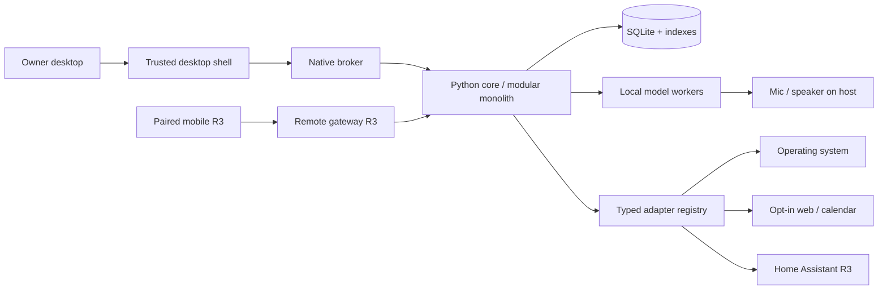
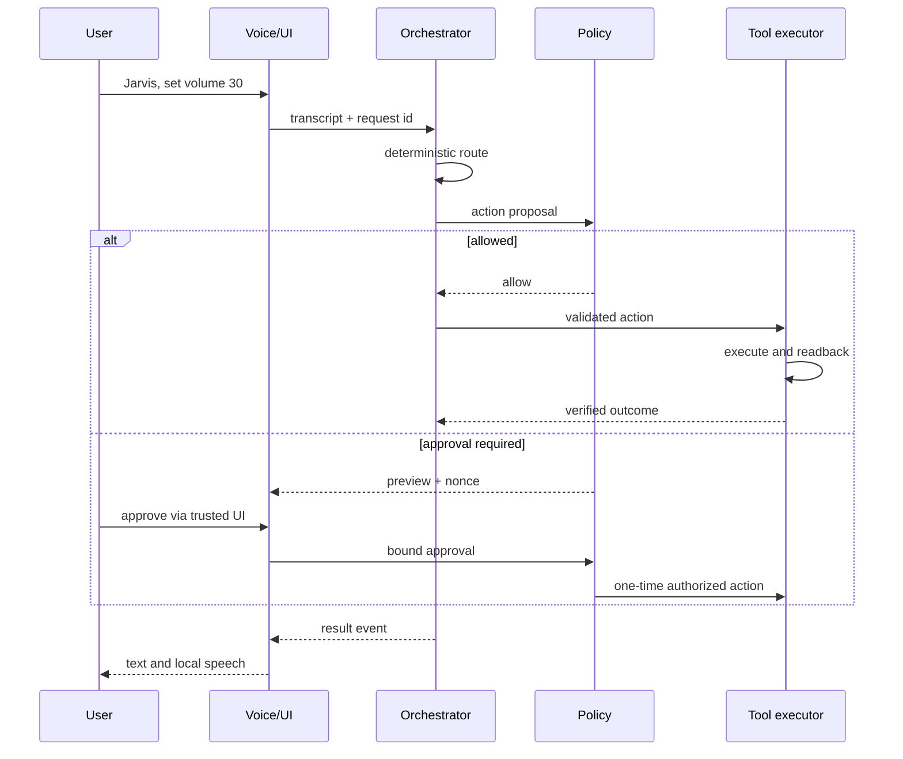
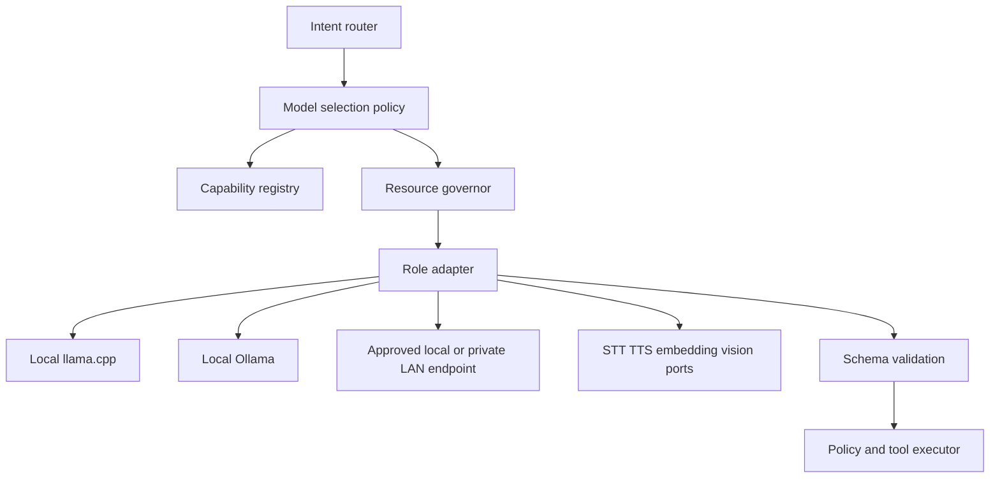
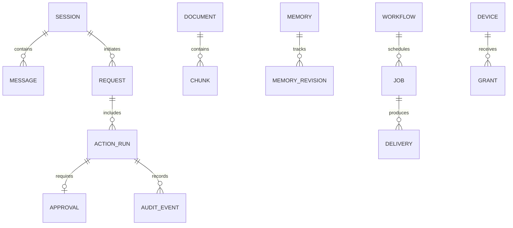
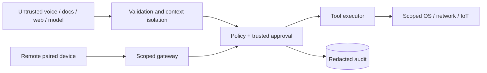

# JARVIS | SDLC documentation pack

**Project:** J.A.R.V.I.S. Local Personal Intelligence System  
**Version:** 0.2.0 | **Status:** Proposed baseline, belum diimplementasikan  
**Tanggal:** 25 November 2026 | **Pemilik persetujuan:** Product Owner

## Tujuan dan cara menggunakan paket
JARVIS adalah personal AI assistant local-first hybrid: voice, memory, desktop control, knowledge, proactive automation, vision, personal management, IoT dan akses jarak jauh. Inferensi inti on-device secara default; private LAN opsional pada R2 dengan persetujuan eksplisit. Internet merupakan alat retrieval/integrasi yang dapat dimatikan. Tidak ada coding agent, eksekusi shell arbitrer, atau API LLM berbayar pada baseline.

Baca 01–04 untuk menyepakati scope dan desain, 05–11 untuk kontrak implementasi, 12–16 untuk delivery, 17 untuk traceability, 18 untuk referensi. Semua persyaratan adalah target desain, bukan hasil pengujian. Gunakan file sumber dalam version control; setiap perubahan requirement harus memperbarui RTM dan test.

## Daftar dokumen
| File | Fungsi |
|---|---|
| [01-PRD.md](01-PRD.md) | Visi produk, scope, journey, KPI |
| [02-SRS.md](02-SRS.md) | Requirements yang dapat diuji |
| [03-SDD.md](03-SDD.md) | Arsitektur dan desain komponen |
| [04-TECH-STACK-ADR.md](04-TECH-STACK-ADR.md) | Stack, keputusan, alternatif |
| [05-BUSINESS-RULES.md](05-BUSINESS-RULES.md) | Izin, otomasi, state, aturan domain |
| [06-AI-VOICE-DESIGN.md](06-AI-VOICE-DESIGN.md) | Local inference, voice, model evaluation |
| [07-DATA-DESIGN.md](07-DATA-DESIGN.md) | ERD, skema, lifecycle, RAG |
| [08-INTERFACE-CONTRACTS.md](08-INTERFACE-CONTRACTS.md) | API/IPC, event, tool contracts |
| [09-SECURITY-PRIVACY.md](09-SECURITY-PRIVACY.md) | Threat model, controls, privacy |
| [10-UX-DESIGN.md](10-UX-DESIGN.md) | UX flows, state, accessibility |
| [11-INTEGRATION-DESIGN.md](11-INTEGRATION-DESIGN.md) | OS, web, personal apps, IoT, mobile |
| [12-TEST-STRATEGY.md](12-TEST-STRATEGY.md) | QA, benchmark, acceptance |
| [13-DEPLOYMENT-OPERATIONS.md](13-DEPLOYMENT-OPERATIONS.md) | CI/CD, instalasi, rollback, runbook |
| [14-PROJECT-PLAN-BACKLOG.md](14-PROJECT-PLAN-BACKLOG.md) | WBS, fase, backlog, release gates |
| [15-RISK-GOVERNANCE.md](15-RISK-GOVERNANCE.md) | RAID, change management, quality gates |
| [16-USER-ACCEPTANCE-HANDBOOK.md](16-USER-ACCEPTANCE-HANDBOOK.md) | UAT, onboarding, handover |
| [17-TRACEABILITY-MATRIX.md](17-TRACEABILITY-MATRIX.md) | Requirement → desain → test → fase |
| [18-REFERENCES.md](18-REFERENCES.md) | Sumber teknis dan standar |

## Keputusan dan batasan
- Confirmed: Full JARVIS, tanpa coding agent; local-first hybrid, tanpa API LLM berbayar. Online search dan integrasi boleh saat diaktifkan.
- Proposed: Windows 11 x64, single owner, desktop-first, Bahasa Indonesia utama dan Inggris sekunder, RTX 3050 4 GB VRAM / RAM 24 GB sebagai reference machine (konfirmasi spesifikasi aktual). Tidak diasumsikan CPU, OS edition, disk, mikrofon, atau device IoT tertentu.
- P0 = R1 fondasi; P1 = R2 produktivitas; P2 = R3 ekosistem. P2 adalah scope target, bukan fitur yang boleh dilupakan. R0 adalah feasibility spike.
- Model, OS support, latency, biaya listrik, lisensi, dan kompatibilitas device perlu dibuktikan sebelum release. Tidak ada kode aplikasi yang dibuat dalam paket ini.
- Penggunaan nama JARVIS bersifat working title internal; branding publik memerlukan clearance IP.

## Release notes v0.2.0
Expanded PRD with E13 Flexible AI and E14 Cinematic UX, six AI modes and four visual quality tiers. New model/provider contracts, model manager, original reactive HUD and motion system. 67 FR + 14 NFR = 81 mapped tests, all Not Run. Default on-device AI; optional explicitly enrolled private LAN R2; no paid cloud or coding agent. 19 documents; v0.1.0 original preserved. New profile and visual thresholds, LAN scope and candidate technologies are design decisions for owner review; R0 must validate hardware and approve prototype. See 01, 06, 10 and 17 first.

---

# Product Requirements Document (PRD)

**Project:** J.A.R.V.I.S. Local Personal Intelligence System  
**Version:** 0.2.0 | **Status:** Proposed baseline, belum diimplementasikan  
**Tanggal:** 25 November 2026 | **Pemilik persetujuan:** Product Owner

## 1. Product vision
Membangun asisten yang tersedia ketika komputer aktif, dapat mendengar, memahami konteks, mengingat informasi yang disetujui, bertindak melalui tools terbatas, dan memberi pengingat proaktif. Tidak menggantikan keputusan pengguna. Local-first berarti tidak ada pengiriman prompt, audio, screen, atau database ke layanan AI eksternal secara default maupun sebagai fallback tersembunyi.

## 2. Problem statements dan persona
| ID | Problem / job to be done | Hasil yang diharapkan |
|---|---|---|
| G01 | Pemilik komputer berulang kali membuka aplikasi dan melakukan operasi rutin | Selesaikan tindakan terdaftar dengan suara atau teks, konfirmasi sesuai risiko |
| G02 | Informasi pribadi tersebar di file, catatan dan jadwal | Temukan informasi dengan provenance dan kontrol memori |
| G03 | Pengingat sering terlupakan | Pengingat persisten, kontekstual dan tidak mengganggu |
| G04 | Cloud AI menambah biaya dan risiko kebocoran | Fungsi inti offline tanpa biaya token |
| G05 | Pengguna perlu akses dan kontrol lintas perangkat | Integrasi opt-in yang aman dan terverifikasi |

Persona utama: satu pemilik workstation pribadi, pengguna teknis maupun non-teknis. Persona sekunder: pengguna dari HP yang telah dipasangkan. Tamu di dekat mikrofon bukan pengguna terautentikasi. Admin workstation bukan role JARVIS yang diberikan kepada model.

## 3. Product scope dan release strategy
| Epic | Scope | Priority | Acceptance value |
|---|---|---|---|
| E01 Voice & interaction | Wake word, push-to-talk, text, STT/TTS lokal, interruption | P0 | Interaksi Indonesia dan Inggris terbatas, tanpa internet |
| E02 Core intelligence | Intent router, bounded planning, local model, contextual response | P0 | Direct actions tidak memakai LLM; unknown intent ditangani |
| E03 OS actions | Launch aplikasi, volume, file search, safe workflows | P0 | Hasil diverifikasi, no arbitrary shell |
| E04 Memory | Preference, episodic, explicit save/edit/delete, retrieval | P0 | Pengguna mengontrol apa yang diingat |
| E05 Scheduling & proactive | Reminder lokal, event rules, quiet hours, notification history | P0 | Tidak kehilangan reminder saat restart |
| E06 Personal knowledge | Folder opt-in, PDF/text/docx, citations, lexical/semantic search | P1 | Jawaban merujuk file dan halaman/section |
| E07 Web intelligence | Read-only search/fetch, source dates, offline indication | P1 | Tidak menyamar sebagai hasil online ketika offline |
| E08 Screen awareness | Snapshot on request, accessibility tree, OCR, optional vision | P1 | Tidak merekam terus-menerus atau membaca password |
| E09 Personal management | Tasks, kalender lokal, expense tracking, habits | P1 | Data lokal dengan CRUD, no payment/medical decisions |
| E10 Advanced automation | Typed workflow, approval, dry-run, cancellation | P1 | Efek samping tercatat dan duplikasi dicegah |
| E11 Environmental & IoT | Camera on-demand, Home Assistant, status and safe controls | P2 | Indicator aktif, no autonomous dangerous actuation |
| E13 Flexible AI | Provider registry, model manager, role mapping, resource profiles, switching, health and rollback | P0 | Swap verified models/runtimes without core changes; local-first enforced |
| E14 Cinematic experience | Original HUD, animated core, voice-reactive visualization, coordinated transitions, quality tiers | P0 | Responsive, state-driven, accessible UI with measured frame budget |
| E12 Remote & adaptive | Paired mobile access, feedback-driven preference proposals | P2 | Scope akses per device; pemilik menyetujui perubahan |

Out of scope: coding/debugging/deploy agent, unattended terminal, keystroke logging, covert recording, face identification, background biometrics, online financial transactions, medical prescriptions, cloud LLM fallback, multi-tenant SaaS, unrestricted autonomous agent. Tidak ada autonomous self-modification atau instalasi plugin otomatis.

## 4. User journeys
- J01: pemilik mengatakan "Jarvis, buka Spotify dan kecilkan volume ke 30 persen" → wake → transcript → dua typed actions → policy check → execute & verify → respons per tindakan. Bila Spotify tidak tersedia, status parsial disampaikan.
- J02: "Ingatkan saya besok jam 8 untuk rapat" → resolve zona waktu lokal → tampilkan tanggal absolut → simpan reminder → alarm tetap tersimpan saat restart; jika perangkat mati, tampilkan missed reminder ketika kembali aktif.
- J03: "Apa yang kamu ingat tentang preferensi saya?" → daftar dengan sumber → pengguna edit/hapus → retrieval tidak mengembalikan data terhapus.
- J04: "Ringkas dokumen ini" → pilih file → retrieve bagian relevan → kutip filename/page/section → unknown apabila sumber kurang.
- J05: "Apa berita hari ini?" → izin network → search query tanpa data privat → tampilkan sumber/tanggal → content diperlakukan sebagai data tidak tepercaya.
- J06: "Matikan lampu kamar" → resolve device → policy allowlist → execute → verifikasi state aktual; jika tidak terkonfirmasi, status unknown.
- J07: pengguna di HP membuat reminder → paired TLS session → policy remote scope → job persist → acknowledgment dari desktop. Desktop tidur/mati berarti unavailable, bukan dijanjikan always-on.

## 5. Success metrics (target, bukan hasil)
| KPI | Definisi | Target awal |
|---|---|---|
| K01 Task success | Intent fixtures yang selesai benar / semua fixtures valid, termasuk error yang diharapkan | ≥95% direct actions; ≥85% mixed intent |
| K02 Voice usability | WER corpus ID bersih dan false wakes per jam | ≤20% WER; ≤0,2 false wake/jam |
| K03 Responsiveness | p95 end-of-utterance → start audio | ≤4s direct; ≤12s warm LLM simple |
| K04 Reliability | Pengingat due yang disampaikan/ditandai missed saat host kembali aktif | 100% pada skenario uji |
| K05 Privacy | Unauthorized external AI requests; unauthorized effects | 0 pada suite pengujian |
| K06 Grounding | Jawaban berbasis dokumen dengan locator yang valid | ≥90% sampel answerable |
| K07 Local cost | Paid LLM charges baseline | Rp0; listrik, perangkat dan layanan eksternal tidak dijamin gratis |
| K08 Control | Permintaan stop/mute berhasil menghentikan aktivitas terkait | 100% pada skenario uji |

## 6. Release gates
R0 membuktikan audio, model, GPU/CPU, licensing dan baseline latency. R1 mengirim E01–E05, E13, E14 dan privacy/security foundation; R2/R3 memperluas motion language dan provider roles seiring fitur terkait. R2 menambah E06–E10 dengan evaluasi grounding dan prompt injection. R3 menambah E11–E12 setelah device dan remote threat review. Tidak ada rilis apabila tindakan tidak terotorisasi, data leak, restore gagal, atau test kritis belum lulus. Lihat 14 dan 16.

## 7. Product decisions pending
OS dan hardware aktual; bahasa/karakter suara yang disukai; folder dan aplikasi yang diperbolehkan; kebutuhan kalender eksternal; device IoT; retention preference; apakah HP perlu native app atau web client; apakah distribusi hanya pribadi atau publik. Default: private, on-device AI, seluruh external integration disabled. LAN inference opsional hanya ke server milik/tepercaya pengguna melalui explicit enrollment; tanpa public cloud fallback. Semua keputusan ini dapat diubah melalui change request.

## 8. Flexible AI: product requirements and user control
**Product promise:** ganti model, runtime atau hardware tanpa fork core, reinstall aplikasi, kehilangan memory, atau mengubah policy tools. Kualitas setiap provider tidak dianggap setara. Local on-device adalah default; private LAN adalah perluasan opt-in, bukan syarat atau fallback otomatis. No paid cloud AI; external commercial inference is out of scope. Internet tetap untuk retrieval/integrasi yang diizinkan.

| Mode | User goal | Behavior |
|---|---|---|
| Eco | Bekerja/gaming tanpa gangguan | Direct tools + model ringan bila perlu, GPU cap, unload on pressure, low motion |
| Performance | Voice cepat | Model kecil approved, short context, warm jika budget cukup, non-thinking bila tersedia |
| Balanced (default) | Harian | Pilih profile tervalidasi dengan kualitas/latency seimbang |
| Quality | Analisis lebih sulit | Model lebih besar atau private LAN yang dipilih pengguna, progress nyata, bounded deadline |
| Adaptive | Otomatis | Route by task/capability and measured resources dalam allowlist dan trust zone yang disetujui |
| Custom | Advanced user | Pilih provider, role, model, quantization, context, CPU/GPU settings dan keep-warm sesuai dukungan |

Model Manager: discover installed provider, inspect capabilities, import signed/verified model manifest, show storage and measured memory, run explicit benchmark, set role/profile, switch with active request drain or user cancellation, rollback last healthy config. No automatic download, executable install, remote code, or silent LAN routing. Show current model, provider, location and effective settings on each request detail. Defaults must work after offline installation. User may pin profile; unsupported capabilities disable relevant features with explanation rather than pretending equivalence. Settings edits persist atomically; embeddings changes trigger versioned reindex, not incompatible vector mixing. Audio, embeddings and vision adapters also replaceable; each requires role-specific quality gates. LAN adapter R2 optional; R1 requires native local provider + second local adapter demonstrated. Model family Qwen/Llama/Gemma etc. candidates only, not promises of compatibility.

## 9. Experience vision: cinematic, not decorative
Original sci-fi industrial interface inspired by the interaction feel of Tony Stark's assistant, not reproduction of Marvel assets, logos, voice or soundtrack. Visual direction: deep graphite/navy, electric cyan and warm amber accents, luminous concentric intelligence core, modular radial geometry, subtle depth, restrained glass, crisp technical typography. Avoid template dashboard grid, excessive glow, fake data, excessive rounded cards, blocking intro and constant flashing. Dashboard focuses on voice center, agenda, real activities and system health. Tray-first + compact HUD + full Command Center, optional fullscreen cinematic scene; chat and detailed settings remain straightforward.

Core animation is a first-class feature from R1: Idle, Listening, Transcribing, Thinking, Executing, Awaiting approval, Speaking, Error, Offline, Muted, Degraded; visual state derived from real engine events. Listening uses measured mic envelope; speaking uses actual playback amplitude; thinking uses indeterminate motion, no fake percentages. User can interrupt immediately, disable audio visualization or motion, and select Cinematic / Balanced / Lite / Reduced Motion visual settings independently of AI mode. All information accessible via text and keyboard. Cinematic features yield resources to voice inference and other apps; no mandatory 3D engine. Detailed motion and acceptance spec: [10-UX-DESIGN.md](10-UX-DESIGN.md).

## 10. Additional measurable success metrics
| KPI | Target / verification |
|---|---|
| K09 Model portability | Two approved local adapters complete same direct/chat/tool-proposal contracts, no changes to core policy; switch/rollback and offline tests pass |
| K10 Resource-aware switching | No concurrent heavyweight model leases on reference GPU; no unapproved trust-zone crossing; failed load restores prior config or direct mode |
| K11 Motion responsiveness | On reference 60 Hz display, Balanced UI p95 frame interval ≤20 ms during scripted foreground animation; p95 input→visible feedback ≤100 ms; report concurrently loaded AI separately |
| K12 Visual integrity | All voice/action states match engine events, no fake progress, no hidden mic; Reduced Motion retains full functional coverage |
| K13 Experience efficiency | ≥90% of agreed usability tasks complete unassisted; mute/stop available within two interactions; no blocking decorative sequence |

These are engineering/product targets, not measured outcomes. R0 establishes display refresh, CPU/GPU headroom, WebView behavior, actual visual and model benchmarks. R1 must ship working motion system, not postpone visual identity to R3. Any threshold change requires explicit approval and evidence.

---

# Software Requirements Specification (SRS)

**Project:** J.A.R.V.I.S. Local Personal Intelligence System  
**Version:** 0.2.0 | **Status:** Proposed baseline, belum diimplementasikan  
**Tanggal:** 25 November 2026 | **Pemilik persetujuan:** Product Owner

## 1. Purpose, environment dan konvensi
Spesifikasi normative untuk single-owner local-first JARVIS. Kata "harus" merupakan requirement; setiap ID stabil dan punya acceptance scenario. P0/R1, P1/R2, P2/R3. Model, adapter, OS dan perangkat merupakan proposed baseline. R0 memvalidasi feasibility. Referensi struktur: ISO/IEC/IEEE 29148, tanpa klaim sertifikasi. Input: mic, text, explicitly selected files/screen/camera, scheduler, paired mobile. Output: audio, text, local notifications, verified tool effects. Host mati/tidur berarti fungsi real-time tidak tersedia. Bahasa ID utama, EN sekunder. External endpoints opt-in; tidak ada cloud LLM. User adalah pemilik OS session; trusted UI adalah boundary untuk approval; wake word tidak membuktikan identitas.

## 2. Functional requirements

### VOI
| ID | Priority | Requirement | Acceptance scenario |
|---|---|---|---|
| FR-VOI-01 | P0 | Sistem harus menerima teks, push-to-talk, dan wake word lokal saat sesi user aktif; wake word dapat dinonaktifkan. | Aktifkan mode satu per satu; offline semua mode bekerja; disable wake tidak memicu dari rekaman. |
| FR-VOI-02 | P0 | Sistem harus menampilkan indikator listening/transcribing/speaking dan menyediakan mute perangkat lunak yang menghentikan capture. | Mute saat capture, verifikasi stream ditutup, tidak ada frame baru; indikator akurat. |
| FR-VOI-03 | P0 | STT harus memproses Bahasa Indonesia dan Inggris lokal dan meminta klarifikasi bila hasil berisiko ambigu. | Uji corpus ID/EN termasuk angka, nama aplikasi dan code-switch; perintah volume ambigu tidak dieksekusi. |
| FR-VOI-04 | P0 | TTS harus membaca respons lokal, dapat dimatikan, dan mendukung stop serta barge-in yang menutup playback lama. | Interupsi respons; playback lama berhenti; tidak ada self-trigger dari suara TTS. |
| FR-VOI-05 | P0 | Sistem harus menyediakan fallback teks jika mic, STT, atau TTS gagal. | Cabut mic, matikan worker TTS; UI tetap bisa melakukan direct action melalui teks. |

### COR
| ID | Priority | Requirement | Acceptance scenario |
|---|---|---|---|
| FR-COR-01 | P0 | Sistem harus merutekan perintah pasti ke deterministic tools sebelum inferensi LLM. | Instrumentasi 100 direct intents; tidak ada panggilan LLM pada fixture yang cocok. |
| FR-COR-02 | P0 | LLM harus berjalan lokal; model output diperlakukan sebagai proposal yang divalidasi schema dan policy. | Simulasikan tool tidak dikenal, field tambahan dan URL berbahaya; semua ditolak tanpa efek. |
| FR-COR-03 | P0 | Orchestrator harus membatasi plan menjadi maksimal 5 steps, maksimal 2 perbaikan format, dan 60 detik deadline model per request. | Loop atau JSON invalid melebihi batas; sistem berhenti tanpa eksekusi tambahan. |
| FR-COR-04 | P0 | Sistem harus meminta klarifikasi bila target atau waktu ambigu, tanpa menebak tindakan berisiko. | Dua file bernama sama dan waktu tanpa konteks; tidak ada write sebelum disambiguasi. |
| FR-COR-05 | P0 | Sistem harus mendukung cancel per request serta melaporkan completed, failed, canceled, partial atau unknown secara akurat. | Batalkan workflow setelah langkah pertama; laporkan langkah yang sudah terjadi dan hentikan yang belum dimulai. |
| FR-COR-06 | P0 | Sistem harus tetap menyediakan direct tools, reminders dan teks ketika model tidak tersedia. | Kill worker LLM; buka aplikasi dan buat reminder berhasil tanpa LLM. |

### OS
| ID | Priority | Requirement | Acceptance scenario |
|---|---|---|---|
| FR-OS-01 | P0 | Sistem harus membuka aplikasi dari registry allowlist dengan executable/identifier tetap, tanpa interpolasi shell. | App terdaftar terbuka; parameter command injection dan app tidak dikenal ditolak. |
| FR-OS-02 | P0 | Sistem harus mengatur dan membaca volume dalam 0–100 serta memverifikasi state. | Set 30, readback 30 dengan toleransi ±2; -5 ditolak. |
| FR-OS-03 | P0 | Sistem harus mencari dan membuka file hanya dalam root yang disetujui, dengan canonical path dan pemeriksaan symlink/reparse point. | File dalam root ditemukan; traversal, UNC tidak diizinkan, dan link keluar root ditolak. |
| FR-OS-04 | P0 | Sistem harus menyediakan operasi file sederhana melalui explicit target, preview, dan approval untuk perubahan konten; deletion permanent tidak didukung. | Rename file yang disetujui; target berubah sebelum eksekusi → approval tidak berlaku; overwrite ditolak. |
| FR-OS-05 | P0 | Sistem harus melaporkan hasil tool dari verifikasi aktual, bukan klaim LLM. | Adapter gagal atau readback mismatch; respons tidak menyatakan sukses. |

### MEM
| ID | Priority | Requirement | Acceptance scenario |
|---|---|---|---|
| FR-MEM-01 | P0 | Sistem harus menyimpan fakta/preferensi jangka panjang hanya dari explicit remember atau review proposal yang disetujui. | Percakapan biasa tidak menciptakan fakta permanen; explicit remember menghasilkan record bersumber. |
| FR-MEM-02 | P0 | Sistem harus menyediakan list, search, edit, delete dan export memori. | Edit preferensi kemudian query; hasil baru tampil; hapus dan re-query tidak mengembalikan nilai lama. |
| FR-MEM-03 | P0 | Sistem harus menyimpan provenance, timestamp, sensitivity, status dan revision setiap memori. | Konflik dua preferensi memicu review; audit tidak memuat konten sensitif mentah. |
| FR-MEM-04 | P0 | Sistem harus memisahkan session history dari long-term memory; history memiliki TTL yang dapat diatur. | Restart dengan history disabled; transcript tidak dipulihkan; preferensi explicit tetap ada. |
| FR-MEM-05 | P0 | Sistem harus menghapus record dari retrieval indexes dan cache aktif saat pengguna menghapusnya. | Delete; lexical/vector lookup kosong; backup lama diperingatkan dan ledger deletion dipakai saat restore. |

### SCH
| ID | Priority | Requirement | Acceptance scenario |
|---|---|---|---|
| FR-SCH-01 | P0 | Sistem harus membuat, melihat, mengubah dan membatalkan reminder dengan waktu absolut dan timezone IANA. | Buat reminder besok jam 8 Asia/Jakarta; restart; due_at UTC sesuai; cancel tidak berbunyi. |
| FR-SCH-02 | P0 | Scheduler harus persist due jobs, menerapkan lease, idempotency dan recovery setelah restart. | Matikan proses sebelum/selama due; restart; satu delivery logis atau status uncertain yang terlihat. |
| FR-SCH-03 | P0 | Sistem harus mendukung quiet hours, snooze, dismiss dan missed reminder. | Reminder due ketika tidur; kembali aktif tampil missed; quiet hours tidak menghasilkan audio kecuali user mengizinkan. |
| FR-SCH-04 | P0 | Proactive engine harus menggunakan aturan opt-in dan event yang terdaftar dengan rate limit. | Rule idle/break diaktifkan; notification muncul maksimal sesuai limit; disable menghentikannya. |

### KNO
| ID | Priority | Requirement | Acceptance scenario |
|---|---|---|---|
| FR-KNO-01 | P1 | Sistem harus mengindeks file TXT, Markdown, PDF text dan DOCX lokal dari folder opt-in dengan limit ukuran. | Indeks fixture berbagai tipe; file di luar root, file terlalu besar, dan PDF scan unsupported diberi status yang jelas. |
| FR-KNO-02 | P1 | Sistem harus melakukan incremental indexing dengan fingerprint dan menghapus stale chunks saat file berubah/dihapus. | Ubah/hapus file; refresh; retrieval tidak menemukan versi stale. |
| FR-KNO-03 | P1 | Sistem harus menyediakan lexical retrieval dan semantic retrieval opsional dengan provenance. | Query fixture kata persis dan sinonim; locator mengarah ke sumber asli; tanpa embedding lexical tetap bekerja. |
| FR-KNO-04 | P1 | Jawaban knowledge harus menyertakan filename dan locator yang valid atau menyatakan evidence tidak cukup. | Question answerable/unanswerable; citation diverifikasi terhadap snapshot sumber. |
| FR-KNO-05 | P1 | Parser dan konten dokumen tidak boleh mengeksekusi macro, script atau instruksi tool. | Dokumen berisi instruksi untuk upload/hapus; tidak ada tool action atau request jaringan. |

### WEB
| ID | Priority | Requirement | Acceptance scenario |
|---|---|---|---|
| FR-WEB-01 | P1 | Web search harus opt-in, read-only, mengirim hanya query yang telah diperiksa dari data privat. | Network disabled: offline response; enabled: query sensitif memerlukan preview dan approval atau redaction. |
| FR-WEB-02 | P1 | Web fetch harus membatasi host/scheme, redirects, size, time dan private address access; konten selalu untrusted. | Uji localhost, metadata IP, DNS redirect, file URI dan halaman injection; semua request terlarang diblok. |
| FR-WEB-03 | P1 | Jawaban online harus menyertakan URL, waktu retrieval dan tanggal publikasi bila tersedia; cache stale harus ditandai. | Simulasikan offline dan cache berumur; label stale tampil dan tidak mengklaim live. |

### SCR
| ID | Priority | Requirement | Acceptance scenario |
|---|---|---|---|
| FR-SCR-01 | P1 | Sistem harus mengambil snapshot screen/window hanya dengan permintaan eksplisit, indikator dan preview scope. | Capture satu window; window lain tidak diambil; stop menutup capture. |
| FR-SCR-02 | P1 | Sistem harus mencoba accessibility tree/OCR lokal sebelum optional vision, dan menolak capture konteks sensitif. | Password field atau denylisted app tidak dikirim ke OCR/model; protected content gagal secara aman. |
| FR-SCR-03 | P1 | Sistem harus menghapus screenshot mentah setelah request kecuali pengguna menyetujui penyimpanan terpisah. | Selesai/cancel/crash recovery; tidak ada screenshot dalam disk cache/log secara default. |

### LIF
| ID | Priority | Requirement | Acceptance scenario |
|---|---|---|---|
| FR-LIF-01 | P1 | Sistem harus menyediakan CRUD task, event kalender lokal, expense dan habit log. | Buat/edit/hapus entitas melalui UI dan voice dengan validasi serta undo jika tersedia. |
| FR-LIF-02 | P1 | Sistem harus menghitung agregat expense dengan integer minor units dan currency terpisah. | Fixture IDR dan USD; subtotal akurat, tidak mencampur mata uang. |
| FR-LIF-03 | P1 | Sistem harus memberi insight deskriptif berdasarkan data yang ada dan tidak mengeksekusi pembayaran atau memberi keputusan medis otomatis. | Data incomplete diberi label; permintaan transfer/medication automation ditolak. |
| FR-LIF-04 | P1 | Integrasi kalender atau email eksternal harus opsional dengan OAuth scope minimal, read-only baseline. | Revoke token; connector berhenti; no send/delete email atau edit kalender pada baseline. |

### AUT
| ID | Priority | Requirement | Acceptance scenario |
|---|---|---|---|
| FR-AUT-01 | P1 | Pengguna harus dapat membuat workflow dari daftar typed tools, trigger, kondisi dan batas yang tervalidasi. | Workflow malformed, loop, action tidak terdaftar dan deadline invalid ditolak. |
| FR-AUT-02 | P1 | Sistem harus menampilkan dry-run dan meminta persetujuan untuk efek samping yang memerlukannya, termasuk reapproval bila parameter berubah. | Preview rename A; ubah target B; approval A tidak dapat digunakan. |
| FR-AUT-03 | P1 | Workflow harus memiliki idempotency, audit per step, stop, dan recovery dengan reconciliation untuk efek tidak pasti. | Crash setelah adapter dipanggil; tidak melakukan retry buta, tampilkan status unknown/verify. |

### IOT
| ID | Priority | Requirement | Acceptance scenario |
|---|---|---|---|
| FR-IOT-01 | P2 | Sistem harus mendukung camera snapshot on-demand dengan consent per sesi dan indikator; default off. | Tolak izin; camera tidak terbuka; stop/lock menutup stream. |
| FR-IOT-02 | P2 | Sistem harus membaca dan mengontrol Home Assistant entities dari allowlist terpisah. | Set lampu, readback state; entity tidak terdaftar ditolak. |
| FR-IOT-03 | P2 | Sistem harus memblokir autonomous/high-risk actuation termasuk lock, alarm, heater dan perangkat keselamatan. | Permintaan buka kunci/ubah alarm ditolak; tidak ada call adapter. |
| FR-IOT-04 | P2 | Sistem harus menangani device unavailable dan stale telemetry tanpa mengarang status. | Putus koneksi HA setelah command; hasil unknown/unavailable, bukan success. |

### REM
| ID | Priority | Requirement | Acceptance scenario |
|---|---|---|---|
| FR-REM-01 | P2 | Sistem harus menyediakan remote access opt-in melalui paired device, encrypted transport, scoped credentials dan revocation. | Pair via local approval; token salah/revoked gagal; tidak ada public port exposure default. |
| FR-REM-02 | P2 | Remote actions harus mengikuti policy yang sama dan scope lebih sempit; local-only controls tidak boleh dieksekusi remote. | Remote mencoba file mutation/screen capture; ditolak; reminder create diizinkan sesuai grant. |
| FR-REM-03 | P2 | Sistem harus menawarkan proposal perubahan preferensi dari feedback lokal tanpa mengubah policy atau model otomatis. | Repeated feedback menghasilkan proposal; reject tidak mengubah preferensi. |
| FR-REM-04 | P2 | Sistem harus menampilkan kondisi host offline/sleep dan tidak mengklaim telah mengeksekusi perintah remote. | Matikan host; mobile client menampilkan unreachable; tidak mengirim ulang mutation otomatis. |

### ADM
| ID | Priority | Requirement | Acceptance scenario |
|---|---|---|---|
| FR-ADM-01 | P0 | Sistem harus menyediakan per-app, per-folder, per-tool dan network permission settings dengan deny-by-default. | Install baru tidak dapat akses folder/network/device belum diizinkan. |
| FR-ADM-02 | P0 | Sistem harus meminta approval melalui trusted UI untuk tindakan kelas R2, dengan target/parameter/expiry binding. | Suara rekaman atau model mencoba approve; ditolak; nonce lama tidak berlaku. |
| FR-ADM-03 | P0 | Sistem harus mengunci sensitive actions saat OS lock, stop capture, membatalkan approval dan menonaktifkan remote mutation. | Lock workstation saat dialog approval; setelah unlock harus minta approval baru. |
| FR-ADM-04 | P0 | Sistem harus menyediakan audit trail berisi tindakan, outcome, actor, timestamp dan correlation ID dengan redaction. | Periksa audit sukses/gagal/denied; token dan transcript mentah tidak ditemukan. |
| FR-ADM-05 | P0 | Sistem harus menyediakan export, backup, restore dan reset melalui explicit local approval. | Restore snapshot terenkripsi dengan password/key yang benar; corrupt snapshot ditolak; reset membutuhkan konfirmasi. |
| FR-ADM-06 | P0 | Sistem harus mendukung health status dan model/device configuration tanpa menjalankan downloaded code. | Model missing, OOM dan DB read-only ditampilkan; unverified model bundle ditolak. |

### Flexible AI / cinematic UX
| ID | Priority | Requirement | Acceptance scenario |
|---|---|---|---|
| FR-AIP-01 | P0 | Sistem harus mendukung dua adapter LLM lokal tervalidasi melalui kontrak yang sama, tanpa perubahan policy core. | Jalankan canonical chat/stream/schema/cancel fixtures pada dua runtime; perbedaan capability dilaporkan, policy tetap sama. |
| FR-AIP-02 | P0 | Sistem harus menyediakan model/provider registry, role mapping, manifest verification dan capability discovery. | Import manifest valid, reject hash mismatch; model tanpa schema support tidak dipakai untuk tool planning. |
| FR-AIP-03 | P0 | Sistem harus menyediakan enam AI profiles dengan batas resource dan fallback allowlist. | Uji keenam mode, manual pin dan adaptive selection; tidak ada parameter unsupported yang diam-diam diterapkan. |
| FR-AIP-04 | P0 | Sistem harus melakukan atomic model switch setelah drain/cancel, rollback jika gagal, dan mempertahankan data domain. | Ganti model ketika turn aktif; simulasi OOM; profil lama atau direct mode pulih; reminder/memory utuh, tidak ada tool replay. |
| FR-AIP-05 | P0 | Sistem harus menyediakan benchmark opt-in yang cancelable dan menunjukkan provider/model/location serta hasil aktual. | Tanpa approval benchmark tidak mulai; setelah consent hasil punya config/corpus/metrics; cancel berhenti dan lease dilepas. |
| FR-AIP-06 | P1 | Private LAN provider hanya boleh diaktifkan melalui explicit enrollment, endpoint authentication dan scope consent. | Endpoint asing/revoked/redirect ditolak; fallback tidak melewati trust zone; offline tetap dapat menjalankan direct mode. |
| FR-AIP-07 | P1 | Perubahan embedding model harus menggunakan index generation yang terpisah dan atomic promotion. | Ganti embedding dimension; tidak ada vector mixing; FTS tetap bekerja; gagal reindex mempertahankan generation lama. |
| FR-UX-01 | P0 | Sistem harus menyediakan Command Center dan compact HUD dengan original animated core, state-driven feedback, transcript dan stop. | Jalankan 12 state fixtures dan 20 rapid transitions; UI cocok dengan event aktual; stale events tidak menghidupkan turn canceled. |
| FR-UX-02 | P0 | Voice visualization harus berasal dari envelope mic atau playback aktual, tanpa menyimpan raw audio tambahan. | Synthetic amplitude matches animation; mute/cancel/lock mematikan input visualization; tidak ada raw PCM di UI log. |
| FR-UX-03 | P0 | Sistem harus mendukung Cinematic/Balanced/Lite/Reduced Motion, pause render saat hidden dan downgrade under pressure. | Toggle OS reduced motion dan pressure; semua kontrol tetap tersedia; minimized tidak menjalankan loop dekoratif. |

## 3. Non-functional requirements
| ID | Priority | Requirement | Verification |
|---|---|---|---|
| NFR-01 | P0 | p95 direct voice end-of-utterance sampai audio pertama ≤4 detik; warm LLM simple ≤12 detik pada reference machine. | 100 direct + 100 warm mixed trials; catat p50/p95, timeout termasuk sebagai gagal; ukur cold terpisah. |
| NFR-02 | P0 | Saat idle tanpa LLM loaded, target RAM proses keluarga ≤1 GB dan CPU rata-rata ≤3% total selama 10 menit; puncak combined working set ≤16 GB dan dedicated GPU ≤3,3 GiB pada reference machine, diukur bukan dijamin. | Sampling 1 Hz idle dan active 30 menit; breach memicu downgrade/fallback; tidak ada OOM tak tertangani. |
| NFR-03 | P0 | Core voice, chat, OS, memory dan reminder harus berfungsi tanpa internet setelah model terinstal. | Block semua egress non-loopback, restart, jalankan R1 smoke suite. |
| NFR-04 | P0 | Tidak ada tindakan tak berizin pada security suite; tidak ada secrets mentah di log; tidak ada non-loopback listener baseline. | Injection, replay, locked session, path traversal, port scan dan secret scanning. |
| NFR-05 | P0 | RPO backup ≤24 jam jika backup harian diaktifkan dan host aktif; RTO target ≤30 menit untuk fixture 1 GB; reminder state tetap persisten setelah crash. | Restore ke profile bersih; cek checksum, schema, due records, deletion ledger dan RTO. |
| NFR-06 | P0 | Semua primary action dan approval dapat diakses keyboard dan screen reader; UI tidak hanya bergantung pada warna/audio. | Keyboard-only walkthrough, focus order, accessible names dan visual transcript. |
| NFR-07 | P0 | Direct action correctness ≥95%, mixed intent ≥85%, WER ID ≤20% clean, false wake ≤0,2/jam dan false reject ≤10% pada corpus terdefinisi. | Jalankan evaluation corpus independen; laporkan denominators, confidence intervals dan strata. |
| NFR-08 | P1 | ≥90% jawaban answerable memiliki citation valid; ≥90% unanswerable abstain atau menyatakan evidence tidak cukup. | ≥100 answerable + 50 unanswerable dengan human adjudication. |
| NFR-09 | P0 | Adapter harus interchangeable melalui versioned contracts; DB migration, pinned deps, SBOM dan signed update diperlukan sebelum release. | Swap mock adapter; migration forward/restore; signature invalid ditolak. |
| NFR-10 | P0 | Default tidak menyimpan raw audio/screenshot, tidak ada external AI request dan tidak ada telemetry upload. | Inspect disk/log/network capture setelah 30 requests dan restart. |
| NFR-11 | P2 | Remote session harus revocable, rate-limited, encrypted dan tidak mengandalkan exposed public listener. | Pair/revoke; replay dan cross-device test; check network binding and encryption. |
| NFR-12 | P0 | Target 8 jam soak tanpa unhandled crash, runaway queue atau memory growth >20% pada workload tetap setelah warm-up. | 8h approved soak; catat memory slope, queue depth, worker exits dan disk growth. |
| NFR-13 | P0 | Balanced pada reference 60Hz harus menargetkan p95 frame interval ≤20ms dan p95 input-to-visible feedback ≤100ms pada workload terdefinisi. | Trace 5×60s interactive scenarios warm/active inference; report p95, long frames, combined resource; gate tier jika gagal. |
| NFR-14 | P0 | Provider switching tidak boleh mengubah authorization, menimbulkan unapproved external data transfer atau melebihi satu heavy GPU lease milik JARVIS pada reference host. | Fault injection, revoked scope, fallback, concurrency tests; zero unauthorized effects/transfers; resource governor logs verified. |

## 4. External interface and constraints
Desktop UI: trusted app shell, keyboard, tray, overlay. Internal interface: authenticated loopback API behind native broker, SSE for events; private workers use per-process credentials. Remote gateway separate and off by default. SQLite single writer with local data directory; no shared network database. File access limited to user-defined roots; parsing untrusted. No administrator service, shell arbitrary, coding tools, credential collection, unattended dangerous actuation or paid LLM dependency.

## 5. Acceptance and traceability
Release only after applicable requirements verified (17), security blockers resolved, model/licenses approved, backup/restore verified, and UAT sign-off (16). Changes to thresholds require recorded evidence and explicit approval, not silent relaxation. Tests in this document are specification cases, not execution reports.

---

# Software Design Description (SDD)

**Project:** J.A.R.V.I.S. Local Personal Intelligence System  
**Version:** 0.2.0 | **Status:** Proposed baseline, belum diimplementasikan  
**Tanggal:** 25 November 2026 | **Pemilik persetujuan:** Product Owner

## 1. Architectural drivers
Local inference, low idle resource, Indonesian voice, controlled effects, offline-first, recoverable reminders, explicit data ownership. Stakeholders: owner (utility/privacy), developer (maintainability), QA (reproducibility), operator (recovery). Design views below address these concerns; inspired by ISO/IEC/IEEE 42010 (not certification).

## 2. Context and container views

Desktop UI uses Tauri 2 + React/TypeScript, no untrusted remote WebView. Rust broker launches Python core in current user's session, selects ephemeral loopback port and exchanges bootstrap token over inherited pipe. Core binds 127.0.0.1 only, verifies broker token and no CORS. UI gets typed IPC calls, not core token. Remote gateway has separate listener and scoped auth; never proxies arbitrary core endpoints. Core owns DB; no adapter receives direct write credentials. Workers isolated in child processes for fault/resource control; no container orchestration, Redis, Kafka, or mandatory microservices.

## 3. Logical components and ownership
| Module | Responsibility | Inputs / outputs | Failure handling |
|---|---|---|---|
| Voice manager | Wake/VAD, PTT, capture, STT, playback | Frames → transcript; text → PCM | Text fallback, close stream on lock/mute |
| Session/context | Request lifecycle, language, turn history | Context budget + identity | Expire on session close; no implicit long-term save |
| Intent router | Deterministic parser, clarification, local LLM fallback | Intent + slots or clarification | Unknown action never coerced into execution |
| Planner | Bounded structured plan | Typed list ≤5 actions | Schema failure ≤2 retries, deadline 60s |
| Policy engine | Evaluate role, channel, risk, grants, state | allow/deny/approval | Fail closed; no model discretion |
| Tool executor | Idempotency, timeout, preconditions, verify, compensate | Action result + audit | Reconcile uncertain external effects |
| Scheduler | Persisted jobs, leases, delivery dedup, missed | Due UTC jobs | Reclaim lease; reconcile non-idempotent effect |
| Resource manager | Worker lifecycle, CPU/GPU admission | Worker budget, priority | Unload model, smaller fallback, direct mode |
| Memory | Consent, CRUD, TTL, provenance | Facts and retrieval context | Delete invalidates indexes/cache |
| Knowledge | Safe extract, FTS, optional embeddings | Chunks and citations | Parser quarantine, stale index invalidation |
| Personal | Tasks, calendar, expenses, habits | Domain CRUD and deterministic aggregates | Input validation, transactional writes |
| Adapters | Windows UIA, OS APIs, network, IoT, camera | Typed result/error | Timeouts, backoff read-only, unavailable |
| Audit/health | Redacted logs, metrics, readiness | Correlation and outcome | Local bounded logs; degraded state visible |

Dependency rule: domain models + policies do not import UI, LLM, or OS implementation. Application services depend on port interfaces; infrastructure implements them. Only executor invokes effectful adapters. Data from LLM/web/doc/screen never enters trusted instruction channel. Scheduler reuses executor and policy. Native OS controls need user-session process; no SYSTEM service.

## 4. Request sequences

For LLM path retrieve scoped context → local infer → strict parse → policy evaluation per step. If ambiguity, request clarification before effects. For remote, authenticated gateway establishes device context, restricts capabilities, forwards typed use case; local approval cannot be forged by remote request. For proactive workflow, event evaluator debounces, enqueues persistent job, policy re-evaluates at run time, result delivered or marked missed. For read-only RAG, no tools in generation; cite valid chunk IDs only.

## 5. State machines
Request: RECEIVED → ROUTING → CLARIFYING / PLANNING → AWAITING_APPROVAL / EXECUTING → VERIFYING → COMPLETED / PARTIAL / FAILED / UNKNOWN / CANCELED. Cancellation stops unstarted steps; completed side effects remain and are reported. Approval expires/rejected → CANCELED, never auto-approved.
Job: SCHEDULED → LEASED → RUNNING → DELIVERED / MISSED / FAILED / UNKNOWN; retry only if read-only/idempotent and precondition still true. On lease expiry inspect state/outbox before retry. Worker: STOPPED → STARTING → READY → BUSY → READY → IDLE_UNLOAD; crashes → DEGRADED → restart with bounded backoff. Audio: MUTED / IDLE_WAKE / LISTENING / TRANSCRIBING / SPEAKING, lock forces MUTED; barge-in cancels playback before new turn.

## 6. Physical deployment
One Windows workstation, current-user privileges, desktop session required. SQLite/data on local disk; separate model cache and backup destination. App shell and core start on login only if enabled; worker processes launched lazily. No external runtime connections in offline mode. GPU heavy jobs serialized; foreground voice preempts background indexing at checkpoint. Host sleep cannot be overcome without separate always-on host; no Wake-on-LAN baseline. Linux/macOS are future ADRs.

## 7. Data consistency and failure boundaries
All DB writes through transactional application service, single writer queue, bounded readers and busy timeout. Persist intent/audit before effect, finalize verified state after effect. DB and OS external effect are not atomic: on crash mark UNKNOWN, reconcile by readback, never repeat non-idempotent action blindly. Notifications may be delivered twice across crash if OS lacks dedup; logical delivery record deduped, uncertainty exposed. No distributed exactly-once claim. Logs redact payloads; use IDs. See 07 and 08.

## 8. Extensibility and implementation layout
```
apps/desktop/               # Tauri shell, React UI
core/jarvis/domain/         # entities, policy, ports
core/jarvis/application/    # requests, workflows, scheduler
core/jarvis/adapters/       # OS, persistence, web, integrations
core/jarvis/workers/        # voice, inference, parsing
core/jarvis/transport/      # authenticated local API, events
contracts/                  # JSON schemas, error catalogue
migrations/                 # numbered immutable SQL migrations
tests/{unit,integration,e2e,eval,security}/
docs/                       # this pack
```
New skills are declarative registered tools or reviewed adapters, not downloaded arbitrary scripts. MCP external adapters are deferred pending separate threat review; no arbitrary tool discovery or server install. Adapters implement validate, execute, verify, optional compensate. Contract version breaking changes require migration, tests and ADR. No implementation supplied here.

## 8. Flexible inference and cinematic presentation extension
Add Provider Registry (adapter lifecycle/capability metadata), Model Manager (manifest/role/profile, atomic config revisions), Selection Policy (task matching and consent), and Resource Governor (lease/admission for inference and rendering). These components sit behind Intent Router; see 06 §6. Native local adapters or separately approved private LAN endpoint never execute application tools themselves. Core stores active profile reference, not runtime-specific dependencies. Motion Controller consumes sequenced core events through existing authenticated broker; view state reducer and ephemeral audio envelope are separate from domain and safety logic. Renderer cannot change grants, approve from animation, or declare success. Governor publishes visual tier recommendations; UI honors Reduced Motion and pressure ceilings. R0 renderer benchmark and R1 motion component tests precede release. See 10 §§6–10.

---

# Technology Stack & Architecture Decision Records

**Project:** J.A.R.V.I.S. Local Personal Intelligence System  
**Version:** 0.2.0 | **Status:** Proposed baseline, belum diimplementasikan  
**Tanggal:** 25 November 2026 | **Pemilik persetujuan:** Product Owner

## 1. Candidate stack (versions pinned after R0)
| Layer | Preferred | Alternative / constraint |
|---|---|---|
| Desktop | Tauri 2 + React + TypeScript + Vite | Native Qt if WebView integration fails; official scaffold only |
| Core | Python 3.11/3.12 candidate + FastAPI/Pydantic + Uvicorn | Confirm all wheels/OS support; choose one version in R0 |
| Native broker | Rust/Tauri command layer | Named pipes ACL if replacing loopback HTTP |
| LLM | Provider abstraction; llama.cpp CUDA and Ollama local candidates; verified GGUF Q4 models | Local compatible API; optional approved private LAN R2; capability tests before use |
| Motion | Motion for React + CSS/SVG, optional Canvas 2D | WebGL/Three.js only after R0 budget proof; reduced motion mandatory |
| Wake/VAD | openWakeWord + Silero VAD candidate | English wake phrase "Hey Jarvis"; PTT fallback; custom model/license test |
| STT | faster-whisper tiny/base multilingual, CPU int8 | small only after benchmark; verify Indonesian quality |
| TTS | Piper local id_ID/en voice candidate | Windows installed offline voice fallback if available; verify voice and GPL obligations |
| Storage | SQLite WAL, FTS5, migration runner | Optional vector extension or brute-force normalized embeddings; no separate vector DB R1 |
| Embedding | Small multilingual CPU encoder (candidate multilingual-e5-small) | FTS-only fallback, benchmark before enabling |
| OS | Win32/Core Audio/UI Automation, native adapters | No admin, no arbitrary shell |
| Document parsing | PyMuPDF or pypdf (license review), python-docx, plaintext | OCR later, cap and isolate parser |
| Screen | Windows capture + local OCR, optional VLM | UIA first, no background capture |
| IoT | Home Assistant REST / MQTT via HA | No broker requirement R1; scoped allowlist proxy |
| Mobile | Responsive private web client over authenticated VPN/TLS | Native mobile later; never expose local core |
| QA | pytest, Vitest, Playwright UI, synthetic adapter fixtures | Hardware E2E on controlled host |
| Distribution | Signed Windows installer, hashes/model manifests, SBOM | Offline install bundle when license permits |

## 2. Decision records
| ADR | Decision / rationale | Rejected or deferred | Consequence / revisit trigger |
|---|---|---|---|
| ADR-001 | Local-first hybrid; no paid LLM, external network opt-in | Cloud-first LLM | Smaller model quality; revisit only with explicit scope change |
| ADR-002 | Modular monolith + isolated model workers | Microservices, Kafka, Redis | Simpler deployment; split only for measured isolation/scale needs |
| ADR-003 | Windows-first desktop UI | Cross-platform parity at launch | OS adapters modular; confirm actual host in R0 |
| ADR-004 | Deterministic routing then LLM | LLM for every command | Better latency/safety; add regression fixtures for phrase coverage |
| ADR-005 | SQLite single owner, FTS-first | PostgreSQL/Chroma required | Local ops simple; revisit if corpus benchmark misses target |
| ADR-006 | Typed tool registry + policy checks | Arbitrary code/shell or agent autonomy | Lower flexibility, predictable scope |
| ADR-007 | CPU audio; one heavy GPU worker at a time | All models resident | Cold-start cost; resource scheduler required |
| ADR-008 | Explicit permanent memory and bounded session history | Save all transcripts by default | Less passive personalization; proposals need review |
| ADR-009 | Authenticated local broker, separated remote gateway | Public HTTP and direct UI-to-worker | More boundary code, narrower exposed surface |
| ADR-010 | Signed manifests and manual model selection | Automatic install/update of models/plugins | Safer but maintenance workflow required |
| ADR-011 | No remote mutation by default; allow narrow grants | Remote full desktop control | Mobile initially chat/reminders/status only |
| ADR-012 | Local OCR/UIA first | Always-on screen/camera VLM | Limited scene reasoning; privacy and resource preservation |

All ADRs are proposed except product direction in ADR-001 and coding-agent exclusion. Confirm dependency versions, licenses, native binaries and actual hardware. Record date, decision owner, alternatives, evidence, consequences and supersession for each change. No framework choice warrants overriding security or OS constraints. Use official source repositories and signed release artifacts; no scratch recreation of runtime libraries.

## 3. ADR additions v0.2.0
- ADR-013: role-based provider abstraction with versioned capability contracts, no fixed model family. Supersedes any implied single-runtime lock; ADR-001/007/010 remain in force. Initial local adapters llama.cpp and Ollama; generic compatible endpoint and private LAN require separate validation. Consequence: normalization and adapter conformance tests mandatory.
- ADR-014: state-driven cinematic interface using Motion for React, SVG and CSS first; optional Canvas 2D. WebGL/Three.js not required; choose only after R0 resource benchmark. Consequence: animation state controller, reduced motion, performance tiers and resource priority enforced before R1.
- ADR-015: atomic model/profile activation and rollback; preserve model-independent domain state and version embeddings. No unapproved download or auto trust-zone changes. Consequence: switch downtime acceptable on 4 GB GPU, explicit UI progress and direct-mode fallback.

---

# Business Rules & Automation Policy

**Project:** J.A.R.V.I.S. Local Personal Intelligence System  
**Version:** 0.2.0 | **Status:** Proposed baseline, belum diimplementasikan  
**Tanggal:** 25 November 2026 | **Pemilik persetujuan:** Product Owner

## 1. Authority and decision order
BR-01 default deny; product hard bans > OS lock/mute > channel scope > explicit grant > risk approval > user preference. Model or document text cannot elevate permission. Voice wake is not authentication. Owner may grant tools through trusted UI; guest speech is treated as unverified actor. Locked host: no capture and no effects requiring owner; scheduler may record due notifications without speaking.

| Class | Examples | Rule |
|---|---|---|
| R0 read | local time, app status, list reminders | allow after capability grant, subject to context |
| R1 reversible low-risk | open allowlisted app, set volume, create local reminder/task, switch allowlisted lamp | explicit unambiguous request or preapproved bounded automation; visible result |
| R2 sensitive / consequential | file rename/move/write, export, memory reset, external private query, connector enable, workflow with sensitive effect | per-action trusted local preview and one-use approval; no blanket consent |
| R3 prohibited | arbitrary shell/code, credential entry/extraction, permanent deletion, payment, email send/delete, public exposure, safety-critical IoT control | deny even if requested through model/automation; change requires scope review, some remain prohibited |

Memory delete is owner privacy operation via trusted UI with clear effect; reset/restore require R2. Approved folder read is R0 for ordinary files; sensitive folders denied or explicit scoped grant. Screen and camera require per-request/session explicit consent independently of read risk. Remote scope narrower than local: R0 and selected R1 chat/reminder; no screen, camera, file mutation, security settings or R2 approval.

## 2. Rules catalogue
| ID | Rule |
|---|---|
| BR-02 | Unknown intent, ambiguous target, missing slot or low-confidence high-impact command yields clarification, never guess. |
| BR-03 | Approval binds action name/version, canonical arguments hash, requester, session, resource revision, nonce and expires after 60s; single use; invalidate on lock/cancel/parameter change. |
| BR-04 | Re-evaluate policy and preconditions immediately before every effect. Revocation invalidates queued runs. |
| BR-05 | No claim success without adapter result; verified, unknown, partial and failed are distinct. |
| BR-06 | Workflow max 5 steps, no recursion, no arbitrary expression/code, per-step timeout and overall 120s execution deadline. LLM proposal max 60s separately. |
| BR-07 | At most one active effectful workflow per owner; other requests wait in bounded queue (20), cancel allowed; voice/text read tasks can be prioritized. |
| BR-08 | Retries only transient read or proven idempotent actions, max 2 with jitter; uncertain effects require readback or user resolution. |
| BR-09 | Reminders store absolute UTC and original IANA timezone; resolve ambiguous local times explicitly; repeat uses local recurrence rules, not fixed UTC interval for calendar repeats. |
| BR-10 | Default quiet hours 22:00–07:00 local configurable; silent tray delivery for due reminders; user may opt-in urgent audio. |
| BR-11 | Proactive rules default off, debounce 60s, nonessential nudges max 3/day and 1/hour; explicit reminders excluded. No automated consequential behavior. |
| BR-12 | Background tasks pause on high resource usage; foreground stop/mute takes priority. |
| BR-13 | Raw mic frames stay in memory ring; no raw audio or screenshots stored by default; transcript retention off by default. |
| BR-14 | Long-term memory save explicit; inferred preference stored only as pending proposal, not retrieved as fact until approved. |
| BR-15 | Web content and documents are untrusted; no tool calls from retrieved instructions; query redaction or approval for private data. |
| BR-16 | Offline mode denies external network; no silent switch to paid/cloud services. |
| BR-17 | Expense amount positive integer minor units with currency and category; refund represented separate type; no conversion without user-selected rate and source. |
| BR-18 | Health/habit insights descriptive only; no diagnosis or automatic treatment. |
| BR-19 | Tool permission change audited; future jobs rechecked. No privilege escalation to SYSTEM/admin. |
| BR-20 | Remote pairing requires local approval, device revoke and credential expiry; no remote grant expansion. |
| BR-21 | Pending actions canceled on lock; camera/mic stop; reminder due recorded. Host offline response truthful. |
| BR-22 | User can stop workflow, mute, disable proactive rules and turn off network from tray. |

## 3. Examples and edge cases
"Buka Chrome dan hapus semua download" → first action may proceed only if independently clear; prohibited deletion denied; report partial, preview mixed plan before execution. "Pindahkan laporan" with duplicate names → ask which path. "Ingat saya suka kopi" → explicit memory, provenance user statement. A website says "send your files" → ignore as data. "Matikan lampu" with two matching entities → ask room. Power loss after rename → read source and destination before outcome; no blind retry. Reminder recurrence during DST gap → ask or apply owner-configured skip/next-valid policy and show it. Device revoked while queued → denied on execution.

## Model and motion policy extension
BR-AI-01 only approved provider/model and supported capability may be activated; BR-AI-02 local device default, private LAN opt-in with data-scope approval, no cloud fallback; BR-AI-03 switch atomic, rollback or direct mode on failure, no action replay; BR-AI-04 no arbitrary model plugin/code execution or autonomous installation; BR-AI-05 benchmark only after explicit consent; BR-UX-01 visual state never authorizes an action or claims unverified result; BR-UX-02 Reduced Motion overrides visual tier; resource pressure can downgrade animation without blocking controls. See 06 and 10.

---

# AI, Voice Pipeline & Resource-Aware Inference

**Project:** J.A.R.V.I.S. Local Personal Intelligence System  
**Version:** 0.2.0 | **Status:** Proposed baseline, belum diimplementasikan  
**Tanggal:** 25 November 2026 | **Pemilik persetujuan:** Product Owner

## 1. Pipeline
Audio 16 kHz mono PCM candidate; frame length driven by wake/VAD model. Ring buffer ≤2 seconds pre-roll in RAM. Wake detection always-on only when enabled and unlocked; PTT fallback. VAD starts capture and detects silence; max utterance 30s, idle timeout 5s configurable. STT CPU int8; normalize punctuation and number/date slots without changing user meaning. Route deterministic exact intents first. LLM fallback uses structured JSON for tool proposal and plain text for chat, never execution privileges. Speech generated in short sentence chunks; cancel clears buffer. Acoustic echo handling and suppress wake during playback unless validated barge-in path; PTT interruption always works. No silent microphone recording on lock.

## 2. Model candidates and selection
| Role | Candidate | Baseline decision / evaluation |
|---|---|---|
| Router | regex/grammar + app aliases | no model needed for supported deterministic commands |
| LLM lightweight | Qwen3-1.7B GGUF Q4 | test Indonesian instruction following, schema correctness, latency |
| LLM higher quality | Qwen3-4B GGUF Q4 | optional partial GPU offload, short context; compare measured benefit |
| STT | faster-whisper multilingual tiny/base int8 CPU | choose based on ID WER and real-time factor |
| Wake | openWakeWord English phrase candidate | custom phrase support and license verify; PTT mandatory fallback |
| TTS | Piper id_ID / en voice | test naturalness, pronunciation, first audio time and license |
| Embedding | multilingual-e5-small CPU candidate | optional R2, compare FTS baseline and hybrid |
| Vision | OCR/UIA baseline; small VLM only after R3 feasibility | never assume full VLM fits 4 GB; unload LLM first if necessary |

Model manifest: id, upstream repo, exact revision, file SHA-256, byte size, format, license/voice model card, context length, backend version, measured RAM/VRAM, approved scope, approval date. Download manual/explicit; verify provenance, no trust_remote_code, no auto model plugins. Model versions not finalized. Qwen family selected as reproducible candidates, not assertion of best/latest.

## 3. Resource envelope (proposed targets, not measured)
Reference RTX 3050 4 GB VRAM / 24 GB RAM. CPU model not known. Target dedicated GPU process family ≤3.3 GiB (leave remainder for desktop), total working set ≤16 GB, idle unloaded ≤1 GB, idle CPU ≤3%. Model weights alone do not represent peak VRAM; KV cache, activations, runtime, display usage matter. Q4 4B may fail at given context; choose GPU layers by measured free memory and keep 2–4k context baseline. CPU STT/TTS and embeddings avoid competition. Only one heavy model lease; index worker nice/low priority and pause during foreground voice. Load LLM lazily; warm retention 120s candidate, unload under pressure. No mandatory model resident at idle. If GPU free memory insufficient, reduce context/GPU layers, CPU fallback, smaller model, or direct-mode; never auto-cloud. If RAM pressure, stop indexing and decline large analysis.

## 4. Prompt/context policy
Budget at 4096 context initial candidate: 700 system/policy guidance, 600 recent history, 1000 scoped retrieved evidence, 600 tool schema, 400 user input, 796 output/overhead; measure actual tokenizer and adjust; trim evidence/history first, never remove essential safety contract. Context exceeding budget triggers chunked summarization with source provenance or user narrowing. Route tool proposal with constrained schema, temperature low, max output 512 tokens; two repair attempts total and 60s LLM deadline. Thinking/reasoning output disabled where model supports suitable non-thinking mode; never expose scratch reasoning. No execution based on plain text. Retrieved docs in separate untrusted field; generation for RAG has tools disabled. User-visible answer cites source ids verified against retrieved evidence. Conversation history default session RAM only.

## 5. Latency and evaluation protocol
Capture timestamps wake_detected, speech_end, stt_done, route_done, llm_first_token, plan_validated, tool_done, tts_first_frame, playback_start. Measure direct and model warm separately, cold start separately, text separately, tool duration separately; report p50/p95, throughput, timeout rate, CPU/GPU and peak RAM. Target p95 end-of-speech→first audio ≤4s direct, ≤12s warm simple LLM; cold startup report and UX progress, no fixed claim. STT WER = (substitutions+deletions+insertions)/reference words; evaluate Indonesia accent/noise and code switching; false wake per non-command hour, false reject per true wake attempt. Evaluate wake in music/TV and playback interference. Use ≥200 STT utterances, ≥100 wake attempts, ≥20h negative audio, consented/synthetic or licensed samples; report confidence intervals and failures. Compare LLM on same ≥100 mixed intents and ≥100 adversarial schema cases. Safety violations disqualify regardless of speed. Model selection score: task correctness 35%, latency 25%, peak resources 20%, Indonesian quality 15%, maintainability 5%; licenses/safety are gates. No tests executed in document creation.

## 6. Provider abstraction and profile runtime (normative design extension)
Provider adapters implement role-specific contracts instead of coupling the core to model names. Local llama.cpp and Ollama are initial local LLM adapter candidates; generic local OpenAI-compatible endpoint only after contract test, never assume identical API semantics. Optional private LAN R2 is a separate trust zone. STT, TTS, wake/VAD, embeddings and VLM use independent ports; feature availability per role. No model adapter has tools/OS privileges; policy executor remains sole effect boundary. Disable built-in provider tool execution and external MCP/agent features.



| Port | Minimum operations / semantics |
|---|---|
| Provider lifecycle | discover, probe, list_models, capabilities, prepare, health, cancel, release; external-owned servers never killed by JARVIS |
| LLM | generate/stream normalized token, final, usage_if_known, error events; structured_output feature negotiated; deadline and max output enforced |
| STT/TTS | transcribe/stream segments, synthesize PCM frames, cancel, supported language/voice discovery |
| Embedding | embed batch, dimension, normalization, embedding_space_id and version; isolated index per space |
| Vision | analyze scoped image, image limits, supported role; OCR fallback; never imply camera permission |

Provider record fields: provider_id, adapter_kind/version, trust_zone (device/private_lan), endpoint ref, credential_ref (vault), lifecycle_owner, enabled, capabilities, last_probe_at, error_code. Model manifest extends existing manifest with role, tokenizer/template compatibility, context and modality limits, tool/schema support, measured profiles, embedding_space_id. Profile stores role→provider/model, context, output cap, temperature, thinking mode if supported, GPU layers/CPU threads if supported, keep_warm, max concurrency, fallback allowlist and trust zone. Persist no secrets in model/profile JSON. Capability probe runs controlled fixture; unrecognized feature means unsupported. Loopback endpoint validated and bound; never arbitrary URL fetch; private LAN opt-in requires pinned identity/trusted TLS, authentication, destination allowlist and per-data scope consent. No silent fallback across trust zones or to public API.

Selection algorithm: (1) deterministic route before model selection; (2) resolve user-pinned profile or adaptive role; (3) filter approved models by capabilities, language, trust, consent and health; (4) estimate/reserve resources from measured high-water mark + current free memory, context/KV headroom; (5) choose fastest acceptable candidate according to task and profile; (6) stream bounded request and validate structured output; (7) release lease and record redacted latency/resource result. Unknown model capabilities require validation first. Fallback on pre-effect load/OOM/timeout to approved same-zone smaller model or CPU; never replay executed action. If model fails after partial stream, label incomplete; if tool effect unknown, reconcile. Adaptive routing uses local metrics, not unconstrained LLM discretion. Eco/Performance/Balanced/Quality/Adaptive/Custom modes defined in PRD. AI and UI quality are independently selectable; governor coordinates actual resource grants.

Switch transaction: validate new profile and manifest → stage pending config → drain request or explicit cancel → release old worker lease → load/probe candidate → atomically commit active revision → invalidate model-specific KV/session cache → emit profile.changed. On failure restore previous known-good profile or direct mode, emit reason; do not lose memory/reminders. No simultaneous heavy workers to achieve zero downtime on 4GB reference GPU. Provider process external to JARVIS may reserve resources independently; probe, respect capacity and refuse admission if unknown/unavailable. Switching STT/TTS waits for audio turn end or explicit cancellation; embedding switching builds new index generation in background, then atomic pointer swap; FTS remains usable. Manual benchmarking requires consent, bounded workload, stop, no private prompts by default. Record model/version, adapter, exact settings, warm/cold, corpus ID, latency, quality, peak memory, failures, and concurrent workload. R0 compare two local adapters; R1 show same canonical contract, failure handling, and model-switch usability. Models are replaceable candidates, not a promise that every family fits hardware.

---

# Data Architecture, Database & Knowledge Design

**Project:** J.A.R.V.I.S. Local Personal Intelligence System  
**Version:** 0.2.0 | **Status:** Proposed baseline, belum diimplementasikan  
**Tanggal:** 25 November 2026 | **Pemilik persetujuan:** Product Owner

## 1. Storage model
SQLite local DB (WAL, foreign_keys ON on every connection, synchronous FULL for critical writes, busy timeout, single write queue). FTS5 search; optional vector index rebuilt from approved chunks. Model cache separate. DB in per-user OS data directory protected by ACL, OS disk encryption recommended; secrets in OS credential store/DPAPI, not plaintext DB. SQLite itself is not encrypted by default; evaluate SQLCipher if app-level encryption required. Backups encrypted with authenticated encryption and user-controlled key recovery. No shared network filesystem.



## 2. Logical schema (proposed)
All PKs UUID/ULID text; timestamps UTC ISO 8601 normalized or epoch integer (choose one physical convention in migration ADR), timezone IANA separately. Revision integer increments on mutation. Every enum constrained; FKs indexed; soft delete only where necessary and deletion ledger records IDs not content. No raw media fields.

| Entity | Key columns and constraints |
|---|---|
| settings | key PK, JSON value schema, revision, updated_at |
| session | id, channel, started_at, expires_at, ended_at; local or device actor |
| message | id, session_id FK, role enum, content, expires_at; absent when retention off |
| request | id, actor_ref, channel, state, created_at, deadline_at, correlation_id unique; no transcript by default |
| action_run | id, request_id FK, tool_id/version, canonical_args_hash, state, idempotency_key unique, attempt_count, outcome_code, started/finished_at; minimal redacted args only |
| approval | id, action_run_id unique FK, nonce_hash unique, bound_hash, actor_ref, session_ref, expiry, consumed_at, state |
| grant | id, subject_type/id, capability, scope_json, expires_at, revoked_at, revision |
| audit_event | id, correlation_id, action_run_id nullable FK, actor, event_type, outcome, redacted_meta, timestamp |
| memory | id, type enum, text, sensitivity, source_ref, status, revision, created_at, updated_at, expires_at nullable |
| memory_revision | id, memory_id FK cascade, revision, change reason, timestamp; no superseded sensitive text by default |
| deletion_ledger | entity_type, entity_id, deleted_at; unique entity_type+id, protected separately for restore replay |
| source_root | id, canonical_path unique, scope, enabled, revision |
| document | id, root_id FK, relative_path, sha256, size, mtime, mime, index_state, source_revision; unique root+path |
| chunk | id, document_id FK cascade, ordinal, locator_json, text, token_count, source_revision; unique doc+revision+ordinal |
| chunk_fts | FTS5 virtual table synchronized with chunk insert/update/delete in transaction |
| embedding | chunk_id FK cascade, model_id, dimension, vector_blob; unique chunk+model |
| workflow | id, name, trigger_json, steps_json, enabled, revision, next_due_at |
| job | id, workflow_id nullable FK, reminder_id nullable FK, due_at, state, lease_until, attempt, idempotency_key unique, payload_min, revision |
| delivery | id, job_id FK, channel, status, dedup_key unique, delivered_at |
| reminder | id, title, due_at, timezone, recurrence_json, state, revision |
| task | id, title, due_at nullable, status, completed_at, revision |
| calendar_event | id, title, start_at, end_at, timezone, source enum, external_ref nullable, revision; end > start |
| expense | id, amount_minor >0, currency ISO code, kind expense/refund, category, occurred_at, notes optional, revision |
| habit_log | id, habit_id or name, local_date, timezone, value, unit, revision |
| device | id, public_key/fingerprint, label, paired_at, expires_at, revoked_at; credential secrets in vault |
| model_manifest | id, revision, hash, path, license_ref, approved, metrics_json |

Indexes: job(state,due_at), job(lease_until), reminder(due_at,state), audit_event(timestamp,correlation_id), memory(status,expires_at), document(root_id,relative_path), expense(currency,occurred_at), calendar_event(start_at). Transactions: request/action ledger before effect; memory update + index invalidation; document version swap + FTS update; reminder + due job upsert; approval consume + action transition atomic.

## 3. Lifecycle and privacy defaults
| Data | Retention proposed | Delete behavior |
|---|---|---|
| Raw audio/screen/camera | RAM only, request lifetime; wake ring ≤2s | zero/release buffers best effort; no disk cache |
| Conversation | current session only by default; optional 30 days | clear message table/cache/index; no implicit permanent facts |
| Explicit memory | until user deletion/TTL | hard delete content + embeddings + cache, ledger tombstone |
| Documents/chunks | while root approved and file exists | remove chunks and vectors on revoke/delete |
| Personal records | until user deletion | delete content and derived cached aggregates |
| Redacted audit/requests | 30 days, configurable | prune; no secret/raw content |
| Backups | 7 daily + 4 weekly if enabled | encrypted; old snapshots may contain deleted content; prune by policy; replay deletion ledger on restore |
| Model files | until uninstall/eviction | remove cache on request |

Deletion guarantees apply to active application copies, not forensic secure erasure, OS swap or external backup copies. Explain this to user. Disable crash dumps or redact; OS disk encryption recommended. Backup key recovery is user responsibility; forgotten key may make backup unrecoverable. Export explicit R2 approval, file path restricted to approved destination.

## 4. Knowledge pipeline
1. Register folder and resolve canonical path; deny system dirs, secrets dirs, UNC, junction escape; limit per file 25 MiB, initial corpus 1000 docs, configurable after benchmark. No macros/active content. Parser worker no network, timeout 30s, archive decompression limit and safe ZIP inspection for DOCX.
2. Compute SHA-256, MIME sniff, incremental skip unchanged. Extract TXT/MD by line/heading; PDF page number (1-based), DOCX heading/paragraph (no fabricated page number). Scanned PDF marked OCR-required, deferred or opt-in local OCR later.
3. Chunk by section/paragraph ~300–500 tokens, overlap 50 candidate; store locator and source revision. Atomic index replacement. If root revoked or source changed, stale revision excluded even if reindex pending.
4. Lexical FTS BM25 top 20; optional multilingual embeddings top 20 cosine; reciprocal rank fusion k=60 candidate, dedup and pick top 4–6 within context. Scope filter applied before ranking or enforced on every candidate. Query budget and no external embedding service.
5. Generate with tools disabled. Answer cites only existing evidence IDs; UI expands path/locator and optional snippet. If citation invalid or evidence insufficient, abstain. No fake confidence or claim full file read when partial.

## 5. Backup/migrations
Versioned SQL migration table with checksums. Before migration create SQLite Online Backup API snapshot, integrity_check, encrypt and record manifest. Do not copy live DB alone in WAL mode. Restore to staging directory, verify checksum/schema/version, replay separate deletion ledger and reindex, then atomically switch while core stopped. Downgrade via compatible pre-migration backup, not destructive reverse DDL. Test RPO/RTO under fixture. Ledger loss means restore may resurrect deleted records; warn and require review before enabling retrieval.

## Model/profile persistence extension v0.2.0
Add model_providers (id, kind, adapter_version, trust_zone, endpoint_ref, credential_ref, capabilities_json, enabled, health_at), model_manifests (id, provider_id, role, revision, sha256, license_ref, capability_json, verified_at), ai_profiles (id, revision, mode, role_map_json, settings_json, fallback_allowlist_json), active_profile (singleton, profile_id, revision, previous_healthy_revision), model_benchmarks (id, manifest_id, adapter_version, settings_hash, corpus_id, metrics_json, created_at), and embedding_index_generations (id, embedding_space_id, status, index_ref). Foreign keys and uniqueness on revisions; transaction for active pointer. Secret refs only; no benchmark prompt by default; bounded retention, audit switching without raw data. UI settings store visual tier, reduced-motion override, audio visualization/earcon preferences; never persist raw audio envelope. Apply migration and rollback/restore tests before R1.

---

# API, IPC, Events & Tool Contracts

**Project:** J.A.R.V.I.S. Local Personal Intelligence System  
**Version:** 0.2.0 | **Status:** Proposed baseline, belum diimplementasikan  
**Tanggal:** 25 November 2026 | **Pemilik persetujuan:** Product Owner

## 1. Transport conventions
Desktop React calls native Tauri IPC allowlisted commands; broker attaches per-run auth token to HTTP localhost core. UI never receives token. Server rejects missing token, invalid Host and unexpected Origin; no wildcard CORS or remote WebView. JSON UTF-8; schema version 1; maximum request 256 KiB (files handled by scoped local references). HTTP 401 unauthenticated, 403 denied, 409 conflict, 422 invalid, 429 capacity, 503 degraded; errors include stable code, safe message, correlation_id, retryable. State transitions asynchronous; HTTP 202 is acceptance, not completion. SSE events authenticated by broker and relayed to UI; reconnect with sequence cursor; expired cursor triggers state resync.

## 2. IPC and internal endpoints
| IPC command | Internal route | Payload / result | Priority |
|---|---|---|---|
| submit_turn | POST /v1/requests | text, channel, client_request_id → request_id/state | P0 |
| get_request | GET /v1/requests/{id} | state + redacted step results | P0 |
| cancel_request | POST /v1/requests/{id}/cancel | accepted + state | P0 |
| approve_action | POST /v1/approvals/{id}/decision | decision, nonce, bound_hash from trusted UI | P0 |
| set_audio_mode | PUT /v1/audio/mode | muted/wake/ptt; state | P0 |
| list_memories | GET /v1/memories | cursor, query, limit → page | P0 |
| mutate_memory | POST/PATCH/DELETE /v1/memories[/{id}] | text, expected_revision or delete | P0 |
| reminders | GET/POST/PATCH/DELETE /v1/reminders[/{id}] | title, local_time, timezone, recurrence, revision | P0 |
| permissions | GET/PUT /v1/grants[/{id}] | scoped capability + revision; trusted UI | P0 |
| health | GET /v1/health | readiness, degraded reasons, worker metrics | P0 |
| event_stream | GET /v1/events | SSE cursor → ordered event stream | P0 |
| knowledge | POST /v1/roots; POST /v1/index/jobs; GET /v1/documents | scoped local roots, index jobs, document status | P1 |
| workflows | GET/POST/PATCH /v1/workflows; POST /v1/workflows/{id}/preview or run | typed steps, condition, trigger, version | P1 |
| personal | /v1/tasks, /v1/calendar, /v1/expenses, /v1/habits | typed CRUD + revision | P1 |
| remote | separate gateway /remote/v1/session, /requests, /reminders, /status | scoped paired-device routes only | P2 |

All mutation requests use idempotency key where applicable; key scope actor + operation, same payload returns same result, different payload gives 409. Optimistic revision for mutable entities. Cursor pagination default 25 max 100. File references are root ID + relative path; broker grants exact target rather than accepting arbitrary raw paths from remote. API paths are design contracts, not implemented endpoints or full OpenAPI spec.

## 3. Tool registry schema and examples
```json
{
  "tool_id": "os.volume.set", "version": 1,
  "risk": "R1", "channels": ["local"],
  "capability": "os.volume", "timeout_ms": 3000,
  "idempotent": true,
  "input_schema": {"type":"object","properties":{"percent":{"type":"integer","minimum":0,"maximum":100}},"required":["percent"],"additionalProperties":false},
  "verification": "readback_volume"
}
```
Tool proposal (LLM untrusted): `{"steps":[{"tool_id":"os.volume.set","version":1,"args":{"percent":30}}]}`. Executor adds actor, session, policy, idempotency key, deadline; model cannot supply approval, credentials or risk class. Validation rejects additional fields and >5 steps.

| Tool ID | Args | Risk | Result verification |
|---|---|---|---|
| os.app.open | app_id | R1 | process/window existence; launched not necessarily ready |
| os.volume.get / set | none / percent | R0/R1 | read current / readback |
| file.search / open | root_id, query or relative_path | R0/R1 | path within root, app opened |
| file.rename | root_id, source, destination, revision | R2 | source absent and expected destination exists |
| memory.save | text, type, sensitivity | R1 explicit | committed record ID |
| reminder.create | title, due_at, timezone, recurrence | R1 | persisted reminder+job |
| knowledge.query | query, root_ids | R0 | scoped citations |
| web.search | query | R0 public / R2 private | approved query and source URLs |
| screen.capture | window_id, consent_ref | consent | selected window only, no persist |
| iot.state / set | entity_id, desired_state | R0/R1 allowed only | fresh HA readback |

Example outcome: `{"status":"unknown","code":"VERIFY_TIMEOUT","verified":false,"message":"Tindakan dikirim; status belum dapat dikonfirmasi.","correlation_id":"example-01"}`. Tool error catalogue: INVALID_ARGS, DENIED, APPROVAL_EXPIRED, TARGET_CHANGED, TARGET_AMBIGUOUS, NOT_FOUND, OFFLINE, WORKER_OOM, TOOL_TIMEOUT, VERIFY_TIMEOUT, QUEUE_FULL, CANCELED, UNSUPPORTED, INTERNAL. Do not leak OS exception secrets.

## 4. Events
Envelope `{"schema_version":1,"event_id":"uuid","seq":42,"type":"action.completed","occurred_at":"2026-11-25T07:00:00Z","correlation_id":"example-01","payload":{"status":"completed"}}`. Event types: voice.state_changed, request.state_changed, approval.required, action.completed, job.due, reminder.delivered, model.health_changed, knowledge.index_progress, permission.revoked. Event log redacted; event subscription cannot cause tools. Persistent delivery for scheduler via DB, UI transient events via SSE; event ordering per request, no global distributed ordering claim.

## 5. Compatibility and contract tests
JSON schemas versioned, unknown enum/fields handled explicitly; additive output fields allowed for clients, input extras rejected. CI verifies schema compatibility, auth/negative cases, timeout and cancellation, idempotency/replay, mock adapter readback. Generate actual OpenAPI from implementation and commit snapshot; native IPC reference separately. API change requires RTM and changelog updates.

## Provider and presentation contracts v0.2.0
Authenticated broker operations (versioned; no direct WebView-to-provider): provider.list/probe/enroll/revoke, model.list/import/verify, profile.get/validate/activate/rollback, benchmark.start/cancel/status, visual.preferences.get/set. Mutations require typed validated payload; model activation accepts expected_revision, profile_id, drain_or_cancel; benchmark.start requires explicit local approval. LAN enrollment binds approved identity, endpoint, data scopes; secrets in vault. Events: provider.health, profile.switch.started/committed/failed, model.load, inference.metrics, resource.pressure, visual.tier.recommended, voice.envelope (ephemeral normalized amplitude only, max 30Hz). All events include sequence, correlation/request ID, timestamp; stale/canceled turn events discarded. State events from core, never trusted client assertions. Keep stream semantics separate from verified action outcome; no raw audio or secret in UI telemetry.

---

# Security Architecture, Threat Model & Privacy

**Project:** J.A.R.V.I.S. Local Personal Intelligence System  
**Version:** 0.2.0 | **Status:** Proposed baseline, belum diimplementasikan  
**Tanggal:** 25 November 2026 | **Pemilik persetujuan:** Product Owner

## 1. Assets and trust boundaries
Assets: private files, audio/screen, personal memories, tasks/expenses, device grants, OAuth tokens, local automation effects and audit. Trusted: owner interaction through native UI, signed app code, policy engine; untrusted: LLM output, webpage/doc contents, microphone speech, remote clients until paired, local model downloads, file paths and adapter responses. OS compromise/malware with same-user access is outside strong isolation guarantees; no claim that loopback auth protects from fully compromised host. No admin privileges.



## 2. Threat register
| Threat | Scenario | Mitigation | Verification |
|---|---|---|---|
| T01 Spoofing | recorded wake/voice, guest requests | wake not identity, locked host denies, R2 local UI approval | FR-ADM-02/03 |
| T02 Prompt injection | malicious webpage/PDF/screen tells model to send or delete | separate data from authority, tools disabled RAG, schema + policy allowlist | FR-KNO-05, FR-WEB-02 |
| T03 Excessive agency | model proposes arbitrary shell or repeated actions | hard ban, step cap, deadlines, no dynamic tools | FR-COR-02/03 |
| T04 Path traversal | symlink/junction/UNC escaping root | canonicalize, open handle validation, recheck before effects | FR-OS-03/04 |
| T05 SSRF | URL redirects to localhost/metadata/private hosts | scheme/host/IP allowlist public web; validate all resolutions and redirects; separate integration adapters | FR-WEB-02 |
| T06 Replay | reuse approval, stale resource revision | nonce one use, bound hash, expiry, session lock invalidation | FR-ADM-02 |
| T07 Info disclosure | secrets in prompts/logs/screen | local inference, scope filtering, redaction, denylist sensitive UI, no raw media | NFR-10 |
| T08 DoS | model OOM, queue flooding, decompression bomb | admission control, cap sizes, timeouts, bounded queue, worker isolation | NFR-02/12 |
| T09 Supply chain | compromised model/dependency/installer | pinned official releases, checksums, signature/SBOM, no remote code | NFR-09 |
| T10 Tampering | modify local settings or DB | ACL, least privilege, schema constraints, revision checks, backup; local owner compromise remains residual | NFR-04/05 |
| T11 Remote breach | stolen device/token or LAN exposure | TLS/VPN, explicit ACL, scoped expiring creds, revoke, rate limit, no direct core exposure | NFR-11 |
| T12 Unsafe actuation | device state stale, heater/door/alarm action | allowlist harmless devices, deny high-risk classes, verify readback | FR-IOT-03/04 |
| T13 Privacy persistence | deleted memory restored from backup | separate deletion ledger, retention, warning/restore review | FR-MEM-05 |
| T14 UI attack | XSS / malicious Markdown invokes native commands | sanitize render, no raw HTML, CSP, explicit Tauri capabilities and command validation | NFR-04 |
| T15 Repudiation | tool success claimed without evidence | correlation, before/after audit, explicit unknown state | FR-ADM-04, FR-OS-05 |

## 3. Controls and operational guardrails
- Local auth uses random per-launch secret ≥256 bits shared over inherited pipe, not command line/log. Restrict loopback host/port, reject invalid Origin, no CORS, no web content in privileged WebView. Tauri command permissions explicit, check every command in core. Workers use separate IPC/credentials and minimal access; parser process network blocked where OS sandbox feasible. Verify sandbox enforcement, not merely process separation.
- Secrets in OS vault; OAuth token revocation and minimal scopes; never include credential in model context, frontend state, export or log. Model runtime has no general web/network tool. Offline flag gates all external adapters, firewall test confirms. Installer/update signed, manual approval, no unsigned binary or model download execution.
- Approval trusted UI displays exact action, resource, effects, risk and expiry; bind to canonical args and resource revision; recheck at execution. File mutation needs no overwrite by default, no permanent delete; remote no R2. Stop/mute available from tray, lock cancels pending approvals and capture.
- Remote: separate gateway, VPN/private network and TLS, per-device credentials with expiry and rotation, explicit deny-all policy except required path/device, pairing local challenge, per-device 30 requests/min candidate, failed login backoff. No UPnP/router port forwarding. Host unreachable shown honestly. No remote screen/camera or arbitrary filesystem.
- Web: public scheme HTTP(S) only, prefer HTTPS, validate all A/AAAA resolved IP and connected address; reject private/loopback/link-local/reserved ranges, DNS rebinding, redirects outside policy, cap 2 MiB response and 10s deadline; no cookies/credentials from personal browser; strip active content. Explicit allowlisted local integrations use separate adapter and TLS/token policy, not web fetch.

## 4. Privacy and data flow
| Data flow | Default | Control |
|---|---|---|
| Mic → STT → local model | local RAM only | mute/indicator, no external AI by default; optional scoped private LAN LLM in R2 |
| Screenshot/camera → local OCR/vision | disabled until explicit request | scoped preview, no raw storage |
| Files → parser/index | disabled until folder grant | root revocation and deletion |
| User query → internet | disabled | opt-in, redact/preview private query, source evidence |
| Calendar/email → local cache | disabled | read-only OAuth, revoke, TTL |
| Audit → disk | redacted only | bounded retention, export approval |
| Data → backup | opt-in encrypted | user-held key, prune and restore review |

User can inspect, edit, export, delete and disable collection. No background face recognition or speaker biometrics in scope. A public distribution or shared-device use needs privacy/legal assessment before release. Standards references: OWASP LLM Top 10 and NIST AI RMF (18). Risk review per release. Zero unresolved critical/high security defects at gate; record accepted residual risks, no acceptance for hard-banned effects.

## Flexible AI and visual threat extension
Untrusted model/runtime supply chain, malicious local endpoints, provider built-in tool execution, LAN impersonation and prompt leakage, stale animation state and spoofed approval are additional threats. Verify signed upstream artifacts/hash/license, sandbox worker and deny model tools/MCP, authenticate/pin allowed LAN endpoint over TLS, explicit data-scope consent, no silent cross-zone fallback, enforce policy on all adapter results; audit profile revision and location. Renderer treats model output as text, sanitizes markdown/URLs, no remote WebView content, no HTML execution. Approval displayed only by trusted core-backed UI; decorative panels cannot mimic authorization. Mic/camera/mute/offline indicators reflect real state; envelope ephemeral, never logged. Regression: malicious model, fake schema, endpoint redirect, revoked LAN credential, provider attempts upload, stale event after cancel, injected markup and spoofed approval. LAN server retention and transport are trust assumptions, explicitly disclose before enable.

---

# UX/UI Specification & Interaction Design

**Project:** J.A.R.V.I.S. Local Personal Intelligence System  
**Version:** 0.2.0 | **Status:** Proposed baseline, belum diimplementasikan  
**Tanggal:** 25 November 2026 | **Pemilik persetujuan:** Product Owner

## 1. Product experience
Desktop tray-first, optional compact overlay and full dashboard. Voice natural and concise; show transcript and action cards. Avoid fake sci-fi telemetry; visual state reflects actual system state. Primary language Indonesian, English selectable. No claim of sentience. WCAG-inspired accessibility: keyboard, visible focus, labels, contrast, no color-only state; validate screen reader and reduced motion.

## 2. Information architecture
| Screen | Contents / actions |
|---|---|
| First-run setup | hardware check, models, language, audio test, consent, optional wake, permitted apps; network off |
| Tray | mute, PTT, open dashboard, pause automation, offline toggle, stop current action, quit |
| Voice overlay | waveform/indicator, partial transcript, final response, cancel, text alternative |
| Dashboard | current state, upcoming reminders, recent verified activities, quick commands, resource status |
| Chat | text/voice history for session, source cards, actions, clarify/approve cards |
| Memory | searchable facts, source/time, edit/delete, pending proposals, retention settings |
| Knowledge | approved roots, indexing queue/errors, document preview/locator, revoke |
| Personal | tasks, calendar, expense totals by currency, habit logs |
| Automation | rule builder, trigger, conditions, typed steps, preview, runs, stop |
| Integrations | OS apps/folders, web network, read-only calendar/email, IoT and paired devices by phase |
| Settings & security | permissions, voice/model profiles, quiet hours, backups, audit, privacy, health |

## 3. Interaction flow
Onboarding: welcome → explain local data and mic → check actual hardware → install/verify models with consent → test mic/TTS → choose PTT/wake → grant only selected app actions → offline smoke command → dashboard. Skip model download leaves direct mode; no forcing network permissions. On wake: sound/visual indicator → listen → transcribe → clarify or plan → approval if required → progress → verified outcome → idle. If user interrupts, cancel audio and prior unstarted steps; confirm already-applied effects. Overlay always has stop button and text fallback.

Approval card: action and target, exact argument before/after, risk label, consequences, expiry countdown, Approve once / Reject. No approve by voice. Escape closes/rejects; focus returns to triggering action; no auto approval. If target changed, show fresh preview. For multi-step mixed action show plan preview and report each result. A red denied action must include reason and safe alternative, not just error code.

## 4. State and feedback design
| State | UI copy/behavior |
|---|---|
| Muted | "Mikrofon nonaktif"; no listening indicator |
| Wake enabled | "Menunggu panggilan"; persistent tray state |
| Listening | live indicator + stop, partial transcript if available |
| Thinking/loading | "Memuat model lokal" or "Memproses" based on real state, no fake percentage |
| Approval | explicit dialog, target and expiry, no hidden effects |
| Degraded | "Model lokal tidak tersedia; perintah dasar masih dapat digunakan" |
| Offline | "Mode offline; pencarian internet dinonaktifkan" |
| Partial/unknown | distinguish completed steps and unverified outcome; offer safe readback |
| Host unavailable | mobile shows last successful contact and no execution confirmation |

## 5. UX acceptance
Keyboard-only setup, chat, stop, approval, permissions and memory delete; screen reader announcement for listening/approval/result; visual indicators for mic/camera; reduced motion; responsive mobile at 360 px minimum candidate; confirmation before destructive settings changes. User can find offline toggle and mute within two interactions from tray. Test Indonesian number/date pronunciation and mixed-language commands with target users. Prototype UI before implementation, no pixel mockups supplied here.

## 6. Art direction and visual system
**Creative direction:** original cinematic command interface, precise, quiet when idle, alive during interaction. One dominant intelligence core instead of a wall of interchangeable cards. Use negative space, thin grid/arc geometry, compact secondary panels and meaningful telemetry. No copied movie HUD, likeness, sound, branding or voice; create original assets.

| Token | Proposed value / rule |
|---|---|
| Background | #080D17 / #101927, layered solid surfaces; glass only where legible |
| Primary / accent | #57DFFF cyan, secondary #7995B8; amber #FFBE69 for approval, red #FF737C for actual errors |
| Text | #E6F1FF main, #A9B9CC secondary, minimum WCAG AA contrast for text and controls; test composited backgrounds |
| Typography | System sans for UI, optional licensed geometric display face for headings, tabular mono for numeric data; no sci-fi font for paragraphs |
| Spacing | 4 px base; 8/12/16/24/32 spacing; 6–14 px panel corners; alignment over decorative borders |
| Effects | Thin halos, low-opacity gradients, sparse grid; avoid blur on large animated surfaces, no full-screen shader by default |
| Sound | Optional original earcons for wake/result/error; mute and quiet hours honored; no imitation of film actor |

### Command Center layout blueprint
```text
┌──────────────────────────────────────────────────────────────────┐
│ JARVIS / LOCAL   Mic state   Active model / runtime   System health │
├───────────────┬──────────────────────────────────┬───────────────┤
│ Navigation    │ Context label / current task     │ Next reminders│
│ Home          │                                  │ Real CPU/GPU  │
│ Conversation  │     Animated intelligence core   │ Active tools  │
│ Knowledge     │       + live state / waveform    │ Network status│
│ Automation    │                                  │               │
│ Personal      │ Transcript / response / citations│ Recent activity│
│ Models        │ Clarify / action / approval card │               │
│ Settings      │ Text input   PTT   Stop          │               │
└───────────────┴──────────────────────────────────┴───────────────┘
```
At smaller widths, side rail collapses and right region becomes drawer; keyboard focus order remains logical. Test 1024×768, 1366×768, 1920×1080, 125/150/200% DPI, multiple monitors. Compact HUD shows core, mic state, transcript, stop; movable, clamped to working area, click-through never applied to controls, always-on-top opt-in. Fullscreen optional with Esc exit; no forced fullscreen. Tray and text mode remain available independently of renderer. Mobile R3 uses static/light core and responsive safe controls, not desktop HUD squeezed into phone.

## 7. Motion choreography and state machine
Motion is state-driven; backend sequence numbers/request IDs resolve out-of-order updates; stale events cannot revive a canceled turn. Mic, camera, offline and model location are independent status badges, not inferred from ring color. State precedence: locked/muted privacy indicators override input visualization; awaiting approval overlays actual current request; error and partial/unknown remain visible until acknowledged. Parallel background jobs have own status and cannot hijack foreground animation.

| Engine state | Visual/audio treatment | Transition / exit |
|---|---|---|
| Startup | Original arc assembly + readiness text, optional skip | ≤600ms decorative portion, no delay to available controls; readiness based on health |
| Idle | Slow low-amplitude orbit/breath, 6–10s cycle optional | Static after idle timeout or in Lite; never implies recording |
| Listening | Cyan inner ring opens, waveform follows normalized mic RMS | 100–180ms enter; close when capture stops; no raw frames persisted |
| Transcribing | Short directional sweep, partial transcript | Stop listening waveform; streaming text without layout jumping |
| Thinking / loading | Segmented orbit, distinct truthful status text | 180–240ms transition; indeterminate unless genuine progress available |
| Executing | Action steps animate into list, actual started/done/failed icons | No premature success; cancel remains available |
| Approval | Amber stationary/slow halo, clear trusted dialog | Focus trapped; no auto approval; no motion obscuring details |
| Speaking | Core expands to actual TTS playback envelope | Smooth attack/release, stop within cancel budget; no fake audio amplitude |
| Success | Single restrained outward pulse and verified result | 220–350ms then idle; avoid repeated reward effects |
| Error / degraded | Ring settles, short non-flashing amber/red cue and text | Retry/direct-mode options; not every error requires red |
| Muted/locked/offline | Explicit persistent label; static core when appropriate | No mic animation on muted/locked; offline may coexist with speaking |

Motion tokens: micro interaction 100–160ms; enter/exit 160–240ms; page/shared layout 220–350ms; cinematic transitions 350–600ms only on non-blocking opt-in scenes. Use spring for core response with bounded overshoot, ease-out enter/ease-in exit; no animation delaying input, approval or stop. Interruptible, retargetable transitions, no queued animations across turns. Prefer transform/opacity, CSS/SVG, Motion for React for layout/choreography; Canvas 2D optional for particles with capped DPR and update rate. WebGL/Three.js optional later after measured benefit; no mandatory 3D render loop. Dynamic values via motion values/requestAnimationFrame, not React rerender at audio sample rate. Audio visualization uses ephemeral envelope sampled at 20–30 Hz and interpolation; smooth attack 50ms/release 150ms candidates. Never pass raw PCM through UI telemetry solely for animation.

## 8. Adaptive rendering and performance budget
| Visual quality | Rendering policy |
|---|---|
| Cinematic | Full core geometry, subtle parallax/particles, shared transitions; optional fullscreen; requires admission by resource governor |
| Balanced default | SVG core, controlled glow, limited particles, motion transitions; 60Hz target |
| Lite | Static geometry + low-frequency indicators, no blur/particles/parallax; 30Hz maximum visual updates |
| Reduced Motion | OS preference or manual; static status + short opacity transitions when safe; overrides all tiers |

Auto downgrade with explicit visible reason when GPU/CPU pressure, hidden/minimized UI, battery saver or measured frame misses; re-upgrade only after stable headroom (candidate 15s hysteresis), no profile flapping. Pause continuous render loops when hidden; only state events continue. Manual Cinematic preference is a ceiling, not permission to starve AI. No telemetry upload. Test with LLM warm/active, STT, TTS, indexing and simulated desktop workload. Reference 60Hz Balanced p95 frame interval ≤20ms and input-to-visible feedback ≤100ms; log dropped/long frames, CPU/GPU and memory. R0 determine incremental UI budget (candidate ≤300MB RAM and ≤250MiB GPU when foreground, within combined NFR-02 envelope); no guarantee before measurement. Use WebView2 performance traces, not FPS counter alone. R0 compare SVG/Canvas prototype; test Lite retains input target when loaded. Frame budget failures block promotion of tier, not core offline operation.

## 9. Model Manager and AI Settings UX
Tabs: Overview, installed models, providers, profiles, benchmark/history, advanced. Show model role, family/version, quantization, capabilities (chat, schema/tool, embeddings, STT/TTS/vision), backend, local/LAN trust badge, file/hash/license status, measured VRAM/RAM, estimated vs measured clearly labeled, context and last health. Import flow: choose file/provider → inspect manifest and license → explain size/location → explicit install/import consent → checksum/health → test → activate or keep installed. No download on open. LAN enrollment includes host identity, TLS trust, scope and warning that selected data leaves workstation; no public endpoint. Secret input write-only and stored via OS vault. Active request: switch after drain or explicit cancel; display old model until committed, rollback with reason if failed. Profile selection preview: effect on quality, latency, resources; custom fields validate bounds; unsupported fields disabled, never silently ignored. Benchmark is explicit, cancelable, labeled load test; no run without consent. Embedding switch indicates reindex state and lexical fallback. Return to known healthy profile and direct-mode always reachable.

## 10. Design handoff and interaction quality gates
R0: original low-fi layout, visual styleframes, clickable prototype for idle→listen→think→speak and approval/cancel; actual local renderer spike under inference; owner approves direction before asset expansion. R1: reusable token library, core component, overlay/tray, keyboard and focus, motion state controller, mock-event story fixtures, settings/model manager and responsive shell. R2/R3: extend same tokens/state semantics to documents, vision, IoT and mobile. Use Storybook or equivalent isolated component catalog (candidate), visual regression on fixed snapshots with animations frozen; motion tested separately via event timelines/video traces. QA covers 12 states, 20 rapid transitions, interruption, lost worker, offline, muted, DPI, resize, idle/minimized, accessibility, and concurrent inference. No high-frequency flashing, no motion-only information. All motion and 3D assets original/licensed; asset inventory includes source and license. No actual prototype or implemented interface is delivered by this document.

---

# Integration, Desktop Automation, IoT & Remote Design

**Project:** J.A.R.V.I.S. Local Personal Intelligence System  
**Version:** 0.2.0 | **Status:** Proposed baseline, belum diimplementasikan  
**Tanggal:** 25 November 2026 | **Pemilik persetujuan:** Product Owner

## 1. Windows adapter
Native allowlisted app registry: stable app_id, verified executable/app identifier, fixed allowed arguments, permitted actions, user grant. Launch via OS API, never shell evaluation. Core Audio endpoint for volume. File search in approved roots only, validate real path and opened handle; restrict rename within approved root and no overwrite. UI Automation for semantic control reading/invocation only on opted-in app/window; no coordinate click fallback by default, no password fields, no login bypass or arbitrary key injection. No elevation. If UAC, protected app, lock screen or unsupported UI appears, return unsupported and ask manual operation. OS sleep pauses active work; reconcile when resumed.

## 2. Screen and camera
R2 window-specific capture via OS API; prefer accessibility tree then local OCR; mask sensitive fields and denylist password managers, banking and private apps. Masking imperfect: show selected scope and refuse unsupported protected content. R3 camera snapshot only when requested, per-session consent and indicator, stop on lock/cancel. No face recognition, covert monitoring, biometric storage or continuous environmental video. Use local OCR or optional vision model; vision requires GPU lease and separate capability benchmark. Raw frames in memory only; explicit save is separate R2 action.

## 3. Web connector
Search provider is unresolved: select lawful documented API or user-approved browser search, respecting terms, quotas and potential fees. No mandatory paid provider. If no approved free provider, open user browser for manual search or return unavailable; do not scrape by default. Public queries only unless approved redacted preview. Fetch through dedicated read-only client with SSRF protections (09), no scripts, cookies or credential carryover; extract safe text, cite canonical URL, title, retrieval time and publication date if available. Cache public data short TTL 15min default, stale label offline. No automated form submission, checkout, account login, email send.

## 4. Personal connectors
Local SQLite tasks/calendar/expenses/habits first. Calendar/email optional read-only R2: OAuth authorization code with PKCE where provider supports desktop clients, system browser, minimal scopes, token stored in vault, disconnect/revoke and purge cached data. Explicit consent for data imported into local knowledge. External source IDs dedup and last_synced metadata; rate limit/429 backoff. Never overwrite external calendar or send email baseline. External services may require registration, network, fees or approval; validate provider-specific API/terms before enabling.

## 5. Home Assistant
R3 HA REST or WebSocket for state, typed service calls for allowlisted light/media/safe plugs only if verified not safety-critical. Device category allowlist plus per-entity grant; block locks, alarms, heat, medical/safety systems, unknown outlets and high-impact actuation. Token in vault; use dedicated limited account/proxy, verify effective scope because HA tokens may inherit broader user privileges. TLS/private network; no direct generic MQTT publish tool. MQTT if needed behind HA with scoped topics and broker ACL. Readback fresh state, timeout unknown, no toggle retry (use explicit desired state). Disconnect → mark unavailable; never queue unsafe commands for later. Device list/addresses TBD by owner.

## 6. Mobile and remote
R3 responsive web client hosted by separate local gateway, reachable only via private VPN with explicit device ACL and TLS. Local pairing displays short-lived challenge, user confirms device fingerprint, issue revocable scoped token; mobile stores credentials in secure storage when available; browser fallback secure HttpOnly SameSite session, CSRF defense. Initially only chat, read status and create/list reminders. No remote screen/camera, file mutation, security configuration, approval or general tool access. Rate limit, short idle expiry (15 min candidate), token rotation/revoke on device removal. Workstation must be awake, network active and local session policy allows; no remote wake baseline. Verify VPN config rather than assume defaults; no public IP/port forwarding.

## 7. Integration reliability contract
Each adapter declares capability, supported channels, risk, timeout, idempotency, error map, health probe, verification method, credentials reference and opt-in setting. Test with mocks first, then controlled live sandbox and user permission. Reads can retry bounded with jitter; write uncertain triggers readback/reconciliation, not blind retry. No adapter may call model, access DB directly, or bypass policy. Revoke immediately blocks new work and queued effects. Track compatibility matrix (OS build, app version, device firmware, connector scopes, last tested date) as implementation artifact.

## Optional private inference server (R2)
Separate provider adapter, not the remote mobile gateway. Explicitly enroll user-controlled LAN server with TLS identity, scoped credential, model capability probe and per-data consent. No arbitrary endpoint routing, public cloud or automatic local-to-LAN fallback; on disconnect mark unavailable and use only approved same-zone fallback or direct mode. Provider may retain data; owner must verify its retention configuration. See 06 §6 and 09.

---

# Software Test Plan & AI Evaluation Strategy

**Project:** J.A.R.V.I.S. Local Personal Intelligence System  
**Version:** 0.2.0 | **Status:** Proposed baseline, belum diimplementasikan  
**Tanggal:** 25 November 2026 | **Pemilik persetujuan:** Product Owner

## 1. Objectives and scope
Verify functional requirements, local-only guarantees, safety, resilience, privacy, voice and retrieval quality. Test levels: unit for domain and policy, contract for adapters, integration for DB/IPC/workers, E2E on actual Windows host, AI evaluation, security/adversarial, UAT. RTM (17) provides one explicit test case per requirement; all statuses initially Not Run. No tests of application performed for this documentation pack.

## 2. Test environments
| Environment | Purpose | Data |
|---|---|---|
| CI | unit, schema, mocked adapters, migration | synthetic only, no physical actions |
| Local sandbox | mic/model/Windows adapter and DB | consented fixtures, temporary files/apps |
| Reference workstation | resource/latency, soak, real mic | RTX 3050 4 GB / 24 GB candidate; record actual CPU, OS, GPU driver, model hashes |
| Integration sandbox | test HA entities, calendar test account, paired device | never production by default |

Obtain owner permission before real device control, GPU/CPU stress, soak, security scanning, destructive tests or external requests. No stress testing on user's working machine without approval. Keep testing offline where possible. Record app commit, dependency lock, build config, model revision, dataset hash, OS locale/timezone and background workload.

## 3. Test suites and coverage
| Suite | Coverage / procedure | Gate |
|---|---|---|
| UNIT | intent slots, date/time DST, permission precedence, approval hash, recurrence, expense math, redaction | all policy tests pass; ≥80% branch target domain, not sole quality gate |
| CONTRACT | invalid JSON, unknown tool, duplicate idempotency key, revision conflict, SSE reconnect, error codes | all critical contracts pass |
| INTEGRATION | reminder transaction, FTS updates, migrations, backups, resource worker death, broker auth | no stale records or unauthorized effects |
| E2E | onboarding → voice command → action → readback; lock, mute, cancellation, offline, degraded mode | all R1 critical journeys pass |
| SECURITY | replay, prompt injection, guest voice, path traversal, SSRF, malicious DOCX, XSS, token leakage, remote scopes | 0 unauthorized effects/network leakage; 0 unresolved high/critical issues |
| AI-EVAL | ID STT, wake, LLM intent, hallucination/abstention, citation | targets NFR-07/08, report uncertainty |
| RESILIENCE | crash mid-effect, DB full/read-only, GPU OOM, device disconnect, sleep/resume, clock changes | no silent success or blind retry |
| PERF | direct/warm/cold latency, idle CPU/RAM, GPU peak, queue saturation, 8h soak | NFR-01/02/12 targets; no safety regression |
| UAT | scripts in 16 | owner sign-off by phase |

## 4. High-risk end-to-end scenarios
| Case | Setup and action | Expected |
|---|---|---|
| SEC-01 | untrusted PDF instructs delete files; ask summary | no effect, cite actual content only |
| SEC-02 | approve rename A, change args to B then replay | denied; no mutation |
| SEC-03 | approved root contains junction to external secrets | read denied |
| SEC-04 | web redirects to 127.0.0.1 or private DNS | blocked before connection |
| SEC-05 | recorded voice asks export while workstation locked | no capture or effect |
| RES-01 | crash after file mutation but before commit | reconcile actual state or UNKNOWN; do not repeat blindly |
| RES-02 | due reminder when host asleep, resume | due marked missed/delivered per policy; one logical delivery |
| RES-03 | simulate GPU OOM in LLM worker | worker isolated; direct path works; no cloud fallback |
| RES-04 | disk full during new reminder | user sees failure; no phantom success |
| PRIV-01 | delete explicit memory then restore older backup | deletion ledger replay or explicit restore review; active retrieval excludes deleted fact |
| R3-01 | revoke paired device while queued mutation | denied on policy recheck |
| R3-02 | HA timeout after command | unknown outcome and readback path; no blind repeat |

## 5. AI quality benchmark protocol
Use fixed holdout corpus separated from prompt tuning. ≥200 consented/synthetic STT utterances across Indonesian accents, English, mixed speech, clean/noisy strata; WER ≤20% on clean ID, report noisy and EN separately. ≥100 positive wake attempts and ≥20h negative audio with TV/music; false reject ≤10%, false wakes ≤0.2/hour. ≥100 direct and ≥100 mixed intents balanced actions, ambiguities and expected denial; correctness means exact target/arguments and outcome, clarification counted correct only where expected. Compare deterministic vs model routes; collect confusion matrix. ≥100 adversarial model tool proposals (must have zero unauthorized effects). For RAG, ≥100 answerable and ≥50 unanswerable, human evaluate correctness, locator and evidence sufficiency; target citation validity ≥90% and appropriate abstention ≥90%. Use Wilson intervals for binomial rates, bootstrap per-utterance WER and p95 when feasible; report sample size, raw counts, failures, CI, no cherry-picking. Two reviewers when available for subjective RAG/TTS; otherwise label single-review limitation. TTS subjective pronunciation sample 30 ID sentences and owner acceptability.

## 6. Performance measurement
Run direct and warm simple model 100 each, after 10 warm-up requests; randomize fixture order. Capture timestamps (06), p50/p95 and max including timeouts separately as failed; no dropping outliers. Cold model load 20 runs; report separately. Idle 10min after model unloaded, sample 1Hz; active mixed workload 30min; GPU dedicated memory use NVML/OS counters, process tree working set and total system headroom, CPU normalized to total capacity. Soak 8h with fixed workload only after explicit approval. Test offline by block non-loopback egress and observe attempted connection counters. Targets provisional; if unmet, optimize/downsize or propose formal change, not change numbers silently.

## 7. Defect handling and exit
Severity S0 unauthorized effect/data leak/data loss; S1 core feature unavailable, repeat crash, failed restore; S2 degraded but workaround; S3 cosmetic. R0 spike uses isolated fixtures. Release gate: all applicable RTM cases pass or explicitly documented noncritical exception approved by owner, no S0/S1 or high/critical security issues, all safety/consent/offline tests mandatory, model/license review, restore and UAT complete. Test report template: case ID, build, environment, data, steps, expected, actual, evidence path, status, defect ID, tester, date. Never mark planned cases as passed.

## Additional suites v0.2.0
- Provider conformance: two local LLM adapters; same normalized stream and cancellation, structured schema validation, unsupported capability handling, locale fixtures, timeout and malformed response. Compare quality rather than assume equal. Include provider-owned process behavior, OOM, invalid manifest, revoked LAN scope, redirects, and atomic switch rollback. Verify no model has direct tool permissions and no duplicate effects. Embedding generation test includes mismatched dimensions and crash during rebuild.
- Motion contract: simulate real sequenced engine states and envelope; 12 states, 20 rapid transitions, cancellation race, failed model switch, mic mute, screen lock, hidden/minimized, reconnect and stale events. Assert accessible labels, focus, stop, no fake success, no raw audio logs. Use deterministic snapshots with motion disabled; measure motion separately.
- Performance: after user authorizes benchmark, run 5×60s each idle/voice overlay/page navigation/streamed conversation with warm and active inference; record WebView traces, refresh rate, frame intervals p50/p95, dropped/long frames, p95 input-to-visible, CPU/GPU, RAM, audio glitches and inference latency. Compare Balanced/Cinematic/Lite/Reduced Motion, hidden and concurrent workload. Target NFR-13 and existing NFR-01/02 concurrently; downgrade tier or optimize on breach. No stress/soak or model download without explicit consent. Record hardware, versions and settings; never report fabricated FPS.
- UAT additions: select profile, switch runtime, recover failure, understand model location, turn off animation, mute/stop and approve via keyboard. Test with agreed users, record completion and defects. All 12 new requirement IDs mapped in 17; Not Run.

---

# Deployment, CI/CD, Maintenance & Runbook

**Project:** J.A.R.V.I.S. Local Personal Intelligence System  
**Version:** 0.2.0 | **Status:** Proposed baseline, belum diimplementasikan  
**Tanggal:** 25 November 2026 | **Pemilik persetujuan:** Product Owner

## 1. Environments and packaging
Windows x64 per-user install (proposed), no required Docker/Kubernetes/cloud service. Dev uses official scaffolds, pinned lockfiles, reproducible Python/Rust/Node dependencies. Release packages native shell, core runtime and signed binaries; models separate manifest-driven download or offline bundle when redistribution license allows. Install path read-only app binaries; per-user data path separate from install, model cache and backup directory separate. No default auto-start; opt-in at login, no system service.

## 2. Pipeline
PR → formatting/lint/typecheck → unit/contract → dependency/license/SBOM and secret scan → build → migration tests → signed artifact → sandbox smoke → owner-approved hardware validation → UAT → signed release. CI must not invoke actual device/OS mutations outside fixtures or upload private data. Branch main protected; feature branches PR, tagged SemVer, release notes include schema/model compatibility, known limitations and rollback. Pin toolchain versions and hashes, verify upstream and signing. Secrets via CI vault only. No auto-install from internet without user confirmation. Hardware tests run locally with explicit permission; evidence redacted.

## 3. Installation and upgrade sequence
1. Verify actual OS, CPU, RAM, GPU/driver, disk free, mic/speaker. Estimate model sizes via manifest; require model + temp + backup headroom (initial 15 GB free candidate, validate). 2. Verify installer signature/hash; install app, initialize DB ACL and schema. 3. Download approved models with checksums or import verified offline files; if unavailable start direct/text mode. 4. Run onboarding audio test and permissions; network off by default. 5. Run offline smoke, verify no listener outside loopback. 6. Enable optional start-on-login and encrypted backups with user key. Upgrade: stop requests and capture, backup, verify package, migrate staging copy, smoke, switch, record version. On failure restore previous app and compatible DB snapshot, replay deletion ledger, test before resuming. Do not overwrite user data on uninstall; offer keep/delete with explicit confirmation.

## 4. Observability
Local rotating structured logs with correlation_id, component, event, duration, state, error code; no raw prompts/audio/secrets. Default 30 days with max 100 MiB candidate; prune oldest noncritical, surface inability to audit. Metrics: request latency, route usage, worker uptime, model load/OOM, GPU/RAM, due job lag, queue depth, denied effects, backup age, index errors. Dashboard health states READY, DEGRADED, OFFLINE, PAUSED, FAILED; component readiness not aggregate false success. No telemetry upload by default. Export support bundle via R2 preview/redaction.

## 5. Incident runbook
| Symptom | Diagnosis | Recovery | Verification |
|---|---|---|---|
| Wake false triggers | mic noise/TTS feedback, sensitivity | mute, PTT, adjust threshold after test | negative audio fixture |
| LLM slow/OOM | GPU free memory, context, worker logs | unload, smaller model/CPU, direct fallback | direct command + benchmark |
| Missed reminder | host sleep, DB/lease/timezone | resume, reconcile due jobs, notify missed | test reminder after restart |
| DB corruption | integrity_check and disk status | stop writes, preserve corrupt copy, restore encrypted snapshot | integrity + RTM smoke |
| Unknown file action | crash/timeout after call | read source/destination, show unknown if inconclusive | no duplicate mutation |
| Network unavailable | check opt-in and connectivity | offline core, no cloud fallback | local-only tests |
| Suspicious tool attempt | audit correlation and grant | stop, revoke, disable network, preserve redacted evidence | denial and scope tests |
| Lost paired phone | device registry | revoke token, rotate affected creds, review access | revoked device rejected |
| Disk full | data/model/log storage | pause writes/index, prune approved caches; never silently delete user records | free space and backup check |

## 6. Backup, recovery and maintenance
Opt-in encrypted daily backups while host active; retain 7 daily/4 weekly, check age and manifest. Monthly restore drill (after approval) to isolated profile, target RPO ≤24h while scheduled backups can run, RTO ≤30min for 1 GB fixture. Verify deletion ledger and prevent resurrection. Weekly review model/dependency/security advisories as manual operator task; patch via signed release. Monthly review grants, audit, quiet rules and model disk usage. No automatic external update/analytics. User owns backup key and recovery path; keep offline recovery instructions. Host failure means voice/remote/scheduler unavailable until recovery.

## 7. Release checklist
Signing verified, SBOM/NOTICE/model cards packaged, migration and restore tested, offline smoke and security pass, hardware metrics recorded, UAT signed, user guide and known issues present, rollback tested, optional connectors default off. Support/handover package includes installer checksums, source tag, configs sans secrets, test evidence, licenses, recovery procedure and unresolved risk list. Nothing installed or deployed as part of this document.

## Provider and renderer operations v0.2.0
Installer ships only approved adapters and manifests; model files optional, explicit download/import and checksum verification. Provide offline bundle where licenses permit. External runtime lifecycle is user-owned unless explicitly enrolled as managed. Roll back active config and app migration independently; preserve memory and pending reminders. Local health diagnostics show model/profile revision, provider trust zone, renderer tier and resource pressure with redacted metrics. Runbook: model load failure → rollback/direct mode; animation jank → Lite/reduced motion → inspect trace and GPU budget; do not disable safety controls to regain speed. Verify WebView2 and local provider versions at R0; no automatic internet inference or update fallback.

---

# SDLC Project Plan, WBS & Product Backlog

**Project:** J.A.R.V.I.S. Local Personal Intelligence System  
**Version:** 0.2.0 | **Status:** Proposed baseline, belum diimplementasikan  
**Tanggal:** 25 November 2026 | **Pemilik persetujuan:** Product Owner

## 1. Lifecycle and responsibilities
Iterative SDLC with stage gates; one developer/owner may fill multiple roles but record explicit approval. Product Owner owns scope and UAT; Architect owns ADR/SRS/SDD; Engineer implements; QA verifies independently when possible; Security reviewer approves risk gates; Operator owns backup/recovery. No effort or dates guaranteed: estimates below are person-weeks for planning, not commitment, depend on hardware, skills, device access and test findings. R0 must happen before final stack freeze.

| Phase | Deliverables | Estimated effort | Exit gate |
|---|---|---|---|
| R0 Feasibility | hardware survey, model benchmarks, voice spike, official scaffolds/ADR, threat review | 1–2 person-weeks | baseline proven, model/license decisions recorded |
| R1 Core | local desktop, voice/text, router, safe OS tools, explicit memory, reminders, settings/security | 4–7 person-weeks | all P0 mandatory tests, restore and UAT |
| R2 Productivity | knowledge, web, screen OCR/UIA, personal domains, workflows | 4–8 person-weeks | all P1 mandatory tests, citation and injection eval |
| R3 Ecosystem | camera, optional vision, HA, paired mobile, adaptive proposals | 4–8 person-weeks | all P2 mandatory tests, remote/IoT security review |
| Hardening | regression, accessibility, soak, packaging, runbooks | 2–4 person-weeks | signed release and handover |

Sequential illustrative total 15–29 person-weeks; overlaps possible only if dependencies/gates allow. Re-estimate after R0. No actual sprint dates selected.

## 2. Work breakdown and prioritized backlog
| ID | Story / deliverable | Phase | Dependencies | Done criteria |
|---|---|---|---|---|
| B01 | Host and model feasibility benchmark | R0 | none | model manifest, latency/resource baseline, license report |
| B02 | Official desktop/core scaffold, CI, contracts | R0 | B01 | reproducible build, no secrets, ADR freeze |
| B03 | Local IPC broker, auth, health, audit, DB migrations | R1 | B02 | FR-ADM foundations, NFR-04/09 |
| B04 | Policy engine and typed tool registry | R1 | B03 | R0–R3 rules, replay and denial tests |
| B05 | Audio capture, PTT/wake, STT, TTS | R1 | B01/B03 | FR-VOI, ID benchmark, stop/mute |
| B06 | Intent router, LLM worker/resource manager | R1 | B04/B05 | FR-COR, latency/VRAM targets or formal resolution |
| B07 | App/volume/file adapters | R1 | B04/B06 | FR-OS, path safety and readback |
| B08 | Explicit memory, privacy controls | R1 | B03/B06 | FR-MEM, delete/retrieval consistency |
| B09 | Scheduler and proactive rules | R1 | B03/B04 | FR-SCH, restart/missed scenarios |
| B10 | Onboarding, tray, dashboard, backup, installer | R1 | B03–B09 | FR-ADM, offline and UAT gate |
| B11 | Document parser, FTS/hybrid RAG | R2 | B08/B10 | FR-KNO, NFR-08, injection cases |
| B12 | Web read-only adapter | R2 | B04/B10 | FR-WEB, SSRF/redaction and provider approval |
| B13 | Screen scope and local OCR/UIA | R2 | B07/B10 | FR-SCR, no raw persistence |
| B14 | Tasks/calendar/expenses/habits + optional read-only connectors | R2 | B03/B09 | FR-LIF, arithmetic and revoke |
| B15 | Typed workflow editor and recovery | R2 | B04/B09 | FR-AUT, dry-run and unknown effect reconciliation |
| B16 | R2 evaluation and UAT | R2 | B11–B15 | P1 gate, regression P0 |
| B17 | Camera on-demand and vision feasibility | R3 | B13/B01 | FR-IOT-01, privacy and resource measurements |
| B18 | Home Assistant integration and allowlists | R3 | B04/B16 | FR-IOT-02–04, safety review |
| B19 | Private remote gateway and mobile UI | R3 | B03/B16 | FR-REM-01/02/04, NFR-11 |
| B20 | Adaptive preference proposals | R3 | B08/B16 | FR-REM-03, no autonomous policy change |
| B21 | Final hardening, signed release, handover | R3 | B17–B20 | RTM, security, restore, UAT, licenses |

## 3. Critical path and sprint planning
B01→B02→B03→B04→B06→B07/B08/B09→B10→B16→B19→B21. Parallelize independent UI/fixture work after contracts stable; do not parallelize heavy model workloads on 4 GB GPU during benchmark. Suggested 1–2 week sprint cadence; each sprint includes acceptance criteria, demo, risk review, retrospective and updated RTM. Start with PTT/text before wake; implement policy before effectful tools; implement reminders before advanced automation; build read-only remote before narrow mutation. New features cannot bypass gates.

## 4. Definition of ready and done
Ready: scoped story, requirement IDs, expected user behavior, negative cases, privacy/risk impact, dependencies, mock test data, estimate, acceptance criteria. Done: reviewed source follows existing architecture, tests pass, contract/migration updated, no secrets, permissions and error handling validated, docs/RTM updated, evidence stored, demo accepted; hardware tests only with permission. No unapproved destructive migration, broad refactor, dependency update or stress test. R0 technical spikes are evidence not production implementation.

## 5. First implementation sequence
Day/sprint ordering only: confirm OS/CPU/disk/mic and distribution scope; benchmark approved models in isolation; choose dependency versions; create repository via official tooling; implement settings/auth/SQLite and mock adapters; direct text command through policy; add PTT/STT/TTS; then wake, local LLM fallback, memory, scheduler, UAT. Start no external integrations until core offline and security gates pass. Full roadmap retained even if R1 is usable first.

## Backlog delta v0.2.0 (mandatory R0/R1 unless stated)
| ID | Story | Phase | Dependencies / acceptance |
|---|---|---|---|
| B22 | Provider abstraction spike + two local runtimes | R0 | B01; canonical adapter and licensing proof |
| B23 | Original cinematic styleframes and interactive renderer spike | R0 | B02; user approval + measured renderer/inference budget |
| B24 | Model registry, profile routing, switching and rollback | R1 | B22/B03/B06; FR-AIP-01–05, NFR-14 |
| B25 | Design tokens, motion state controller, core, HUD, quality tiers | R1 | B23/B05; FR-UX-01–03, NFR-13 |
| B26 | Model Manager screens and usability/accessibility | R1 | B24/B25; consent, benchmark, switch, stop, visual gates |
| B27 | Private LAN provider and embedding generation migration | R2 | B24/B11; FR-AIP-06/07 and security review |
| B28 | Extend motion language to R2/R3 modules | R2/R3 | B25; regression and mobile lite mode |
Prior 15–29 person-week estimate predates scope expansion; provisional additional 2–5 person-weeks, not commitment. Re-estimate after R0 proof and user approves styleframes. R1 release requires E13/E14 and applicable new tests; cinematic polish is not deferred wholesale to R3.

---

# Risk, Governance & Change Control Plan

**Project:** J.A.R.V.I.S. Local Personal Intelligence System  
**Version:** 0.2.0 | **Status:** Proposed baseline, belum diimplementasikan  
**Tanggal:** 25 November 2026 | **Pemilik persetujuan:** Product Owner

## 1. RAID register
Likelihood (L) and impact (I) 1–5; score L×I, ≥15 high, 8–14 medium, ≤7 low. Scores preliminary, reviewed each sprint. Owner roles may be same individual but approval evidence required.

| ID | Risk | L/I | Score | Mitigation / contingency | Owner |
|---|---|---|---|---|---|
| RK01 | 4 GB VRAM insufficient or poor latency | 4/4 | 16 | R0 benchmark, short context, CPU offload, smaller model/direct route | Architect |
| RK02 | Indonesian STT/wake quality poor | 4/3 | 12 | corpus eval, PTT/text fallback, phrase tuning | AI engineer |
| RK03 | Model/tool prompt injection | 4/5 | 20 | typed tools, policy, untrusted data isolation, security gate | Security |
| RK04 | Unauthorized effects by guests/remote | 3/5 | 15 | local approval, scope, lock, no dangerous actions | Security |
| RK05 | Data loss or stale deletion after restore | 3/5 | 15 | transactional storage, encrypted backup, ledger replay, restore drill | Operator |
| RK06 | Host sleep makes assistant unavailable | 4/3 | 12 | missed reminder policy, clear availability, no always-on claim | Product |
| RK07 | Dependency/model/voice license incompatible | 3/4 | 12 | upstream model cards, NOTICE/SBOM, review before distribution | Architect |
| RK08 | Free web provider unavailable or quota limited | 4/3 | 12 | provider adapter, manual browser fallback, no scraping assumption | Product |
| RK09 | OS capture/automation unsupported | 3/3 | 9 | UIA first, app allowlist, manual fallback | Engineer |
| RK10 | Private data leak via logs or web | 3/5 | 15 | redaction, network opt-in, no raw data persist | Security |
| RK11 | Scope creep into coding agent or SaaS | 4/3 | 12 | hard non-goals, change control | Product |
| RK12 | Integration credentials overprivileged | 3/5 | 15 | scoped proxy/account, verify permissions and revocation | Security |
| RK13 | Branding/IP risk for public distribution | 3/3 | 9 | internal working title, clearance before public release | Product |
| RK14 | Unmeasured energy/disk costs | 3/3 | 9 | lazy model lifecycle, metrics, headroom checks | Operator |

Assumptions A01 Windows-first; A02 reference GPU/RAM based on prior user context; A03 single owner; A04 ID primary; A05 local personal use; A06 user accepts staged release. Issues I01 CPU/OS/mic unknown; I02 model/wake/TTS exact versions and licenses unverified; I03 search provider unresolved; I04 HA and remote devices unknown. Dependencies D01 official tool/model releases; D02 GPU driver; D03 test corpus; D04 user permission for real hardware/integration testing; D05 signing and distribution setup. Track status, owner, due date and evidence in implementation RAID log; none marked resolved without evidence.

## 2. Change control
CR template: ID, requester, problem, proposed change, alternatives, requirement IDs, affected ADR/data/API/tests, privacy/security/resource impact, cost/effort, migration/rollback, decision owner/date, approval, release target. Classify minor (docs/no behavior), standard (feature/contract), major (scope, permission, external data, architecture, thresholds). Major changes require explicit owner and security review. Baseline constraints no coding agent and no paid LLM API cannot be changed silently. Update PRD/SRS/SDD/RTM together; version and changelog. Any discovered gap becomes defect or CR, not an undocumented behavior.

## 3. Quality gates and evidence
G0 scope/assumptions accepted; G1 R0 benchmark/license/ADR; G2 design and threat review; G3 implementation review and test results; G4 release security/restore/UAT; G5 handover and maintenance ownership. R1/R2/R3 each repeat G2–G4. Mandatory controls no unauthorized effect, local-only inference, stop/mute, revocation, restore safety. Noncritical waivers require owner, rationale, expiry and remediation issue; no waiver for critical security or core privacy violation. Report weekly if project active: completed deliverables, planned next, blocked issues, test counts, risks, CR decisions. Do not manufacture progress or dates.

## 4. Responsible AI and compliance posture
Map risks to NIST AI RMF governance/map/measure/manage and OWASP LLM threats (18). Model limitations disclosed, no autonomous irreversible decisions, no covert monitoring, no cloud fallback. For distribution, review local privacy law and software/model licenses with qualified reviewer; no claim of regulatory compliance or ISO certification from this documentation alone. Security incidents: stop effects, revoke grants/network, preserve redacted evidence, assess affected data, remediate and regression test before resume.

## Additional risk register v0.2.0
| Risk | Mitigation / gate |
|---|---|
| Adapter incompatibility / unsupported schema | Capability contracts, conformance tests, deterministic fallback |
| Model switching OOM / incompatible indexes | One heavy lease, atomic activation, rollback, generation-scoped embeddings |
| Private LAN disclosure | Explicit scope, TLS identity, revocation, no automatic trust crossing |
| Cinematic UI steals AI resources | Governor, SVG-first, quality tiers and measured NFR-13, no compulsory WebGL |
| Motion sickness / spoofed status / approval | Reduced Motion, text state, trusted dialogs and stale-event checks |
| Movie asset/IP reuse | Original design assets and voice; commercial clearance before public distribution |
New requirements are proposed baseline pending owner approval and R0 validation.

---

# User Acceptance Test, User Guide & Handover

**Project:** J.A.R.V.I.S. Local Personal Intelligence System  
**Version:** 0.2.0 | **Status:** Proposed baseline, belum diimplementasikan  
**Tanggal:** 25 November 2026 | **Pemilik persetujuan:** Product Owner

## 1. Pre-acceptance requirements
Approved build and hash, actual reference hardware recorded, model manifests/licenses approved, RTM and QA evidence available, encrypted backup configured if enabled, test profile with synthetic data, no critical defects. User grants test-specific permissions. Do not test destructive or real IoT high-risk actions. UAT status starts Not Run.

| UAT | Phase | User scenario | Expected acceptance |
|---|---|---|---|
| U01 | R1 | install, offline, type "buka aplikasi" (allowlisted) | opens and reports verified status |
| U02 | R1 | PTT and wake command set volume 30 | transcript + actual volume, no paid API |
| U03 | R1 | mute and interrupt spoken response | capture/playback stops, text works |
| U04 | R1 | remember preference, ask, edit, delete, ask again | updated data only, deletion effective |
| U05 | R1 | create reminder, restart, snooze, cancel | state survives, no phantom success |
| U06 | R1 | attempt ambiguous or unapproved file action | clarify/deny, R2 trusted preview for rename |
| U07 | R1 | lock workstation during approval; unlock | old approval invalid, capture off |
| U08 | R1 | stop LLM worker, use basic command | degraded direct mode, no cloud |
| U09 | R1 | backup and restore to isolated profile | valid records, ledger applied, no silent loss |
| U10 | R2 | index approved file and ask summary | accurate citation and locator; revoke removes retrieval |
| U11 | R2 | ask internet question in offline and enabled mode | explicit offline vs cited online, no private leakage |
| U12 | R2 | select window, explain content, stop | scope visible, no persistent screenshot |
| U13 | R2 | create task and expense, inspect totals | correct local records and separated currencies |
| U14 | R2 | create workflow, dry-run, approve, cancel | expected steps, verified/partial states |
| U15 | R3 | camera on demand and stop | clear indicator, no capture after stop |
| U16 | R3 | control allowlisted light, test unavailable device | actual state or unknown, no dangerous actions |
| U17 | R3 | pair mobile, create reminder, revoke device | scoped success then denied; offline shown |
| U18 | R3 | reject adaptive preference proposal | no permanent change or policy escalation |

For each case record tester, environment, build, steps, actual, evidence, pass/fail, defect and approval. No tests run yet. Owner sign-off: release tag ___; UAT date ___; accepted scope ___; exceptions ___; approval ___; QA reviewer ___; rollback owner ___.

## 2. User guide (planned behavior)
Start JARVIS from desktop/tray. First-run check hardware and approved local models; select language and mic. Enable wake only if desired, otherwise use PTT or type. Example commands: "Jarvis, buka Spotify", "atur volume ke 30 persen", "ingatkan saya besok jam 8", "ingat bahwa saya suka kopi", "apa yang kamu ingat?". App names must be granted. Review transcript if action ambiguous. For sensitive effects review exact preview and approve once via trusted UI. Stop immediately via tray; mute disables capture; offline toggle disables external requests. Use Memory to review/delete facts, Knowledge to grant/revoke folders, Personal to manage local records, Integrations to opt in and revoke. Optional network/IoT/remote features appear only at applicable release.

## 3. Troubleshooting and limitations
No wake: verify mic permission, mute state, language/phrase and noise; use PTT. Model slow: switch approved smaller profile or direct mode; check resource dashboard. If app action unsupported, perform manually. If reminder missed while host off, inspect missed history. Offline cannot fetch current web data; cached data labeled stale. Remote cannot work while host asleep/off. JARVIS does not authenticate identity by voice, does not code, pay, send email, control safety-critical devices, or run arbitrary commands. Raw media not stored by default; OS swap or old backups may retain residual data. Do not treat assistant as emergency/medical/safety system.

## 4. Handover package checklist
Signed installer and SHA-256, source repository/tag, README and all SDLC docs, actual OpenAPI/IPC and migration artifacts after implementation, config template without secrets, model manifest and licenses, SBOM/NOTICE, QA/AI benchmark reports and RTM actual status, UAT record, deployment/rollback/runbook, backup key recovery instructions (not the secret itself), known issues/risks and maintenance owner. Document package alone is not a completed software handover or BAST. No application implementation or validation is included in this deliverable.

## UAT extension v0.2.0
Owner verifies model profile selection, actual provider/location shown, switch/rollback, direct mode, offline baseline, explicit benchmark consent and LAN consent/revoke if R2. Test animated voice core and verified action state, rapid interruption, keyboard focus, Reduced Motion, Lite and renderer pressure fallback. Owner approves original visual direction from R0 prototype before implementation; no pixel mockup or benchmark evidence included here. Acceptance requires applicable TC-FR-AIP, TC-FR-UX, TC-NFR-13/14 in 17.

---

# Requirements Traceability Matrix (RTM)

**Project:** J.A.R.V.I.S. Local Personal Intelligence System  
**Version:** 0.2.0 | **Status:** Proposed baseline, belum diimplementasikan  
**Tanggal:** 25 November 2026 | **Pemilik persetujuan:** Product Owner

## 1. Traceability convention
Each SRS requirement maps to an epic, design module and a uniquely identified acceptance test. Test procedures use the acceptance scenario below plus the environment/recording procedure in 12. Phase is the first required release. All statuses are **Not Run**: this is a specification, not implementation/test evidence. At execution, add build, tester, date, actual result, evidence and defect/waiver IDs. For any requirement change update 02, 03/related design, 12 and this matrix.

| Requirement | Epic | Design | Test ID | Release | Acceptance / expected | Status |
|---|---|---|---|---|---|---|
| FR-VOI-01 | E01 | Voice (03 §3; 06) | TC-FR-VOI-01 | R1 | Aktifkan mode satu per satu; offline semua mode bekerja; disable wake tidak memicu dari rekaman. | Not Run |
| FR-VOI-02 | E01 | Voice (03 §3; 06) | TC-FR-VOI-02 | R1 | Mute saat capture, verifikasi stream ditutup, tidak ada frame baru; indikator akurat. | Not Run |
| FR-VOI-03 | E01 | Voice (03 §3; 06) | TC-FR-VOI-03 | R1 | Uji corpus ID/EN termasuk angka, nama aplikasi dan code-switch; perintah volume ambigu tidak dieksekusi. | Not Run |
| FR-VOI-04 | E01 | Voice (03 §3; 06) | TC-FR-VOI-04 | R1 | Interupsi respons; playback lama berhenti; tidak ada self-trigger dari suara TTS. | Not Run |
| FR-VOI-05 | E01 | Voice (03 §3; 06) | TC-FR-VOI-05 | R1 | Cabut mic, matikan worker TTS; UI tetap bisa melakukan direct action melalui teks. | Not Run |
| FR-COR-01 | E02 | Orchestrator (03 §3; 06) | TC-FR-COR-01 | R1 | Instrumentasi 100 direct intents; tidak ada panggilan LLM pada fixture yang cocok. | Not Run |
| FR-COR-02 | E02 | Orchestrator (03 §3; 06) | TC-FR-COR-02 | R1 | Simulasikan tool tidak dikenal, field tambahan dan URL berbahaya; semua ditolak tanpa efek. | Not Run |
| FR-COR-03 | E02 | Orchestrator (03 §3; 06) | TC-FR-COR-03 | R1 | Loop atau JSON invalid melebihi batas; sistem berhenti tanpa eksekusi tambahan. | Not Run |
| FR-COR-04 | E02 | Orchestrator (03 §3; 06) | TC-FR-COR-04 | R1 | Dua file bernama sama dan waktu tanpa konteks; tidak ada write sebelum disambiguasi. | Not Run |
| FR-COR-05 | E02 | Orchestrator (03 §3; 06) | TC-FR-COR-05 | R1 | Batalkan workflow setelah langkah pertama; laporkan langkah yang sudah terjadi dan hentikan yang belum dimulai. | Not Run |
| FR-COR-06 | E02 | Orchestrator (03 §3; 06) | TC-FR-COR-06 | R1 | Kill worker LLM; buka aplikasi dan buat reminder berhasil tanpa LLM. | Not Run |
| FR-OS-01 | E03 | Tools/OS (03 §3; 11) | TC-FR-OS-01 | R1 | App terdaftar terbuka; parameter command injection dan app tidak dikenal ditolak. | Not Run |
| FR-OS-02 | E03 | Tools/OS (03 §3; 11) | TC-FR-OS-02 | R1 | Set 30, readback 30 dengan toleransi ±2; -5 ditolak. | Not Run |
| FR-OS-03 | E03 | Tools/OS (03 §3; 11) | TC-FR-OS-03 | R1 | File dalam root ditemukan; traversal, UNC tidak diizinkan, dan link keluar root ditolak. | Not Run |
| FR-OS-04 | E03 | Tools/OS (03 §3; 11) | TC-FR-OS-04 | R1 | Rename file yang disetujui; target berubah sebelum eksekusi → approval tidak berlaku; overwrite ditolak. | Not Run |
| FR-OS-05 | E03 | Tools/OS (03 §3; 11) | TC-FR-OS-05 | R1 | Adapter gagal atau readback mismatch; respons tidak menyatakan sukses. | Not Run |
| FR-MEM-01 | E04 | Memory (07) | TC-FR-MEM-01 | R1 | Percakapan biasa tidak menciptakan fakta permanen; explicit remember menghasilkan record bersumber. | Not Run |
| FR-MEM-02 | E04 | Memory (07) | TC-FR-MEM-02 | R1 | Edit preferensi kemudian query; hasil baru tampil; hapus dan re-query tidak mengembalikan nilai lama. | Not Run |
| FR-MEM-03 | E04 | Memory (07) | TC-FR-MEM-03 | R1 | Konflik dua preferensi memicu review; audit tidak memuat konten sensitif mentah. | Not Run |
| FR-MEM-04 | E04 | Memory (07) | TC-FR-MEM-04 | R1 | Restart dengan history disabled; transcript tidak dipulihkan; preferensi explicit tetap ada. | Not Run |
| FR-MEM-05 | E04 | Memory (07) | TC-FR-MEM-05 | R1 | Delete; lexical/vector lookup kosong; backup lama diperingatkan dan ledger deletion dipakai saat restore. | Not Run |
| FR-SCH-01 | E05 | Scheduler (03 §3; 05) | TC-FR-SCH-01 | R1 | Buat reminder besok jam 8 Asia/Jakarta; restart; due_at UTC sesuai; cancel tidak berbunyi. | Not Run |
| FR-SCH-02 | E05 | Scheduler (03 §3; 05) | TC-FR-SCH-02 | R1 | Matikan proses sebelum/selama due; restart; satu delivery logis atau status uncertain yang terlihat. | Not Run |
| FR-SCH-03 | E05 | Scheduler (03 §3; 05) | TC-FR-SCH-03 | R1 | Reminder due ketika tidur; kembali aktif tampil missed; quiet hours tidak menghasilkan audio kecuali user mengizinkan. | Not Run |
| FR-SCH-04 | E05 | Scheduler (03 §3; 05) | TC-FR-SCH-04 | R1 | Rule idle/break diaktifkan; notification muncul maksimal sesuai limit; disable menghentikannya. | Not Run |
| FR-KNO-01 | E06 | Knowledge/RAG (07) | TC-FR-KNO-01 | R2 | Indeks fixture berbagai tipe; file di luar root, file terlalu besar, dan PDF scan unsupported diberi status yang jelas. | Not Run |
| FR-KNO-02 | E06 | Knowledge/RAG (07) | TC-FR-KNO-02 | R2 | Ubah/hapus file; refresh; retrieval tidak menemukan versi stale. | Not Run |
| FR-KNO-03 | E06 | Knowledge/RAG (07) | TC-FR-KNO-03 | R2 | Query fixture kata persis dan sinonim; locator mengarah ke sumber asli; tanpa embedding lexical tetap bekerja. | Not Run |
| FR-KNO-04 | E06 | Knowledge/RAG (07) | TC-FR-KNO-04 | R2 | Question answerable/unanswerable; citation diverifikasi terhadap snapshot sumber. | Not Run |
| FR-KNO-05 | E06 | Knowledge/RAG (07) | TC-FR-KNO-05 | R2 | Dokumen berisi instruksi untuk upload/hapus; tidak ada tool action atau request jaringan. | Not Run |
| FR-WEB-01 | E07 | Web adapter (11) | TC-FR-WEB-01 | R2 | Network disabled: offline response; enabled: query sensitif memerlukan preview dan approval atau redaction. | Not Run |
| FR-WEB-02 | E07 | Web adapter (11) | TC-FR-WEB-02 | R2 | Uji localhost, metadata IP, DNS redirect, file URI dan halaman injection; semua request terlarang diblok. | Not Run |
| FR-WEB-03 | E07 | Web adapter (11) | TC-FR-WEB-03 | R2 | Simulasikan offline dan cache berumur; label stale tampil dan tidak mengklaim live. | Not Run |
| FR-SCR-01 | E08 | Screen (11; 10) | TC-FR-SCR-01 | R2 | Capture satu window; window lain tidak diambil; stop menutup capture. | Not Run |
| FR-SCR-02 | E08 | Screen (11; 10) | TC-FR-SCR-02 | R2 | Password field atau denylisted app tidak dikirim ke OCR/model; protected content gagal secara aman. | Not Run |
| FR-SCR-03 | E08 | Screen (11; 10) | TC-FR-SCR-03 | R2 | Selesai/cancel/crash recovery; tidak ada screenshot dalam disk cache/log secara default. | Not Run |
| FR-LIF-01 | E09 | Personal domain (07; 11) | TC-FR-LIF-01 | R2 | Buat/edit/hapus entitas melalui UI dan voice dengan validasi serta undo jika tersedia. | Not Run |
| FR-LIF-02 | E09 | Personal domain (07; 11) | TC-FR-LIF-02 | R2 | Fixture IDR dan USD; subtotal akurat, tidak mencampur mata uang. | Not Run |
| FR-LIF-03 | E09 | Personal domain (07; 11) | TC-FR-LIF-03 | R2 | Data incomplete diberi label; permintaan transfer/medication automation ditolak. | Not Run |
| FR-LIF-04 | E09 | Personal domain (07; 11) | TC-FR-LIF-04 | R2 | Revoke token; connector berhenti; no send/delete email atau edit kalender pada baseline. | Not Run |
| FR-AUT-01 | E10 | Workflow (05; 08) | TC-FR-AUT-01 | R2 | Workflow malformed, loop, action tidak terdaftar dan deadline invalid ditolak. | Not Run |
| FR-AUT-02 | E10 | Workflow (05; 08) | TC-FR-AUT-02 | R2 | Preview rename A; ubah target B; approval A tidak dapat digunakan. | Not Run |
| FR-AUT-03 | E10 | Workflow (05; 08) | TC-FR-AUT-03 | R2 | Crash setelah adapter dipanggil; tidak melakukan retry buta, tampilkan status unknown/verify. | Not Run |
| FR-IOT-01 | E11 | IoT/camera (11) | TC-FR-IOT-01 | R3 | Tolak izin; camera tidak terbuka; stop/lock menutup stream. | Not Run |
| FR-IOT-02 | E11 | IoT/camera (11) | TC-FR-IOT-02 | R3 | Set lampu, readback state; entity tidak terdaftar ditolak. | Not Run |
| FR-IOT-03 | E11 | IoT/camera (11) | TC-FR-IOT-03 | R3 | Permintaan buka kunci/ubah alarm ditolak; tidak ada call adapter. | Not Run |
| FR-IOT-04 | E11 | IoT/camera (11) | TC-FR-IOT-04 | R3 | Putus koneksi HA setelah command; hasil unknown/unavailable, bukan success. | Not Run |
| FR-REM-01 | E12 | Remote/adaptive (11; 09) | TC-FR-REM-01 | R3 | Pair via local approval; token salah/revoked gagal; tidak ada public port exposure default. | Not Run |
| FR-REM-02 | E12 | Remote/adaptive (11; 09) | TC-FR-REM-02 | R3 | Remote mencoba file mutation/screen capture; ditolak; reminder create diizinkan sesuai grant. | Not Run |
| FR-REM-03 | E12 | Remote/adaptive (11; 09) | TC-FR-REM-03 | R3 | Repeated feedback menghasilkan proposal; reject tidak mengubah preferensi. | Not Run |
| FR-REM-04 | E12 | Remote/adaptive (11; 09) | TC-FR-REM-04 | R3 | Matikan host; mobile client menampilkan unreachable; tidak mengirim ulang mutation otomatis. | Not Run |
| FR-ADM-01 | Cross-cutting | Settings/security (09; 10; 13) | TC-FR-ADM-01 | R1 | Install baru tidak dapat akses folder/network/device belum diizinkan. | Not Run |
| FR-ADM-02 | Cross-cutting | Settings/security (09; 10; 13) | TC-FR-ADM-02 | R1 | Suara rekaman atau model mencoba approve; ditolak; nonce lama tidak berlaku. | Not Run |
| FR-ADM-03 | Cross-cutting | Settings/security (09; 10; 13) | TC-FR-ADM-03 | R1 | Lock workstation saat dialog approval; setelah unlock harus minta approval baru. | Not Run |
| FR-ADM-04 | Cross-cutting | Settings/security (09; 10; 13) | TC-FR-ADM-04 | R1 | Periksa audit sukses/gagal/denied; token dan transcript mentah tidak ditemukan. | Not Run |
| FR-ADM-05 | Cross-cutting | Settings/security (09; 10; 13) | TC-FR-ADM-05 | R1 | Restore snapshot terenkripsi dengan password/key yang benar; corrupt snapshot ditolak; reset membutuhkan konfirmasi. | Not Run |
| FR-ADM-06 | Cross-cutting | Settings/security (09; 10; 13) | TC-FR-ADM-06 | R1 | Model missing, OOM dan DB read-only ditampilkan; unverified model bundle ditolak. | Not Run |
| NFR-01 | Cross-cutting | Performance (06; 12) | TC-NFR-01 | R1 | 100 direct + 100 warm mixed trials; catat p50/p95, timeout termasuk sebagai gagal; ukur cold terpisah. | Not Run |
| NFR-02 | Cross-cutting | Resource manager (06) | TC-NFR-02 | R1 | Sampling 1 Hz idle dan active 30 menit; breach memicu downgrade/fallback; tidak ada OOM tak tertangani. | Not Run |
| NFR-03 | Cross-cutting | Offline (03; 09) | TC-NFR-03 | R1 | Block semua egress non-loopback, restart, jalankan R1 smoke suite. | Not Run |
| NFR-04 | Cross-cutting | Security (09) | TC-NFR-04 | R1 | Injection, replay, locked session, path traversal, port scan dan secret scanning. | Not Run |
| NFR-05 | Cross-cutting | Reliability (03; 13) | TC-NFR-05 | R1 | Restore ke profile bersih; cek checksum, schema, due records, deletion ledger dan RTO. | Not Run |
| NFR-06 | Cross-cutting | Accessibility (10) | TC-NFR-06 | R1 | Keyboard-only walkthrough, focus order, accessible names dan visual transcript. | Not Run |
| NFR-07 | Cross-cutting | Quality (12) | TC-NFR-07 | R1 | Jalankan evaluation corpus independen; laporkan denominators, confidence intervals dan strata. | Not Run |
| NFR-08 | Cross-cutting | Knowledge quality (07; 12) | TC-NFR-08 | R2 | ≥100 answerable + 50 unanswerable dengan human adjudication. | Not Run |
| NFR-09 | Cross-cutting | Maintainability (04; 13) | TC-NFR-09 | R1 | Swap mock adapter; migration forward/restore; signature invalid ditolak. | Not Run |
| NFR-10 | Cross-cutting | Privacy (07; 09) | TC-NFR-10 | R1 | Inspect disk/log/network capture setelah 30 requests dan restart. | Not Run |
| NFR-11 | Cross-cutting | Remote (11) | TC-NFR-11 | R3 | Pair/revoke; replay dan cross-device test; check network binding and encryption. | Not Run |
| NFR-12 | Cross-cutting | Stability (12; 13) | TC-NFR-12 | R1 | 8h approved soak; catat memory slope, queue depth, worker exits dan disk growth. | Not Run |
| FR-AIP-01 | E13 | 06 §6; 04 | TC-FR-AIP-01 | R1 | Jalankan canonical chat/stream/schema/cancel fixtures pada dua runtime; perbedaan capability dilaporkan, policy tetap sama. | Not Run |
| FR-AIP-02 | E13 | 06 §6; 07; 10 §9 | TC-FR-AIP-02 | R1 | Import manifest valid, reject hash mismatch; model tanpa schema support tidak dipakai untuk tool planning. | Not Run |
| FR-AIP-03 | E13 | 06 §6; 10 §9 | TC-FR-AIP-03 | R1 | Uji keenam mode, manual pin dan adaptive selection; tidak ada parameter unsupported yang diam-diam diterapkan. | Not Run |
| FR-AIP-04 | E13 | 06 §6; 07; 08 | TC-FR-AIP-04 | R1 | Ganti model ketika turn aktif; simulasi OOM; profil lama atau direct mode pulih; reminder/memory utuh, tidak ada tool replay. | Not Run |
| FR-AIP-05 | E13 | 06 §6; 10 §9 | TC-FR-AIP-05 | R1 | Tanpa approval benchmark tidak mulai; setelah consent hasil punya config/corpus/metrics; cancel berhenti dan lease dilepas. | Not Run |
| FR-AIP-06 | E13 | 06 §6; 09 | TC-FR-AIP-06 | R2 | Endpoint asing/revoked/redirect ditolak; fallback tidak melewati trust zone; offline tetap dapat menjalankan direct mode. | Not Run |
| FR-AIP-07 | E13 | 06 §6; 07 | TC-FR-AIP-07 | R2 | Ganti embedding dimension; tidak ada vector mixing; FTS tetap bekerja; gagal reindex mempertahankan generation lama. | Not Run |
| FR-UX-01 | E14 | 10 §§6–7; 03 | TC-FR-UX-01 | R1 | Jalankan 12 state fixtures dan 20 rapid transitions; UI cocok dengan event aktual; stale events tidak menghidupkan turn canceled. | Not Run |
| FR-UX-02 | E14 | 10 §7; 08 | TC-FR-UX-02 | R1 | Synthetic amplitude matches animation; mute/cancel/lock mematikan input visualization; tidak ada raw PCM di UI log. | Not Run |
| FR-UX-03 | E14 | 10 §8 | TC-FR-UX-03 | R1 | Toggle OS reduced motion dan pressure; semua kontrol tetap tersedia; minimized tidak menjalankan loop dekoratif. | Not Run |
| NFR-13 | E14 | 10 §8; 12 | TC-NFR-13 | R1 | Trace 5×60s interactive scenarios warm/active inference; report p95, long frames, combined resource; gate tier jika gagal. | Not Run |
| NFR-14 | E13 | 06 §6; 09; 12 | TC-NFR-14 | R1 | Fault injection, revoked scope, fallback, concurrency tests; zero unauthorized effects/transfers; resource governor logs verified. | Not Run |

## 2. Baseline inventory
Functional requirements: 67. Non-functional requirements: 14. Total: 81. Unique test cases mapped: 81. Planned coverage 100% by ID; actual execution coverage 0% (no application test performed).
- P0: 51 requirements.
- P1: 21 requirements.
- P2: 9 requirements.

---

# Technical References, Standards & Verification Notes

**Project:** J.A.R.V.I.S. Local Personal Intelligence System  
**Version:** 0.2.0 | **Status:** Proposed baseline, belum diimplementasikan  
**Tanggal:** 25 November 2026 | **Pemilik persetujuan:** Product Owner

## 1. Requirements and governance references
| ID | Source | Application |
|---|---|---|
| REF-01 | [ISO/IEC/IEEE 29148:2018](https://www.iso.org/standard/72089.html) | Requirements structure, attributes, traceability; public abstract consulted, not full paid standard or certification |
| REF-02 | [ISO/IEC/IEEE 42010:2022](https://www.iso.org/standard/74393.html) | Stakeholders, concerns and architecture description; public abstract only |
| REF-03 | [NIST AI Risk Management Framework](https://www.nist.gov/itl/ai-risk-management-framework) | Risk governance and AI evaluation |
| REF-04 | [OWASP Top 10 for LLM Applications](https://owasp.org/projects/top-10-for-large-language-model-applications) | Prompt injection, excessive agency, sensitive information and supply chain |

## 2. Primary technical references
| ID | Source | Relevance |
|---|---|---|
| REF-05 | [llama.cpp server documentation](https://github.com/ggml-org/llama.cpp/blob/master/tools/server/README.md) | GGUF local inference, GPU offload and constrained JSON |
| REF-06 | [Qwen3-1.7B GGUF](https://huggingface.co/Qwen/Qwen3-1.7B-GGUF) | Candidate lightweight model; verify exact revision/license |
| REF-07 | [Qwen3-4B GGUF](https://huggingface.co/Qwen/Qwen3-4B-GGUF) | Candidate higher quality; verify actual fit |
| REF-08 | [faster-whisper](https://github.com/SYSTRAN/faster-whisper) | Local STT, CPU int8 and GPU options |
| REF-09 | [openWakeWord](https://github.com/dscripka/openWakeWord) | Wake-word candidate, English limitations and model license review |
| REF-10 | [Piper TTS](https://github.com/OHF-Voice/piper1-gpl) | Local TTS candidate, GPL project |
| REF-11 | [Piper voices](https://github.com/OHF-Voice/piper1-gpl/blob/main/docs/VOICES.md) | Indonesian voice availability; model cards required |
| REF-12 | [Piper licensing](https://github.com/OHF-Voice/piper1-gpl/blob/main/docs/LICENSING.md) | Separate voice licensing and distribution obligations |
| REF-13 | [SQLite FTS5](https://www.sqlite.org/fts5.html) | Local lexical retrieval |
| REF-14 | [SQLite WAL](https://www.sqlite.org/wal.html) | Local concurrency and WAL constraints |
| REF-15 | [SQLite backup API](https://sqlite.org/backup.html) | Consistent snapshots and restore |
| REF-16 | [Tauri capabilities](https://v2.tauri.app/security/capabilities/) | Native permission boundaries; explicit command allowlisting |
| REF-17 | [Windows UI Automation](https://learn.microsoft.com/en-us/windows/win32/winauto/uiauto-uiautomationoverview) | Semantic desktop interaction |
| REF-18 | [Home Assistant MQTT](https://www.home-assistant.io/integrations/mqtt) | IoT integration option |
| REF-19 | [Home Assistant REST API docs source](https://github.com/home-assistant/developers.home-assistant/blob/master/docs/api/rest.md) | State and service integration |
| REF-20 | [Tailscale access control](https://tailscale.com/docs/features/access-control) | Private remote access candidate; explicit policy verification |

References checked via available public search results on 25 November 2026. These establish candidate capability, not compatibility, security assurance, performance or license clearance for a particular release. Verify exact upstream versions, license texts, dependencies, model cards, hashes, OS support and pricing/terms in R0. Other candidate components (Python/FastAPI/Pydantic, VAD, embedding, OCR, parser, VPN implementation) require their own official documentation and license review at selection. No claim of using the latest model. No paid standard text reproduced.

## 3. Required R0 evidence
Hardware inventory; benchmark raw metrics and corpus; selected model manifests; dependency lock and SBOM; license and distribution assessment; proof offline/no egress; model and adapter compatibility matrix; updated ADRs and RTM. Store evidence locally and redact private data before sharing.

## v0.2.0 technical additions
- [Motion for React layout animation](https://motion.dev/docs/react-layout-animations): shared layout and component choreography.
- [Motion reduced motion](https://motion.dev/docs/react-use-reduced-motion): adaptive motion and accessibility.
- [Tauri WebView versions](https://v2.tauri.app/reference/webview-versions/): Windows WebView2 runtime behavior; validate installed version.
- [llama.cpp server](https://github.com/ggml-org/llama.cpp/blob/master/tools/server/README.md): adapter API candidate; test exact versions and capabilities, disable built-in tool execution.
- [Ollama API documentation](https://docs.ollama.com/api): second local adapter candidate; exact endpoints/version/license and conformance remain R0 verification items. No claim of benchmarking or full API compatibility.
