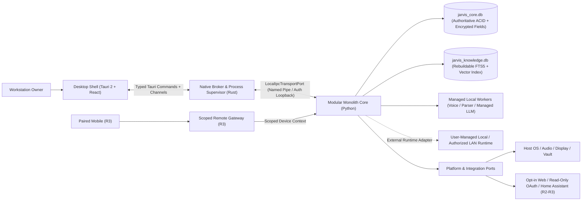
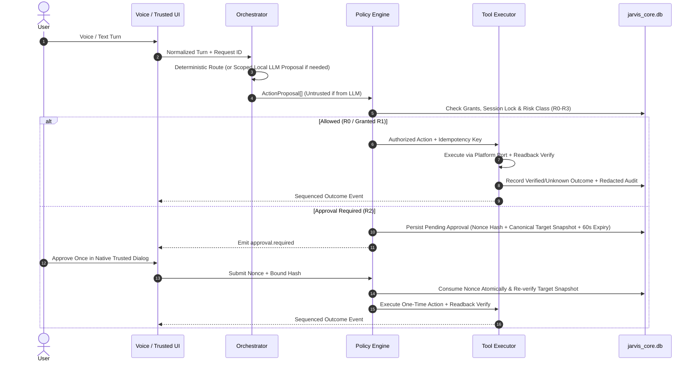
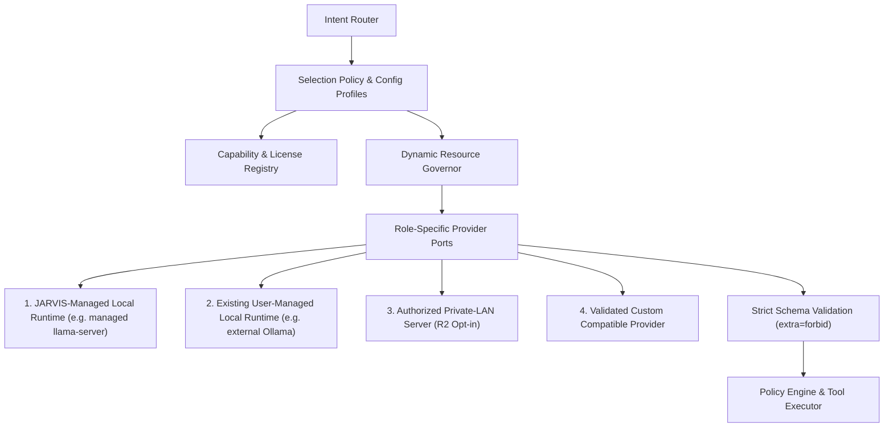
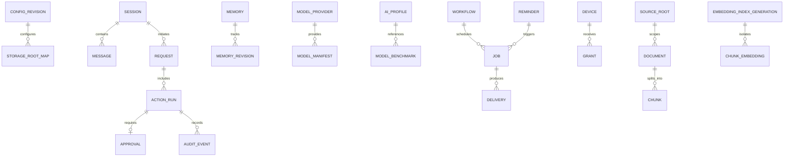
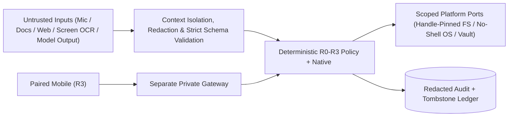

# JARVIS | SDLC documentation pack

**Project:** J.A.R.V.I.S. Local Personal Intelligence System  
**Version:** 0.2.1 | **Status:** Approved architectural baseline (`DEC-001`–`DEC-025`), belum diimplementasikan  
**Tanggal:** 26 November 2026 | **Pemilik persetujuan:** Product Owner

## Tujuan dan orientasi produk
JARVIS adalah **private-first, open-source-ready, hardware-adaptive, local-first Personal Intelligence Operating System**: voice, memory, desktop control, knowledge, proactive automation, vision, personal management, IoT, dan akses jarak jauh. Prinsip desain utama adalah ***convention over configuration, with full configuration overrides***: pengguna awam dapat memilih *Recommended Setup* hasil deteksi kapabilitas perangkat, sementara pengguna lanjut dapat mengatur sendiri model, runtime, akselerator GPU/CPU, lokasi penyimpanan, batas resource, voice engine, bahasa/persona, dan target visual.

Inferensi inti berjalan on-device secara default; server inferensi private LAN atau provider kompatibel tambahan bersifat opt-in dengan persetujuan eksplisit. Internet hanya digunakan untuk retrieval/integrasi yang diaktifkan pengguna. Tidak ada coding agent, eksekusi shell arbitrer, atau ketergantungan API LLM berbayar pada baseline.

Baca `01`–`04` untuk cakupan dan keputusan arsitektur, `05`–`11` untuk kontrak implementasi, `12`–`16` untuk pengujian dan delivery, `17` untuk matriks ketertelusuran (`RTM`), dan `18` untuk referensi teknis. Seluruh angka performa adalah target rekayasa yang harus dibuktikan melalui pengujian, bukan jaminan absolut. File di direktori `JARVIS-SDLC-v0.2.1/` merupakan sumber tunggal (*canonical source*); bundel `JARVIS-SDLC-Complete-v0.2.1.md` dihasilkan otomatis melalui `scripts/build_sdlc_complete.py`.

## Daftar dokumen
| File | Fungsi |
|---|---|
| [01-PRD.md](01-PRD.md) | Visi produk, cakupan `E01`–`E15`, onboarding, profil hardware/AI/UX, KPI |
| [02-SRS.md](02-SRS.md) | Persyaratan fungsional (`82` FR) dan non-fungsional (`16` NFR) yang dapat diuji |
| [03-SDD.md](03-SDD.md) | Arsitektur modular monolith, abstraksi platform, state machine, konsistensi dual-DB |
| [04-TECH-STACK-ADR.md](04-TECH-STACK-ADR.md) | Kandidat teknologi, tata kelola lisensi open-source, `ADR-001`–`ADR-025` |
| [05-BUSINESS-RULES.md](05-BUSINESS-RULES.md) | Otoritas `R0`–`R3`, aturan domain, kepemilikan runtime, kebijakan lisensi dan storage |
| [06-AI-VOICE-DESIGN.md](06-AI-VOICE-DESIGN.md) | Pipeline suara, abstraksi provider, 4 mode kepemilikan runtime, evaluasi model |
| [07-DATA-DESIGN.md](07-DATA-DESIGN.md) | Arsitektur dual SQLite, skema ternormalisasi, konsistensi lintas-DB, migrasi storage & backup |
| [08-INTERFACE-CONTRACTS.md](08-INTERFACE-CONTRACTS.md) | Kontrak IPC/API, discovery/storage/runtime contracts, skema tool dan event |
| [09-SECURITY-PRIVACY.md](09-SECURITY-PRIVACY.md) | Threat model STRIDE/LLM, isolasi proses/file, enkripsi, privasi dan supply chain |
| [10-UX-DESIGN.md](10-UX-DESIGN.md) | Onboarding 10 langkah, Command Center, HUD, Adaptive Visual Rendering Engine, aksesibilitas |
| [11-INTEGRATION-DESIGN.md](11-INTEGRATION-DESIGN.md) | Abstraksi OS, audio dinamis, web, konektor personal, Home Assistant, mobile, LAN |
| [12-TEST-STRATEGY.md](12-TEST-STRATEGY.md) | Strategi QA Tier A/Tier B, konformansi provider/storage/hardware, evaluasi AI dan performa |
| [13-DEPLOYMENT-OPERATIONS.md](13-DEPLOYMENT-OPERATIONS.md) | Installer minimal, manajemen storage/update/rollback, observabilitas, runbook |
| [14-PROJECT-PLAN-BACKLOG.md](14-PROJECT-PLAN-BACKLOG.md) | WBS `R0`–`R3` + Hardening, backlog `B01`–`B34`, jalur kritis terintegrasi, DoR/DoD |
| [15-RISK-GOVERNANCE.md](15-RISK-GOVERNANCE.md) | Register risiko ternormalisasi `RK01`–`RK22`, kontrol perubahan, quality gates `G0`–`G5` |
| [16-USER-ACCEPTANCE-HANDBOOK.md](16-USER-ACCEPTANCE-HANDBOOK.md) | Skenario UAT `U01`–`U26`, panduan penggunaan, troubleshooting, checklist handover |
| [17-TRACEABILITY-MATRIX.md](17-TRACEABILITY-MATRIX.md) | Pemetaan 1-ke-1 `98` requirement → desain → `98` test ID → fase rilis |
| [18-REFERENCES.md](18-REFERENCES.md) | Standar acuan dan dokumentasi hulu `REF-01`–`REF-28` |

## Keputusan inti dan batasan produk
- **Confirmed (`LOCKED`):** Visi penuh JARVIS tanpa pengurangan kapabilitas; tanpa coding agent, tanpa shell arbitrer, tanpa API LLM berbayar wajib. Local-first hybrid dengan internet/integrasi eksternal opt-in.
- **Orientasi Produk (`DEC-001`):** *Private-first, open-source-ready*. Pemilihan pustaka menggunakan prinsip *best-fit technology with license compliance* (`MIT`, `Apache-2.0`, `BSD`, `MPL-2.0`, `LGPL`, `GPL`, `AGPL` diizinkan dengan kepatuhan lisensi penuh; lisensi repositori akhir dan peninjauan merek dagang dilakukan sebelum rilis publik).
- **Hardware-Adaptive & Portable (`DEC-016`–`DEC-023`):** Workstation pengembang (Windows 11 x64, Core i5-11400H, RTX 3050 Laptop 4 GB VRAM) berfungsi semata-mata sebagai *reference development profile* lokal, **bukan** batas permanen produk. Produk wajib dapat diinstal pengguna lain pada CPU-only, NVIDIA, AMD, Intel, atau server LAN privat yang didukung tanpa mengubah kode sumber, serta bebas dari hardcode huruf drive, username, zona waktu `WIB`, bahasa tunggal, atau batas permanen `60 FPS`.
- **Release Priorities:** `R0` membuktikan kelayakan teknis/benchmark secara terkendali; `P0 = R1` mengirim fondasi inti + konfigurasi dinamis; `P1 = R2` menambah produktivitas, RAG, migrasi storage penuh, dan LAN opsional; `P2 = R3` menambah IoT, kamera, akses mobile, dan adaptasi preferensi.

## Release notes v0.2.1
Revisi arsitektur pasca-audit Fase 0 (`DEC-001`–`DEC-025`; baseline asli `v0.2.0` disimpan utuh pada tag Git `sdlc-v0.2.0`). Menambahkan Epic `E15` (*Hardware-Adaptive Portability, Storage & Provisioning*), 10-step First-Run Onboarding, Dynamic 11-Root Storage Manager dengan migrasi bertransaksi, 4 mode kepemilikan runtime (`managed_local`, `external_local`, `authorized_lan`, `custom_compatible`), kebijakan lisensi *best-fit with compliance* beserta inventaris artefak 11 kategori, Adaptive Visual Rendering Engine (`Auto/30/60/120/Native` FPS), personalisasi multibahasa/timezone/persona dinamis, 9 port abstraksi platform, dan definisi konsistensi lintas-DB pada arsitektur Dual SQLite. Mengoreksi kontradiksi skema v0.2.0 (`model_manifest`, `embedding_index_generation`), menormalisasi seluruh ID (`82 FR + 16 NFR = 98 TC-*`, `ADR-001`–`025`, `RK01`–`22`, `U01`–`26`, `REF-01`–`28`, `B01`–`34`), dan mengganti klaim teknis absolut menjadi target terukur beserta prosedur verifikasi.

---

# Product Requirements Document (PRD)

**Project:** J.A.R.V.I.S. Local Personal Intelligence System  
**Version:** 0.2.1 | **Status:** Approved architectural baseline, belum diimplementasikan  
**Tanggal:** 26 November 2026 | **Pemilik persetujuan:** Product Owner

## 1. Product vision dan prinsip desain
Membangun sistem inteligensi personal yang tersedia saat komputer aktif, mampu mendengar, memahami konteks, mengingat informasi yang disetujui, bertindak melalui *typed tools* terbatas, memberi pengingat proaktif, serta beradaptasi terhadap perangkat keras dan preferensi setiap pengguna.

1. **Local-first & Privacy-first:** Tidak ada pengiriman prompt, audio, tangkapan layar, atau database ke layanan AI komersial eksternal secara default maupun sebagai fallback tersembunyi.
2. **Private-first, Open-source-ready:** Dirancang pertama-tama untuk keandalan penggunaan pribadi, namun dibangun secara portabel sehingga dapat diinstal oleh pengguna lain pada perangkat berbeda dan siap dipublikasikan sebagai proyek open source setelah audit lisensi dan merek dagang.
3. **Convention over Configuration, with Full Overrides:** Pengguna umum cukup memilih *Recommended Setup* berdasarkan hasil deteksi perangkat keras otomatis, sedangkan pengguna mahir memegang kendali penuh atas model, runtime, akselerator, lokasi penyimpanan, kuota resource, voice engine, bahasa, dan rendering visual.

## 2. Problem statements dan persona
| ID | Problem / job to be done | Hasil yang diharapkan |
|---|---|---|
| G01 | Pengguna berulang kali membuka aplikasi dan menjalankan operasi rutin | Selesaikan tindakan terdaftar melalui suara atau teks dengan verifikasi hasil dan konfirmasi sesuai risiko |
| G02 | Informasi pribadi tersebar di dokumen, catatan, dan jadwal | Temukan informasi lokal dengan provenance, sitasi akurat, dan kontrol penuh atas memori |
| G03 | Pengingat mudah terlewat saat bekerja atau perangkat sempat mati | Pengingat persisten lintas restart, menghormati *quiet hours*, dan melaporkan *missed reminders* secara jujur |
| G04 | Layanan AI cloud menambah biaya berulang dan risiko kebocoran privasi | Kapabilitas inti bekerja offline dengan biaya API Rp0 |
| G05 | Pengguna memiliki spesifikasi perangkat, storage, dan ekosistem berbeda | Instalasi adaptif tanpa mengubah kode sumber; integrasi lintas perangkat bersifat opt-in dan terverifikasi |

Persona utama: pemilik workstation pribadi (pengguna umum maupun pengguna teknis) dengan beragam konfigurasi perangkat keras (CPU-only laptop hingga workstation multi-GPU atau server LAN privat). Persona sekunder: pemilik yang sama mengakses dari perangkat mobile yang telah dipasangkan (`R3`). Tamu di dekat mikrofon diperlakukan sebagai aktor tidak terautentikasi.

## 3. Product scope dan release strategy
| Epic | Scope | Priority | Acceptance value |
|---|---|---|---|
| E01 Voice & interaction | Wake word opsional, push-to-talk, teks, STT/TTS lokal, barge-in adaptif, hotplug perangkat audio | P0 (`R1`) | Interaksi suara dan teks berjalan offline dengan fallback aman |
| E02 Core intelligence | Deterministic router, normalisasi locale dinamis, bounded planning, kontekstualisasi | P0 (`R1`) | Perintah pasti berjalan tanpa LLM; ambiguitas meminta klarifikasi |
| E03 OS actions | Launch aplikasi (`Win32`/`AUMID`), volume, pencarian & operasi file berbasis handle aman | P0 (`R1`) | Efek diverifikasi secara aktual, tanpa evaluasi shell arbitrer |
| E04 Memory | Preferensi & memori episodik eksplisit, edit/hapus/ekspor, pemisahan riwayat sesi | P0 (`R1`) | Pengguna mengendalikan penuh apa yang diingat dan dihapus |
| E05 Scheduling & proactive | Reminder IANA timezone dinamis, aturan proaktif opt-in, *quiet hours*, rekonsiliasi daya/jam | P0 (`R1`) | Reminder persisten melintasi restart dan perubahan daya |
| E06 Personal knowledge | Folder opt-in, TXT/MD/PDF/DOCX, sitasi terverifikasi, pencarian leksikal & semantik | P1 (`R2`) | Jawaban merujuk file serta halaman/bagian atau menyatakan bukti kurang |
| E07 Web intelligence | Pencarian/fetch read-only pluggable, tanggal sumber, proteksi SSRF, status offline jujur | P1 (`R2`) | Tidak menyamarkan cache/offline sebagai data langsung |
| E08 Screen awareness | Snapshot per permintaan, UI Automation, OCR lokal, redaksi rahasia, vision opsional | P1 (`R2`) | Tanpa perekaman latar belakang; kredensial tidak dikirim ke model |
| E09 Personal management | Tasks, kalender lokal, pencatatan pengeluaran integer multi-mata uang, habit, OAuth read-only opsional | P1 (`R2`) | CRUD akurat secara lokal tanpa eksekusi pembayaran atau keputusan medis |
| E10 Advanced automation | Workflow bertipe (`≤ 5` langkah), dry-run, persetujuan terikat parameter, pembatalan & rekonsiliasi | P1 (`R2`) | Efek samping tercatat dan tidak diulang secara buta pasca-gagal |
| E11 Environmental & IoT | Kamera on-demand, Home Assistant allowlist, verifikasi state dan pemblokiran aktuasi berbahaya | P2 (`R3`) | Indikator perangkat keras jelas; kunci/alarm/pemanas diblokir |
| E12 Remote & adaptive | Akses mobile terpasangkan via jaringan privat/TLS, proposal preferensi berbasis umpan balik lokal | P2 (`R3`) | Cakupan akses sempit per perangkat; tanpa perubahan kebijakan otomatis |
| E13 Flexible AI | Abstraksi provider/runtime, 4 mode kepemilikan runtime, 6 profil AI, manajemen model & switching aman | P0 (`R1` / perluasan `R2`) | Ganti model/runtime tanpa ubah core; pengguna hanya menginstal komponen yang dibutuhkan |
| E14 Cinematic experience | HUD & Command Center orisinal, Intelligence Core reaktif, Adaptive Visual Rendering Engine, 4 tier visual | P0 (`R1`) | UI sinematik berbasis state nyata, aksesibel, dan adaptif terhadap refresh rate & beban |
| E15 Hardware-adaptive portability & storage | System Capability Discovery, Configuration Recommendation Engine, 11-root Dynamic Storage Manager, 10-step onboarding, inventaris lisensi, abstraksi platform | P0 (`R1` fondasi / migrasi & ekstensi `R2`) | Instalasi portabel lintas spesifikasi hardware dan drive tanpa hardcode mesin pengembang |

**Out of scope (Hard Bans):** Coding/debugging/deployment agent, terminal tak terawasi, keylogger, perekaman tersembunyi, identifikasi wajah/biometrik suara latar, penghapusan file permanen, transaksi pembayaran online, pengiriman/penghapusan email otomatis, diagnosis/resep medis, fallback cloud LLM diam-diam, multi-tenant SaaS, modifikasi diri otonom, dan eksekusi plugin unduhan tak terverifikasi.

## 4. User journeys
- **J00 (Onboarding portabel):** Pengguna baru memasang installer minimal JARVIS → sistem memindai CPU/RAM/GPU/disk/audio/layar → merekomendasikan lokasi penyimpanan, profil AI (mis. CPU-only ringan atau GPU lokal), dan tier visual → pengguna menyetujui *Recommended Setup* atau memilih direktori/runtime yang sudah ada (mis. *Existing Ollama*) → menguji mikrofon/suara dan memilih aplikasi yang diizinkan → siap digunakan offline bahkan jika unduhan model ditunda (*Direct Mode*).
- **J01:** Pengguna mengucapkan perintah pembukaan aplikasi terdaftar dan pengaturan volume → wake/PTT → transkrip → dua *typed actions* → pemeriksaan policy → eksekusi & readback → laporan per langkah (termasuk status parsial bila salah satu aplikasi belum tersedia).
- **J02:** Pengguna membuat pengingat relatif terhadap waktu lokal → sistem meresolusi terhadap zona waktu IANA aktif pengguna → menampilkan waktu absolut → menyimpan secara persisten → menampilkan *missed reminder* bila perangkat sempat mati saat jatuh tempo.
- **J03:** Pengguna menanyakan, menyunting, atau menghapus memori preferensi → perubahan segera berlaku dan data terhapus dikeluarkan dari indeks aktif serta dicatat pada *deletion ledger*.
- **J04 (`R2`):** Pengguna meminta ringkasan dokumen pada folder yang diizinkan → retrieval leksikal/hibrida mengambil potongan relevan → jawaban mencantumkan nama file dan halaman/bagian yang valid atau menyatakan bukti tidak cukup.
- **J05 (`R2`):** Pengguna meminta informasi terkini saat mode online diaktifkan → query diperiksa dari data privat → hasil menampilkan URL sumber dan waktu pengambilan serta diperlakukan sebagai data tidak tepercaya.
- **J06 (`R3`):** Pengguna mengontrol entitas lampu Home Assistant yang diizinkan → eksekusi → readback status aktual; bila koneksi terputus, hasil dilaporkan `unknown`/`unavailable`, bukan klaim sukses.
- **J07 (`R3`):** Pengguna membuat pengingat dari ponsel terpasangkan melalui sesi terenkripsi → policy cakupan remote memvalidasi → pengingat tersimpan atau status *host unreachable* ditampilkan secara jujur bila desktop tidur/mati.

## 5. Hardware-adaptive & storage product capabilities (`E15`)

### 5.1 Profil rekomendasi perangkat keras ilustratif
Tabel berikut adalah **ilustrasi logika rekomendasi awal** dari *Configuration Recommendation Engine*, bukan jaminan kompatibilitas tanpa verifikasi kapabilitas model, driver, dan memori bebas aktual saat runtime:

| Kelas perangkat pengguna | Rekomendasi awal konfigurasi AI | Rekomendasi awal visual | Klasifikasi dukungan awal |
|---|---|---|---|
| CPU-only, RAM 8 GB | Direct tools + model kuantisasi sangat ringan on-demand | `Lite` | `Supported` (Direct) / `Experimental` (LLM CPU) |
| CPU-only, RAM ≥16 GB | Model kecil dengan inferensi CPU thread terukur | `Balanced` | `Supported` (setelah verifikasi R0) |
| NVIDIA GPU VRAM ~4 GB (reference dev class) | Model kuantisasi 1.7B–4B sesuai kuota VRAM & KV cache | `Balanced` | `Supported` (target validasi utama R0/R1) |
| NVIDIA GPU VRAM ≥12 GB | Model lokal menengah (mis. 7B–14B Q4) sesuai memori bebas | `Cinematic` | `Unverified` hingga diuji pada perangkat terkait |
| NVIDIA GPU VRAM ≥24 GB | Model lokal lebih besar / konteks lebih panjang | `Cinematic` | `Unverified` hingga diuji pada perangkat terkait |
| AMD / Intel GPU (Vulkan / ROCm / kompatibel) | Backend akselerator kompatibel melalui runtime yang mendukung | `Adaptive` | `Experimental` / `Unverified` sesuai status uji adapter |
| Server AI private LAN terotorisasi (`R2`) | Inferensi jaringan privat opt-in dengan persetujuan cakupan data | `Cinematic` / `Balanced` | `Supported` pada `R2` setelah uji keamanan |

Setiap konfigurasi diberi label eksplisit **`Supported`**, **`Experimental`**, **`Unverified`**, atau **`Unsupported`**, dan seluruh rekomendasi dapat di-override pengguna selama tidak melanggar batas keamanan atau integritas data.

### 5.2 Dynamic Storage Manager & Runtime Ownership
- **11 lokasi penyimpanan independen yang dapat dikonfigurasi:** `app_data`, `models`, `runtimes`, `core_db`, `knowledge_db`, `logs`, `temp`, `cache`, `backups`, `imported_docs`, dan `extensions`, dengan kuota cache konfigurabel (`10 GB`, `25 GB`, `50 GB`, `Custom`, `Unlimited`), dukungan *shared model directory* lintas runtime agar tidak menduplikasi file multi-GB, serta migrasi antar-drive bertransaksi dengan checksum dan rollback (`R2`).
- **4 mode kepemilikan runtime (`DEC-020`):** (1) *JARVIS-Managed Local Runtime*, (2) *Existing User-Managed Local Runtime* (mis. memakai instalasi Ollama/llama.cpp milik pengguna tanpa dimatikan sepihak oleh JARVIS), (3) *Authorized Private-LAN Runtime* (`R2`), dan (4) *Custom Compatible Provider*. Pengguna produksi hanya memasang runtime yang dipilih, tidak diwajibkan menginstal lebih dari satu runtime.

## 6. Flexible AI modes & Adaptive Cinematic UX (`E13`, `E14`)
Enam mode AI tetap dipertahankan: **`Eco`** (hemat resource/gaming), **`Performance`** (respons suara cepat), **`Balanced`** (default harian), **`Quality`** (model lokal terbesar yang tervalidasi pada kapasitas perangkat atau private LAN opt-in pada `R2`), **`Adaptive`** (pemilihan otomatis berbasis tugas dan telemetri resource aktual dalam zona kepercayaan yang disetujui), dan **`Custom`** (kendali penuh parameter backend, GPU offload, CPU threads, context, idle timeout, prioritas, kebijakan baterai dan gaming).

Antarmuka **Orbital Precision OS** menghadirkan *Interactive Intelligence Core* orisinal tanpa menyalin aset film maupun pola dashboard AI generik. Empat profil kualitas visual independen (**`Cinematic`**, **`Balanced`**, **`Lite`**, **`Reduced Motion`**) dipadukan dengan pengatur batas *frame rate* (**`Auto`**, **`30`**, **`60`**, **`120`**, **`Native`**) dan verifikasi telemetri GPU/WebView sehingga tampilan halus pada monitor standar maupun *high-refresh-rate* tanpa memonopoli resource inferensi AI.

## 7. Measurable success metrics (engineering targets, bukan klaim hasil)
| KPI | Definisi pengukuran | Target rekayasa awal |
|---|---|---|
| K01 Task success | Proporsi intent fixture valid yang selesai benar (termasuk penolakan/klarifikasi yang diharapkan) | ≥95% direct actions; ≥85% mixed intent |
| K02 Voice usability | WER pada korpus uji Bahasa Indonesia bersih dan *false wake* per jam audio negatif | ≤20% WER bersih; ≤0,2 false wake/jam |
| K03 Responsiveness | Latensi `p95` akhir ucapan → awal audio respons pada *reference machine* | ≤4s direct path; ≤12s warm simple LLM |
| K04 Schedule reliability | Pengingat jatuh tempo yang terkirim atau ditandai *missed* secara akurat pasca-restart/sleep | 100% pada skenario uji deterministik |
| K05 Privacy & safety | Permintaan AI eksternal tak berizin atau efek tool tanpa otorisasi pada suite keamanan | 0 kejadian pada suite pengujian |
| K06 Knowledge grounding | Jawaban berbasis dokumen dengan sitasi halaman/bagian yang terverifikasi (`R2`) | ≥90% sampel *answerable*; ≥90% abstensi tepat |
| K07 Mandatory cloud cost | Biaya langganan/token API LLM berbayar pada konfigurasi baseline | Rp0 |
| K08 User control | Perintah *Stop* / *Mute* menghentikan capture, playback, atau langkah yang belum dimulai | 100% pada skenario uji kontrol |
| K09 Runtime portability | Dua adapter lokal referensi menyelesaikan kontrak chat/stream/schema/cancel yang sama di `R0`/`R1` | Lulus suite konformansi tanpa perubahan policy core |
| K10 Resource governance | Kepatuhan terhadap batas sewa GPU/RAM yang dikonfigurasi dan pemulihan saat gagal muat model | Rollback ke profil sehat terakhir atau Direct Mode tercatat |
| K11 Adaptive frame pacing | Interval frame `p95` UI saat mode `Balanced` (`target 60 FPS`) aktif di foreground pada *reference host* | `p95` ≤20 ms; input→umpan balik visual `p95` ≤100 ms |
| K12 Visual truthfulness | Kesesuaian indikator UI terhadap event mesin dan status perangkat keras aktual | 0 *fake progress*; cakupan fungsi penuh pada `Reduced Motion` |
| K13 Onboarding & usability | Penyelesaian alur onboarding *Recommended Setup* dan akses *Mute/Stop* dari tray | ≥90% skenario uji tanpa bantuan; *Mute/Stop* ≤2 interaksi |

## 8. Release gates & tata kelola keputusan
- **`R0` (Feasibility Spike):** Membuktikan kompatibilitas dependensi aktual, kualitas suara/STT/TTS, kecocokan model/VRAM, dua adapter referensi, telemetri WebView, serta inventaris lisensi sebelum *stack freeze*.
- **`R1` (`P0`):** Mengirim `E01`–`E05`, `E13`, `E14`, fondasi `E15` (discovery, rekomendasi, konfigurasi storage/runtime/personalisasi, onboarding 10 langkah, inventaris lisensi), dan keamanan/backup inti.
- **`R2` (`P1`):** Menambah `E06`–`E10`, migrasi storage bertransaksi lintas-drive penuh, private LAN provider opt-in, generasi indeks embedding terisolasi, dan SDK ekstensi tepercaya.
- **`R3` (`P2`):** Menambah `E11`–`E12` (kamera/vision opsional, Home Assistant allowlist, gateway mobile privat, proposal preferensi adaptif).
- Keputusan produk, lisensi open-source, dan portabilitas dicatat dalam `04-TECH-STACK-ADR.md` (`ADR-001`–`ADR-025`). Peninjauan lisensi repositori publik dan klirens merek dagang dilakukan pada gerbang terpisah sebelum distribusi publik.

---

# Software Requirements Specification (SRS)

**Project:** J.A.R.V.I.S. Local Personal Intelligence System  
**Version:** 0.2.1 | **Status:** Approved architectural baseline, belum diimplementasikan  
**Tanggal:** 26 November 2026 | **Pemilik persetujuan:** Product Owner

## 1. Purpose, environment dan konvensi
Spesifikasi normatif untuk sistem inteligensi personal JARVIS yang *local-first*, *private-first*, *open-source-ready*, dan *hardware-adaptive*. Kata **"harus"** menyatakan persyaratan wajib yang terikat pada ID stabil dan skenario penerimaan di `17-TRACEABILITY-MATRIX.md`. Prioritas mengikuti fase rilis: `P0` (`R1`), `P1` (`R2`), `P2` (`R3`), dengan validasi kelayakan awal pada `R0`. Struktur mengacu pada prinsip ISO/IEC/IEEE 29148 tanpa klaim sertifikasi formal.

Platform produksi pertama adalah Windows 11 x64 dalam sesi pengguna standar (tanpa layanan `SYSTEM`/hak administrator), namun logika domain dan aplikasi tidak boleh bergantung langsung pada API spesifik OS atau asumsi perangkat keras tunggal. Bahasa interaksi default awal adalah Bahasa Indonesia dengan dukungan multibahasa dan *code-switching* yang dapat dikonfigurasi; zona waktu mengikuti konfigurasi IANA pengguna tanpa hardcode `WIB`. Seluruh interaksi suara melalui wake word tidak dianggap sebagai bukti identitas kriptografis; persetujuan tindakan sensitif (`R2`) wajib melalui *trusted local UI*.

## 2. Functional requirements (`82 FR`)

### 2.1 Voice & Interaction (`VOI`)
| ID | Priority | Requirement | Acceptance scenario |
|---|---|---|---|
| FR-VOI-01 | P0 | Sistem harus menerima input teks, push-to-talk (PTT), dan wake word lokal saat sesi pengguna tidak terkunci; wake word dan frasa pemicu (bila didukung engine) harus dapat dikonfigurasi atau dinonaktifkan. | Aktifkan tiap mode secara offline; matikan wake word dan verifikasi audio rekaman tidak memicu capture. |
| FR-VOI-02 | P0 | Sistem harus menampilkan indikator akurat untuk status *listening/transcribing/speaking/muted* dan menyediakan mute perangkat lunak yang segera menutup stream capture mikrofon. | Aktifkan mute saat capture berlangsung; verifikasi stream audio ditutup dan tidak ada frame baru yang diproses. |
| FR-VOI-03 | P0 | STT harus memproses bahasa aktif yang dipilih pengguna (default Bahasa Indonesia + istilah Inggris umum) secara lokal dan meminta klarifikasi bila transkrip atau slot berisiko ambigu. | Uji korpus ID/EN termasuk angka, waktu, dan nama aplikasi; perintah dengan slot ambigu meminta konfirmasi tanpa eksekusi. |
| FR-VOI-04 | P0 | TTS harus menyintesis respons secara lokal dengan dukungan pengaturan kecepatan/volume yang didukung engine, tombol stop, serta *barge-in* yang menghentikan playback lama. | Interupsi saat asisten berbicara; playback lama berhenti dalam batas waktu pembatalan tanpa menumpuk audio. |
| FR-VOI-05 | P0 | Sistem harus menyediakan fallback interaksi teks penuh apabila mikrofon, engine STT, atau engine TTS tidak tersedia atau gagal. | Simulasikan kegagalan mikrofon dan worker TTS; pengguna tetap dapat menjalankan perintah langsung dan melihat respons teks. |
| FR-VOI-06 | P0 | Sistem harus mendeteksi perubahan perangkat input/output audio secara dinamis, menyesuaikan pencegahan *self-trigger* (echo/AEC atau gating speaker terbuka), serta memverifikasi ketersediaan voice pack OS/lokal sebelum mengaktifkannya. | Cabut/ganti perangkat audio aktif saat sesi berjalan dan uji pemutaran TTS pada speaker terbuka; sistem pulih tanpa crash dan tidak memicu wake palsu dari suaranya sendiri. |

### 2.2 Core Intelligence & Personalization (`COR`)
| ID | Priority | Requirement | Acceptance scenario |
|---|---|---|---|
| FR-COR-01 | P0 | Sistem harus merutekan perintah deterministik yang dikenali ke *typed tools* tanpa memanggil inferensi LLM. | Instrumentasi 100 fixture perintah langsung; verifikasi nol panggilan ke adapter LLM. |
| FR-COR-02 | P0 | Inferensi LLM default harus berjalan lokal; seluruh keluaran model diperlakukan sebagai proposal tidak tepercaya yang divalidasi terhadap skema ketat dan Policy Engine. | Umpankan proposal berisi tool tak dikenal, properti tambahan, dan argumen berbahaya; seluruhnya ditolak tanpa efek samping. |
| FR-COR-03 | P0 | Orchestrator harus membatasi rencana maksimal 5 langkah, maksimal 2 upaya perbaikan skema, dan batas waktu inferensi konfigurabel (default 60 detik) per permintaan. | Simulasikan keluaran JSON invalid berulang dan respons lambat melampaui batas; eksekusi berhenti bersih dengan kode status jelas. |
| FR-COR-04 | P0 | Sistem harus meminta klarifikasi ketika target, entitas, atau parameter waktu bersifat ambigu tanpa menebak tindakan berisiko. | Uji dua file bernama serupa dan waktu relatif multi-arti; tidak ada mutasi sebelum pengguna memilih target eksplisit. |
| FR-COR-05 | P0 | Sistem harus mendukung pembatalan per permintaan dan melaporkan status akhir (`completed`, `partial`, `failed`, `canceled`, `unknown`) secara jujur. | Batalkan rencana multi-langkah setelah langkah pertama selesai; langkah pertama dilaporkan selesai dan langkah berikutnya tidak dijalankan. |
| FR-COR-06 | P0 | Sistem harus tetap menyediakan *Direct Mode* (eksekusi tool deterministik, pengingat, memori eksplisit, dan pengaturan) ketika tidak ada runtime/model AI yang terpasang atau aktif. | Jalankan sistem tanpa model LLM terinstal atau matikan worker LLM; pembuatan pengingat dan pembukaan aplikasi terdaftar tetap berhasil. |
| FR-COR-07 | P0 | Sistem harus mendukung konfigurasi bahasa utama, perilaku multibahasa, zona waktu IANA, gaya persona, dan verbositas respons tanpa hardcode locale/timezone tunggal, serta menormalisasi angka/waktu sesuai locale aktif. | Ubah zona waktu IANA dan preferensi bahasa/verbositas di pengaturan; resolusi waktu pengingat dan format respons mengikuti konfigurasi baru tanpa mengubah kode. |

### 2.3 Operating System Actions (`OS`)
| ID | Priority | Requirement | Acceptance scenario |
|---|---|---|---|
| FR-OS-01 | P0 | Sistem harus membuka aplikasi hanya dari registri allowlist yang disetujui pengguna tanpa evaluasi shell (`cmd`/`powershell`/`sh`). | Aplikasi yang diizinkan terbuka; argumen injeksi perintah dan aplikasi di luar allowlist ditolak. |
| FR-OS-02 | P0 | Sistem harus membaca dan mengatur volume sistem dalam rentang `0–100` serta memverifikasi nilai aktual melalui readback. | Atur volume ke `30`, verifikasi readback `30 ± 2`; nilai `-5` atau `150` ditolak pada validasi input. |
| FR-OS-03 | P0 | Sistem harus mencari dan membuka file hanya di dalam *source root* yang disetujui dengan validasi jalur kanonik dan penolakan symlink/junction keluar cakupan. | File di dalam root ditemukan; percobaan `../`, path UNC tak berizin, dan junction menuju direktori luar ditolak. |
| FR-OS-04 | P0 | Sistem harus memproses mutasi file sederhana (seperti ubah nama/pindah dalam root) hanya melalui target eksplisit, pratinjau `R2`, dan larangan timpa (*no-overwrite*) maupun hapus permanen. | Setujui pratinjau rename file A, lalu ubah file target sebelum eksekusi; token persetujuan ditolak dan file tujuan yang sudah ada tidak tertimpa. |
| FR-OS-05 | P0 | Sistem harus melaporkan hasil tindakan OS berdasarkan verifikasi aktual dari adapter, bukan klaim teks dari model. | Simulasikan kegagalan adapter atau ketidakcocokan readback; sistem melaporkan `failed` atau `unknown`, bukan `completed`. |
| FR-OS-06 | P0 | Adapter OS pada Windows harus mendukung peluncuran aplikasi terpaket (`AppUserModelID`/MSIX) maupun path executable terverifikasi, serta menggunakan verifikasi berbasis handle pada operasi file untuk memitigasi *TOCTOU*. | Luncurkan aplikasi Store terdaftar melalui `AUMID` dan uji percobaan pengalihan junction saat jeda pratinjau file; keduanya ditangani sesuai kontrak keamanan. |

### 2.4 Personal Memory (`MEM`)
| ID | Priority | Requirement | Acceptance scenario |
|---|---|---|---|
| FR-MEM-01 | P0 | Sistem harus menyimpan memori jangka panjang hanya dari perintah ingat eksplisit pengguna atau proposal yang disetujui secara eksplisit. | Percakapan biasa tidak menambah fakta permanen; perintah ingat eksplisit menyimpan record dengan provenance jelas. |
| FR-MEM-02 | P0 | Sistem harus menyediakan fitur lihat daftar, cari, sunting, hapus, dan ekspor memori pengguna. | Sunting lalu cari memori dan pastikan nilai terbaru tampil; hapus memori dan pastikan pencarian tidak lagi mengembalikannya. |
| FR-MEM-03 | P0 | Sistem harus mencatat provenance, waktu, tingkat sensitivitas, status, dan nomor revisi pada setiap memori. | Pembaruan dengan revisi usang ditolak (`409`); log audit mencatat perubahan tanpa membocorkan teks sensitif mentah. |
| FR-MEM-04 | P0 | Sistem harus memisahkan riwayat percakapan sesi dari memori jangka panjang dengan retensi/TTL sesi yang dapat diatur pengguna (default hanya selama sesi aktif). | Mulai ulang aplikasi saat penyimpanan riwayat dimatikan; transkrip sesi bersih sementara memori eksplisit tetap utuh. |
| FR-MEM-05 | P0 | Penghapusan memori harus segera menghapus entri dari indeks pencarian/cache aktif dan mencatat *tombstone* pada `deletion_ledger` untuk mencegah kebangkitan data saat pemulihan backup lama. | Hapus memori, pulihkan snapshot backup lama melalui prosedur resmi, dan verifikasi item terhapus tetap dikecualikan dari retrieval aktif. |

### 2.5 Scheduling & Proactive Engine (`SCH`)
| ID | Priority | Requirement | Acceptance scenario |
|---|---|---|---|
| FR-SCH-01 | P0 | Sistem harus membuat, menampilkan, mengubah, dan membatalkan pengingat dengan waktu UTC absolut serta zona waktu IANA asal pengguna. | Buat pengingat pada zona waktu pengguna, mulai ulang aplikasi, verifikasi jatuh tempo akurat, dan pastikan pengingat yang dibatalkan tidak berbunyi. |
| FR-SCH-02 | P0 | Scheduler harus menyimpan job secara persisten, menerapkan mekanisme *lease* dan *idempotency*, serta memulihkan status setelah restart atau crash. | Hentikan proses tepat sebelum dan saat job jatuh tempo; setelah hidup kembali tercatat satu pengiriman logis atau status *uncertain* yang eksplisit. |
| FR-SCH-03 | P0 | Sistem harus mendukung *quiet hours* konfigurabel, *snooze*, *dismiss*, dan pelaporan *missed reminders* saat perangkat kembali aktif dari kondisi mati/tidur. | Biarkan pengingat melewati waktu jatuh tempo saat proses nonaktif; saat aktif kembali tampil sebagai *missed*; selama *quiet hours* pengiriman mengikuti kebijakan senyap pengguna. |
| FR-SCH-04 | P0 | Proactive engine harus bersifat opt-in per aturan dengan *debounce* dan batas frekuensi (*rate limit*) yang dapat dikonfigurasi. | Aktifkan aturan pengingat istirahat; notifikasi tidak melebihi batas per jam/hari dan segera berhenti saat aturan dinonaktifkan. |
| FR-SCH-05 | P0 | Sistem harus menangani event perubahan daya OS (`Suspend`/`Resume`) dan lompatan jam sistem menggunakan *monotonic clock* untuk batas waktu eksekusi serta merekonsiliasi antrean jadwal saat bangun. | Simulasikan siklus *suspend/resume* dan perubahan jam sistem; capture tertutup saat *suspend*, tidak terjadi timeout palsu, dan pengingat jatuh tempo direkonsiliasi. |

### 2.6 Personal Knowledge & Hybrid RAG (`KNO`)
| ID | Priority | Requirement | Acceptance scenario |
|---|---|---|---|
| FR-KNO-01 | P1 | Sistem harus mengindeks file TXT, Markdown, PDF teks, dan DOCX dari folder opt-in dengan batas ukuran konfigurabel dan pelaporan status jelas untuk file tidak didukung/PDF hasil pindai. | Indeks kumpulan fixture dokumen; file di luar root ditolak dan PDF pindai tanpa teks ditandai `ocr_required` secara jujur. |
| FR-KNO-02 | P1 | Sistem harus menjalankan pengindeksan inkremental berbasis sidik jari konten (SHA-256) dan membersihkan potongan (*chunks*) usang saat file berubah, dihapus, atau akses folder dicabut. | Ubah dan hapus dokumen sumber lalu jalankan sinkronisasi; pencarian tidak lagi mengembalikan teks versi lama. |
| FR-KNO-03 | P1 | Sistem harus menyediakan pencarian leksikal (FTS5) dan pencarian semantik opsional dengan provenance lokasi sumber; mode leksikal harus tetap berfungsi penuh tanpa model embedding. | Nonaktifkan model embedding dan jalankan pencarian kata kunci; hasil tetap kembali beserta penunjuk lokasi sumber yang valid. |
| FR-KNO-04 | P1 | Jawaban berbasis pengetahuan harus menyertakan nama file dan penunjuk halaman/bagian yang terverifikasi, atau menyatakan bukti tidak mencukupi bila sumber tidak menjawab pertanyaan. | Uji pertanyaan yang ada jawabannya dan yang tidak ada di dokumen; sitasi cocok dengan sumber dan pertanyaan tak terjawab tidak mengarang fakta. |
| FR-KNO-05 | P1 | Ekstraktor dokumen dan konteks RAG harus berjalan tanpa eksekusi makro/skrip dan dengan pemanggilan tool dinonaktifkan selama sintesis jawaban dokumen. | Indeks dokumen berisi instruksi injeksi prompt untuk mengubah file/mengakses jaringan; nol eksekusi tool terjadi. |

### 2.7 Web Intelligence (`WEB`)
| ID | Priority | Requirement | Acceptance scenario |
|---|---|---|---|
| FR-WEB-01 | P1 | Pencarian web harus bersifat opt-in melalui arsitektur provider pluggable, read-only, dan memeriksa/menyamarkan data privat pada query sebelum dikirim keluar. | Saat mode offline aktif, permintaan ditolak secara jujur; saat online, query yang memuat indikasi data sensitif memerlukan pratinjau/persetujuan atau redaksi. |
| FR-WEB-02 | P1 | Pengambilan halaman web harus memvalidasi skema HTTP(S) publik, seluruh alamat IP hasil resolusi DNS dan redirect terhadap daftar blokir jaringan privat/loopback/link-local, batas ukuran, dan batas waktu; isi halaman selalu tidak tepercaya. | Uji URL ke `127.0.0.1`, IP privat RFC1918, link-local metadata, redirect ke localhost, `file://`, dan halaman berisi prompt injection; seluruhnya diblokir atau dinetralkan. |
| FR-WEB-03 | P1 | Jawaban berbasis web harus menampilkan URL sumber, waktu pengambilan, dan tanggal publikasi bila tersedia, serta memberi label eksplisit pada data cache yang sudah kedaluwarsa (*stale*). | Putus koneksi setelah pengambilan awal dan baca ulang cache yang melewati TTL; label *stale* tampil jelas tanpa klaim data langsung. |

### 2.8 Screen Awareness (`SCR`)
| ID | Priority | Requirement | Acceptance scenario |
|---|---|---|---|
| FR-SCR-01 | P1 | Sistem harus mengambil tangkapan jendela/layar hanya atas permintaan eksplisit pengguna per aksi/sesi dengan indikator aktif dan pratinjau cakupan jendela. | Pilih satu jendela aplikasi; jendela lain tidak ikut tertangkap dan tombol stop segera menghentikan akses. |
| FR-SCR-02 | P1 | Sistem harus memprioritaskan pembacaan struktur aksesibilitas (UIA) atau OCR lokal sebelum model vision opsional, serta menolak konteks kolom kata sandi dan jendela terlarang. | Arahkan ke jendela dengan kolom password atau aplikasi dalam daftar blokir; konten sensitif ditolak secara aman. |
| FR-SCR-03 | P1 | Tangkapan layar mentah harus dikelola di memori sementara selama siklus permintaan dan dihapus setelah selesai/batal tanpa disimpan ke disk/log secara default. | Selesaikan dan batalkan permintaan analisis layar; periksa direktori data/cache/log dan pastikan tidak ada file gambar tersisa. |
| FR-SCR-04 | P1 | Sebelum teks hasil UIA/OCR dikirim ke konteks model atau ditampilkan di riwayat sesi, sistem harus menyamarkan pola kredensial/rahasia berisiko tinggi (seperti token API, private key, dan baris rahasia `.env`). | Uji ekstraksi teks jendela yang memuat contoh token rahasia sintetis; teks yang masuk ke konteks model telah tersamarkan (`[REDACTED]`). |

### 2.9 Personal Life Management (`LIF`)
| ID | Priority | Requirement | Acceptance scenario |
|---|---|---|---|
| FR-LIF-01 | P1 | Sistem harus menyediakan operasi CRUD lokal untuk task, agenda kalender lokal, catatan pengeluaran, dan log kebiasaan melalui UI maupun suara tervalidasi, dengan pemulihan/pembatalan berbasis revisi untuk penghapusan tidak sengaja. | Buat, ubah, hapus, dan pulihkan item melalui UI dan perintah suara; validasi skema menolak input kosong/rusak. |
| FR-LIF-02 | P1 | Pencatatan dan agregasi pengeluaran harus menggunakan satuan integer minor (*minor units*) dan kode mata uang ISO terpisah tanpa pencampuran otomatis antar-mata uang. | Masukkan transaksi IDR dan USD; rekapitulasi terpisah per mata uang secara presisi tanpa galat *floating-point*. |
| FR-LIF-03 | P1 | Ringkasan/insight personal harus bersifat deskriptif semata berdasarkan data yang tercatat, tanpa mengeksekusi transaksi keuangan maupun memberi diagnosis/keputusan medis. | Minta analisis saat data parsial serta coba minta transfer uang/rekomendasi dosis obat; keterbatasan data diberi label dan tindakan terlarang ditolak. |
| FR-LIF-04 | P1 | Konektor kalender/email eksternal bersifat opsional (`R2`), menggunakan cakupan OAuth read-only minimal, menyimpan token di brankas kredensial OS, dan mendukung pencabutan seketika. | Cabut akses konektor dari pengaturan; sinkronisasi berhenti dan data cache terkait dapat dibersihkan tanpa akses tulis ke akun eksternal. |

### 2.10 Advanced Automation (`AUT`)
| ID | Priority | Requirement | Acceptance scenario |
|---|---|---|---|
| FR-AUT-01 | P1 | Pengguna harus dapat menyusun workflow deklaratif dari *typed tools* terdaftar, pemicu, kondisi sederhana, dan batas langkah/waktu tanpa ekspresi kode bebas atau perulangan. | Simpan workflow valid dan uji penolakan terhadap workflow dengan siklus, tool tak dikenal, atau batas waktu tidak valid. |
| FR-AUT-02 | P1 | Sistem harus menampilkan pratinjau *dry-run* dan mewajibkan persetujuan baru apabila langkah atau parameter berefek sensitif (`R2`) berubah. | Lakukan pratinjau workflow, ubah argumen target, dan coba gunakan persetujuan lama; eksekusi ditolak hingga disetujui ulang. |
| FR-AUT-03 | P1 | Eksekusi workflow harus mencatat audit per langkah, mendukung penghentian di tengah jalan, menerapkan *idempotency key*, dan melakukan rekonsiliasi status `unknown` pasca-kegagalan tanpa *blind retry* pada aksi non-idempoten. | Simulasikan penghentian mendadak setelah pemanggilan adapter; saat pulih sistem memeriksa status aktual atau menandai `unknown` untuk konfirmasi pengguna. |

### 2.11 Environmental & Smart Home IoT (`IOT`)
| ID | Priority | Requirement | Acceptance scenario |
|---|---|---|---|
| FR-IOT-01 | P2 | Sistem harus mendukung pengambilan snapshot kamera secara *on-demand* dengan izin eksplisit per sesi, indikator aktif, dan penghentian seketika saat dibatalkan atau sesi terkunci. | Tolak izin kamera dan pastikan perangkat tidak terbuka; aktifkan lalu kunci sesi OS dan pastikan stream langsung tertutup. |
| FR-IOT-02 | P2 | Integrasi Home Assistant harus membatasi pembacaan dan kontrol hanya pada daftar entitas aman yang diizinkan pengguna secara eksplisit. | Kontrol entitas lampu dalam allowlist dan verifikasi readback; permintaan ke entitas di luar allowlist ditolak sebelum memanggil jaringan. |
| FR-IOT-03 | P2 | Policy Engine harus memblokir secara keras aktuasi berisiko tinggi atau keselamatan (kunci pintu, alarm, pemanas berdaya tinggi, katup gas/air kritis, perangkat medis). | Ajukan perintah membuka kunci pintar melalui teks, suara, dan proposal model; seluruhnya ditolak (`R3`). |
| FR-IOT-04 | P2 | Ketika perangkat IoT tidak terjangkau atau readback melewati batas waktu, sistem harus melaporkan status `unavailable` atau `unknown` tanpa mengklaim keberhasilan. | Putus koneksi ke endpoint uji Home Assistant sesaat setelah perintah dikirim; respons melaporkan ketidakpastian secara akurat. |

### 2.12 Remote Access & Adaptive Preferences (`REM`)
| ID | Priority | Requirement | Acceptance scenario |
|---|---|---|---|
| FR-REM-01 | P2 | Akses jarak jauh harus nonaktif secara default, hanya berjalan melalui gateway terpisah di atas jaringan privat/TLS terenkripsi dengan pemasangan perangkat (*pairing*) yang disetujui secara lokal dan token yang dapat dicabut. | Pasangkan perangkat uji, jalankan permintaan berizin, lalu cabut perangkat; permintaan berikutnya langsung ditolak dan tidak ada port publik terbuka. |
| FR-REM-02 | P2 | Sesi remote harus memiliki cakupan izin yang lebih sempit daripada sesi lokal dan dilarang menjalankan persetujuan `R2`, mutasi file, tangkapan layar/kamera, atau perubahan kebijakan keamanan. | Kirim permintaan mutasi file dan perubahan izin dari klien remote; keduanya ditolak dengan kode otorisasi `403`. |
| FR-REM-03 | P2 | Sistem dapat mengajukan proposal penyesuaian preferensi dari pola koreksi eksplisit pengguna secara lokal, namun tidak boleh mengubah preferensi, model, atau izin tanpa persetujuan pengguna. | Tolak proposal preferensi yang muncul; konfigurasi aktif tetap tidak berubah. |
| FR-REM-04 | P2 | Klien remote harus menampilkan status ketidaktersediaan secara jujur ketika host desktop mati, tidur, atau terputus tanpa mengantrekan ulang mutasi secara diam-diam. | Hentikan layanan host; klien remote menampilkan *host unreachable* dan tidak mengklaim perintah telah dijalankan. |

### 2.13 Administration, Security & Persistence (`ADM`)
| ID | Priority | Requirement | Acceptance scenario |
|---|---|---|---|
| FR-ADM-01 | P0 | Sistem harus menerapkan kebijakan *deny-by-default* dengan pengaturan izin terperinci per aplikasi, folder, tool, perangkat, dan akses jaringan. | Pada profil bersih, pastikan akses folder, jaringan, dan aplikasi ditolak sebelum diberikan izin eksplisit. |
| FR-ADM-02 | P0 | Tindakan kelas `R2` harus memerlukan persetujuan satu-kali melalui *trusted local UI* yang terikat pada hash argumen kanonik, revisi target, sesi aktif, dan waktu kedaluwarsa singkat (`60` detik). | Coba setujui melalui suara atau gunakan ulang nonce persetujuan yang sudah dipakai/kedaluwarsa; seluruhnya ditolak. |
| FR-ADM-03 | P0 | Saat sesi OS terkunci (`Lock`), sistem harus segera menghentikan capture audio/kamera, membatalkan persetujuan yang sedang menunggu, dan memblokir aksi sensitif maupun mutasi remote. | Kunci sesi saat dialog persetujuan `R2` terbuka; setelah dibuka kembali, persetujuan lama sudah tidak berlaku. |
| FR-ADM-04 | P0 | Sistem harus mencatat jejak audit lokal terstruktur berisi `correlation_id`, aktor, aksi, hasil, dan waktu dengan penyamaran (*redaction*) rahasia serta data mentah sensitif. | Jalankan skenario berhasil, gagal, dan ditolak; periksa log audit dan pastikan tidak ada token/kredensial/transkrip mentah bocor. |
| FR-ADM-05 | P0 | Sistem harus menyediakan ekspor data, backup terenkripsi, pemulihan (*restore*), dan reset pabrik melalui konfirmasi eksplisit pengguna lokal. | Buat backup terenkripsi, uji penolakan terhadap kata sandi salah/file rusak, lalu pulihkan pada profil bersih dan verifikasi keutuhan data. |
| FR-ADM-06 | P0 | Sistem harus menampilkan diagnostik kesehatan komponen secara akurat dan memverifikasi integritas/manifest model sebelum digunakan tanpa mengeksekusi kode unduhan arbitrer. | Umpankan manifest dengan hash SHA-256 tidak cocok dan simulasikan ketiadaan runtime; keduanya ditolak/dilaporkan secara jelas tanpa crash. |
| FR-ADM-07 | P0 | Sistem harus menyediakan instalasi dasar minimal yang langsung dapat beroperasi dalam *Direct Mode* offline serta memandu alur *First-Run Onboarding* 10 langkah dengan informasi ukuran unduhan, kebutuhan disk/memori, kompatibilitas, dan lisensi yang transparan. | Jalankan onboarding pada profil baru dengan memilih melewati unduhan model; aplikasi selesai dikonfigurasi dan *Direct Mode* berfungsi penuh. |
| FR-ADM-08 | P0 | Arsitektur penyimpanan harus memisahkan `jarvis_core.db` (data otoritatif + enkripsi field sensitif) dari `jarvis_knowledge.db` (indeks turunan yang dapat dibangun ulang), menegakkan batas konsistensi lintas-DB berbasis allowlist `root_id` dan `deletion_ledger`, serta mendukung pemulihan backup terenkripsi (`Argon2id + AES-256-GCM`) lintas instalasi/perangkat. | Cabut suatu `source_root` lalu paksa penghentian sebelum pembersihan indeks selesai; saat mulai ulang potongan dari root tersebut tidak pernah bocor ke hasil query, dan backup dapat dipulihkan pada profil/mesin uji terpisah menggunakan kunci pemulihan pengguna. |

### 2.14 Flexible AI & Runtime Management (`AIP`)
| ID | Priority | Requirement | Acceptance scenario |
|---|---|---|---|
| FR-AIP-01 | P0 | Arsitektur inti harus mendukung kontrak provider LLM lokal yang terstandarisasi dan dibuktikan pada minimal dua adapter referensi tanpa mengubah logika Policy Engine, sementara pengguna akhir hanya perlu memasang runtime yang digunakannya. | Jalankan suite konformansi chat, streaming, skema JSON, dan pembatalan pada dua adapter referensi; keduanya mematuhi kontrak yang sama, dan instalasi produksi tetap berjalan dengan satu atau nol runtime. |
| FR-AIP-02 | P0 | Sistem harus menyediakan registri provider dan manifest model terverifikasi (hash, lisensi, peran, kapabilitas skema/konteks/kontrol *thinking*) serta menolak penggunaan model untuk perencanaan tool bila kapabilitas skema tidak terpenuhi. | Impor manifest valid dan manifest rusak; model tanpa dukungan output terstruktur diblokir dari peran *tool planner*. |
| FR-AIP-03 | P0 | Sistem harus menyediakan enam profil AI (`Eco`, `Performance`, `Balanced`, `Quality`, `Adaptive`, `Custom`) dengan batas resource yang terukur serta mengabaikan/menonaktifkan opsi yang tidak didukung runtime secara transparan. | Uji keenam profil beserta override manual; opsi yang tidak didukung backend diberi keterangan jelas dan tidak diklaim aktif secara diam-diam. |
| FR-AIP-04 | P0 | Pergantian model/profil harus berjalan secara atomik setelah permintaan aktif selesai (*drain*) atau dibatalkan, serta melakukan *rollback* ke konfigurasi sehat terakhir atau *Direct Mode* bila pemuatan gagal tanpa kehilangan data domain maupun mengulang aksi tool. | Picu pergantian ke konfigurasi yang melampaui memori saat giliran aktif; sistem melakukan *drain/cancel*, gagal dengan aman, memulihkan profil sebelumnya/Direct Mode, dan tidak mengulang eksekusi tool. |
| FR-AIP-05 | P0 | Fitur benchmark model/runtime harus bersifat opt-in dengan persetujuan eksplisit, dapat dibatalkan kapan saja, tidak memakai data pribadi secara default, dan menampilkan metrik terukur beserta lokasi eksekusi. | Pastikan benchmark tidak berjalan tanpa izin; jalankan lalu batalkan di tengah proses dan verifikasi pelepasan alokasi worker. |
| FR-AIP-06 | P1 | Provider inferensi *private LAN* hanya dapat diaktifkan melalui pendaftaran eksplisit, verifikasi identitas/TLS, kredensial di brankas OS, dan persetujuan cakupan data tanpa fallback otomatis lintas zona kepercayaan. | Uji endpoint tak terdaftar, sertifikat tidak cocok, dan pencabutan izin LAN; seluruhnya ditolak dan sistem kembali ke kandidat lokal yang diizinkan atau *Direct Mode*. |
| FR-AIP-07 | P1 | Perubahan model atau dimensi embedding harus membangun generasi indeks baru secara terpisah dan mempromosikannya secara atomik tanpa mencampur ruang vektor yang berbeda, sementara pencarian leksikal tetap tersedia. | Ganti konfigurasi model embedding dan simulasikan gangguan di tengah reindex; generasi aktif lama tetap melayani query tanpa pencampuran dimensi. |
| FR-AIP-08 | P0 | Runtime Manager harus membedakan secara tegas empat mode kepemilikan runtime (`managed_local`, `external_local`, `authorized_lan`, `custom_compatible`), menyediakan kontrol GPU/CPU/context/idle/baterai/gaming sesuai dukungan backend, serta dilarang mematikan atau mengubah konfigurasi runtime eksternal milik pengguna tanpa izin eksplisit. | Hubungkan JARVIS ke proses runtime lokal eksternal tiruan lalu tutup JARVIS; proses eksternal tetap berjalan utuh sementara proses `managed_local` dihentikan bersih. |

### 2.15 Adaptive Cinematic UX (`UX`)
| ID | Priority | Requirement | Acceptance scenario |
|---|---|---|---|
| FR-UX-01 | P0 | Sistem harus menyediakan *Command Center*, *Compact HUD*, dan kontrol *System Tray* dengan *Intelligence Core* orisinal yang digerakkan oleh event mesin berurutan (`seq`) sehingga event usang dari giliran yang sudah dibatalkan tidak menghidupkan ulang animasi. | Putar 12 state mesin dan 20 transisi cepat termasuk pembatalan; tampilan selalu selaras dengan state otoritatif terbaru. |
| FR-UX-02 | P0 | Visualisasi reaktif suara harus bersumber dari envelope amplitudo mikrofon atau pemutaran TTS aktual yang bersifat sementara tanpa menyimpan/mencatat audio PCM mentah di jalur telemetri UI. | Uji sinyal amplitudo terukur serta status mute/lock; animasi mengikuti sinyal nyata, berhenti seketika saat mute/lock, dan log UI bebas PCM mentah. |
| FR-UX-03 | P0 | Sistem harus menyediakan empat profil kualitas visual independen (`Cinematic`, `Balanced`, `Lite`, `Reduced Motion`), menghentikan loop render dekoratif saat jendela tersembunyi/diminimalkan, dan menurunkan kompleksitas visual dengan histeresis saat terjadi tekanan resource. | Aktifkan preferensi *Reduced Motion* OS, minimalkan jendela, dan simulasikan tekanan resource; loop render berhenti saat tersembunyi dan seluruh kontrol tetap dapat dioperasikan penuh. |
| FR-UX-04 | P0 | *Adaptive Visual Rendering Engine* harus mendukung batas *frame rate* konfigurabel (`Auto`, `30`, `60`, `120`, `Native`) tanpa mengunci produk secara permanen pada satu vendor GPU atau batas 60 FPS, menyediakan mode hemat saat baterai/gaming, serta mengelola registrasi shortcut global dengan deteksi konflik yang aman. | Uji perubahan batas FPS pada konfigurasi layar *high-refresh-rate* serta simulasikan konflik shortcut global; aplikasi menerapkan target baru, melaporkan konflik dengan aman tanpa crash, dan mencatat telemetri render secara jujur. |

### 2.16 System Portability, Storage & Licensing Governance (`SYS`)
| ID | Priority | Requirement | Acceptance scenario |
|---|---|---|---|
| FR-SYS-01 | P0 | Sistem harus menyediakan lapisan *System Capability Discovery* yang mendeteksi OS/arsitektur, CPU, RAM, GPU/VRAM/driver, volume penyimpanan, perangkat audio, layar/refresh rate, dan status daya, serta mengklasifikasikan dukungan konfigurasi ke `Supported`, `Experimental`, `Unverified`, atau `Unsupported`. | Jalankan discovery pada fixture kapabilitas beragam (CPU-only, GPU 4 GB, GPU tak dikenal, path jaringan); klasifikasi dan alasan tampil akurat tanpa klaim dukungan palsu. |
| FR-SYS-02 | P0 | Sistem harus menyediakan *Configuration Recommendation Engine* yang menghasilkan rekomendasi awal yang dapat dijelaskan (*Recommended Setup*) sekaligus mengizinkan override pengguna dalam skema konfigurasi berversi yang mendukung validasi, ekspor/impor tanpa rahasia, dan *rollback*. | Terapkan *Recommended Setup*, lakukan override kustom, ekspor konfigurasi (pastikan rahasia tidak ikut terekspor), lalu uji *rollback* dari revisi konfigurasi yang gagal validasi. |
| FR-SYS-03 | P0 | *Dynamic Storage Manager* harus menggunakan direktori standar OS secara default tanpa hardcode drive/username, mengizinkan konfigurasi independen pada 11 lokasi penyimpanan, menegakkan kuota/pembersihan cache aman, mendukung *shared model directory* tanpa duplikasi paksa, dan menolak filesystem jaringan untuk database SQLite WAL aktif. | Konfigurasikan lokasi model dan cache kustom, uji penolakan lokasi UNC/SMB untuk `core_db`, dan verifikasi preflight penolakan saat ruang kosong di bawah ambang aman. |
| FR-SYS-04 | P1 | Pemindahan penyimpanan (*storage migration*) antar-direktori/drive harus menggunakan validasi ruang kosong, penghentian sementara penulis aktif, penyalinan ke area *staging*, verifikasi checksum/`integrity_check`, komit pointer konfigurasi atomik, dan *rollback* otomatis bila terputus, serta menangani pelepasan drive eksternal atau kondisi disk penuh secara aman. | Pindahkan lokasi model dan database ke direktori kedua serta simulasikan kegagalan di tengah proses; sumber asli tetap utuh saat gagal dan berhasil berpindah bersih saat utuh. |
| FR-SYS-05 | P0 | Sistem harus memelihara inventaris artefak dan lisensi untuk seluruh dependensi perangkat lunak, runtime, model, voice assets, wake models, font, ikon, dan aset audio/UI, memblokir komponen berlisensi `Unknown`, serta menghasilkan SBOM dan pemberitahuan lisensi pihak ketiga (*notices*). | Jalankan pemeriksa inventaris lisensi pada manifest artefak; komponen `Unknown` ditolak dan berkas SBOM/`NOTICE` terbentuk lengkap. |
| FR-SYS-06 | P1 | Sistem harus menyediakan kontrak ekstensi/provider berversi yang berjalan di bawah Policy Engine, Resource Governor, dan Audit yang sama, serta mendukung pembaruan komponen/aplikasi terverifikasi tanda tangan/hash dengan *rollback* independen. | Pasang ekstensi uji tervalidasi dan uji paket pembaruan dengan hash/versi tidak cocok; ekstensi tunduk pada izin `R0`–`R3` dan pembaruan rusak ditolak dengan *rollback* bersih. |

## 3. Non-functional requirements (`16 NFR`)
| ID | Priority | Requirement | Verification |
|---|---|---|---|
| NFR-01 | P0 | Pada *reference development hardware* (Core i5-11400H, RTX 3050 4 GB, SSD lokal), target rekayasa latensi `p95` akhir ucapan → awal audio adalah `≤ 4 detik` untuk jalur deterministik dan `≤ 12 detik` untuk LLM sederhana kondisi hangat (*warm*); profil perangkat lain seperti CPU-only diukur dan dilaporkan terpisah per kelas perangkat keras. | 100 percobaan direct + 100 warm mixed pada *reference host* (setelah persetujuan benchmark); laporkan `p50`/`p95`, timeout sebagai kegagalan, serta waktu *cold-load* terpisah. |
| NFR-02 | P0 | Saat idle tanpa model dimuat, target penggunaan RAM pohon proses JARVIS `≤ 1 GB` dan rata-rata CPU `≤ 3%` selama 10 menit; saat aktif, sistem mematuhi anggaran RAM/VRAM yang dikonfigurasi pengguna (target referensi `≤ 16 GB` RAM gabungan dan `≤ 3,3 GiB` VRAM khusus milik JARVIS pada GPU 4 GB, bergantung memori bebas aktual OS/aplikasi lain) dengan *downgrade/fallback* terukur tanpa crash OOM tak tertangani. | Pengambilan sampel `1 Hz` saat idle (10 menit) dan beban campuran aktif (30 menit); simulasikan keterbatasan VRAM/RAM dan verifikasi degradasi aman. |
| NFR-03 | P0 | Kapabilitas inti (`VOI`, `COR`, `OS`, `MEM`, `SCH`, `ADM`, `UX`, `SYS` dasar) harus berfungsi penuh tanpa koneksi internet setelah instalasi awal selesai. | Blokir seluruh trafik jaringan non-loopback pada firewall uji, mulai ulang aplikasi, dan jalankan smoke suite `R1`. |
| NFR-04 | P0 | Nol tindakan tanpa otorisasi pada suite pengujian keamanan, nol rahasia mentah pada log/ekspor konfigurasi, dan nol *network listener* non-loopback yang terbuka secara default. | Jalankan suite injeksi prompt, replay persetujuan, sesi terkunci, traversal/TOCTOU path, pemindaian port lokal, dan pemindaian rahasia di log. |
| NFR-05 | P0 | Bila backup terjadwal diaktifkan dan host aktif, target RPO `≤ 24 jam`; target RTO pemulihan snapshot `1 GB` pada SSD lokal `≤ 30 menit`, termasuk verifikasi integritas skema dan *replay* `deletion_ledger`. | Jalankan latihan pemulihan (*restore drill*) ke profil terisolasi dan uji pemulihan lintas-konfigurasi dengan kunci pemulihan pengguna. |
| NFR-06 | P0 | Seluruh aksi utama, onboarding, manajemen model/storage, dan dialog persetujuan `R2` harus memenuhi aksesibilitas keyboard penuh, dukungan pembaca layar, kontras minimum setara WCAG 2.2 AA, dan tidak mengandalkan warna/suara semata. | Audit aksesibilitas otomatis + telusur manual khusus keyboard, urutan fokus, label ARIA, dan transkrip visual. |
| NFR-07 | P0 | Target kualitas evaluasi pada korpus uji tetap: ketepatan direct intent `≥ 95%`, mixed intent `≥ 85%`, WER Bahasa Indonesia bersih `≤ 20%`, *false wake* `≤ 0,2/jam`, dan *false reject* wake `≤ 10%`. | Evaluasi pada *holdout corpus* terpisah; laporkan ukuran sampel, interval kepercayaan statistik, dan rincian kegagalan per strata. |
| NFR-08 | P1 | Pada korpus evaluasi pengetahuan (`R2`), target `≥ 90%` pertanyaan *answerable* memuat sitasi terverifikasi yang valid dan `≥ 90%` pertanyaan *unanswerable* menyatakan bukti tidak mencukupi secara tepat. | Evaluasi minimal 100 kasus *answerable* dan 50 kasus *unanswerable* dengan pemeriksaan ketepatan lokator sumber. |
| NFR-09 | P0 | Reproduksibilitas rekayasa: kontrak antarmodul berversi, migrasi database terverifikasi checksum, lockfile dependensi terkunci untuk toolchain pengembangan, pembuatan SBOM/`NOTICE`, dan verifikasi integritas artefak rilis. | Uji pertukaran mock adapter, migrasi maju + pemulihan backup pra-migrasi, pemeriksaan `uv.lock`/`package-lock.json`, dan validasi SBOM. |
| NFR-10 | P0 | Privasi default: tidak menyimpan rekaman audio mentah atau tangkapan layar ke disk secara default, tidak mengunggah telemetri eksternal, dan mengenkripsi field memori berlabel sensitif saat disimpan. | Inspeksi isi direktori disk, file database mentah, log, dan tangkapan trafik jaringan setelah rangkaian 30 permintaan dan restart. |
| NFR-11 | P2 | Sesi akses jarak jauh (`R3`) harus terenkripsi, dibatasi laju (*rate-limited*), menggunakan kredensial berbatas waktu yang dapat dicabut seketika, dan tidak membuka port publik tanpa otentikasi jaringan privat. | Uji pemasangan, pencabutan perangkat saat antrean berjalan, *rate limit*, percobaan replay token, dan pemeriksaan binding antarmuka jaringan. |
| NFR-12 | P0 | Stabilitas jangka panjang: pada uji rendam (*soak test*) selama 8 jam yang diotorisasi secara eksplisit dengan beban kerja konstan pasca-pemanasan, tidak terjadi crash tak tertangani, kebocoran antrean tak terbatas, atau pertumbuhan memori melebihi `20%`. | Eksekusi pada gerbang rilis perangkat keras (Tier B dengan izin pemilik); rekam kemiringan memori, kedalaman antrean, dan siklus worker. |
| NFR-13 | P0 | Target kelancaran visual: pada mode `Balanced` dengan target `60 FPS` di perangkat referensi, interval frame `p95 ≤ 20 ms` dan latensi input-ke-umpan-balik-visual `p95 ≤ 100 ms` pada skenario terukur; saat tekanan resource melampaui batas, sistem menurunkan kompleksitas visual secara terkendali. | Rekam jejak performa WebView2 5×60 detik dengan dan tanpa inferensi aktif; laporkan distribusi waktu frame, penempatan GPU aktual, dan perilaku *auto-downgrade*. |
| NFR-14 | P0 | Keamanan pergantian runtime/model: pergantian provider atau profil tidak boleh memperluas otorisasi tool, memicu pengiriman data melintasi zona kepercayaan tanpa izin, atau melanggar batas sewa GPU/RAM yang dikonfigurasi. | Uji injeksi kegagalan pemuatan model, pencabutan cakupan LAN, dan permintaan konkuren saat *switching*; verifikasi log Resource Governor dan Policy Engine. |
| NFR-15 | P0 | Pengendalian proses anak: proses worker yang dikelola JARVIS (`managed_local`) harus diawasi melalui abstraksi supervisor OS (seperti *Windows Job Object*) dan pembersihan startup sehingga penghentian paksa aplikasi induk menargetkan pelepasan proses anak terkelola dalam `≤ 5 detik` tanpa mengganggu proses eksternal milik pengguna (`external_local`). | Uji penghentian paksa proses induk saat worker terkelola dan proses eksternal tiruan sama-sama aktif; ukur waktu pelepasan PID/memori worker terkelola dan pastikan proses eksternal tidak terbunuh. |
| NFR-16 | P0 | Portabilitas kode inti: paket domain, kebijakan, orkestrasi, dan skema konfigurasi tidak boleh memuat import langsung API spesifik Windows maupun konstanta hardcode jalur pribadi, huruf drive, username, zona waktu tunggal, atau perangkat keras tunggal. | Jalankan pemeriksa batas arsitektur statis (`import-linter` / pemindai pola konfigurasi) pada CI setiap perubahan kode. |

## 4. External interface and architectural constraints
Antarmuka pengguna terdiri atas jendela desktop tepercaya, *Compact HUD*, *System Tray*, dan klien web responsif privat pada `R3`. Komunikasi UI ke Core berjalan melalui broker native dan transport lokal terautentikasi di balik `LocalIpcTransportPort` (implementasi awal *Windows Named Pipe* dengan fallback loopback terautentikasi). Penyimpanan aktif menggunakan arsitektur Dual SQLite (`jarvis_core.db` dan `jarvis_knowledge.db`) pada filesystem lokal tervalidasi; rahasia disimpan melalui `SecretVaultAndCryptoPort`. Seluruh persyaratan fungsional dan non-fungsional di atas adalah spesifikasi rekayasa yang berstatus **Not Run** sampai diverifikasi pada fase pengujian masing-masing.

---

# Software Design Description (SDD)

**Project:** J.A.R.V.I.S. Local Personal Intelligence System  
**Version:** 0.2.1 | **Status:** Approved architectural baseline, belum diimplementasikan  
**Tanggal:** 26 November 2026 | **Pemilik persetujuan:** Product Owner

## 1. Architectural drivers dan prinsip utama
Penggerak arsitektur utama: inferensi lokal fleksibel lintas kelas perangkat keras, jejak resource idle rendah, keamanan berbasis *zero-trust tool proposal*, portabilitas instalasi tanpa hardcode mesin pengembang, ketahanan jadwal/pengingat, kepemilikan data transparan, dan antarmuka sinematik yang adaptif. Desain disusun berdasarkan sudut pandang konteks, kontainer, komponen logis, urutan interaksi, state machine, konsistensi data, dan abstraksi platform (mengacu konsep ISO/IEC/IEEE 42010).

## 2. Context and container views


- **Trusted Desktop Shell & Native Broker:** Tauri 2 + React/TypeScript tanpa memuat konten web jarak jauh ke dalam WebView berhak istimewa. Broker Rust menghasilkan rahasia sesi per peluncuran (`≥ 256-bit`), mengelola transport lokal melalui `LocalIpcTransportPort` (*Windows Named Pipe* ber-ACL SID pengguna aktif sebagai default, loopback `127.0.0.1` terautentikasi untuk harness pengujian), dan mengawasi proses anak yang dikelola JARVIS melalui `ProcessSupervisorPort` (*Windows Job Object* `KILL_ON_JOB_CLOSE` + pemeriksaan PID yatim saat startup).
- **Modular Monolith Core + Isolated Workers:** Core memegang seluruh aturan domain, kebijakan keamanan, penjadwalan, manajemen konfigurasi/storage/runtime, dan akses tulis ke `jarvis_core.db`. Komputasi berat atau pemrosesan input tak tepercaya (audio/STT/TTS, ekstraksi dokumen, inferensi model lokal yang dikelola JARVIS) dijalankan pada proses anak terisolasi agar kegagalan C++/GPU atau timeout parser tidak menjatuhkan proses inti. Tidak digunakan microservices terdistribusi, Docker wajib, Redis, atau Kafka.

## 3. Logical components, Four Foundations & platform abstraction ports
Arsitektur dibagi menjadi empat fondasi kohesif yang berkomunikasi hanya melalui kontrak antarmuka publik bertipe (*ports*):

| Foundation | Modul utama | Tanggung jawab | Penanganan kegagalan |
|---|---|---|---|
| **F1 Intelligence Core** | `IntentRouter`, `LocaleNormalizer`, `BoundedPlanner`, `ProviderRegistry`, `ModelManager`, `MemoryService`, `KnowledgeService`, `PersonalService` | Routing deterministik, normalisasi bahasa/zona waktu dinamis, rencana terstruktur `≤ 5` langkah, manajemen manifest/profil AI, memori eksplisit, dan hybrid RAG | Fallback ke *Direct Mode* bila model gagal/absen; abstensi saat bukti RAG kurang |
| **F2 Voice Engine** | `AudioSessionManager`, `WakeVadPipeline`, `SttAdapter`, `TtsAdapter`, `EchoGuard` | Ring buffer RAM `≤ 2s`, deteksi hotplug perangkat audio, wake/PTT, STT/TTS lokal, barge-in adaptif, pengiriman envelope amplitudo sementara | Tutup stream saat *mute/lock/suspend*; alihkan ke input/output teks bila perangkat audio gagal |
| **F3 Cinematic Experience** | `VisualStateReducer`, `AdaptiveRenderEngine`, `HudController`, `OnboardingWizard`, `ManagementViews` | Koreografi 12 state berbasis nomor urut event (`seq`), pengaturan target FPS (`Auto/30/60/120/Native`), 4 tier kualitas visual, dialog persetujuan `<dialog>` | Abaikan event usang; turunkan tier visual saat tekanan resource; hentikan loop saat jendela tersembunyi |
| **F4 Execution, Security & System** | `PolicyEngine`, `ApprovalManager`, `ToolExecutor`, `Scheduler`, `CapabilityDiscovery`, `ConfigRecommendationEngine`, `StorageManager`, `RuntimeSupervisor`, `LicenseInventory`, `AuditBackupService` | Evaluasi izin `R0`–`R3`, nonce/hash `R2`, verifikasi readback, penjadwalan UTC persisten, deteksi hardware, manajemen 11 lokasi storage, kepemilikan runtime, audit & backup terenkripsi | *Fail-closed* pada policy; status `unknown` bila verifikasi gantung; *rollback* atomik pada gagal switch/migrasi |

### Sembilan Port Abstraksi Platform (`DEC-023`)
Agar domain inti tetap bebas dari ketergantungan langsung pada API Windows dan siap diperluas di masa depan:
1. `LocalIpcTransportPort` (Named Pipe Windows / loopback; ekstensi masa depan Unix Domain Socket).
2. `ProcessSupervisorPort` (Windows Job Object + watchdog; dibedakan tegas antara `managed_local` dan `external_local`).
3. `SecretVaultAndCryptoPort` (Windows Credential Manager + DPAPI local key wrapping + `Argon2id/AES-256-GCM` portabel lintas perangkat).
4. `DesktopAutomationPort` (Win32 process/AUMID + CoreAudio volume + UI Automation).
5. `AudioDevicePort` (enumerasi perangkat, notifikasi hotplug, deteksi form-factor headphone vs speaker).
6. `FilesystemSafetyPort` (validasi jenis filesystem lokal vs jaringan, resolusi handle kanonik anti-*TOCTOU*, pemeriksaan reparse point/junction, kuota ruang bebas).
7. `HardwareDiscoveryPort` (CPU/ISA, RAM, enumerasi GPU multi-vendor & memori bebas via NVML/DXGI/OS counters, layar/Hz/DPI, status baterai/daya).
8. `NotificationPort` (notifikasi desktop/tray lokal dengan penghormatan *quiet hours*).
9. `StartupIntegrationPort` (pendaftaran *start-on-login* tingkat pengguna yang bersifat opt-in).

## 4. Request and configuration sequences


## 5. Core state machines
- **Request:** `RECEIVED → ROUTING → CLARIFYING / PLANNING → AWAITING_APPROVAL / EXECUTING → VERIFYING → COMPLETED / PARTIAL / FAILED / UNKNOWN / CANCELED`. Pembatalan menghentikan langkah yang belum dimulai; persetujuan kedaluwarsa atau ditolak selalu berakhir di `CANCELED`.
- **Scheduled Job:** `SCHEDULED → LEASED → RUNNING → DELIVERED / MISSED / FAILED / UNKNOWN`. *Retry* otomatis hanya untuk operasi baca atau terbukti idempoten (`maks 2` dengan jitter); saat bangun dari *sleep*, rekonsiliasi menandai jadwal terlewat sebagai `MISSED` atau mengirimkan sesuai kebijakan *quiet hours*.
- **Runtime Lifecycle (`DEC-020`):** Untuk `managed_local`: `STOPPED → STARTING → PROBING → READY → BUSY → IDLE_UNLOAD` (dan `DEGRADED → BACKOFF_RESTART` saat gagal). Untuk `external_local` dan `authorized_lan`: `DISCONNECTED → PROBING → AVAILABLE → BUSY / UNAVAILABLE` — JARVIS hanya memantau kesehatan dan melepaskan sewa logis tanpa pernah membunuh proses milik pengguna.
- **Storage Migration (`DEC-019`, `R2`):** `IDLE → PREFLIGHT_VALIDATED → WRITES_PAUSED → STAGING_COPY → VERIFYING_INTEGRITY → POINTER_COMMITTED → OLD_CLEANUP_PENDING → COMPLETED` (kegagalan sebelum `POINTER_COMMITTED` langsung memicu `ROLLED_BACK` dengan menghapus direktori `.staging` dan memulihkan operasi pada path asal).

## 6. Dual-SQLite consistency, encryption and failure boundaries (`DEC-007`)
SQLite dalam mode WAL **tidak** menjamin atomisitas transaksi dua-fase lintas dua berkas database terpisah. Oleh sebab itu, batas konsistensi didefinisikan secara eksplisit:
1. **Pembagian Tanggung Jawab:**
   - **`jarvis_core.db` (Authoritative System of Record):** Menyimpan konfigurasi, sesi, permintaan, persetujuan, izin (`grant`), `source_root`, memori, `deletion_ledger`, pengingat/job, domain personal, registri provider/model/profil, dan audit teredaksi. Menggunakan antrean penulis tunggal, `foreign_keys = ON`, `busy_timeout`, dan `synchronous = FULL` pada komit kritis.
   - **`jarvis_knowledge.db` (Derived & Rebuildable Index Store):** Menyimpan metadata ekstraksi dokumen, `chunk`, tabel virtual `chunk_fts` (FTS5), metadata generasi vektor, dan tabel vektor. Tidak pernah digabungkan menggunakan `ATTACH DATABASE` untuk transaksi tulis lintas-file.
2. **Invarian Konsistensi Lintas-DB & Pemulihan Pasca-Crash:**
   - Setiap pencabutan izin folder (`source_root`) atau penghapusan entitas dicatat terlebih dahulu secara atomik pada `jarvis_core.db` (termasuk `deletion_ledger`).
   - Setiap pembacaan pencarian pengetahuan wajib mengambil daftar `(root_id, revision)` aktif dan filter `deletion_ledger` dari `jarvis_core.db` sebelum mengeksekusi query ke `jarvis_knowledge.db`. Apabila terjadi crash setelah pencabutan di `jarvis_core.db` namun sebelum pembersihan di `jarvis_knowledge.db`, potongan data tersebut langsung terisolasi dari hasil pencarian dan dibersihkan secara idempoten oleh pekerja rekonsiliasi saat startup.
   - Bila `jarvis_knowledge.db` rusak atau hilang saat perpindahan perangkat, tidak ada data otoritatif pengguna yang hilang; indeks dibangun ulang secara deterministik dari folder sumber yang diizinkan.
3. **Koordinasi Enkripsi & Backup Lintas Perangkat:**
   - Kunci enkripsi data lokal (`DEK` 256-bit untuk kolom sensitif di `jarvis_core.db`) dibungkus pada mesin aktif melalui `SecretVaultAndCryptoPort` (DPAPI/OS Vault).
   - Saat membuat backup (`FR-ADM-05`/`08`), sistem menjeda antrean tulis `jarvis_core.db`, menyalin snapshot konsisten via *SQLite Online Backup API* beserta `deletion_ledger` dan manifest konfigurasi (tanpa rahasia mentah atau jalur lokal absolut), lalu mengenkripsi bundel menggunakan kunci turunan `Argon2id + AES-256-GCM` dari frasa pemulihan pengguna sehingga dapat dipulihkan dengan aman baik pada instalasi yang sama maupun komputer baru.

## 7. Target repository layout (`Convention + Platform Isolation`)
```text
JARVIS/
├── JARVIS-SDLC-v0.2.1/              # Dokumen spesifikasi kanonik
├── JARVIS-SDLC-Complete-v0.2.1.md   # Bundel otomatis (scripts/build_sdlc_complete.py)
├── planning/                        # Artefak audit, keputusan, dan rencana eksekusi R0
├── scripts/                         # Utilitas dokumentasi, verifikasi skema, dan CI
├── contracts/                       # JSON Schema berversi (config, tools, events, manifests, extensions)
├── apps/desktop/                    # Tauri 2 shell (src/ React + Adaptive Render; src-tauri/ Rust Broker)
├── core/
│   ├── migrations/{core,knowledge}/ # Migrasi SQL bernomor dengan verifikasi SHA-256
│   └── jarvis/
│       ├── domain/                  # Entitas murni, policy R0-R3, state machine, port interfaces (0 OS imports)
│       ├── application/             # Router, normalizer locale, orchestrator, config/storage/runtime managers
│       ├── providers/               # Adapter LLM, STT, TTS, wake, embedding, vision, web search
│       ├── platform/                # Implementasi port spesifik platform (windows/, mock_portable/)
│       ├── workers/                 # Entrypoint proses terisolasi (voice, parser)
│       └── transport/               # Endpoint lokal terautentikasi + sequenced event stream + remote gateway (R3)
└── tests/{unit,contract,integration,security,eval,e2e}/
```
Konfigurasi spesifik mesin pengembang (seperti pengalihan direktori cache build lokal) diletakkan pada berkas `.local` yang diabaikan oleh `.gitignore` dan tidak pernah dikomit ke logika produk.

---

# Technology Stack, Open-Source Licensing & Architecture Decision Records

**Project:** J.A.R.V.I.S. Local Personal Intelligence System  
**Version:** 0.2.1 | **Status:** Approved architectural baseline (`DEC-001`–`DEC-025`), versi paket dikunci setelah `R0`  
**Tanggal:** 26 November 2026 | **Pemilik persetujuan:** Product Owner

## 1. Candidate stack & pemisahan toolchain vs fleksibilitas produk
Prinsip pemilihan teknologi membedakan secara tegas:
1. **Development Toolchain yang Konsisten & Reproducible:** Pengembang menggunakan versi runtime, package manager, dan lockfile yang ditetapkan (`npm` + `package-lock.json`, `uv` + `Python 3.11.9` baseline awal, `Cargo.lock`) agar build deterministik.
2. **Product Runtime yang Adaptif & Interchangeable:** Pengguna akhir bebas memilih atau mengganti model AI, runtime inferensi, akselerator (`CPU`, `CUDA`, `Vulkan`, dan backend kompatibel lain sesuai dukungan), voice engine, serta lokasi penyimpanan tanpa mengubah kode sumber.

| Layer | Baseline kandidat pengembangan | Alternatif / fleksibilitas pengguna & syarat validasi R0 |
|---|---|---|
| Desktop shell | Tauri 2 + React + TypeScript + Vite + Tailwind CSS | Scaffold resmi; akselerasi hardware WebView2 tetap aktif secara default dan diverifikasi via telemetri |
| Core backend | Python `3.11.9` baseline awal dikelola `uv` + FastAPI + Pydantic v2 + Uvicorn | Dukungan versi Python lain ditambahkan hanya setelah uji resolusi wheel dan regresi lulus |
| Native broker & supervisor | Rust (`tauri`, abstraksi `LocalIpcTransportPort` & `ProcessSupervisorPort`) | Implementasi awal *Windows Named Pipe* + *Windows Job Object*; fallback loopback untuk harness uji |
| LLM runtime adapters | Adapter referensi awal: `llama.cpp` (`llama-server`) dan `Ollama` | Pengguna produksi cukup memasang satu runtime pilihan, memakai runtime lokal/LAN yang sudah ada, atau *Direct Mode* tanpa LLM; mendukung CPU, CUDA, Vulkan sesuai kemampuan runtime |
| Visual & motion | Motion (`motion/react`) + SVG + CSS, opsional Canvas 2D | *Adaptive Visual Rendering Engine* (`Auto/30/60/120/Native` FPS); WebGL/Three.js dapat dievaluasi bila terbukti memberi nilai tambah dalam batas anggaran resource |
| Wake word & VAD | Kandidat evaluasi R0: `openWakeWord` dan `sherpa-onnx` + Silero VAD | Pilih berdasarkan akurasi, latensi, dukungan kustomisasi frasa, dan kepatuhan lisensi; PTT selalu tersedia |
| STT | Kandidat evaluasi R0: `faster-whisper` (`tiny`/`base`/`small` CPU `int8` atau GPU bila dikonfigurasi) & alternatif ONNX | Pilih berdasarkan benchmark WER Bahasa Indonesia/multibahasa dan anggaran resource perangkat |
| TTS | Kandidat evaluasi R0: `Piper` (`piper1-gpl` / `sherpa-onnx` VITS) & fallback suara offline OS (WinRT/SAPI bila terpasang) | Wajib memeriksa ketersediaan voice pack aktual pada OS dan meninjau lisensi engine maupun *model card* suara secara terpisah |
| Storage & RAG | Dual SQLite WAL (`jarvis_core.db` + `jarvis_knowledge.db`), FTS5, kandidat `sqlite-vec` | Enkripsi field sensitif (`DPAPI`/`SecretVault` + `AES-256-GCM`) & backup portabel (`Argon2id`); FTS5 tetap jalan tanpa vektor |
| Embeddings (`R2`) | Kandidat encoder multibahasa ringan (mis. `multilingual-e5-small` ONNX) | Dievaluasi terhadap baseline leksikal FTS5; mendukung isolasi generasi indeks (`FR-AIP-07`) |
| Document parsing (`R2`) | Kandidat evaluasi R0/R2: `PyMuPDF` (`AGPL-3.0`), `pypdfium2` (`Apache-2.0/BSD`), `pypdf`, `python-docx` | Dipilih berdasarkan akurasi ekstraksi, keamanan sandboxing, performa, dan kepatuhan kewajiban lisensi |
| OS, Screen & IoT | Adapter `DesktopAutomationPort` (Win32, `AUMID`, CoreAudio, UIA, WinRT Capture/OCR), Home Assistant (`R3`) | Tanpa shell arbitrer, tanpa hak admin; konektor eksternal *opt-in* |
| QA & Supply chain | `pytest`, `hypothesis`, `Vitest`, `Playwright`, generator CycloneDX SBOM & `NOTICE` | Pemisahan suite CI otomatis (Tier A) dan benchmark perangkat keras berizin pemilik (Tier B) |

## 2. Kebijakan lisensi open-source (*Best-Fit with License Compliance* — `DEC-001`, `DEC-022`)
JARVIS menolak kebijakan *permissive-only* yang kaku dan menerapkan evaluasi teknis terbaik disertai kepatuhan hukum lisensi secara transparan:

| Kategori lisensi | Kebijakan pada JARVIS | Kewajiban yang wajib dipenuhi |
|---|---|---|
| `MIT`, `Apache-2.0`, `BSD` | Diizinkan | Sertakan teks hak cipta, lisensi, dan `NOTICE` |
| `MPL-2.0`, `LGPL` | Diizinkan dengan tinjauan kepatuhan | Patuhi batas berkas/penautan dinamis dan penyediaan sumber untuk berkas yang dimodifikasi |
| `GPL` (`v2`/`v3`), `AGPL` (`v3`) | Diizinkan sesuai kewajiban distribusi & penggunaan jaringan | Jangan berasumsi isolasi proses atau unduhan opsional otomatis menghapus kewajiban *copyleft*; selaraskan dengan lisensi distribusi akhir proyek sebelum rilis publik |
| `Non-Commercial` (mis. `CC-BY-NC-SA`) | Opsional sesuai tujuan penggunaan | Boleh untuk penggunaan pribadi non-komersial dengan atribusi; dilarang untuk bundel komersial tanpa lisensi terpisah/pengganti |
| `Proprietary SDK` | Opsional bila diperlukan & diizinkan lisensinya | Hanya jika syarat redistribusi/penggunaan mengizinkan dan tidak mengunci arsitektur inti |
| `Unknown` / Tanpa lisensi jelas | **Diblokir** | Tidak boleh digunakan atau diimpor sebelum status lisensinya terverifikasi |

Inventaris lisensi wajib mencakup **11 kategori artefak**: paket perangkat lunak, pustaka native, runtime AI, bobot model (*weights*), dataset pelatihan yang relevan pada rantai turunan, aset suara (*voice model cards*), model wake-word, font, ikon, efek suara, dan aset UI pihak ketiga. Pemilihan lisensi repositori JARVIS sendiri ditunda hingga arsitektur dependensi final ditetapkan sebelum publikasi repositori.

## 3. Architecture Decision Records (`ADR-001` – `ADR-025`)
| ADR / DEC | Keputusan & rasional utama | Alternatif yang ditolak / ditunda | Konsekuensi & pemicu peninjauan ulang |
|---|---|---|---|
| ADR-001 (`DEC-001`) | Local-first, private-first, open-source-ready; tanpa API LLM berbayar wajib; kebijakan lisensi *best-fit with compliance* | Cloud-first LLM; kebijakan *permissive-only* kaku | Review lisensi akhir & merek dagang wajib sebelum rilis publik |
| ADR-002 | Modular monolith Core + isolated child workers | Microservices, Docker wajib, Redis/Kafka | Operasi lokal sederhana; pisahkan proses hanya untuk isolasi kegagalan/resource |
| ADR-003 (`DEC-023`) | Windows 11 sebagai platform produksi pertama dengan 9 port abstraksi platform di Core | Implementasi penuh Linux/macOS sejak hari pertama; ketergantungan Win32 langsung di domain | Fokus kualitas R1 terjaga sementara portabilitas lintas-OS tetap terbuka |
| ADR-004 | Deterministic-first intent routing sebelum inferensi LLM | Memanggil LLM untuk setiap perintah | Latensi dan keamanan lebih baik; butuh korpus regresi pola perintah |
| ADR-005 (`DEC-007`) | Dual SQLite WAL (`jarvis_core.db` otoritatif + `jarvis_knowledge.db` indeks turunan) di filesystem lokal + enkripsi field sensitif & backup portabel | Server DB eksternal; satu file DB tunggal untuk semua beban RAG; SQLite di atas SMB/NFS | Mengurangi kontensi tulis saat indexing; wajib menjaga invarian konsistensi lintas-DB (`03-SDD` §6) |
| ADR-006 | Registri *typed tools* + Policy Engine `R0`–`R3` + verifikasi readback | Eksekusi shell/kode bebas atau agen otonom | Cakupan tindakan terkendali dan dapat diaudit |
| ADR-007 | Tata kelola resource dinamis (CPU/RAM/VRAM) berdasarkan telemetri aktual | Memuat semua model bersamaan di memori | Membutuhkan *Resource Governor*, antrean sewa, dan degradasi ke model kecil/CPU/Direct Mode |
| ADR-008 (`DEC-012`) | Memori jangka panjang eksplisit, riwayat sesi ber-TTL, izin *deny-by-default* | Menyimpan seluruh transkrip dan memberi izin default | Privasi kuat; dilengkapi alur onboarding 10 langkah yang mudah |
| ADR-009 (`DEC-008`) | Transport lokal terautentikasi (`Windows Named Pipe` + token 256-bit) & gateway remote terpisah (`R3`) di balik abstraksi transport | Port HTTP publik tanpa autentikasi; ekspos langsung Core ke jaringan | Permukaan serangan sempit; tetap sediakan mode loopback terautentikasi untuk pengujian |
| ADR-010 (`DEC-021`) | Manajemen model berbasis manifest terverifikasi (hash, lisensi, kapabilitas) & impor model lokal | Unduhan dan eksekusi kode model otomatis tanpa verifikasi | Aman dan mendukung direktori model bersama (*shared model dir*) |
| ADR-011 | Cakupan remote sempit (`R0`/`R1` terbatas) melalui jaringan privat/TLS; tanpa persetujuan `R2` jarak jauh | Kendali penuh desktop dari jarak jauh | Risiko kebocoran perangkat mobile terkendali |
| ADR-012 | Prioritas struktur UIA dan OCR lokal dengan redaksi rahasia sebelum vision model opsional | Perekaman layar/kamera latar belakang terus-menerus | Menjaga privasi kredensial dan efisiensi memori GPU/CPU |
| ADR-013 (`DEC-006`) | Abstraksi provider berbasis peran; `llama.cpp` dan `Ollama` sebagai adapter referensi awal, bukan instalasi ganda wajib | Mengunci produk pada satu model atau mewajibkan semua runtime dipasang | Pengguna cukup memasang komponen yang diperlukan |
| ADR-014 (`DEC-010`) | *Adaptive Visual Rendering Engine* (SVG + Motion + Canvas 2D awal; target FPS konfigurabel `Auto/30/60/120/Native`; WebGL terbuka pasca-benchmark) | Mengunci permanen pada satu GPU/60 FPS atau mewajibkan 3D berat di R1 | Halus di layar standar maupun tinggi, hemat daya saat idle/tersembunyi |
| ADR-015 | Aktivasi profil/model atomik dengan *drain/cancel* dan *rollback* otomatis, serta isolasi generasi indeks embedding | Pergantian model tanpa koordinasi request/vektor | Mencegah pencampuran vektor dan pengulangan efek tool saat gagal muat |
| ADR-016 (`DEC-016`) | *System Capability Discovery* & *Configuration Recommendation Engine* dengan label tier dukungan jujur | Konfigurasi statis khusus satu PC pengembang | Pengalaman *Recommended Setup* otomatis bagi pengguna umum + override manual penuh |
| ADR-017 (`DEC-017`) | Skema konfigurasi berversi dengan profil, ekspor/impor tanpa rahasia, dan riwayat *rollback* | Berkas konfigurasi tak berversi atau hardcode jalur lokal | Pembaruan aman dan pemisahan tegas antara profil mesin dev (`.local`) vs produk |
| ADR-018 (`DEC-018`) | Installer dasar minimal + provisi komponen/model opsional atas persetujuan pengguna & dukungan *offline import* | Installer monolitik multi-GB yang memaksa unduhan saat pertama dibuka | Ukuran awal ringan dan langsung berguna dalam *Direct Mode* |
| ADR-019 (`DEC-003`/`019`) | *Dynamic 11-Root Storage Manager* dengan pemantauan kuota, *shared model dir*, dan migrasi bertransaksi + *rollback* | Hardcode huruf drive (`C:`/`D:`) atau username Windows | Pengguna dapat memindahkan model/DB antar-drive langsung dari aplikasi |
| ADR-020 (`DEC-020`) | Empat mode kepemilikan runtime (`managed_local`, `external_local`, `authorized_lan`, `custom_compatible`) + pengawasan *Job Object* khusus proses terkelola | Mematikan paksa seluruh proses runtime lokal tanpa melihat kepemilikan | Menghormati layanan eksternal pengguna (seperti Ollama yang dipakai aplikasi lain) |
| ADR-021 (`DEC-004`/`005`) | Pinning toolchain pengembangan (`uv` + `Python 3.11.9` awal; `npm` + lockfile) terpisah dari fleksibilitas runtime pengguna | Membiarkan versi paket mengambang tanpa lockfile atau mengklaim kompatibilitas tanpa uji | Build pengembangan konsisten; dukungan versi baru dibuka melalui bukti pengujian |
| ADR-022 (`DEC-009`/`022`) | Evaluasi engine suara & parser dokumen berbasis kualitas, performa, keamanan, dan kepatuhan lisensi pada `R0` | Menolak pustaka bagus semata karena `GPL`/`AGPL` atau mengabaikan *model card* suara | Kualitas teknis optimal dengan jejak kepatuhan lisensi dan SBOM yang rapi |
| ADR-023 (`DEC-011`/`013`/`015`) | Konektor pencarian web pluggable, adaptasi endpoint audio/AEC dinamis, dan personalisasi bahasa/zona waktu/persona penuh | Hardcode satu API pencarian, satu mikrofon, Bahasa Indonesia saja, atau `WIB` | Siap digunakan lintas wilayah, perangkat audio, dan preferensi interaksi |
| ADR-024 (`DEC-024`) | SDK ekstensi/provider berversi melalui registri tepercaya yang tunduk penuh pada Policy Engine & Audit | Eksekusi skrip/plugin pihak ketiga tanpa batas keamanan | Ekstensibel bagi komunitas open source tanpa membuka celah *excessive agency* |
| ADR-025 (`DEC-002`/`014`/`025`) | Tata kelola Git lokal (tag `sdlc-v0.2.0` utuh, kanonik `v0.2.1` + generator `Complete.md`), gerbang persetujuan eksekusi `R0`, serta mekanisme update & *rollback* komponen | Menimpa dokumen awal tanpa jejak versi atau menginstal/mengunduh beban besar tanpa izin | Ketertelusuran penuh dan keamanan operasional pada mesin pengguna maupun pengembang |

---

# Business Rules & Automation Policy

**Project:** J.A.R.V.I.S. Local Personal Intelligence System  
**Version:** 0.2.1 | **Status:** Approved architectural baseline, belum diimplementasikan  
**Tanggal:** 26 November 2026 | **Pemilik persetujuan:** Product Owner

## 1. Authority hierarchy dan klasifikasi risiko (`R0`–`R3`)
**BR-01 Urutan Otoritas Mutlak:** Larangan keras produk (`R3`) > Status sesi OS terkunci/*suspend*/mute > Cakupan kanal (*local* vs *remote*) > Izin eksplisit pengguna (*grant*) > Persetujuan per-aksi (`R2`) > Preferensi & profil aktif. Teks dari model AI, dokumen, halaman web, OCR layar, maupun ekstensi pihak ketiga tidak pernah dapat menaikkan hak akses. Deteksi wake word bukan bukti identitas pemilik.

| Kelas | Contoh operasi | Aturan eksekusi |
|---|---|---|
| `R0` Read | Waktu lokal, status kesehatan komponen, daftar pengingat, pencarian dalam folder yang sudah diizinkan | Diizinkan setelah kapabilitas diaktifkan, tunduk pada status sesi dan cakupan kanal |
| `R1` Reversible low-risk | Membuka aplikasi dalam allowlist, mengatur volume, membuat pengingat/task lokal, menyalakan lampu yang diizinkan | Permintaan eksplisit tak ambigu atau workflow terjadwal yang telah disetujui; hasil diverifikasi |
| `R2` Sensitive / consequential | Ubah nama/pindah file, ekspor data, reset/restore, migrasi lokasi database, pendaftaran server LAN, query web berisi indikasi privat, workflow dengan efek sensitif | Wajib pratinjau lokal pada *trusted UI* dan persetujuan satu-kali terikat parameter; dilarang via suara atau sesi remote |
| `R3` Prohibited | Shell/kode arbitrer, ekstraksi/pengisian kredensial, hapus file permanen, pembayaran, kirim/hapus email, eksposur publik tanpa pengaman, aktuasi kunci/alarm/pemanas/keselamatan | Ditolak secara deterministik pada semua kanal, model, maupun otomasi |

## 2. Katalog aturan domain inti (`BR-02` – `BR-22`)
| ID | Aturan bisnis |
|---|---|
| BR-02 | Intent tak dikenal, target ganda, slot kurang, atau transkrip berkeyakinan rendah pada aksi berdampak wajib meminta klarifikasi, tidak pernah menebak. |
| BR-03 | Persetujuan `R2` mengikat nama/versi tool, hash argumen kanonik, identitas sesi lokal, snapshot revisi/handle target, dan nonce sekali-pakai dengan masa berlaku `60` detik; otomatis gugur saat sesi terkunci, *suspend*, dibatalkan, atau target berubah. |
| BR-04 | Kebijakan izin dan prakondisi diperiksa ulang tepat sebelum setiap langkah dieksekusi; pencabutan izin membatalkan pekerjaan yang masih mengantre. |
| BR-05 | Dilarang mengklaim keberhasilan tanpa bukti verifikasi adapter; status `completed`, `partial`, `failed`, `canceled`, dan `unknown` dibedakan secara tegas. |
| BR-06 | Workflow dibatasi maksimal `5` langkah tanpa rekursi/ekspresi kode bebas, timeout per langkah, dan batas total `120` detik; batas waktu inferensi proposal model diatur terpisah (default `60` detik). |
| BR-07 | Maksimal satu workflow berefek samping yang berjalan aktif pada satu waktu; permintaan lain masuk antrean terbatas (`20`) yang dapat dibatalkan sementara pembacaan ringan dapat diprioritaskan. |
| BR-08 | Pengulangan otomatis (*retry*) hanya diizinkan untuk pembacaan sementara atau aksi yang terbukti idempoten (`maks 2` kali dengan jitter); efek tak pasti memerlukan *readback* atau keputusan pengguna. |
| BR-09 | Pengingat menyimpan stempel UTC absolut beserta zona waktu IANA aktif pengguna (tanpa hardcode zona waktu tunggal); pengulangan kalender mengikuti aturan waktu lokal pengguna termasuk penanganan pergeseran jam/DST. |
| BR-10 | *Quiet hours* dapat dikonfigurasi pengguna (default awal `22:00–07:00` waktu lokal aktif); pengingat jatuh tempo dikirim secara senyap kecuali pengguna mengizinkan prioritas suara. |
| BR-11 | Aturan proaktif nonaktif secara default, menerapkan *debounce* `60` detik, dan dibatasi maksimal `3` anjuran non-esensial per hari serta `1` per jam. |
| BR-12 | Pekerjaan latar belakang (seperti pengindeksan dokumen) otomatis dijeda/diturunkan prioritasnya saat interaksi suara foreground, mode baterai hemat, atau beban gaming/inferensi tinggi, sementara *Stop/Mute* selalu berprioritas tertinggi. |
| BR-13 | Frame mikrofon mentah hanya berada di ring buffer RAM (`≤ 2` detik pre-roll); tidak ada penyimpanan audio mentah atau tangkapan layar ke disk secara default, dan riwayat percakapan tidak disimpan permanen kecuali diaktifkan pengguna. |
| BR-14 | Penyimpanan memori jangka panjang harus eksplisit; usulan preferensi hasil pengamatan hanya disimpan sebagai proposal tertunda yang tidak dipakai sebagai fakta sebelum disetujui pemilik. |
| BR-15 | Konten dokumen, halaman web, dan teks layar selalu diperlakukan sebagai data pasif tak tepercaya; pemanggilan tool dinonaktifkan saat menghasilkan ringkasan/jawaban RAG. |
| BR-16 | Mode offline memutus seluruh adapter jaringan eksternal tanpa pengalihan diam-diam ke layanan cloud atau server lain. |
| BR-17 | Nilai pengeluaran dicatat dalam integer satuan terkecil (*minor units* positif) dengan kode mata uang ISO terpisah; *refund* dicatat sebagai jenis transaksi tersendiri dan tidak dilakukan konversi kurs tanpa sumber/nilai yang dipilih pengguna. |
| BR-18 | Ringkasan kebiasaan dan kebugaran bersifat deskriptif semata tanpa klaim diagnosis atau anjuran pengobatan. |
| BR-19 | Setiap perubahan izin tool, lokasi penyimpanan, runtime, atau perangkat terpasangkan dicatat pada jejak audit teredaksi; tidak ada eskalasi hak ke tingkat administrator/`SYSTEM`. |
| BR-20 | Pemasangan perangkat remote (`R3`) memerlukan tantangan persetujuan lokal, masa berlaku kredensial terbatas, dan pencabutan seketika tanpa hak memperluas izin dari jarak jauh. |
| BR-21 | Penguncian sesi OS maupun *system suspend* segera membatalkan persetujuan tertunda dan menghentikan capture mikrofon/kamera; jadwal jatuh tempo selama mati/tidur dicatat jujur. |
| BR-22 | Pengguna selalu dapat menghentikan aksi aktif, membisukan mikrofon, mematikan aturan proaktif, dan mengaktifkan mode offline dalam maksimal dua interaksi dari *System Tray*. |

## 3. Aturan tata kelola AI, kepatuhan lisensi, storage & portabilitas (`v0.2.1`)
| ID | Aturan tata kelola tambahan |
|---|---|
| BR-AI-01 | Hanya provider, runtime, dan manifest model terverifikasi dengan kapabilitas yang sesuai peran yang boleh diaktifkan; konfigurasi diberi label jujur (`Supported`, `Experimental`, `Unverified`, `Unsupported`). |
| BR-AI-02 | Inferensi on-device adalah default; server *private LAN* memerlukan pendaftaran eksplisit dan persetujuan cakupan data; dilarang melakukan fallback otomatis melintasi zona kepercayaan. |
| BR-AI-03 | Pergantian model/profil berlangsung atomik setelah *drain* atau pembatalan eksplisit; kegagalan memicu *rollback* ke revisi sehat terakhir atau *Direct Mode* tanpa mengulang aksi tool yang sudah berjalan. |
| BR-AI-04 | Kepemilikan runtime wajib dihormati (`DEC-020`): JARVIS berhak menghentikan proses `managed_local` yang dimulainya sendiri, tetapi **dilarang** mematikan atau mengubah konfigurasi proses `external_local` (seperti daemon Ollama milik pengguna) tanpa persetujuan eksplisit. |
| BR-AI-05 | Eksekusi benchmark atau unduhan komponen/model hanya dimulai setelah pengguna melihat ukuran/kebutuhan resource dan memberikan persetujuan eksplisit. |
| BR-UX-01 | Animasi dan indikator visual tidak pernah memberi otorisasi aksi ataupun menyatakan keberhasilan sebelum verifikasi selesai. |
| BR-UX-02 | Preferensi *Reduced Motion* mengesampingkan seluruh tier visual dekoratif; target *frame rate* dan penurunan kualitas otomatis tunduk pada batas resource namun tidak pernah menyembunyikan kontrol fungsional. |
| BR-SYS-01 | *Convention with Override*: *Recommended Setup* tidak boleh mengunci pengguna dari kustomisasi manual selama override lulus pemeriksaan keamanan dan integritas (contoh: menolak penempatan database SQLite WAL aktif pada *network share* SMB/NFS). |
| BR-SYS-02 | Pembersihan ruang/kuota cache otomatis hanya boleh menghapus artefak sementara/cache yang dapat dibuat ulang; sistem **dilarang** menghapus memori, pengingat, catatan personal, backup, atau file dokumen pengguna secara otomatis saat disk penuh. |
| BR-SYS-03 | Komponen dengan lisensi `Unknown` dilarang diaktifkan; penggunaan pustaka `GPL`/`AGPL` atau aset suara/model berketentuan khusus wajib dicatat dalam inventaris kepatuhan lisensi beserta atribusi dan kewajiban distribusinya (`DEC-022`). |

---

# AI, Voice Pipeline & Resource-Aware Runtime Architecture

**Project:** J.A.R.V.I.S. Local Personal Intelligence System  
**Version:** 0.2.1 | **Status:** Approved architectural baseline, belum diimplementasikan  
**Tanggal:** 26 November 2026 | **Pemilik persetujuan:** Product Owner

## 1. Adaptive voice & multimodal pipeline
1. **Capture & Wake/PTT:** Input audio (kandidat standar 16 kHz mono PCM, panjang frame mengikuti spesifikasi engine wake/VAD aktif) disimpan hanya dalam ring buffer RAM `≤ 2 detik`. Perangkat input/output tidak di-hardcode; `AudioDevicePort` memantau perangkat aktif dan menangani pergantian perangkat (*hotplug*). Wake word hanya berjalan bila diaktifkan pengguna dan sesi tidak terkunci; PTT dan input teks selalu siap sebagai jalur utama maupun cadangan.
2. **VAD, STT & Locale Normalization:** VAD memotong ucapan (`maks 30s` durasi, `5s` hening yang dapat diatur). STT memproses bahasa utama pilihan pengguna (default Bahasa Indonesia dengan kosakata campuran Inggris/nama aplikasi) secara lokal. Normalizer deterministik memetakan angka, mata uang, dan ungkapan waktu sesuai locale serta zona waktu IANA pengguna sebelum masuk ke router.
3. **Deterministic-First Routing & Bounded LLM Proposal:** Perintah yang cocok dengan tata bahasa deterministik langsung diteruskan ke Policy Engine (`0` panggilan LLM). Permintaan kompleks atau percakapan bebas menggunakan runtime LLM terpilih: untuk perencanaan tool digunakan output JSON terstruktur berbatas skema (`maks 5` langkah, tanpa eksekusi langsung); untuk jawaban pengetahuan (`RAG`) pemanggilan tool dimatikan sepenuhnya.
4. **TTS, Barge-In & Echo Protection:** Respons disintesis per kalimat pendek agar latensi audio pertama rendah. Kebijakan *barge-in* menyesuaikan perangkat output yang terdeteksi: pada headphone diizinkan interupsi suara penuh, sedangkan pada speaker terbuka diterapkan proteksi *self-trigger* (gating wake/VAD terhadap sinyal playback atau AEC yang lulus validasi `R0`) sembari tetap mengizinkan interupsi instan melalui PTT, keyboard, atau klik UI.

## 2. Kandidat model & seleksi adaptif lintas perangkat keras
Aplikasi tidak terikat pada satu keluarga model atau satu ukuran kuantisasi. Kandidat berikut menjadi titik awal evaluasi `R0` dan rekomendasi dinamis:

| Peran | Kandidat evaluasi awal (`R0`) | Kriteria evaluasi & adaptasi perangkat keras |
|---|---|---|
| Deterministic router | Aturan tata bahasa/regex + alias aplikasi terizinkan | Tidak membutuhkan model AI; selalu tersedia di semua perangkat |
| LLM kelas CPU-only / ringan | Kandidat GGUF Q4 0.5B–1.7B (mis. `Qwen3-1.7B` Q4) | Uji kepatuhan skema JSON, Bahasa Indonesia, dan kontrol *non-thinking* pada CPU-only maupun GPU kecil |
| LLM kelas GPU ~4 GB VRAM | Kandidat 1.7B–4B Q4 (mis. `Qwen3-1.7B` / `Qwen3-4B` dengan kuantisasi KV cache bila didukung) | Sesuaikan lapisan offload GPU dan panjang konteks terhadap VRAM bebas aktual yang terukur |
| LLM kelas GPU ≥12–24 GB / LAN | Kandidat model lokal lebih besar (mis. kelas 7B–14B+) yang diimpor pengguna | Diklasifikasikan `Unverified` hingga lulus *capability probe* pada perangkat pengguna |
| Wake word & VAD | `openWakeWord` (ONNX) dan `sherpa-onnx` keyword spotter + Silero VAD | Bandingkan *false wake*, *false reject*, kemudahan kustomisasi frasa, dan lisensi bobot model |
| STT | `faster-whisper` (`tiny`/`base`/`small` `int8` CPU atau akselerator kompatibel) & kandidat ONNX | Pilih per profil perangkat berdasarkan WER korpus uji dan faktor waktu-nyata (*RTF*) |
| TTS | `Piper` (`piper1-gpl` / `sherpa-onnx` VITS `id_ID` & `en`) + fallback suara offline OS (WinRT/SAPI) | Periksa ketersediaan riil voice pack pada OS pengguna dan tinjau *model card* suara secara terpisah |
| Embedding (`R2`) | Kandidat multibahasa ringan (mis. `multilingual-e5-small` ONNX) | Opsional mendampingi FTS5; terikat pada `embedding_space_id` dan generasi indeks terpisah |
| Vision (`R2`/`R3`) | UIA + OCR lokal sebagai baseline; VLM kecil opsional pada `R3` | VLM memerlukan kuota memori tersendiri dan pelepasan model LLM terlebih dahulu pada GPU terbatas |

Setiap manifest model menyimpan: `id`, repositori hulu, revisi tepat, ukuran byte, hash `SHA-256`, format, referensi lisensi kode & *model card*/dataset, batas konteks, dukungan output terstruktur, mekanisme kontrol *thinking* (`supports_thinking_control`), estimasi vs hasil ukur RAM/VRAM, dan status verifikasi. Tidak diizinkan memuat `trust_remote_code` atau kode eksekusi dalam berkas model.

## 3. Tata kelola resource dinamis (bukan batas statis satu mesin)
*Resource Governor* membaca kapasitas dan memori bebas aktual melalui `HardwareDiscoveryPort` (RAM tersedia, VRAM bebas via NVML/OS counters jika ada, beban CPU, serta status baterai/daya):
- **Anggaran Konfigurabel:** Pada *reference host* (GPU 4 GB / RAM ≥24 GB), target awal menjaga idle tanpa model `≤ 1 GB` RAM dan `≤ 3%` CPU, serta membatasi sewa GPU berat milik JARVIS agar menyisakan ruang aman bagi kompositor OS dan aplikasi lain (target referensi `≤ 3,3 GiB` saat memori bebas mencukupi, bukan asumsi bahwa seluruh 4 GB selalu kosong). Pada mesin CPU-only 8–16 GB atau workstation GPU 12–24 GB, batas dihitung proporsional terhadap kapasitas nyata dan preferensi pengguna.
- **Kebijakan Siklus Hidup, Baterai & Gaming:** Mendukung mode `always_loaded`, `on_demand`, dan `idle_unload` (TTL konfigurabel, kandidat default `120s`), pembatasan thread CPU, penyesuaian otomatis ke hemat daya saat baterai lemah, serta peredaman/penjedaan inferensi latar saat aplikasi layar penuh berat (seperti game) terdeteksi.
- **Degradasi Bertingkat:** Bila memori bebas saat akan memuat model lebih rendah dari kebutuhan model + KV cache, sistem secara berurutan menyesuaikan panjang konteks/lapisan offload yang diizinkan profil, beralih ke kandidat model lokal lebih ringan/CPU dalam zona kepercayaan yang sama, atau masuk ke *Direct Mode* dengan penjelasan jujur — tidak pernah beralih diam-diam ke cloud.

## 4. Kebijakan prompt, kontrol *thinking* & isolasi konteks
- **Kontrol Mode *Thinking* pada Model Penalaran Hibrida:** Model seperti keluarga `Qwen3` secara bawaan menghasilkan blok penalaran internal (`<think>...</think>`) yang dapat menghabiskan kuota token output dan menggagalkan penguraian JSON skema ketat. Oleh karena itu, adapter wajib menormalisasi penonaktifan *thinking* (mis. `enable_thinking=false` / `think=false` / direktif template terverifikasi saat *capability probe*) pada seluruh pemanggilan *tool proposal* serta pada profil cepat (`Eco`, `Performance`, `Balanced`), dan hanya mengaktifkan *thinking* berbatas kuota pada tugas analisis teks murni di profil `Quality`/`Custom` bila dipilih pengguna.
- **Anggaran Konteks Adaptif:** Pada jendela konteks kandidat awal `4096` token (disesuaikan per kapabilitas model dan anggaran memori): instruksi sistem & kontrak keamanan dijaga utuh di prefiks statis untuk efisiensi *KV prefix reuse*, diikuti skema tool relevan, bukti terambil yang dibungkus dalam penanda data tak tepercaya, riwayat singkat sesi, input pengguna, dan ruang token keluaran (`maks 512` token untuk proposal tool).

## 5. Abstraksi provider & empat mode kepemilikan runtime (`DEC-006`, `DEC-020`)


| Mode kepemilikan (`ownership_mode`) | Hak siklus hidup oleh JARVIS | Kewajiban keamanan & operasional |
|---|---|---|
| `managed_local` | JARVIS memprovisi (atas izin pengguna), menjalankan, memantau, melakukan *idle unload*, dan menghentikan proses saat keluar (di bawah `ProcessSupervisorPort`) | Verifikasi hash biner/model, ikat pada transport lokal terautentikasi, matikan fitur tool/WebUI bawaan runtime |
| `external_local` | Pengguna/OS mengelola proses (mis. daemon Ollama atau llama.cpp yang sudah berjalan); JARVIS hanya melakukan *probe*, mengirim permintaan, dan melepas sewa logis | **Dilarang** mematikan proses atau mengubah konfigurasi global saat JARVIS keluar; peringatkan bila endpoint lokal terbuka ke `0.0.0.0` |
| `authorized_lan` (`R2`) | Server di jaringan privat milik/tepercaya pengguna | Wajib pendaftaran eksplisit, verifikasi TLS/identitas, kredensial di Vault OS, persetujuan cakupan data, tanpa fallback otomatis lintas zona |
| `custom_compatible` | Endpoint tambahan melalui adapter tervalidasi | Wajib lulus suite uji *capability probe* (streaming, pembatalan, skema JSON, batas error) sebelum diizinkan aktif |

Pengguna akhir pada instalasi produksi **tidak pernah diwajibkan** memasang `llama.cpp` dan `Ollama` sekaligus; keduanya dievaluasi pada `R0` untuk membuktikan portabilitas kontrak `FR-AIP-01`, sementara pengguna cukup memilih satu runtime yang sesuai atau beroperasi dalam *Direct Mode*.

## 6. Transaksi pergantian profil/model & protokol evaluasi
- **Atomic Switch & Rollback:** Validasi profil & manifest → tahap konfigurasi tertunda → tunggu permintaan aktif selesai (*drain*) atau batalkan atas perintah pengguna → lepaskan sewa lama → muat & jalankan *capability/health probe* kandidat baru → komit revisi konfigurasi aktif secara atomik → bersihkan cache sesi spesifik model. Jika pemuatan atau *probe* gagal (mis. OOM atau driver tidak kompatibel), kembalikan ke revisi sehat sebelumnya atau *Direct Mode* tanpa mengulang aksi tool yang telah tereksekusi.
- **Protokol Evaluasi & Benchmark (`R0` / `FR-AIP-05`):** Rekam stempel waktu setiap tahap (`wake_detected`, `speech_end`, `stt_done`, `route_done`, `llm_first_token`, `plan_validated`, `tool_done`, `tts_first_frame`, `playback_start`), pisahkan kondisi *warm* vs *cold* serta per kelas perangkat keras, gunakan korpus *holdout* (`≥ 200` ucapan STT, `≥ 100` percobaan wake + `≥ 20 jam` audio negatif, `≥ 100` mixed intents, `≥ 100` kasus skema adversarial), dan jangan pernah menjalankan benchmark berat tanpa persetujuan eksplisit pengguna.

---

# Data Architecture, Dual-SQLite Consistency & Dynamic Storage Design

**Project:** J.A.R.V.I.S. Local Personal Intelligence System  
**Version:** 0.2.1 | **Status:** Approved architectural baseline, belum diimplementasikan  
**Tanggal:** 26 November 2026 | **Pemilik persetujuan:** Product Owner

## 1. Arsitektur penyimpanan Dual SQLite & manajemen 11 lokasi dinamis
JARVIS memisahkan penyimpanan relasional lokal menjadi dua database SQLite mode WAL dengan antrean penulis tunggal per database, `PRAGMA foreign_keys = ON` di setiap koneksi, dan `busy_timeout` terukur:
1. **`jarvis_core.db` (Authoritative Transactional Store):** Menyimpan seluruh data primer pengguna, izin, konfigurasi berversi, pengingat, memori, registri model/runtime, inventaris lisensi, `deletion_ledger`, dan jejak audit (`synchronous = FULL` untuk komit kritis). Kolom berlabel sensitif dienkripsi pada lapisan aplikasi (`AES-256-GCM`) menggunakan kunci yang dilindungi `SecretVaultAndCryptoPort` (DPAPI/OS Credential Vault pada mesin aktif).
2. **`jarvis_knowledge.db` (Derived & Rebuildable Index Store):** Menyimpan status ekstraksi dokumen, potongan teks (`chunk`), indeks leksikal `chunk_fts` (FTS5), metadata `embedding_index_generation`, dan tabel vektor (`synchronous = NORMAL`). Berkas ini murni indeks turunan yang dapat dibangun ulang secara deterministik dari folder dokumen sumber yang diizinkan.

### 1.1 Dynamic 11-Root Storage Manager (`DEC-003`, `DEC-019`)
Seluruh jalur menggunakan direktori aplikasi standar OS secara default tanpa hardcode huruf drive atau nama pengguna, dan setiap kategori berikut dapat diarahkan secara independen oleh pengguna melalui *Storage Manager*:
`app_data`, `models` (mendukung referensi ke *shared model directory* milik runtime lain tanpa menyalin ulang file multi-GB), `runtimes`, `core_db`, `knowledge_db`, `logs`, `temp`, `cache` (dengan kuota konfigurabel mis. `10 GB`, `25 GB`, `50 GB`, `Custom`, `Unlimited` dan penggusuran LRU khusus artefak sementara), `backups`, `imported_docs`, serta `extensions`. Penempatan `core_db` dan `knowledge_db` wajib divalidasi berada pada filesystem lokal (menolak *network filesystem* SMB/UNC/NFS/WebDAV karena keterbatasan penguncian *shared-memory* SQLite WAL).



## 2. Skema logis ternormalisasi (`v0.2.1`)
Seluruh kunci primer menggunakan teks UUID/ULID; stempel waktu disimpan seragam dalam UTC ISO-8601 ternormalisasi sementara zona waktu asal disimpan pada kolom IANA terpisah; setiap entitas yang dapat diubah memiliki integer `revision` untuk penguncian optimistik. Kontradiksi duplikasi tabel manifest dan pencampuran generasi vektor pada v0.2.0 telah disatukan di bawah ini.

### 2.1 Entitas pada `jarvis_core.db`
| Entitas | Kolom utama dan batasan integritas |
|---|---|
| `config_revision` | `revision` PK integer, `schema_version`, `config_json` (tanpa rahasia), `source` (`onboarding`/`user`/`rollback`), `is_active`, `previous_healthy_revision`, `created_at` |
| `storage_location` | `category` PK (`app_data`..`extensions`), `resolved_path`, `quota_bytes` nullable, `is_removable`, `filesystem_kind`, `status`, `updated_at` |
| `hardware_snapshot` | `id` PK, `os_info_json`, `cpu_json`, `ram_bytes`, `gpus_json`, `displays_json`, `audio_json`, `power_state`, `captured_at` |
| `session` | `id` PK, `channel`, `actor_ref`, `started_at`, `expires_at`, `ended_at` |
| `message` | `id` PK, `session_id` FK, `role`, `content_cipher_or_text`, `is_encrypted`, `expires_at` (kosong bila retensi riwayat mati) |
| `request` | `id` PK, `correlation_id` UNIQUE, `actor_ref`, `channel`, `state`, `created_at`, `deadline_at` |
| `action_run` | `id` PK, `request_id` FK, `tool_id`, `tool_version`, `canonical_args_hash`, `state`, `idempotency_key` UNIQUE, `attempt_count`, `outcome_code`, `verified`, `redacted_summary`, `started_at`, `finished_at` |
| `approval` | `id` PK, `action_run_id` UNIQUE FK, `nonce_hash` UNIQUE, `bound_hash`, `actor_ref`, `session_ref`, `expires_at`, `consumed_at`, `state` |
| `grant` | `id` PK, `subject_type`, `subject_id`, `capability`, `scope_json`, `expires_at`, `revoked_at`, `revision` |
| `audit_event` | `id` PK, `correlation_id`, `action_run_id` nullable FK, `actor`, `event_type`, `outcome`, `redacted_meta_json`, `timestamp` |
| `memory` | `id` PK, `kind`, `content`, `is_encrypted`, `sensitivity`, `source_ref`, `status` (`active`/`proposal`/`superseded`), `revision`, `created_at`, `updated_at`, `expires_at` nullable |
| `memory_revision` | `id` PK, `memory_id` FK CASCADE, `revision`, `change_reason`, `timestamp` (tanpa menyimpan salinan teks sensitif lama secara default) |
| `deletion_ledger` | `entity_type`, `entity_id`, `deleted_at`; `UNIQUE(entity_type, entity_id)` — dipertahankan untuk *replay* saat pemulihan backup |
| `source_root` | `id` PK, `canonical_path` UNIQUE, `scope_json`, `enabled`, `revision`, `revoked_at` nullable |
| `workflow` | `id` PK, `name`, `trigger_json`, `steps_json`, `enabled`, `revision`, `next_due_at` |
| `reminder` | `id` PK, `title`, `due_at_utc`, `timezone_iana`, `recurrence_json`, `state`, `revision` |
| `job` | `id` PK, `workflow_id` nullable FK, `reminder_id` nullable FK, `due_at_utc`, `state`, `lease_until`, `attempt`, `idempotency_key` UNIQUE, `payload_min_json`, `revision` |
| `delivery` | `id` PK, `job_id` FK, `channel`, `status`, `dedup_key` UNIQUE, `delivered_at` |
| `task` | `id` PK, `title`, `due_at_utc` nullable, `status`, `completed_at`, `revision` |
| `calendar_event` | `id` PK, `title`, `start_at_utc`, `end_at_utc` (`> start_at_utc`), `timezone_iana`, `source_kind`, `external_ref` nullable, `revision` |
| `expense` | `id` PK, `amount_minor` (`CHECK > 0`), `currency_iso`, `kind` (`expense`/`refund`), `category`, `occurred_at_utc`, `notes` nullable, `revision` |
| `habit_log` | `id` PK, `habit_key`, `local_date`, `timezone_iana`, `value`, `unit`, `revision` |
| `device` | `id` PK, `fingerprint`, `label`, `paired_at`, `expires_at`, `revoked_at` (rahasia sesi disimpan di OS Vault) |
| `model_provider` | `id` PK, `adapter_kind`, `adapter_version`, `ownership_mode` (`managed_local`/`external_local`/`authorized_lan`/`custom_compatible`), `trust_zone`, `endpoint_ref`, `credential_vault_ref` nullable, `capabilities_json`, `support_tier`, `enabled`, `last_probe_at`, `health_code` |
| `model_manifest` | `id` PK, `provider_id` FK, `role`, `family`, `revision`, `sha256`, `byte_size`, `storage_ref` nullable, `is_shared_external_file`, `format`, `license_spdx`, `model_card_ref`, `dataset_license_note`, `capability_json`, `resource_estimate_json`, `approval_state`, `verified_at` |
| `ai_profile` | `id` PK, `revision`, `mode` (`eco`/`performance`/`balanced`/`quality`/`adaptive`/`custom`), `role_bindings_json`, `runtime_knobs_json`, `resource_limits_json`, `fallback_allowlist_json`, `UNIQUE(id, revision)` |
| `active_ai_profile` | `singleton_id` PK (`= 1`), `profile_id`, `profile_revision`, `previous_healthy_profile_id`, `previous_healthy_revision`, `updated_at` |
| `model_benchmark` | `id` PK, `manifest_id` FK, `provider_id` FK, `hardware_snapshot_id` FK, `settings_hash`, `corpus_id`, `metrics_json`, `created_at` |
| `license_artifact` | `id` PK, `category` (11 kategori artefak), `name`, `version_or_rev`, `license_spdx`, `obligations_json`, `source_url`, `notice_text`, `verified_at` |
| `extension_package` | `id` PK, `version`, `sdk_version`, `sha256`, `capabilities_requested_json`, `enabled`, `installed_at` |

### 2.2 Entitas pada `jarvis_knowledge.db` (Indeks Turunan yang Dapat Dibangun Ulang)
| Entitas | Kolom utama dan isolasi generasi |
|---|---|
| `document` | `id` PK, `root_id` (merujuk logis `source_root.id`), `root_revision`, `relative_path`, `sha256`, `byte_size`, `mtime_ns`, `mime_type`, `index_state` (`indexed`/`ocr_required`/`unsupported`/`failed`), `source_revision`; `UNIQUE(root_id, relative_path)` |
| `chunk` | `id` PK, `document_id` FK CASCADE, `root_id`, `ordinal`, `locator_json` (halaman/heading), `text`, `token_count`, `source_revision`; `UNIQUE(document_id, source_revision, ordinal)` |
| `chunk_fts` | Tabel virtual FTS5 tersinkronisasi secara transaksional dengan penyisipan/pembaruan/penghapusan `chunk` |
| `embedding_index_generation` | `id` PK, `embedding_space_id` (`model_id + dim + norm`), `dimension`, `status` (`building`/`ready`/`active`/`superseded`/`failed`), `is_active_pointer`, `created_at`, `promoted_at` |
| `chunk_embedding` | `generation_id` FK CASCADE, `chunk_id` FK CASCADE, `vector_blob`; `PRIMARY KEY (generation_id, chunk_id)` (atau tabel virtual `sqlite-vec` per `generation_id`) |

## 3. Invarian konsistensi lintas-DB, siklus hidup privasi & pipeline RAG
1. **Batas Konsistensi Lintas-Database:** Tidak ada transaksi SQL lintas `jarvis_core.db` dan `jarvis_knowledge.db`. Setiap kueri RAG pertama-tama membaca himpunan `(root_id, revision)` yang berstatus `enabled = 1 AND revoked_at IS NULL` serta daftar `deletion_ledger` dari `jarvis_core.db`, kemudian menyaring kandidat dari `jarvis_knowledge.db` secara ketat terhadap daftar izin tersebut. Pembersihan fisik dokumen dari root yang dicabut dijalankan secara asinkron dan diulang secara idempoten saat startup bila sempat terputus oleh crash.
2. **Privasi & Retensi:** Frame audio/layar/kamera mentah hanya hidup di RAM selama siklus permintaan (`wake ring ≤ 2s`); riwayat percakapan sesi default hanya selama sesi aktif; penghapusan memori bersifat keras pada tabel aktif + pencatatan ID di `deletion_ledger`; audit teredaksi disimpan berbatas waktu/ukuran (kandidat default `30` hari / `100 MiB`). Dijelaskan secara transparan bahwa penghapusan aplikasi tidak menggantikan penghapusan forensik *swap* OS atau salinan backup eksternal milik pengguna.
3. **Pipeline Pengetahuan (`R2`):** Validasi jalur kanonik & jenis file (`maks 25 MiB`/file default konfigurabel) di dalam *parser worker* tanpa jaringan (`timeout 30s`, proteksi rasio kompresi ZIP pada DOCX) → ekstraksi teks dengan lokator nyata (halaman PDF 1-based, subjudul/paragraf DOCX tanpa mengarang nomor halaman; PDF gambar ditandai `ocr_required`) → *chunking* ~300–500 token → pengambilan hibrida BM25 + vektor pada `generation_id` yang berstatus `active` (`RRF`) → sintesis jawaban dengan `tools=[]` dan verifikasi ID sitasi.

## 4. Transaksi migrasi penyimpanan, migrasi skema & backup lintas perangkat
- **Migrasi Skema Database:** Tabel versi migrasi bernomor dengan verifikasi SHA-256. Sebelum migrasi `jarvis_core.db`, sistem membuat snapshot konsisten via *SQLite Online Backup API* dan menjalankan `PRAGMA integrity_check`.
- **Migrasi Lokasi Penyimpanan (`FR-SYS-04`):** (1) Preflight memverifikasi ruang bebas tujuan, hak tulis ACL, dan menolak share jaringan untuk DB WAL; (2) menjeda antrean tulis dan melepas file handle worker terkait; (3) menyalin ke subdirektori `.staging` pada lokasi baru; (4) memverifikasi hash SHA-256 / `PRAGMA integrity_check`; (5) memperbarui `storage_location` pada `config_revision` secara atomik; (6) bila gagal di tahap mana pun sebelum komit pointer, direktori `.staging` dibersihkan dan lokasi asal langsung aktif kembali tanpa kehilangan data.
- **Backup & Pemulihan Lintas Instalasi (`FR-ADM-08`):** Snapshot backup bundel terenkripsi menggunakan kunci turunan `Argon2id + AES-256-GCM` dari frasa pemulihan pengguna (tidak bergantung pada DPAPI mesin asal), menyertakan `deletion_ledger` yang diputar ulang sebelum indeks retrieval dibuka kembali, serta memetakan ulang jalur penyimpanan sesuai direktori yang dipilih pengguna pada mesin tujuan.

---

# API, IPC, Events, Configuration & Tool Contracts

**Project:** J.A.R.V.I.S. Local Personal Intelligence System  
**Version:** 0.2.1 | **Status:** Approved architectural baseline, belum diimplementasikan  
**Tanggal:** 26 November 2026 | **Pemilik persetujuan:** Product Owner

## 1. Transport conventions & platform IPC abstraction
UI React berkomunikasi hanya melalui perintah Tauri IPC yang terdaftar eksplisit dalam `capabilities/*.json`. Broker native meneruskan permintaan ke proses Core melalui `LocalIpcTransportPort` (implementasi utama pada Windows: *Named Pipe* khusus SID pengguna aktif + token rahasia per-peluncuran `≥ 256-bit`; mode loopback `127.0.0.1` terautentikasi tanpa CORS dan dengan validasi `Host`/`Origin` tersedia bagi harness pengujian terisolasi). WebView tidak pernah menerima token rahasia Core maupun memanggil proses runtime AI secara langsung.

Payload menggunakan JSON UTF-8 berversi (`schema_version: 1`, ukuran maks `256 KiB`; referensi berkas memakai `root_id + relative_path` atau `manifest_id`, bukan jalur mentah tak tervalidasi). Kode status mengikuti semantik konsisten: `200/201` selesai sinkron, `202` diterima asinkron (*bukan* klaim selesai), `401` tak terautentikasi, `403` ditolak policy, `409` konflik revisi/idempotensi, `422` validasi gagal, `429` antrean penuh, `503` komponen terdegradasi. Setiap respons galat memuat `code`, `message` aman, `correlation_id`, dan flag `retryable`.

## 2. Katalog operasi IPC dan rute internal
| Kelompok kontrak | Operasi IPC / Rute internal (`/v1/...`) | Ringkasan muatan & hasil | Fase |
|---|---|---|---|
| Percakapan & eksekusi | `submit_turn` (`POST /v1/requests`), `get_request`, `cancel_request` | Teks/kanal, `client_request_id` → `request_id`, state, hasil langkah teredaksi | `R1` |
| Persetujuan `R2` | `approve_action` (`POST /v1/approvals/{id}/decision`) | `decision`, `nonce`, `bound_hash` dari dialog native lokal | `R1` |
| Audio & perangkat | `audio.get_state`, `audio.set_mode`, `audio.select_devices`, `audio.test` | Mode `muted/wake/ptt`, pemilihan input/output dinamis, tes voice/mic | `R1` |
| Kapabilitas & rekomendasi | `system.discover` (`GET /v1/system/capabilities`), `config.recommend` | Snapshot CPU/RAM/GPU/disk/audio/display/daya + profil rekomendasi & tier dukungan | `R1` |
| Konfigurasi & onboarding | `config.get/update/export/import/rollback`, `onboarding.complete_step` | Skema konfigurasi berversi, preferensi bahasa/timezone/persona/visual, status onboarding | `R1` |
| Manajemen storage | `storage.list_volumes`, `storage.get_locations`, `storage.set_location`, `storage.migrate` (`R2`), `storage.cleanup_cache` | 11 lokasi penyimpanan, kuota cache, pratinjau ruang bebas, status migrasi & rollback | `R1`/`R2` |
| Provider, runtime & model | `provider.list/probe/configure/revoke`, `model.list/import/verify/remove`, `profile.list/activate/rollback`, `benchmark.start/cancel` | Mode kepemilikan (`managed_local`/`external_local`/`authorized_lan`/`custom_compatible`), aktivasi atomik, benchmark berizin | `R1`/`R2` |
| Lisensi & ekstensi | `license.inventory`, `license.export_notices`, `extension.list/install/toggle` (`R2`) | Inventaris 11 kategori artefak, SBOM/`NOTICE`, paket ekstensi berversi | `R1`/`R2` |
| Memori & pengingat | `memories` (`GET/POST/PATCH/DELETE`), `reminders` (`GET/POST/PATCH/DELETE`) | CRUD dengan `expected_revision`, provenance, IANA timezone, *snooze/dismiss* | `R1` |
| Izin, backup & kesehatan | `grants` (`GET/PUT`), `backups` (`create/verify/restore`), `health` (`GET /v1/health`) | Matriks izin `R0`–`R3`, snapshot `Argon2id/AES-GCM`, kesiapan per komponen | `R1` |
| Pengetahuan, web, layar, life & workflow | `/v1/roots`, `/v1/index/jobs`, `/v1/web/query`, `/v1/screen/analyze`, `/v1/{tasks,calendar,expenses,habits}`, `/v1/workflows` | Kontrak domain produktivitas tervalidasi | `R2` |
| IoT & gateway remote | `/v1/iot/entities`, gateway terpisah `/remote/v1/{session,requests,reminders,status}` | Allowlist Home Assistant & rute sempit perangkat mobile terpasangkan | `R3` |

## 3. Kontrak skema Tool Registry & katalog status
```json
{
  "tool_id": "os.volume.set",
  "version": 1,
  "risk": "R1",
  "channels": ["local"],
  "capability": "os.volume",
  "timeout_ms": 3000,
  "idempotent": true,
  "input_schema": {
    "type": "object",
    "properties": { "percent": { "type": "integer", "minimum": 0, "maximum": 100 } },
    "required": ["percent"],
    "additionalProperties": false
  },
  "verification": "readback_volume"
}
```
Proposal dari model hanya boleh berisi `{"steps":[{"tool_id":"...","version":1,"args":{...}}]}` (`maks 5` langkah, `additionalProperties: false`). Konteks `actor`, `session`, `risk`, `grant`, `idempotency_key`, dan batas waktu disuntikkan secara eksklusif oleh sisi server. Katalog kode galat terstandar: `INVALID_ARGS`, `DENIED`, `APPROVAL_REQUIRED`, `APPROVAL_EXPIRED`, `TARGET_CHANGED`, `TARGET_AMBIGUOUS`, `NOT_FOUND`, `OFFLINE`, `INSUFFICIENT_DISK`, `UNSUPPORTED_FILESYSTEM`, `RUNTIME_UNAVAILABLE`, `WORKER_OOM`, `LICENSE_UNVERIFIED`, `TOOL_TIMEOUT`, `VERIFY_TIMEOUT`, `QUEUE_FULL`, `CANCELED`, `UNSUPPORTED`, `INTERNAL`.

## 4. Pemisahan jalur Event Sekuensial vs Telemetri Ephemeral
1. **Reliable Sequenced Domain Stream (`/v1/events` via SSE/IPC):** Membawa perubahan state otoritatif dengan amplop `{"schema_version":1,"event_id":"uuid","seq":42,"request_id":"...","correlation_id":"...","type":"request.state_changed","occurred_at":"...","payload":{...}}`. Jenis event mencakup: `voice.state_changed`, `audio.devices_changed`, `request.state_changed`, `approval.required`, `action.completed`, `job.due`, `reminder.delivered`, `provider.health_changed`, `profile.switch.started/committed/failed`, `storage.migration_progress`, `storage.space_low`, `resource.pressure_changed`, `visual.recommendation_changed`, `knowledge.index_progress`, dan `permission.revoked`. Mendukung penyambungan ulang dengan kursor `seq` dan resinkronisasi penuh bila kursor kedaluwarsa.
2. **Ephemeral Real-Time Signal Channel (Tauri `Channel` terpisah):** Mengirimkan amplitudo ternormalisasi `voice.envelope` (`0.0..1.0`, dibatasi `≤ 30 Hz`, nol PCM mentah) dan sampel ringkas metrik frame/resource saat jendela tampil di foreground, sehingga tidak membanjiri antrean kursor event domain maupun log audit.

## 5. Kompatibilitas skema & kontrak ekstensi (`DEC-017`, `DEC-024`)
Setiap skema konfigurasi, manifest model, dan paket ekstensi mencantumkan `schema_version` dan `sdk_version`. Perubahan yang merusak kompatibilitas memerlukan migrasi skema teruji dan pembaruan `RTM`. Snapshot spesifikasi OpenAPI dan definisi tipe TypeScript/JSON Schema dihasilkan otomatis dari kode sumber saat implementasi dan diverifikasi pada CI.

---

# Security Architecture, Threat Model & Privacy

**Project:** J.A.R.V.I.S. Local Personal Intelligence System  
**Version:** 0.2.1 | **Status:** Approved architectural baseline, belum diimplementasikan  
**Tanggal:** 26 November 2026 | **Pemilik persetujuan:** Product Owner

## 1. Assets, trust boundaries & batasan model ancaman
- **Aset yang dilindungi:** Dokumen dan file pribadi, aliran mikrofon/layar/kamera, memori dan catatan personal, konfigurasi izin, kredensial konektor/LAN, efek otomasi sistem operasi, integritas database/backup, serta jejak audit.
- **Batas kepercayaan (*Trust Boundaries*):**
  - *Tepercaya:* Interaksi pemilik langsung melalui *trusted native UI* pada sesi tidak terkunci, kode aplikasi terverifikasi, dan *Policy Engine* deterministik.
  - *Tidak tepercaya:* Ucapan mikrofon (wake word bukan autentikasi identitas), keluaran model LLM/VLM, isi dokumen/halaman web/teks OCR layar, respons runtime/ekstensi eksternal, jalur file mentah, serta klien jarak jauh sebelum dan di luar cakupan pemasangan (*pairing*).
- **Asumsi realistis tingkat host:** Aplikasi berjalan dengan hak pengguna standar (tanpa layanan `SYSTEM`/administrator). Arsitektur ini memitigasi injeksi prompt, penyalahgunaan tool, *confused deputy* antarproses/jaringan lokal, *TOCTOU* file, SSRF, dan kebocoran privasi, namun **tidak mengklaim isolasi tingkat kernel terhadap malware yang sudah berjalan dengan SID pengguna Windows yang sama**.



## 2. Threat register (`T01` – `T18`)
| ID | Ancaman | Skenario serangan / kegagalan | Kontrol mitigasi berlapis | Verifikasi |
|---|---|---|---|---|
| T01 | Voice spoofing / guest | Rekaman suara atau tamu di dekat mikrofon meminta aksi sensitif | Wake bukan identitas; sesi terkunci/*suspend* mematikan capture; `R2` wajib klik/keyboard di UI lokal | `TC-FR-ADM-02/03`, `TC-FR-VOI-06` |
| T02 | Indirect prompt injection | PDF, DOCX, web, atau teks layar menyisipkan perintah eksfiltrasi/mutasi | Pemisahan kanal data vs instruksi; `tools=[]` saat sintesis RAG; skema ketat + Policy Engine | `TC-FR-KNO-05`, `TC-FR-WEB-02` |
| T03 | Excessive model agency | Model mengusulkan shell, properti liar, atau loop langkah panjang | Larangan keras `R3`, `extra="forbid"`, batas `5` langkah, kontrol *non-thinking*, timeout `60s` | `TC-FR-COR-02/03` |
| T04 | Path traversal & TOCTOU | Symlink/junction mengarah ke luar root atau target ditukar saat jeda approval | Validasi berbasis handle (`FilesystemSafetyPort`), tolak reparse point keluar cakupan, ikat snapshot handle pada hash `R2`, larang timpa | `TC-FR-OS-03/04/06` |
| T05 | SSRF & DNS rebinding | URL pencarian/fetch dialihkan ke `127.0.0.1`, metadata IP, atau router privat | Validasi skema HTTPS/HTTP publik, periksa seluruh IP hasil resolusi DNS sebelum koneksi dan pada tiap redirect, batas `2 MiB`/`10s` | `TC-FR-WEB-02` |
| T06 | Approval replay | Penggunaan ulang nonce persetujuan atau persetujuan pada target yang telah berubah | `nonce_hash` unik sekali-pakai, `bound_hash` argumen+revisi, TTL `60s`, gugur saat *lock/suspend* | `TC-FR-ADM-02/03` |
| T07 | Sensitive info disclosure | Kredensial di layar/log/DB tanpa BitLocker bocor ke konteks model atau disk | Redaksi rahasia pra-OCR (`FR-SCR-04`), enkripsi kolom sensitif (`AES-256-GCM`), kredensial di OS Vault, tanpa simpan audio/layar mentah | `TC-FR-SCR-04`, `TC-NFR-10`, `TC-FR-ADM-08` |
| T08 | Resource DoS & zombie | Model OOM, bom kompresi DOCX, atau worker menggantung pasca-crash induk | *Resource Governor*, batas ukuran/rasio arsip, antrean terbatas, supervisor `Job Object` untuk proses `managed_local` (`NFR-15`) | `TC-NFR-02/12/15` |
| T09 | Software/model supply chain | Biner runtime, bobot model, atau ekstensi rusak/berbahaya atau berlisensi gelap | Verifikasi hash `SHA-256`, larang `trust_remote_code`, inventaris lisensi 11 kategori (`Unknown` diblokir), SBOM/`NOTICE` | `TC-FR-ADM-06`, `TC-FR-SYS-05/06` |
| T10 | Storage migration corruption | Gangguan daya/pencabutan drive eksternal saat memindahkan database/model | Preflight ruang & jenis FS lokal, jeda tulis, salin ke `.staging`, `integrity_check`, komit pointer atomik + rollback | `TC-FR-SYS-03/04` |
| T11 | Remote session compromise | Token perangkat mobile dicuri atau port terekspos ke publik | Gateway terpisah nonaktif default, wajib VPN/jaringan privat + TLS, cakupan sempit tanpa `R2`, *rate limit*, pencabutan seketika | `TC-FR-REM-01/02`, `TC-NFR-11` |
| T12 | Unsafe IoT actuation | Perintah ke kunci/alarm/pemanas atau status perangkat IoT basi | Blokir keras kelas keselamatan (`R3`), allowlist per entitas, readback segar atau status `unknown` | `TC-FR-IOT-02/03/04` |
| T13 | Deleted data resurrection | Pemulihan backup lama menghidupkan kembali memori yang sudah dihapus pengguna | `deletion_ledger` diputar ulang secara wajib saat *restore* sebelum indeks dibuka kembali | `TC-FR-MEM-05`, `TC-FR-ADM-08` |
| T14 | WebView XSS / IPC abuse | Markdown jahat mencoba mengeksekusi skrip atau memalsukan dialog persetujuan | Sanitasi ketat tanpa HTML mentah, CSP ketat, kapabilitas Tauri eksplisit, dialog `<dialog>` hanya dari state Core | `TC-NFR-04`, `TC-FR-UX-01` |
| T15 | Repudiation / false success | Klaim tindakan selesai padahal adapter gagal atau timeout | Pencatatan audit sebelum/sesudah aksi dengan `correlation_id` dan pembedaan tegas status `unknown` | `TC-FR-ADM-04`, `TC-FR-OS-05` |
| T16 | External runtime interference | JARVIS mematikan daemon Ollama milik pengguna atau terpapar tool bawaan provider | Pisahkan `external_local` (dilarang dibunuh tanpa izin) vs `managed_local`; matikan eksekusi tool/MCP bawaan provider | `TC-FR-AIP-08`, `TC-NFR-14` |
| T17 | Private LAN data leakage | Pengiriman prompt ke endpoint LAN salah atau fallback diam-diam dari lokal ke LAN | Pendaftaran eksplisit, verifikasi TLS/identitas, persetujuan cakupan data per jenis input, larang fallback lintas zona | `TC-FR-AIP-06` |
| T18 | Machine-config secret leak | Ekspor profil konfigurasi atau komit Git tidak sengaja menyertakan jalur pribadi/token | Pemisahan referensi Vault dari JSON konfigurasi, `.gitignore` ketat, dan pemeriksa otomatis bebas rahasia/jalur pribadi | `TC-FR-SYS-02`, `TC-NFR-04/16` |

## 3. Kontrol kriptografi, transport & privasi data
1. **Transport & Isolasi Lokal:** Rahasia autentikasi Core (`≥ 256-bit` acak kriptografis) dikirim melalui pipa terwarisi saat peluncuran proses anak, tidak pernah melalui argumen baris perintah atau variabel lingkungan global yang mudah dibaca proses lain. Implementasi Windows menggunakan *Named Pipe* dengan DACL yang dibatasi pada SID pengguna saat ini serta `PIPE_REJECT_REMOTE_CLIENTS`.
2. **Kredensial, Enkripsi Data & Backup Portabel:** Seluruh token API/OAuth/LAN/HA disimpan di brankas kredensial OS (`SecretVaultAndCryptoPort`). Kolom sensitif pada `jarvis_core.db` dienkripsi menggunakan `AES-256-GCM` dengan nonce unik 96-bit per penulisan. Snapshot backup dienkripsi secara autentik menggunakan kunci yang diturunkan melalui `Argon2id` dari frasa pemulihan pengguna sehingga aman disimpan di media cadangan maupun dipulihkan ke perangkat baru.
3. **Transparansi Aliran Data:** Seluruh konektor jaringan, tangkapan layar, kamera, folder pengetahuan, server LAN, dan akses mobile berada dalam kondisi **nonaktif secara default** dan setiap pengaktifannya memerlukan persetujuan eksplisit yang dapat dicabut kapan saja.

---

# UX/UI Specification, Onboarding & Adaptive Visual Rendering Design

**Project:** J.A.R.V.I.S. Local Personal Intelligence System  
**Version:** 0.2.1 | **Status:** Approved architectural baseline, belum diimplementasikan  
**Tanggal:** 26 November 2026 | **Pemilik persetujuan:** Product Owner

## 1. Product experience & filosofi antarmuka
JARVIS dirancang sebagai antarmuka *tray-first* dengan *Contextual Compact HUD* dan *Desktop Command Center* penuh beridentitas orisinal **Orbital Precision OS**. Seluruh indikator visual merepresentasikan state mesin dan telemetri sistem aktual tanpa angka atau persentase palsu, tanpa menyalin aset film, serta mendukung penuh aksesibilitas keyboard, pembaca layar, dan *Reduced Motion*. Prinsip ***convention over configuration, with full overrides*** diwujudkan melalui tombol ekspres *Recommended Setup* yang berdampingan dengan pengaturan detail bagi pengguna mahir.

## 2. Information architecture (`13 Screens / Surfaces`)
| Permukaan / Layar | Isi & aksi utama |
|---|---|
| First-Run Onboarding (10 langkah) | Deteksi perangkat keras, pemilihan *Recommended Setup* atau kustomisasi lokasi penyimpanan, runtime, model, anggaran resource, audio/suara, bahasa/persona, visual, izin awal, dan cek kesiapan |
| System Tray | *Mute/Unmute*, *Stop* aktif, mode *Offline*, jeda aturan proaktif, buka HUD/Command Center, ganti profil cepat, keluar |
| Compact Floating HUD | *Intelligence Core* ringkas, indikator mic/offline, transkrip streaming, input teks cadangan, tombol *Stop* |
| Command Center (Home) | *Interactive Intelligence Core* utama, waveform suara nyata, kartu transkrip/aksi/persetujuan, pengingat terdekat, telemetri aktual |
| Session & Conversation | Riwayat sesi aktif (sesuai TTL), sitasi sumber yang dapat diperluas, status tiap langkah eksekusi |
| Memory Vault | Daftar & pencarian fakta eksplisit, provenance, proposal tertunda, sunting/hapus/ekspor, pengaturan retensi |
| Knowledge (`R2`) | *Source roots* terizinkan, antrean indeks, lokator halaman/bagian, pencabutan folder |
| Personal Life (`R2`) | Task, kalender lokal, rekap pengeluaran multi-mata uang, catatan kebiasaan |
| Automation Workflows (`R2`) | Penyusun workflow bertipe (`≤ 5` langkah), *dry-run*, riwayat eksekusi, rekonsiliasi `unknown` |
| Runtime & Model Manager | 4 mode kepemilikan runtime, manifest model, impor model lokal/*shared dir*, parameter GPU/CPU/context/idle, benchmark berizin |
| Storage Manager | 11 lokasi penyimpanan independen, pemantauan kapasitas drive, kuota cache (`10/25/50 GB/Custom/Unlimited`), migrasi antar-drive (`R2`), backup & restore |
| Personalization & Visuals | Bahasa utama/multibahasa, zona waktu IANA, suara/kecepatan/wake phrase, gaya persona/verbositas, *quiet hours*, kualitas visual & target FPS |
| Permissions, Audit & Licenses | Matriks izin `R0`–`R3` per aplikasi/folder/tool/jaringan, jejak audit teredaksi, inventaris lisensi & ekspor SBOM/`NOTICE` |

## 3. Guided 10-step First-Run Onboarding (`DEC-018`, `FR-ADM-07`)
Agar dapat diinstal oleh pengguna mana pun tanpa mengubah kode sumber:
1. **System Capability Discovery:** Menampilkan hasil deteksi CPU, RAM, GPU/VRAM/driver, drive lokal, perangkat audio, resolusi/refresh rate layar, serta status baterai beserta lencana *Recommended Setup* satu klik.
2. **Storage Location Selection:** Menampilkan direktori standar OS dan memungkinkan pengguna memilih drive/folder khusus untuk model, database, cache, dan backup dengan pemeriksaan ruang bebas langsung.
3. **AI Runtime Selection:** Memilih antara *JARVIS-Managed Local Runtime*, *Existing Local Runtime* (mis. mendeteksi Ollama/llama.cpp yang sudah berjalan), *Authorized LAN* (`R2`), atau *Direct Mode Only* (tanpa LLM).
4. **Recommended AI Model Selection:** Menampilkan kandidat model yang sesuai kapasitas memori perangkat beserta ukuran unduhan, ruang disk yang dibutuhkan, status kompatibilitas (`Supported`/`Experimental`/`Unverified`), lisensi, atau opsi impor file model lokal yang sudah dimiliki.
5. **Resource Budget Configuration:** Menetapkan batas maksimum RAM/VRAM/CPU threads, kebijakan *idle unload*, perilaku saat menggunakan baterai, dan pengurangan beban saat bermain game.
6. **Audio Device & Voice Setup:** Memilih mikrofon dan perangkat keluaran, memeriksa voice pack lokal/OS yang benar-benar terpasang, serta menjalankan uji rekam/putar singkat (PTT vs wake word).
7. **Language & Persona Configuration:** Memilih bahasa utama (default Bahasa Indonesia, siap diubah), perilaku multibahasa, zona waktu IANA (terdeteksi otomatis + dapat diubah), gaya bahasa, verbositas, dan *quiet hours*.
8. **Visual Quality & Frame-Rate Selection:** Memilih tier `Cinematic`, `Balanced`, `Lite`, atau `Reduced Motion` serta batas FPS (`Auto`, `30`, `60`, `120`, `Native`).
9. **Permission Configuration:** Seluruh izin sensitif dan jaringan nonaktif secara default; pengguna mencentang aplikasi/folder awal yang ingin diizinkan.
10. **Validation & Readiness Check:** Menjalankan uji kesiapan offline dan langsung masuk ke Command Center (bahkan bila pengguna memilih menunda unduhan model).

## 4. Art direction, token semantik & alur persetujuan `R2`
- **Palet & Tipografi:** Latar permukaan berlapis gelap (`#080D17` / `#101927`), aksen fokus tunggal `#57DFFF` khusus pada elemen aktif utama, amber `#FFBE69` untuk persetujuan `R2` dan status `unknown`, merah `#FF737C` untuk kegagalan nyata, teks `#E6F1FF` dan `#A9B9CC` yang memenuhi rasio kontras WCAG 2.2 AA (`≥ 4.5:1` teks, `≥ 3:1` kontrol UI). Angka telemetri dan waktu memakai *tabular monospace* agar tata letak tidak bergeser. Hindari *glassmorphism* berlebihan (`maks 1–2` permukaan), kartu statistik fiktif, atau titik berkedip tanpa arti.
- **Kartu Persetujuan `R2` (`<dialog>` Native):** Memerangkap fokus keyboard, menempatkan fokus awal pada tombol aman (*Tolak / Periksa*), menampilkan perubahan tepat sebelum→sesudah, label risiko, hitung mundur kedaluwarsa `60s`, serta menolak persetujuan lewat suara.

## 5. Koreografi 12 state & Adaptive Visual Rendering Engine (`DEC-010`, `FR-UX-04`)
State mesin (`Startup`, `Idle`, `Listening`, `Transcribing`, `Thinking/Loading`, `Executing`, `Approval`, `Speaking`, `Success`, `Error/Degraded`, `Muted/Locked`, `Offline`) direduksi secara deterministik menggunakan pasangan `(request_id, seq)` sehingga event terlambat dari permintaan yang sudah dibatalkan langsung dibuang. Lencana privasi mikrofon, kamera, jaringan, dan lokasi eksekusi model selalu ditampilkan sebagai teks/ikon eksplisit, tidak pernah hanya dari warna cincin.

| Pengaturan visual | Perilaku rendering |
|---|---|
| Kualitas Visual | `Cinematic` (geometri penuh, partikel halus, transisi terkoordinasi), `Balanced` (default; SVG core + transisi halus), `Lite` (geometri statis + pembaruan indikator frekuensi rendah, tanpa blur/partikel), `Reduced Motion` (mengikuti preferensi aksesibilitas OS/manual; transisi opasitas singkat tanpa gerak orbital berkelanjutan) |
| Target Frame Rate (`FPS Limit`) | `Auto` (menyesuaikan refresh rate layar yang terdeteksi, sumber daya listrik/baterai, dan beban inferensi aktif), `30`, `60`, `120`, atau `Native` — tidak mengunci produk secara permanen pada 60 FPS |
| Akselerasi GPU & Telemetri | Akselerasi hardware WebView2 tetap aktif secara default sesuai panduan platform; penempatan GPU aktual dan waktu frame (`p50`/`p95`, *dropped frames*) diverifikasi melalui telemetri runtime, bukan diasumsikan selalu berjalan pada satu vendor iGPU tertentu |
| Evolusi Teknologi Render | Implementasi awal menggunakan SVG, `Motion`, dan Canvas 2D berbatas DPR; evaluasi WebGL/Three.js tetap terbuka untuk tier lanjut apabila benchmark membuktikan peningkatan kualitas dalam batas anggaran resource |
| Penghematan Kontekstual | Menghentikan loop animasi kontinu saat jendela tersembunyi/diminimalkan, menurunkan kompleksitas dengan histeresis (`~15s`) saat tekanan CPU/GPU terdeteksi, serta menghormati mode hemat baterai dan mode gaming |

## 6. Aksesibilitas, responsivitas & gerbang kualitas UX
Seluruh layar (termasuk onboarding 10 langkah, Storage Manager, Runtime/Model Manager, dan dialog `R2`) dapat dioperasikan penuh hanya dengan keyboard, memiliki indikator `:focus-visible` kontras tinggi (`≥ 3:1`), kursor interaktif yang jelas, pengumuman `aria-live` untuk perubahan state penting, serta diuji pada resolusi `1024×768` hingga `1920×1080+`, skala DPI `100%–200%`, konfigurasi multi-monitor, dan klien mobile `360px` (`R3`).

---

# Integration, Platform Abstraction, IoT & Remote Design

**Project:** J.A.R.V.I.S. Local Personal Intelligence System  
**Version:** 0.2.1 | **Status:** Approved architectural baseline, belum diimplementasikan  
**Tanggal:** 26 November 2026 | **Pemilik persetujuan:** Product Owner

## 1. Desktop OS & filesystem adapter (`DesktopAutomationPort`, `FilesystemSafetyPort`)
- **Peluncuran Aplikasi Tanpa Shell:** Menggunakan registri allowlist yang memetakan `app_id` stabil ke path executable terverifikasi (`CreateProcessW` dengan argumen tetap) atau pengenal aplikasi terpaket Windows (`AppUserModelID` melalui `IApplicationActivationManager`) tanpa melibatkan `cmd.exe`/`powershell.exe`.
- **Kontrol Audio & Perangkat Dinamis (`AudioDevicePort`):** Mengatur volume melalui Windows Core Audio API dengan verifikasi readback; mendengarkan notifikasi perubahan perangkat (`IMMNotificationClient`) untuk menangani pencabutan headphone/mikrofon tanpa menjatuhkan proses suara; memeriksa voice pack lokal/OS yang benar-benar terpasang sebelum mengaktifkan fallback TTS sistem.
- **Keamanan Operasi File:** Pencarian dan pembukaan file dibatasi pada `source_root` yang disetujui. Mutasi sederhana seperti `file.rename` (`R2`) memvalidasi handle berkas (`GetFinalPathNameByHandleW`), menolak symlink/junction keluar cakupan, melarang penimpaan file yang sudah ada, dan tidak mendukung penghapusan permanen.
- **UI Automation:** Hanya membaca atau memicu kontrol semantik pada jendela yang diizinkan pengguna secara eksplisit; menolak jendela berhak administrator (UAC), layar kunci, atau kolom kata sandi tanpa melakukan klik koordinat buta atau injeksi ketikan bebas.

## 2. Screen awareness & on-demand camera (`R2` / `R3`)
- **Tangkapan Jendela Terbatas (`R2`):** Menggunakan API tangkapan jendela OS atas permintaan eksplisit per aksi/sesi disertai indikator visual. Mengutamakan pembacaan pohon aksesibilitas (UIA), diikuti OCR lokal (setelah memverifikasi paket bahasa OCR tersedia), dan melakukan pemindaian penyamaran pola rahasia/token (`FR-SCR-04`) sebelum teks dikirim ke model. Frame mentah hanya berada di memori sementara.
- **Kamera On-Demand (`R3`):** Mengambil snapshot hanya setelah persetujuan sesi dengan indikator aktif; langsung menutup perangkat saat dibatalkan, sesi terkunci, atau *suspend*. Tanpa pengenalan wajah maupun pemantauan latar belakang.

## 3. Pluggable web search & anti-SSRF fetch connector (`DEC-011`, `R2`)
Arsitektur konektor web menggunakan `WebSearchProviderPort` yang mendukung: (a) instance pencarian lokal/LAN milik pengguna (mis. `SearXNG`), (b) provider API berkuota gratis/opsional dengan kunci milik pengguna di OS Vault, dan (c) fallback aman pembukaan pencarian di peramban pengguna atau pelaporan ketidaktersediaan tanpa *scraping* liar. Pengambilan halaman berjalan melalui klien HTTP(S) read-only khusus yang memeriksa seluruh IP hasil resolusi DNS dan setiap redirect terhadap daftar blokir alamat privat/loopback/link-local, membatasi ukuran (`2 MiB`) serta waktu (`10s`), membuang skrip aktif, dan menandai usia cache (`TTL 15m` default).

## 4. Personal read-only connectors (`R2`)
Penyimpanan tugas, kalender, pengeluaran, dan kebiasaan bekerja secara lokal penuh terlebih dahulu. Sinkronisasi kalender/email eksternal bersifat opsional dengan alur OAuth *Authorization Code + PKCE* pada peramban sistem, cakupan *read-only* minimal, penyimpanan token di OS Credential Vault, penghormatan batas *rate limit*, serta pencabutan instan yang menghapus cache terkait.

## 5. Home Assistant (`R3`) & Private LAN Inference (`R2`)
- **Home Assistant (`R3`):** Berkomunikasi melalui REST/WebSocket di jaringan privat/TLS menggunakan akun/token khusus berhak terbatas. Hanya entitas aman dalam allowlist (seperti lampu, media, atau colokan non-kritis yang diverifikasi) yang dapat diakses; kunci pintu, alarm, pemanas, dan perangkat keselamatan diblokir di Policy Engine (`R3`). Tidak pernah melakukan *retry* buta jenis *toggle*; selalu mengirim target state eksplisit dan memverifikasi readback.
- **Authorized Private-LAN Inference (`R2`):** Adapter provider terpisah dari gateway mobile. Memerlukan pendaftaran host eksplisit, verifikasi identitas TLS, kredensial di OS Vault, persetujuan cakupan data per jenis input, dan pengungkapan bahwa kebijakan retensi di sisi server LAN berada di bawah kendali pengelola server tersebut.

## 6. Scoped remote mobile gateway (`R3`)
Dijalankan sebagai pendengar terpisah yang nonaktif secara default, hanya diikat pada antarmuka VPN/jaringan privat terautentikasi dengan TLS (tanpa UPnP atau pembukaan port publik otomatis). Pemasangan perangkat memerlukan konfirmasi tantangan pendek pada layar desktop lokal, mengeluarkan token berbatas waktu dan laju (`~30 req/menit`) yang dapat dicabut seketika, serta membatasi kemampuan hanya pada status, percakapan berizin, dan pengingat — tanpa akses ke layar, kamera, file, pengaturan keamanan, maupun persetujuan `R2`.

## 7. Trusted extension & integration reliability contract (`DEC-024`)
Setiap adapter internal maupun paket ekstensi tepercaya mendeklarasikan versi SDK, kapabilitas yang diminta, kelas risiko, batas waktu, sifat idempotensi, metode verifikasi, dan pemeriksaan kesehatan. Ekstensi tidak pernah boleh mengakses database inti secara langsung, melewati Policy Engine, atau mematikan pencatatan audit.

---

# Software Test Plan, Hardware Verification & AI Evaluation Strategy

**Project:** J.A.R.V.I.S. Local Personal Intelligence System  
**Version:** 0.2.1 | **Status:** Approved architectural baseline, belum diimplementasikan  
**Tanggal:** 26 November 2026 | **Pemilik persetujuan:** Product Owner

## 1. Objectives, scope & pemisahan gerbang pengujian (Tier A vs Tier B)
Strategi pengujian memverifikasi kebenaran fungsional, jaminan *local-first*, keamanan batas kepercayaan, konsistensi Dual SQLite, portabilitas konfigurasi/storage/runtime lintas perangkat keras, aksesibilitas, dan kualitas model AI. Seluruh `98` persyaratan pada `02-SRS.md` dipetakan 1-ke-1 ke kasus uji di `17-TRACEABILITY-MATRIX.md` dan berstatus **Not Run** pada tahap dokumentasi ini.

Untuk menghormati aturan persetujuan resource pengguna, eksekusi pengujian dibagi menjadi dua tingkat:
1. **Tier A — Automated Offline CI & Local Safe Verification (`L1`):** Unit, property-based, skema kontrak, migrasi & rollback database sintetis, batas arsitektur platform (`NFR-16`), inventaris lisensi (`FR-SYS-05`), mock adapter conformance, keamanan statis/injeksi sintetis, dan snapshot state UI Playwright. Berjalan otomatis tanpa mengunduh model, tanpa menyentuh perangkat nyata pengguna, dan tanpa beban stres.
2. **Tier B — Owner-Authorized Hardware, Live Runtime & Soak Gate (`L3`/`L4`):** Benchmark model/suara nyata (`R0` & pra-rilis), konformansi live dua runtime lokal, jejak performa WebView di berbagai target FPS, migrasi file ukuran besar lintas-drive, uji penghentian paksa proses anak (`Job Object`), serta uji rendam `8 jam` (`NFR-12`). **Wajib mendapat persetujuan eksplisit pemilik sebelum dijalankan.**

## 2. Test suites and coverage targets
| Suite | Cakupan pengujian | Kriteria kelulusan gerbang |
|---|---|---|
| `UNIT` & `PROPERTY` | Normalisasi angka/waktu per locale, urutan otoritas `BR-01`, hash persetujuan `R2`, matematika pengeluaran integer, reduksi state `seq`, redaksi log, logika rekomendasi hardware | 100% tes policy/keamanan lulus; target cakupan cabang domain `≥ 80%` |
| `CONTRACT` | Validasi JSON Schema, idempotensi, konflik revisi `409`, rekoneksi event `seq`, kontrak 9 port platform, skema konfigurasi berversi & ekspor tanpa rahasia | 100% kontrak kritis lulus; `0` pelanggaran batas impor platform (`NFR-16`) |
| `STORAGE` & `DB` | Migrasi maju & pemulihan pra-migrasi, konsistensi lintas `core.db`/`knowledge.db` saat crash pencabutan root, *replay* `deletion_ledger`, penolakan path SMB/UNC, transaksi migrasi storage & rollback (`FR-SYS-03/04`), pemulihan backup `Argon2id` di profil bersih | `0` korupsi data, `0` kebocoran chunk tercabut, `0` kebangkitan memori terhapus |
| `RUNTIME` & `PORTABILITY` | Discovery kapabilitas tiruan (CPU-only, GPU 4 GB, GPU 12 GB, perangkat tak dikenal), pelabelan `Supported`/`Experimental`/`Unverified`/`Unsupported`, 4 mode kepemilikan runtime (pastikan `external_local` tidak dibunuh saat keluar), konformansi dua adapter referensi, *atomic switch/rollback* | Kepatuhan penuh kontrak `FR-AIP-01`..`08` & `FR-SYS-01/02/05/06` |
| `SECURITY` | Prompt injection dokumen/web/OCR (`SEC-01`), replay persetujuan (`SEC-02`), symlink/junction & *TOCTOU* handle (`SEC-03`), SSRF/DNS rebinding (`SEC-04`), sesi terkunci/*suspend* (`SEC-05`), redaksi rahasia layar (`FR-SCR-04`), cakupan remote (`R3-01`) | `0` efek tanpa otorisasi, `0` kebocoran rahasia, `0` listener publik default |
| `UI`, `MOTION` & `A11Y` | Onboarding 10 langkah (termasuk lewati model → *Direct Mode*), 12 state + 20 transisi cepat, perubahan batas FPS (`Auto/30/60/120/Native`), suspensi saat tersembunyi, telusur keyboard penuh, kontras WCAG 2.2 AA, `Reduced Motion` | Seluruh alur kritis dapat diselesaikan via keyboard; state visual selaras dengan event |
| `AI-EVAL` (Tier B) | Korpus *holdout* STT Bahasa Indonesia/Inggris, wake word positif & audio negatif `≥ 20 jam`, akurasi routing direct vs mixed intent, kepatuhan skema adversarial, validitas sitasi & abstensi RAG (`R2`) | Memenuhi target `NFR-07`/`NFR-08` atau dicatat secara jujur dengan rencana mitigasi/CR |
| `PERF` & `RESILIENCE` (Tier B) | Latensi `p50`/`p95` direct & warm/cold LLM, konsumsi RAM/CPU idle & aktif, telemetri VRAM/GPU WebView aktual, pelepasan proses `Job Object` pasca-kill induk (`≤ 5s`), disk penuh, pencabutan perangkat audio/drive eksternal, *soak test* `8 jam` | Memenuhi target `NFR-01/02/12/13/15` pada perangkat keras referensi tanpa klaim hasil fiktif |
| `UAT` | Skenario penerimaan pengguna `U01`–`U26` (`16-USER-ACCEPTANCE-HANDBOOK.md`) | Tanda tangan persetujuan pemilik per rilis |

## 3. Protokol pengukuran statistik & kejujuran pelaporan
1. Gunakan korpus evaluasi yang terpisah dari data penyetelan prompt (*holdout*). Laporkan ukuran sampel, angka mentah keberhasilan/kegagalan, timeout (dihitung sebagai kegagalan, tidak dibuang sebagai *outlier*), interval kepercayaan statistik (mis. interval Wilson untuk proporsi dan bootstrap untuk `WER`/`p95`), serta spesifikasi perangkat keras, versi driver, versi runtime, dan hash model yang tepat.
2. Pengujian performa memisahkan profil perangkat (mis. *reference host* GPU 4 GB vs profil CPU-only) sehingga hasil pada satu komputer tidak diklaim secara sepihak berlaku identik pada seluruh perangkat keras pengguna lain.
3. Keparahan cacat (*Severity*): `S0` efek tak berizin / kebocoran data / kehilangan data; `S1` fitur inti gagal / crash berulang / gagal pulih backup; `S2` penurunan fungsi dengan jalan memutar (*workaround*); `S3` kosmetik. Gerbang rilis melarang cacat terbuka `S0`/`S1` atau temuan keamanan tinggi/kritis.

---

# Deployment, Provisioning, Storage Operations & Runbook

**Project:** J.A.R.V.I.S. Local Personal Intelligence System  
**Version:** 0.2.1 | **Status:** Approved architectural baseline, belum diimplementasikan  
**Tanggal:** 26 November 2026 | **Pemilik persetujuan:** Product Owner

## 1. Arsitektur paket instalasi portabel (`DEC-018`)
- **Minimal Base Installer:** Paket instalasi per-pengguna (Windows x64 sebagai target produksi pertama, tanpa membutuhkan hak administrator, Docker, atau layanan cloud) hanya memuat shell desktop, broker native, Core runtime, skema migrasi, dan tool deterministik. Aplikasi langsung dapat berjalan offline dalam *Direct Mode* segera setelah dipasang tanpa mewajibkan unduhan multi-GB.
- **Optional Component & Model Provisioning:** Runtime inferensi terkelola, bobot model AI, voice pack, dan model embedding disediakan sebagai komponen opsional yang dipilih pengguna saat onboarding atau melalui *Runtime/Model Manager*, dilengkapi dukungan *offline import* dan pemanfaatan *shared model directory* dari instalasi lokal yang sudah ada.
- **Pemisahan Direktori Bersih:** Biner aplikasi dipasang terpisah dari 11 kategori direktori data/storage pengguna (`07-DATA-DESIGN.md`). Konfigurasi lokal pengembang (`.local`) tidak pernah dibundel ke dalam installer produk.

## 2. Alur CI/CD, manajemen rilis & kepatuhan lisensi (`DEC-022`, `DEC-025`)
Alur CI otomatis (Tier A): pemeriksaan format/lint/ketat tipe → pemeriksa isolasi platform & ketiadaan jalur pribadi (`NFR-16`) → verifikasi sinkronisasi `Complete.md` (`scripts/build_sdlc_complete.py --check`) → unit/contract/DB/security suites → pemindaian rahasia & kerentanan dependensi → validasi inventaris lisensi 11 kategori & pembuatan otomatis berkas CycloneDX **SBOM** serta **`THIRD-PARTY-NOTICES`** → pembuatan artefak bertanda tangan/ber-checksum. Pengujian perangkat keras nyata (Tier B) dan UAT dijalankan terpisah dengan persetujuan eksplisit sebelum tag rilis SemVer diterbitkan.

## 3. Urutan instalasi, pembaruan komponen & rollback independen (`DEC-025`)
1. **Instalasi Awal:** Verifikasi integritas installer → pasang biner aplikasi → jalankan *First-Run Onboarding* 10 langkah (deteksi perangkat keras, pemilihan lokasi storage dengan validasi filesystem lokal & ruang bebas, konfigurasi runtime/model/audio/bahasa/visual/izin) → jalankan *readiness smoke check* offline.
2. **Pembaruan Aplikasi & Komponen:** Pembaruan tidak pernah dijalankan diam-diam dari internet tanpa persetujuan pengguna. Sebelum memperbarui aplikasi atau migrasi skema `jarvis_core.db`, sistem menghentikan permintaan aktif, membuat backup terenkripsi pra-migrasi, memverifikasi tanda tangan/hash paket baru, dan menjalankan migrasi.
3. **Tiga Lapis Rollback Independen:** (a) *Configuration/Profile Rollback* mengembalikan `config_revision` atau `active_ai_profile` ke revisi sehat sebelumnya dalam hitungan detik; (b) *Runtime/Model Rollback* mengalihkan kembali ke manifest/runtime sebelumnya atau *Direct Mode* bila komponen baru gagal *probe*; (c) *Application & Schema Rollback* memulihkan versi aplikasi sebelumnya beserta snapshot pra-migrasi yang kompatibel dan memutar ulang `deletion_ledger`. Saat *uninstall*, data pengguna tidak dihapus paksa tanpa pilihan eksplisit pengguna.

## 4. Observabilitas lokal teredaksi
Log terstruktur berputar otomatis (*rotating JSON logs*, kandidat batas default `30` hari / `100 MiB` pada lokasi `logs` pilihan pengguna) mencatat `correlation_id`, komponen, jenis event, durasi, perubahan tier dukungan/visual, metrik penempatan GPU/RAM/VRAM aktual, dan kode galat tanpa pernah menulis prompt mentah, transkrip pribadi, audio, atau kredensial. Panel diagnostik menampilkan status per komponen (`READY`, `DEGRADED`, `DIRECT_ONLY`, `OFFLINE`, `PAUSED`, `FAILED`) secara jujur tanpa mengunggah telemetri ke luar.

## 5. Runbook insiden operasional
| Gejala | Diagnosis awal | Pemulihan aman | Verifikasi |
|---|---|---|---|
| Wake palsu / pantulan suara TTS | Sensitivitas mic atau keluaran speaker terbuka | Aktifkan *Mute* / mode PTT, periksa profil proteksi echo `AudioDevicePort`, sesuaikan ambang | Uji pemutaran TTS tanpa pemicu wake berulang |
| Model lambat atau gagal dimuat (OOM) | Memori VRAM/RAM bebas terkuras aplikasi lain atau konteks terlalu besar | *Auto-rollback* ke model lebih ringan/CPU atau *Direct Mode*; sesuaikan anggaran di Runtime Manager | Perintah langsung & diagnostik memori sehat |
| Runtime eksternal (`Ollama`) terputus | Layanan milik pengguna dihentikan di luar JARVIS | Tandai `external_local` sebagai `UNAVAILABLE` tanpa mencoba membunuh/mengubahnya; alihkan ke fallback berizin atau *Direct Mode* | Status provider akurat; data domain aman |
| Drive eksternal model/knowledge terlepas | Volume pada `storage_location` berstatus *offline/missing* | Tangguhkan model/indeks pada drive tersebut dan masuk ke *Direct Mode* tanpa merusak `jarvis_core.db` | Sambungkan kembali drive atau ubah lokasi di Storage Manager |
| Ruang disk hampir habis / penuh | Pemeriksaan kuota pada volume aktif | Hentikan pengindeksan latar, bersihkan hanya cache sementara yang diizinkan (`BR-SYS-02`); jangan pernah menghapus data pengguna secara diam-diam | Periksa ruang bebas dan keutuhan `PRAGMA integrity_check` |
| Migrasi penyimpanan terputus di tengah jalan | Status transaksi migrasi belum mencapai komit pointer | Batalkan otomatis, hapus folder `.staging` parsial, dan lanjutkan dari lokasi asal yang masih utuh | Cek checksum & jalankan kueri baca/tulis normal |
| Korupsi berkas database | Kegagalan media penyimpanan pada `integrity_check` | Untuk `knowledge.db`: bangun ulang indeks dari dokumen sumber; untuk `core.db`: simpan salinan rusak untuk inspeksi dan pulihkan snapshot backup terenkripsi + *deletion ledger* | Uji integritas skema & smoke suite `R1` |
| Perangkat mobile terpasangkan hilang (`R3`) | Daftar perangkat di pengaturan keamanan | Cabut token perangkat seketika dan tinjau jejak audit sesi remote terkait | Permintaan dengan token lama ditolak (`401`/`403`) |

---

# SDLC Project Plan, WBS & Prioritized Backlog

**Project:** J.A.R.V.I.S. Local Personal Intelligence System  
**Version:** 0.2.1 | **Status:** Approved architectural baseline, belum diimplementasikan  
**Tanggal:** 26 November 2026 | **Pemilik persetujuan:** Product Owner

## 1. Fase siklus hidup, tanggung jawab & estimasi terintegrasi
Pengembangan menggunakan tahapan bergerbang (*stage-gated iterative SDLC*). Estimasi di bawah bersifat ilustratif (dalam *person-weeks*, bukan janji tanggal kalender) dan diperbarui setelah bukti empiris `R0` diperoleh. Fondasi konfigurasi dinamis, deteksi kapabilitas perangkat keras, dan portabilitas lokasi penyimpanan dirancang sejak awal (`R0`/`R1`), sementara fitur migrasi lanjut dan ekosistem ditambahkan secara bertahap (`R2`/`R3`).

| Fase | Cakupan utama | Estimasi ilustratif | Gerbang keluar (*Exit Gate*) |
|---|---|---|---|
| `R0` Feasibility & Prototype | Validasi resolusi dependensi (`uv`/`npm`), benchmark terukur suara & 2 adapter LLM referensi, purwarupa gaya visual & telemetri render, audit lisensi awal | 1,5–3 *person-weeks* | `G1` & `G2`: bukti `R0`, arah visual, dan kunci dependensi disetujui pemilik |
| `R1` Core & Adaptive Foundation | Shell Tauri 2 + Broker, Dual SQLite + enkripsi, Policy `R0`–`R3`, *Capability Discovery & Recommendation*, *11-Root Storage Manager* dasar, 4 mode kepemilikan runtime, 6 profil AI, onboarding 10 langkah, suara lokal, tool OS aman, memori, pengingat, HUD & *Adaptive Rendering* | 6–10 *person-weeks* | `G3` & `G4` (`R1`): seluruh `65` persyaratan `P0` terverifikasi, *restore drill*, dan UAT `R1` |
| `R2` Productivity & Portability Expansion | Hybrid RAG (`knowledge.db` + generasi embedding atomik), migrasi storage lintas-drive bertransaksi, web pluggable anti-SSRF, layar UIA/OCR + redaksi rahasia, domain personal, workflow bertipe, *private LAN* opt-in, SDK ekstensi & update/rollback | 5–9 *person-weeks* | `G3` & `G4` (`R2`): seluruh `24` persyaratan `P1` + regresi `P0`, evaluasi sitasi & injeksi, UAT `R2` |
| `R3` Full Ecosystem | Kamera *on-demand* & evaluasi vision opsional, konektor Home Assistant ber-allowlist, gateway mobile privat via VPN/TLS, proposal preferensi adaptif | 4–8 *person-weeks* | `G3` & `G4` (`R3`): seluruh `9` persyaratan `P2` + tinjauan keamanan IoT/remote, UAT `R3` |
| Production Hardening | Uji regresi menyeluruh `98` kasus `RTM`, audit aksesibilitas, *soak test* `8h` berizin, pemaketan installer minimal bertanda tangan, SBOM/`NOTICE`, dokumentasi serah terima | 2–4 *person-weeks* | `G5`: nol cacat `S0`/`S1`, paket rilis terverifikasi & *handover* ditandatangani |

## 2. Prioritized product backlog (`B01` – `B34`)
| ID | Deliverable / Story | Fase | Dependensi | Kriteria selesai utama (*Done Criteria*) |
|---|---|---|---|---|
| B01 | Benchmark kelayakan suara, model & perangkat keras referensi (berizin `L3`) | R0 | Gate G0 | Metrik riil STT/TTS/wake/LLM, profil memori, dan draf inventaris lisensi tercatat |
| B02 | Scaffold monorepo resmi (`Tauri 2` + `uv Python 3.11.9`), CI Tier A, kontrak skema & pemeriksa portabilitas (`NFR-16`) | R0→R1 | B01 | Build deterministik dengan lockfile, nol jalur pribadi di kode sumber |
| B03 | Broker native, abstraksi `LocalIpcTransportPort` (Named Pipe/loopback), `ProcessSupervisorPort` (*Job Object*), Dual SQLite & enkripsi | R1 | B02 | `FR-ADM-03/04/06/08`, `NFR-04/09/10/15` lulus uji integrasi |
| B04 | Policy Engine `R0`–`R3`, registri *typed tools*, dan alur persetujuan `R2` ber-nonce/hash | R1 | B03 | `FR-ADM-01/02`, penolakan replay & sesi terkunci terverifikasi |
| B05 | Pipeline audio dinamis (hotplug perangkat, PTT/wake, STT, TTS, proteksi pantulan speaker) | R1 | B01, B03 | `FR-VOI-01`..`06`, `NFR-01/03/07` terverifikasi |
| B06 | Deterministic router, normalizer locale/timezone/persona dinamis, dan *Bounded Planner* | R1 | B04, B05 | `FR-COR-01`..`07`; *Direct Mode* berjalan penuh tanpa LLM |
| B07 | Adapter OS aman (`Win32` + `AUMID`, volume CoreAudio, pencarian & `R2` rename berbasis handle) | R1 | B04, B06 | `FR-OS-01`..`06`, uji anti-*TOCTOU* & readback lulus |
| B08 | Memori personal eksplisit, pemisahan riwayat sesi ber-TTL, dan `deletion_ledger` | R1 | B03, B06 | `FR-MEM-01`..`05` lulus uji hapus & konsistensi indeks |
| B09 | Scheduler pengingat IANA/UTC persisten, *quiet hours*, aturan proaktif, dan rekonsiliasi *suspend/clock* | R1 | B03, B04 | `FR-SCH-01`..`05` lulus skenario restart & *sleep* |
| B10 | Backup/restore terenkripsi lintas instalasi (`Argon2id + AES-GCM`) & installer dasar minimal | R1 | B03–B09, B29–B32 | `FR-ADM-05/07/08`, `NFR-05`, latihan pemulihan & UAT `R1` |
| B11 | Parser dokumen terisolasi & Hybrid RAG pada `jarvis_knowledge.db` (FTS5 + vektor tergenerasi) | R2 | B08, B10 | `FR-KNO-01`..`05`, `FR-AIP-07`, `NFR-08`, uji anti-injeksi lulus |
| B12 | Konektor pencarian web pluggable & klien fetch read-only anti-SSRF | R2 | B04, B10 | `FR-WEB-01`..`03`, pemblokiran IP privat/redirect terverifikasi |
| B13 | Kesadaran layar per jendela (UIA, OCR lokal, dan penyamaran pola rahasia `FR-SCR-04`) | R2 | B07, B10 | `FR-SCR-01`..`04`, nol penyimpanan tangkapan mentah ke disk |
| B14 | Domain manajemen personal (tasks, kalender, pengeluaran integer, habit) & OAuth read-only opsional | R2 | B03, B09 | `FR-LIF-01`..`04`, presisi multi-mata uang & pencabutan token |
| B15 | Editor workflow bertipe, pratinjau *dry-run*, pembatalan, dan rekonsiliasi status `unknown` | R2 | B04, B09 | `FR-AUT-01`..`03` lulus uji gangguan di tengah langkah |
| B16 | Evaluasi kualitas, keamanan & gerbang UAT `R2` | R2 | B11–B15, B27, B33–B34 | Seluruh `24` persyaratan `P1` & regresi `P0` lulus |
| B17 | Kamera *on-demand* & evaluasi kelayakan model vision opsional | R3 | B13, B24 | `FR-IOT-01`, indikator aktif & pelepasan sewa memori terukur |
| B18 | Integrasi Home Assistant ber-allowlist & pemblokiran aktuasi keselamatan | R3 | B04, B16 | `FR-IOT-02`..`04`, readback & penanganan putus koneksi |
| B19 | Gateway remote privat terenkripsi & antarmuka web mobile responsif | R3 | B03, B16 | `FR-REM-01/02/04`, `NFR-11`, pencabutan perangkat instan |
| B20 | Proposal penyesuaian preferensi berbasis koreksi eksplisit lokal | R3 | B08, B16 | `FR-REM-03`, tanpa eskalasi izin otomatis |
| B21 | Penguatan akhir (*hardening*), *soak test* berizin, installer bertanda tangan, SBOM & serah terima | Hardening | B17–B20, B28 | Seluruh `98` kasus `RTM`, pemulihan bencana, dan UAT final lulus |
| B22 | Spike abstraksi provider & uji konformansi dua runtime lokal referensi (`llama.cpp` & `Ollama`) | R0 | B01 | Bukti portabilitas kontrak & normalisasi kontrol *non-thinking* |
| B23 | Purwarupa gaya visual orisinal & spike telemetri *Adaptive Visual Rendering Engine* | R0 | Gate G0 | Persetujuan arah visual pemilik + jejak waktu frame nyata |
| B24 | Registri provider, 4 mode kepemilikan runtime (`FR-AIP-08`), 6 profil AI, dan *atomic switch/rollback* | R1 | B22, B03, B06 | `FR-AIP-01`..`05`, `FR-AIP-08`, `NFR-14`; runtime eksternal pengguna aman |
| B25 | Token desain, *12-state motion reducer*, HUD/Command Center, 4 tier visual & pengatur batas FPS (`FR-UX-04`) | R1 | B23, B05 | `FR-UX-01`..`04`, `NFR-06/13` terverifikasi |
| B26 | Layar manajemen Runtime/Model, Storage, Personalisasi & Izin yang aksesibel | R1 | B24, B25, B29, B30 | Seluruh kontrol dapat dioperasikan via keyboard & *screen reader* |
| B27 | Provider inferensi *private LAN* opt-in & promosi atomik generasi indeks embedding | R2 | B24, B11 | `FR-AIP-06/07` lulus uji keamanan TLS & isolasi vektor |
| B28 | Perluasan sistem visual adaptif ke modul `R2`/`R3` dan mode ringan mobile | R2/R3 | B25 | Konsistensi state visual tanpa menguras resource |
| B29 | *System Capability Discovery* & *Configuration Recommendation Engine* (`DEC-016`, `DEC-017`) | R1 | B03 | `FR-SYS-01/02`; pelabelan tier dukungan & skema berversi bekerja akurat |
| B30 | *Dynamic 11-Root Storage Manager*, kuota cache & dukungan *shared model directory* (`DEC-003`, `DEC-019`) | R1 | B03, B29 | `FR-SYS-03`; bebas hardcode drive/username, penolakan SMB/UNC pada DB WAL |
| B31 | Alur *First-Run Onboarding* 10 langkah dengan opsi *Recommended Setup* & *Offline Direct Mode* (`DEC-018`) | R1 | B25, B29, B30 | `FR-ADM-07`; pengguna baru selesai setup tanpa paksaan unduh model |
| B32 | Inventaris lisensi 11 kategori artefak, pemblokir lisensi `Unknown`, dan generator SBOM/`NOTICE` (`DEC-022`) | R1 | B02, B03 | `FR-SYS-05`, `NFR-09` terverifikasi otomatis di CI |
| B33 | Migrasi lokasi penyimpanan lintas-drive bertransaksi dengan staging, checksum & rollback (`DEC-019`) | R2 | B30, B10 | `FR-SYS-04` lulus uji pemutusan paksa & pelepasan drive eksternal |
| B34 | SDK ekstensi/provider berversi tepercaya & mekanisme pembaruan komponen dengan rollback (`DEC-024`, `DEC-025`) | R2 | B04, B24, B32 | `FR-SYS-06` lulus uji isolasi izin dan pembatalan paket rusak |

## 3. Jalur kritis terintegrasi & definisi kesiapan/selesai (DoR / DoD)
- **Jalur Kritis Utama:** `Gate G0 → B01/B22/B23 (R0) → Gate G1/G2 → B02 → B03 → B04/B29/B30/B32 → Paralel empat fondasi R1 (B05, B06/B24, B07/B08/B09, B25/B26/B31) → B10 (Gate R1) → B11–B15/B27/B33/B34 → B16 (Gate R2) → B17–B20/B28 (Gate R3) → B21 (Gate G5)`.
- **Definition of Ready (DoR):** ID persyaratan & tes `RTM` jelas, skenario 4-jalur (*happy*, validasi negatif, batas otorisasi, pembatalan/pemulihan) tertulis, dampak portabilitas/lisensi diperiksa, dan persetujuan eksplisit pemilik tercatat bila menyentuh aksi berbatas (`L2`–`L4`).
- **Definition of Done (DoD):** Kode mematuhi batas arsitektur & tipe ketat tanpa kode mati, seluruh tes Tier A lulus 100%, tidak ada konstanta jalur/perangkat pribadi yang terkomit, dokumentasi kontrak/`RTM`/inventaris lisensi diperbarui, serta status teruji vs belum terukur dilaporkan secara jujur.

---

# Risk, Licensing Governance & Change Control Plan

**Project:** J.A.R.V.I.S. Local Personal Intelligence System  
**Version:** 0.2.1 | **Status:** Approved architectural baseline, belum diimplementasikan  
**Tanggal:** 26 November 2026 | **Pemilik persetujuan:** Product Owner

## 1. Normalized RAID Risk Register (`RK01` – `RK22`)
Skor risiko dihitung dari Kemungkinan (`L`, 1–5) × Dampak (`I`, 1–5): `≥ 15` Tinggi, `8–14` Sedang, `≤ 7` Rendah. Seluruh risiko dievaluasi ulang setiap akhir iterasi dan pada gerbang rilis.

| ID | Risiko | L/I | Skor | Mitigasi & rencana kontingensi | Pemilik |
|---|---|---|---|---|---|
| RK01 | Memori GPU terbatas (mis. 4 GB VRAM) atau terpakai aplikasi lain sehingga memicu OOM/lambat | 4/4 | 16 | Pemeriksaan VRAM bebas aktual sebelum muat, kuantisasi KV cache bila didukung, degradasi ke model kecil/CPU/*Direct Mode* | Architect |
| RK02 | Kualitas STT Bahasa Indonesia/campuran atau akurasi wake word kurang memadai di ruang bising | 4/3 | 12 | Benchmark korpus `R0`, normalizer deterministik, proteksi pantulan speaker, fallback PTT & teks selalu siap | AI Engineer |
| RK03 | Indirect prompt injection dari dokumen, halaman web, atau teks layar memicu aksi tool | 4/5 | 20 | Isolasi konteks data, `tools=[]` saat sintesis RAG, validasi skema ketat, Policy Engine `R0`–`R3` + approval `R2` | Security |
| RK04 | Aksi tanpa izin oleh tamu di dekat mikrofon atau sesi remote yang disalahgunakan | 3/5 | 15 | Wake bukan identitas, sesi terkunci/*suspend* mematikan capture, `R2` wajib di UI lokal, cakupan remote sempit | Security |
| RK05 | Kehilangan data saat crash atau bangkitnya kembali memori yang telah dihapus saat *restore* | 3/5 | 15 | Snapshot konsisten Online Backup API + enkripsi `Argon2id/AES-GCM`, pemutaran wajib `deletion_ledger`, latihan *restore* | Operator |
| RK06 | Host desktop tidur/mati sehingga pengingat waktu-nyata dan akses remote tidak tersedia | 4/3 | 12 | Kebijakan rekonsiliasi *missed reminder* saat bangun dan indikator ketidaktersediaan yang jujur (tanpa klaim *always-on*) | Product |
| RK07 | Pelanggaran kewajiban lisensi kode (`GPL`/`AGPL`/`LGPL`) atau *model card*/dataset suara & wake word | 3/4 | 12 | Inventaris lisensi 11 kategori (`FR-SYS-05`), blokir lisensi `Unknown`, pembuatan SBOM/`NOTICE`, tinjauan pra-publikasi (`DEC-022`) | Architect |
| RK08 | Ketidaktersediaan atau batas kuota penyedia pencarian web gratis pada `R2` | 4/3 | 12 | Kontrak `WebSearchProviderPort` pluggable (lokal/LAN/API opsional) + fallback buka peramban pengguna | Product |
| RK09 | Aplikasi pihak ketiga memblokir UI Automation atau tangkapan jendela | 3/3 | 9 | Dukungan peluncuran `AUMID`, penolakan aman pada jendela terproteksi dengan panduan operasi manual | Engineer |
| RK10 | Kebocoran rahasia/memori sensitif melalui log, teks OCR layar, atau partisi disk tanpa enkripsi | 3/5 | 15 | Redaksi terpusat di log & pra-OCR (`FR-SCR-04`), brankas OS Vault, enkripsi kolom sensitif `AES-256-GCM` | Security |
| RK11 | Pembengkakan cakupan ke arah coding agent, shell bebas, atau ketergantungan cloud | 3/3 | 9 | Larangan keras `R3`, pemeriksa skema tool di CI, dan prosedur Change Request formal | Product |
| RK12 | Token integrasi OAuth atau Home Assistant memiliki hak akses berlebihan | 3/5 | 15 | Cakupan read-only minimal, akun khusus terbatas di HA, pemblokiran domain keselamatan, pencabutan instan | Security |
| RK13 | Risiko merek dagang / HKI atas nama kerja `"JARVIS"` atau kemiripan visual film saat rilis publik | 3/3 | 9 | Aset visual & suara 100% orisinal sejak awal; audit nama/merek dagang terpisah sebelum distribusi publik | Product |
| RK14 | Ruang penyimpanan penuh atau pencabutan drive eksternal tempat model/indeks berada | 4/4 | 16 | *Dynamic 11-Root Storage Manager*, pemeriksaan ruang pra-operasi, kuota cache aman (`BR-SYS-02`), degradasi ke *Direct Mode* | Operator |
| RK15 | Ketidakcocokan perilaku output terstruktur atau mode *thinking* antar-runtime AI | 4/4 | 16 | Kontrak kapabilitas terversi, normalisasi kontrol *non-thinking*, dan suite uji konformansi provider | AI Engineer |
| RK16 | Proses worker terkelola tertinggal pasca-crash atau JARVIS tidak sengaja mematikan runtime milik pengguna | 3/4 | 12 | Pemisahan tegas `managed_local` (diawasi *Job Object*) vs `external_local` (dilarang dihentikan sepihak) + uji fault-injection | Engineer |
| RK17 | Kebocoran prompt atau *man-in-the-middle* pada server inferensi *private LAN* (`R2`) | 3/4 | 12 | Pendaftaran eksplisit, verifikasi TLS, persetujuan per cakupan data, dan larangan fallback lintas zona kepercayaan | Security |
| RK18 | Animasi UI menguras CPU/GPU pada monitor *high-refresh-rate* atau mengganggu inferensi AI/game | 3/3 | 9 | *Adaptive Visual Rendering Engine* (`Auto/30/60/120/Native` FPS), suspensi saat tersembunyi, penurunan otomatis saat beban tinggi | Engineer |
| RK19 | Event asinkron terlambat menghidupkan ulang state giliran yang dibatalkan atau membingungkan pengguna | 3/4 | 12 | Reduksi state berbasis nomor urut `(request_id, seq)`, teks status eksplisit, dan dialog `<dialog>` khusus dari Core | Engineer |
| RK20 | Kegagalan resolusi wheel native Python/C++ atau ketidaksesuaian asumsi paket bahasa OS di komputer pengguna | 4/3 | 12 | Pinning baseline dev (`uv` + `Python 3.11.9`), uji resolusi nyata pada `R0`, dan pemeriksaan voice/OCR pack aktual saat runtime | Architect |
| RK21 | Ketidakselarasan status antara `jarvis_core.db` dan `jarvis_knowledge.db` akibat crash lintas-berkas | 3/4 | 12 | `core.db` sebagai satu-satunya sumber otoritas izin/hapus; filter wajib `root_id` pada setiap kueri + rekonsiliasi startup | Architect |
| RK22 | Kebocoran jalur lokal pengembang atau asumsi satu perangkat keras ke dalam kode produk | 3/3 | 9 | Pemisahan konfigurasi `.local` di `.gitignore`, abstraksi 9 port platform, dan pemeriksa otomatis di CI (`NFR-16`) | Engineer |

## 2. Change control & quality gates (`G0` – `G5`)
Setiap perubahan terhadap cakupan, kontrak antarmuka, kebijakan izin, skema database, ambang metrik, atau kebijakan lisensi wajib melalui **Change Request (CR)** yang memperbarui `02-SRS.md`, dokumen desain terkait, dan `17-TRACEABILITY-MATRIX.md` secara bersamaan serta menjalankan ulang `scripts/build_sdlc_complete.py`.
- **`G0` (Baseline & Revision Approval):** Persetujuan arah arsitektur `v0.2.1` (`DEC-001`–`DEC-025`) dan rencana `R0`.
- **`G1` (`R0` Feasibility Evidence):** Bukti empiris kompatibilitas dependensi, benchmark suara/model/render, dan tinjauan lisensi awal disetujui pemilik.
- **`G2` (Architecture & Threat Gate):** Kontrak skema, migrasi, dan kontrol keamanan STRIDE terkunci per fase rilis.
- **`G3` (Implementation & Automated CI Gate):** Seluruh tes otomatis Tier A lulus 100% tanpa pelanggaran batas keamanan/portabilitas.
- **`G4` (Release Hardware, Restore & UAT Gate):** Pengujian Tier B yang diizinkan pemilik, latihan pemulihan backup lintas-profil, dan skenario UAT fase terkait lulus tanpa cacat `S0`/`S1`.
- **`G5` (Handover & Pre-Publication Gate):** Paket installer terverifikasi, SBOM/`NOTICE` lengkap, runbook operasional, serta (bila akan dipublikasikan secara terbuka) keputusan akhir lisensi repositori dan peninjauan merek dagang selesai.

---

# User Acceptance Test (UAT), User Guide & Handover

**Project:** J.A.R.V.I.S. Local Personal Intelligence System  
**Version:** 0.2.1 | **Status:** Approved architectural baseline, belum diimplementasikan  
**Tanggal:** 26 November 2026 | **Pemilik persetujuan:** Product Owner

## 1. Prasyarat penerimaan & matriks skenario UAT (`U01` – `U26`)
Prasyarat UAT: artefak build terverifikasi hash, snapshot kapabilitas perangkat uji tercatat, inventaris lisensi/manifest model tervalidasi, hasil suite QA tersedia, dan nol cacat `S0`/`S1` terbuka. Seluruh skenario di bawah berstatus **Not Run** sampai aplikasi diimplementasikan dan diuji.

| ID | Fase | Skenario pengguna | Hasil penerimaan yang diharapkan |
|---|---|---|---|
| U01 | R1 | Pasang installer dasar minimal dalam kondisi offline dan jalankan alur onboarding 10 langkah menggunakan *Recommended Setup* tanpa mengunduh model | Onboarding selesai mulus; sistem masuk ke *Direct Mode* dan perintah dasar berjalan |
| U02 | R1 | Jalankan perintah teks & suara (PTT/wake) untuk membuka aplikasi terdaftar (Win32 & Store/`AUMID`) serta mengatur volume ke 30% | Transkrip tampil, aplikasi terbuka, readback volume `30 ± 2`, tanpa API berbayar |
| U03 | R1 | Aktifkan *Mute* saat mendengarkan, interupsi ucapan asisten, dan cabut/ganti perangkat audio aktif | Capture/playback berhenti bersih, pergantian perangkat terdeteksi tanpa crash, tanpa *self-trigger* speaker |
| U04 | R1 | Simpan memori preferensi secara eksplisit, cari, sunting, hapus, lalu tanyakan kembali | Hanya nilai terbaru yang muncul sebelum dihapus, dan tidak muncul lagi setelah dihapus |
| U05 | R1 | Buat pengingat pada zona waktu pengguna, mulai ulang aplikasi, uji *snooze*, pembatalan, dan kondisi terlewat (*missed*) | Jadwal bertahan lintas restart dan melaporkan *missed reminder* secara akurat |
| U06 | R1 | Ajukan perintah file yang ambigu atau ubah nama file (`R2`) lalu ubah target sebelum menyetujui | Sistem meminta klarifikasi atau membatalkan persetujuan lama; tidak menimpa file tujuan |
| U07 | R1 | Kunci sesi OS (*Lock*) atau *suspend* saat dialog persetujuan `R2` terbuka lalu buka kembali | Capture berhenti dan persetujuan lama dinyatakan gugur |
| U08 | R1 | Hubungkan ke runtime `external_local` (mis. proses tiruan/Ollama milik pengguna) lalu tutup JARVIS; uji juga penghentian paksa proses `managed_local` | Proses `external_local` tetap hidup utuh, sedangkan worker `managed_local` dibersihkan dan *Direct Mode* tetap jalan bila model dimatikan |
| U09 | R1 | Buat backup terenkripsi (`Argon2id`), hapus satu memori, lalu pulihkan backup lama ke profil/direktori instalasi baru yang bersih | Pemulihan berhasil dengan frasa pemulihan, jalur dipetakan ke lokasi baru, dan `deletion_ledger` mencegah memori terhapus muncul kembali |
| U10 | R2 | Indeks folder dokumen yang diizinkan, ajukan pertanyaan yang ada dan tidak ada jawabannya di dokumen, lalu cabut izin folder | Jawaban memuat sitasi halaman/bagian yang valid, menyatakan bukti kurang bila tak terjawab, dan berhenti mengembalikan data setelah dicabut |
| U11 | R2 | Uji pertanyaan pencarian web saat mode offline dan saat mode online dengan provider pluggable aktif | Status offline jujur; saat online query sensitif disaring/dipratinjau dan sumber bertanggal ditampilkan |
| U12 | R2 | Analisis satu jendela aplikasi yang memuat teks biasa dan contoh token rahasia sintetis | Cakupan jendela jelas, token rahasia tersamarkan (`[REDACTED]`), dan tidak ada tangkapan layar tersisa di disk |
| U13 | R2 | Kelola task, agenda, dan pengeluaran dalam IDR serta USD | Perhitungan integer akurat dan terpisah per mata uang tanpa eksekusi transaksi keuangan |
| U14 | R2 | Buat workflow multi-langkah, jalankan *dry-run*, setujui aksi `R2`, dan batalkan di tengah jalan | Langkah yang selesai dan dibatalkan dilaporkan secara jujur tanpa pengulangan buta |
| U15 | R3 | Gunakan kamera *on-demand* lalu batalkan atau kunci sesi | Indikator kamera tampil jelas dan stream tertutup seketika saat dihentikan |
| U16 | R3 | Kontrol lampu Home Assistant dalam allowlist, uji perangkat terputus, dan coba perintah membuka kunci pintu | Lampu terverifikasi readback, perangkat putus berstatus `unknown`/`unavailable`, dan kunci pintu ditolak keras (`R3`) |
| U17 | R3 | Pasangkan ponsel melalui jaringan privat/TLS, buat pengingat, cabut perangkat, dan uji saat host mati | Akses berhasil sesuai cakupan sempit, langsung ditolak setelah dicabut, dan jujur menampilkan *unreachable* saat host mati |
| U18 | R3 | Tinjau dan tolak proposal penyesuaian preferensi adaptif | Preferensi maupun kebijakan keamanan tetap tidak berubah |
| U19 | R1 | Ubah lokasi penyimpanan model/cache pada *Dynamic Storage Manager*, atur kuota cache, dan coba arahkan `core_db` ke path jaringan | Lokasi lokal valid diterima, kuota ditegakkan aman, dan path jaringan untuk DB WAL ditolak dengan alasan jelas |
| U20 | R1 | Beralih antar enam profil AI (`Eco`..`Custom`), uji kegagalan muat model (*rollback*), dan jalankan benchmark berizin lalu batalkan | Pergantian berlangsung atomik, gagal muat kembali ke profil sehat/*Direct Mode*, dan benchmark berhenti bersih saat dibatalkan |
| U21 | R1 | Uji keempat tier visual (`Cinematic`, `Balanced`, `Lite`, `Reduced Motion`) serta pengatur batas FPS (`Auto/30/60/120/Native`) dan jendela diminimalkan | Animasi mengikuti state mesin nyata, loop berhenti saat tersembunyi, dan seluruh fungsi utuh pada `Reduced Motion` |
| U22 | R1 | Ubah bahasa interaksi, zona waktu IANA, gaya persona/verbositas, dan *quiet hours* dari pengaturan | Perilaku asisten dan penjadwalan langsung beradaptasi tanpa mengubah kode sumber |
| U23 | R1 | Selesaikan alur utama (onboarding, chat, stop/mute, persetujuan `R2`, manajemen memori & model) sepenuhnya hanya menggunakan keyboard | Urutan fokus logis, indikator fokus jelas, dan tidak ada jebakan fokus di luar dialog modal |
| U24 | R1 | Periksa tampilan inventaris lisensi di aplikasi dan ekspor berkas SBOM serta `THIRD-PARTY-NOTICES` | Seluruh komponen perangkat lunak, model, dan aset suara yang aktif tercatat lengkap tanpa status `Unknown` |
| U25 | R2 | Pindahkan lokasi model dan database ke drive/direktori lokal lain melalui fitur *Storage Migration*, termasuk simulasi pembatalan/drive eksternal dicabut | Migrasi utuh memindahkan data dengan checksum valid; gangguan memicu *rollback* bersih tanpa kehilangan data |
| U26 | R2 | Daftarkan server inferensi *private LAN* uji dengan persetujuan cakupan data, cabut izinnya, serta uji penolakan paket ekstensi/update yang hash-nya tidak cocok | LAN bekerja sesuai izin lalu terputus bersih saat dicabut; paket tidak valid ditolak dengan *rollback* aman |

## 2. Ringkasan panduan pengguna & batasan jujur
Setelah memasang JARVIS, ikuti panduan 10 langkah *First-Run Onboarding* (cukup pilih *Recommended Setup* untuk pengaturan otomatis sesuai kemampuan perangkat Anda, atau sesuaikan direktori penyimpanan, runtime AI, bahasa, dan kualitas visual secara mandiri). Gunakan *System Tray* kapan saja untuk *Mute*, *Stop*, atau mengaktifkan mode *Offline* dalam dua klik. JARVIS tidak mengenali identitas pemilik dari suara semata, tidak menjalankan perintah shell bebas atau agen pemrograman, tidak melakukan pembayaran atau diagnosis medis, tidak mengontrol perangkat keselamatan kritis, dan tidak dapat menerima perintah jarak jauh ketika komputer host sedang mati atau tidur.

## 3. Daftar periksa serah terima (*Handover Checklist*)
Installer dasar minimal beserta hash SHA-256, repositori sumber bertag rilis, paket dokumentasi kanonik `JARVIS-SDLC-v0.2.1/` dan bundel tergenerasi, snapshot skema OpenAPI/IPC/konfigurasi dan migrasi SQL, inventaris lisensi 11 kategori beserta SBOM dan `THIRD-PARTY-NOTICES`, laporan hasil pengujian Tier A & Tier B serta status aktual `RTM`, berita acara UAT `U01`–`U26`, panduan pemulihan kunci backup (tanpa menyertakan kunci rahasia pengguna), dan daftar risiko residual.

---

# Requirements Traceability Matrix (RTM)

**Project:** J.A.R.V.I.S. Local Personal Intelligence System  
**Version:** 0.2.1 | **Status:** Approved architectural baseline, belum diimplementasikan  
**Tanggal:** 26 November 2026 | **Pemilik persetujuan:** Product Owner

## 1. Konvensi ketertelusuran
Setiap persyaratan normatif dalam `02-SRS.md` dipetakan secara 1-ke-1 ke Epic terkait, rujukan modul desain, ID kasus uji unik (`TC-*`), dan fase rilis wajib pertamanya (`R1`/`R2`/`R3`). Seluruh status saat ini adalah **Not Run** karena belum ada kode aplikasi yang diimplementasikan maupun diuji. Setiap perubahan persyaratan wajib memperbarui `02-SRS.md`, dokumen desain terkait, `12-TEST-STRATEGY.md`, dan matriks ini secara bersamaan.

| Requirement | Epic | Design Ref | Test ID | Release | Acceptance / expected outcome | Status |
|---|---|---|---|---|---|---|
| FR-VOI-01 | E01 | 03 §3; 06 §1 | TC-FR-VOI-01 | R1 | Mode teks, PTT, dan wake lokal bekerja offline; wake dapat dikonfigurasi/dimatikan dan tidak terpicu saat nonaktif. | Not Run |
| FR-VOI-02 | E01 | 03 §3; 06 §1 | TC-FR-VOI-02 | R1 | Mute menutup stream capture segera tanpa frame baru; indikator status akurat. | Not Run |
| FR-VOI-03 | E01 | 06 §§1–2 | TC-FR-VOI-03 | R1 | STT memproses bahasa aktif & *code-switch* lokal; slot ambigu meminta klarifikasi tanpa eksekusi. | Not Run |
| FR-VOI-04 | E01 | 06 §1 | TC-FR-VOI-04 | R1 | TTS lokal mendukung pengaturan kecepatan/volume, stop, dan *barge-in* bersih. | Not Run |
| FR-VOI-05 | E01 | 03 §3; 06 §1 | TC-FR-VOI-05 | R1 | Kegagalan mikrofon/STT/TTS dialihkan mulus ke interaksi teks penuh. | Not Run |
| FR-VOI-06 | E01 | 06 §1; 11 §1 | TC-FR-VOI-06 | R1 | Hotplug perangkat audio pulih tanpa crash; proteksi pantulan speaker mencegah self-trigger; voice pack diperiksa nyata. | Not Run |
| FR-COR-01 | E02 | 03 §3; 06 §1 | TC-FR-COR-01 | R1 | 100 fixture perintah deterministik dieksekusi dengan nol panggilan LLM. | Not Run |
| FR-COR-02 | E02 | 06 §§4–5; 08 §3 | TC-FR-COR-02 | R1 | Proposal model tak dikenal/properti ekstra/argumen berbahaya ditolak skema & Policy Engine tanpa efek. | Not Run |
| FR-COR-03 | E02 | 05 §2; 06 §4 | TC-FR-COR-03 | R1 | Rencana >5 langkah, perbaikan skema >2 kali, atau lewat batas waktu dihentikan bersih. | Not Run |
| FR-COR-04 | E02 | 05 §2 | TC-FR-COR-04 | R1 | Target atau waktu ambigu memicu klarifikasi sebelum ada mutasi. | Not Run |
| FR-COR-05 | E02 | 03 §5; 08 §2 | TC-FR-COR-05 | R1 | Pembatalan menghentikan langkah belum mulai dan melaporkan status parsial/batal secara akurat. | Not Run |
| FR-COR-06 | E02 | 03 §3; 06 §3 | TC-FR-COR-06 | R1 | Tanpa model/worker LLM aktif, *Direct Mode* (tool langsung, pengingat, memori) tetap berfungsi penuh. | Not Run |
| FR-COR-07 | E02 | 05 §2; 06 §1; 10 §3 | TC-FR-COR-07 | R1 | Perubahan bahasa, zona waktu IANA, gaya persona, dan verbositas berlaku dinamis tanpa hardcode locale/WIB. | Not Run |
| FR-OS-01 | E03 | 08 §3; 11 §1 | TC-FR-OS-01 | R1 | Hanya aplikasi dalam allowlist terbuka tanpa shell; injeksi argumen dan aplikasi asing ditolak. | Not Run |
| FR-OS-02 | E03 | 08 §3; 11 §1 | TC-FR-OS-02 | R1 | Pengaturan volume `0–100` terverifikasi readback `±2`; input di luar batas ditolak. | Not Run |
| FR-OS-03 | E03 | 09 §2; 11 §1 | TC-FR-OS-03 | R1 | Pencarian/buka file terbatas pada *source root* kanonik; traversal, UNC liar, dan junction keluar ditolak. | Not Run |
| FR-OS-04 | E03 | 05 §1; 11 §1 | TC-FR-OS-04 | R1 | Mutasi file sederhana wajib pratinjau `R2`, gagal bila target berubah, menolak timpa, dan melarang hapus permanen. | Not Run |
| FR-OS-05 | E03 | 05 §2; 08 §3 | TC-FR-OS-05 | R1 | Kegagalan adapter/ketidakcocokan readback dilaporkan jujur (`failed`/`unknown`), bukan klaim sukses model. | Not Run |
| FR-OS-06 | E03 | 09 §2; 11 §1 | TC-FR-OS-06 | R1 | Peluncuran `AUMID` maupun path Win32 bekerja tanpa shell; validasi berbasis handle menolak percobaan *TOCTOU*. | Not Run |
| FR-MEM-01 | E04 | 05 §2; 07 §2 | TC-FR-MEM-01 | R1 | Percakapan biasa tidak menjadi fakta permanen; perintah ingat eksplisit menyimpan record bersumber. | Not Run |
| FR-MEM-02 | E04 | 07 §2; 08 §2 | TC-FR-MEM-02 | R1 | Daftar, cari, sunting, hapus, dan ekspor memori akurat dan konsisten pada kueri berikutnya. | Not Run |
| FR-MEM-03 | E04 | 07 §2; 09 §3 | TC-FR-MEM-03 | R1 | Provenance, sensitivitas, dan konflik revisi (`409`) terjaga; log audit bebas teks sensitif mentah. | Not Run |
| FR-MEM-04 | E04 | 07 §§2–3 | TC-FR-MEM-04 | R1 | Riwayat sesi terpisah dari memori jangka panjang dan mematuhi pengaturan TTL/nonaktif saat restart. | Not Run |
| FR-MEM-05 | E04 | 07 §§2–4; 09 §2 | TC-FR-MEM-05 | R1 | Penghapusan membersihkan indeks aktif dan mencatat `deletion_ledger` sehingga tidak hidup lagi pasca-restore. | Not Run |
| FR-SCH-01 | E05 | 05 §2; 07 §2 | TC-FR-SCH-01 | R1 | CRUD pengingat menyimpan UTC + IANA timezone pengguna secara akurat melintasi restart. | Not Run |
| FR-SCH-02 | E05 | 03 §5; 07 §2 | TC-FR-SCH-02 | R1 | Lease dan idempotensi job mencegah pengiriman ganda buta setelah crash/restart. | Not Run |
| FR-SCH-03 | E05 | 05 §2; 10 §2 | TC-FR-SCH-03 | R1 | *Quiet hours*, *snooze*, *dismiss*, dan pelaporan *missed reminder* bekerja sesuai kebijakan. | Not Run |
| FR-SCH-04 | E05 | 05 §2 | TC-FR-SCH-04 | R1 | Aturan proaktif opt-in mematuhi *debounce* serta batas per jam/hari dan berhenti saat dimatikan. | Not Run |
| FR-SCH-05 | E05 | 03 §§3,5; 09 §2 | TC-FR-SCH-05 | R1 | Siklus *suspend/resume* menutup capture/approval; *monotonic timer* & rekonsiliasi tahan perubahan jam sistem. | Not Run |
| FR-KNO-01 | E06 | 07 §3 | TC-FR-KNO-01 | R2 | Indeks TXT/MD/PDF/DOCX dalam root terizinkan; file berlebih/luar root ditolak dan PDF pindai berlabel `ocr_required`. | Not Run |
| FR-KNO-02 | E06 | 07 §§2–3 | TC-FR-KNO-02 | R2 | Pembaruan/penghapusan file memperbarui indeks inkremental SHA-256 dan menghapus *chunk* usang. | Not Run |
| FR-KNO-03 | E06 | 07 §§2–3 | TC-FR-KNO-03 | R2 | Retrieval leksikal FTS5 dan hibrida bekerja dengan lokator valid; leksikal jalan penuh tanpa model vektor. | Not Run |
| FR-KNO-04 | E06 | 06 §4; 07 §3 | TC-FR-KNO-04 | R2 | Jawaban menyertakan nama file & halaman/bagian terverifikasi atau menyatakan bukti kurang secara jujur. | Not Run |
| FR-KNO-05 | E06 | 07 §3; 09 §2 | TC-FR-KNO-05 | R2 | Parser tanpa jaringan/makro dan sintesis RAG dengan `tools=[]` menolak instruksi injeksi di dalam dokumen. | Not Run |
| FR-WEB-01 | E07 | 09 §2; 11 §3 | TC-FR-WEB-01 | R2 | Pencarian web opt-in via provider pluggable; mode offline jujur dan indikasi data privat dipratinjau/disaring. | Not Run |
| FR-WEB-02 | E07 | 09 §2; 11 §3 | TC-FR-WEB-02 | R2 | Fetch memblokir IP privat/loopback/metadata/redirect berbahaya serta menetralkan injeksi halaman web. | Not Run |
| FR-WEB-03 | E07 | 11 §3 | TC-FR-WEB-03 | R2 | Jawaban web mencantumkan URL/waktu ambil dan memberi label *stale* pada cache yang melewati TTL. | Not Run |
| FR-SCR-01 | E08 | 10 §2; 11 §2 | TC-FR-SCR-01 | R2 | Tangkapan layar terbatas pada jendela yang dipilih secara eksplisit dengan indikator aktif dan tombol stop. | Not Run |
| FR-SCR-02 | E08 | 09 §2; 11 §2 | TC-FR-SCR-02 | R2 | Prioritas UIA/OCR lokal; kolom password dan aplikasi terlarang ditolak dengan aman. | Not Run |
| FR-SCR-03 | E08 | 07 §3; 11 §2 | TC-FR-SCR-03 | R2 | Gambar tangkapan mentah hanya di RAM selama permintaan dan bersih dari disk/log setelah selesai/batal. | Not Run |
| FR-SCR-04 | E08 | 09 §2; 11 §2 | TC-FR-SCR-04 | R2 | Pola token/kunci privat/rahasia `.env` pada hasil UIA/OCR disamarkan sebelum masuk ke konteks model. | Not Run |
| FR-LIF-01 | E09 | 07 §2; 08 §2 | TC-FR-LIF-01 | R2 | CRUD lokal task, kalender, pengeluaran, dan kebiasaan tervalidasi beserta pemulihan penghapusan berbasis revisi. | Not Run |
| FR-LIF-02 | E09 | 05 §2; 07 §2 | TC-FR-LIF-02 | R2 | Agregasi pengeluaran memakai integer *minor units* dan memisahkan mata uang secara presisi. | Not Run |
| FR-LIF-03 | E09 | 05 §2 | TC-FR-LIF-03 | R2 | Insight bersifat deskriptif dengan label kelengkapan data; pembayaran otomatis dan keputusan medis ditolak. | Not Run |
| FR-LIF-04 | E09 | 09 §3; 11 §4 | TC-FR-LIF-04 | R2 | Konektor kalender/email opsional memakai OAuth read-only minimal di OS Vault dan berhenti seketika saat dicabut. | Not Run |
| FR-AUT-01 | E10 | 05 §2; 08 §2 | TC-FR-AUT-01 | R2 | Workflow bertipe menolak perulangan, langkah >5, tool tak terdaftar, dan batas waktu tidak valid. | Not Run |
| FR-AUT-02 | E10 | 05 §§1–2 | TC-FR-AUT-02 | R2 | Pratinjau *dry-run* mewajibkan persetujuan baru apabila target atau parameter langkah `R2` berubah. | Not Run |
| FR-AUT-03 | E10 | 03 §5; 05 §2 | TC-FR-AUT-03 | R2 | Audit per langkah, idempotensi, pembatalan, dan rekonsiliasi `unknown` pasca-crash tanpa *blind retry*. | Not Run |
| FR-IOT-01 | E11 | 09 §2; 11 §2 | TC-FR-IOT-01 | R3 | Kamera *on-demand* memerlukan izin sesi, menampilkan indikator, dan langsung berhenti saat batal/terkunci. | Not Run |
| FR-IOT-02 | E11 | 08 §3; 11 §5 | TC-FR-IOT-02 | R3 | Hanya entitas Home Assistant dalam allowlist yang dapat diakses dan diverifikasi melalui readback. | Not Run |
| FR-IOT-03 | E11 | 05 §1; 11 §5 | TC-FR-IOT-03 | R3 | Perintah ke kunci pintu, alarm, pemanas, dan perangkat keselamatan diblokir keras (`R3`). | Not Run |
| FR-IOT-04 | E11 | 05 §2; 11 §5 | TC-FR-IOT-04 | R3 | Koneksi HA putus atau readback timeout dilaporkan `unavailable`/`unknown`, bukan klaim berhasil. | Not Run |
| FR-REM-01 | E12 | 09 §§2–3; 11 §6 | TC-FR-REM-01 | R3 | Gateway remote nonaktif default, wajib pemasangan lokal di jaringan privat/TLS, dan token dapat dicabut. | Not Run |
| FR-REM-02 | E12 | 05 §1; 11 §6 | TC-FR-REM-02 | R3 | Sesi remote dibatasi pada cakupan sempit dan ditolak untuk aksi `R2`, file, layar/kamera, atau pengaturan izin. | Not Run |
| FR-REM-03 | E12 | 05 §2 | TC-FR-REM-03 | R3 | Proposal preferensi dari koreksi lokal tidak mengubah preferensi/policy/model bila ditolak atau diabaikan. | Not Run |
| FR-REM-04 | E12 | 10 §2; 11 §6 | TC-FR-REM-04 | R3 | Saat host tidur/mati, klien mobile menampilkan *unreachable* dan tidak mengulang mutasi secara otomatis. | Not Run |
| FR-ADM-01 | Cross-cutting | 05 §1; 09 §3; 10 §2 | TC-FR-ADM-01 | R1 | Profil baru menerapkan *deny-by-default* untuk aplikasi, folder, tool, perangkat, dan jaringan. | Not Run |
| FR-ADM-02 | Cross-cutting | 05 §§1–2; 09 §2; 10 §4 | TC-FR-ADM-02 | R1 | Persetujuan `R2` hanya diterima dari dialog native lokal dengan nonce & hash valid sebelum kedaluwarsa. | Not Run |
| FR-ADM-03 | Cross-cutting | 05 §§1–2; 09 §2 | TC-FR-ADM-03 | R1 | Penguncian sesi OS menghentikan capture, membatalkan persetujuan tertunda, dan memblokir mutasi sensitif/remote. | Not Run |
| FR-ADM-04 | Cross-cutting | 07 §2; 09 §2; 13 §4 | TC-FR-ADM-04 | R1 | Jejak audit mencatat korelasi dan hasil aksi tanpa membocorkan token, rahasia, atau transkrip mentah. | Not Run |
| FR-ADM-05 | Cross-cutting | 07 §4; 13 §3 | TC-FR-ADM-05 | R1 | Ekspor, backup terenkripsi, pemulihan, dan reset memerlukan konfirmasi lokal serta menolak snapshot rusak/kunci salah. | Not Run |
| FR-ADM-06 | Cross-cutting | 06 §2; 08 §2; 09 §2 | TC-FR-ADM-06 | R1 | Diagnostik kesehatan per komponen akurat dan manifest model tidak terverifikasi ditolak tanpa eksekusi kode. | Not Run |
| FR-ADM-07 | E15 | 10 §3; 13 §1 | TC-FR-ADM-07 | R1 | Installer dasar minimal menyelesaikan onboarding 10 langkah dan bekerja dalam *Direct Mode* tanpa unduhan paksa. | Not Run |
| FR-ADM-08 | E15 | 03 §6; 07 §§1–4; 09 §3 | TC-FR-ADM-08 | R1 | Pemisahan `core.db`/`knowledge.db` menjaga isolasi pencabutan root saat crash dan mendukung *restore* lintas perangkat. | Not Run |
| FR-AIP-01 | E13 | 04 §1; 06 §5; 12 §2 | TC-FR-AIP-01 | R1 | Dua adapter referensi lulus suite konformansi kontrak yang sama; instalasi produksi tidak mewajibkan keduanya. | Not Run |
| FR-AIP-02 | E13 | 06 §§2,4; 07 §2 | TC-FR-AIP-02 | R1 | Registri manifest memvalidasi hash, lisensi, dukungan skema, dan kontrol *thinking* sebelum peran diaktifkan. | Not Run |
| FR-AIP-03 | E13 | 01 §6; 06 §§3,5 | TC-FR-AIP-03 | R1 | Keenam profil AI bekerja sesuai batas resource dan menandai parameter tak didukung secara jujur. | Not Run |
| FR-AIP-04 | E13 | 06 §6; 07 §2 | TC-FR-AIP-04 | R1 | Pergantian model/profil berjalan atomik pasca-*drain/cancel* dan *rollback* ke profil sehat/*Direct Mode* saat gagal. | Not Run |
| FR-AIP-05 | E13 | 05 §3; 06 §6; 10 §2 | TC-FR-AIP-05 | R1 | Benchmark memerlukan izin eksplisit, dapat dibatalkan dengan pelepasan worker, dan melaporkan lokasi/metrik nyata. | Not Run |
| FR-AIP-06 | E13 | 06 §5; 09 §2; 11 §5 | TC-FR-AIP-06 | R2 | Provider *private LAN* menolak endpoint asing/tanpa izin cakupan dan tidak pernah menjadi fallback otomatis. | Not Run |
| FR-AIP-07 | E13 | 06 §2; 07 §2 | TC-FR-AIP-07 | R2 | Pergantian model embedding membangun generasi indeks terpisah dan promosi atomik tanpa mencampur dimensi vektor. | Not Run |
| FR-AIP-08 | E13 | 05 §3; 06 §5; 10 §2 | TC-FR-AIP-08 | R1 | Empat mode kepemilikan runtime dihormati; penutupan JARVIS tidak pernah mematikan proses `external_local` milik pengguna. | Not Run |
| FR-UX-01 | E14 | 08 §4; 10 §5 | TC-FR-UX-01 | R1 | 12 state dan 20 transisi cepat pada HUD/Command Center selaras dengan nomor urut `seq` dan membuang event usang. | Not Run |
| FR-UX-02 | E14 | 08 §4; 10 §5 | TC-FR-UX-02 | R1 | Visualisasi suara mengikuti envelope nyata, berhenti saat mute/lock, dan tidak mencatat PCM mentah di UI. | Not Run |
| FR-UX-03 | E14 | 10 §5 | TC-FR-UX-03 | R1 | Keempat tier visual, penghentian render saat jendela tersembunyi, dan penurunan saat tekanan resource berfungsi utuh. | Not Run |
| FR-UX-04 | E14 | 10 §§3,5 | TC-FR-UX-04 | R1 | Pengatur target FPS (`Auto/30/60/120/Native`), mode hemat baterai/gaming, dan deteksi konflik shortcut global bekerja aman. | Not Run |
| FR-SYS-01 | E15 | 01 §5; 03 §3; 08 §2 | TC-FR-SYS-01 | R1 | *System Capability Discovery* mendeteksi kapabilitas sistem dan memberi label `Supported`/`Experimental`/`Unverified`/`Unsupported` secara akurat. | Not Run |
| FR-SYS-02 | E15 | 04 §3; 07 §2; 08 §2 | TC-FR-SYS-02 | R1 | *Configuration Recommendation Engine*, override berversi, ekspor/impor tanpa rahasia, dan *rollback* konfigurasi bekerja valid. | Not Run |
| FR-SYS-03 | E15 | 05 §3; 07 §1; 10 §2 | TC-FR-SYS-03 | R1 | *Dynamic 11-Root Storage Manager* bebas hardcode drive/username, menegakkan kuota cache, mendukung *shared model dir*, dan menolak SMB/UNC untuk DB WAL. | Not Run |
| FR-SYS-04 | E15 | 03 §5; 07 §4; 13 §5 | TC-FR-SYS-04 | R2 | Migrasi storage lintas-drive bertransaksi dengan verifikasi checksum, *rollback* saat gagal, dan pemulihan saat drive eksternal dicabut. | Not Run |
| FR-SYS-05 | E15 | 04 §2; 05 §3; 13 §2 | TC-FR-SYS-05 | R1 | Inventaris lisensi 11 kategori memblokir status `Unknown` dan menghasilkan berkas SBOM serta `NOTICE` yang lengkap. | Not Run |
| FR-SYS-06 | E15 | 08 §5; 11 §7; 13 §3 | TC-FR-SYS-06 | R2 | Ekstensi tepercaya berversi tunduk pada Policy/Audit yang sama; pembaruan komponen mendukung verifikasi integritas & *rollback*. | Not Run |
| NFR-01 | Cross-cutting | 06 §6; 12 §2 | TC-NFR-01 | R1 | Pengukuran latensi `p50`/`p95` direct (`≤ 4s`) dan warm simple LLM (`≤ 12s`) pada perangkat referensi sesuai protokol Tier B. | Not Run |
| NFR-02 | Cross-cutting | 06 §3; 12 §2 | TC-NFR-02 | R1 | Pengukuran penggunaan RAM/CPU idle dan kepatuhan batas memori aktif serta degradasi aman saat memori terbatas. | Not Run |
| NFR-03 | Cross-cutting | 03 §2; 12 §2 | TC-NFR-03 | R1 | Seluruh fungsi inti `R1` lulus smoke suite saat akses jaringan non-loopback diblokir penuh. | Not Run |
| NFR-04 | Cross-cutting | 09 §§2–3; 12 §2 | TC-NFR-04 | R1 | Suite injeksi, replay, sesi terkunci, TOCTOU, port lokal, dan pemindaian rahasia menghasilkan nol pelanggaran. | Not Run |
| NFR-05 | Cross-cutting | 03 §6; 07 §4; 13 §3 | TC-NFR-05 | R1 | Latihan pemulihan snapshot terenkripsi memenuhi target RTO `≤ 30m`, integritas skema, dan *replay* `deletion_ledger`. | Not Run |
| NFR-06 | Cross-cutting | 10 §§4,6; 12 §2 | TC-NFR-06 | R1 | Audit keyboard penuh, *screen reader*, kontras WCAG 2.2 AA, dan transkrip visual lulus di seluruh layar utama. | Not Run |
| NFR-07 | Cross-cutting | 06 §6; 12 §§2–3 | TC-NFR-07 | R1 | Evaluasi korpus *holdout* STT, wake, dan routing memenuhi target kualitas dengan pelaporan interval kepercayaan. | Not Run |
| NFR-08 | E06 | 07 §3; 12 §§2–3 | TC-NFR-08 | R2 | Evaluasi `≥ 100` kasus *answerable* dan `≥ 50` *unanswerable* memenuhi target `≥ 90%` validitas sitasi & abstensi. | Not Run |
| NFR-09 | Cross-cutting | 04 §§1–2; 13 §2 | TC-NFR-09 | R1 | Kontrak berversi, checksum migrasi, lockfile `uv`/`npm`, SBOM/`NOTICE`, dan verifikasi integritas lulus di CI. | Not Run |
| NFR-10 | Cross-cutting | 07 §§1,3; 09 §3 | TC-NFR-10 | R1 | Inspeksi disk, DB mentah, log, dan jaringan membuktikan nol simpanan media mentah default, enkripsi field sensitif, dan nol telemetri luar. | Not Run |
| NFR-11 | E12 | 09 §2; 11 §6 | TC-NFR-11 | R3 | Sesi remote terenkripsi, ber-*rate-limit*, dapat dicabut seketika, dan tidak membuka listener publik. | Not Run |
| NFR-12 | Cross-cutting | 12 §2; 13 §4 | TC-NFR-12 | R1 | *Soak test* `8 jam` berizin (Tier B) berjalan tanpa crash, penumpukan antrean, atau kenaikan memori `> 20%`. | Not Run |
| NFR-13 | E14 | 10 §5; 12 §2 | TC-NFR-13 | R1 | Jejak performa WebView2 5×60s memenuhi target waktu frame pada mode `Balanced` dan menurunkan kualitas secara terkendali saat beban puncak. | Not Run |
| NFR-14 | E13 | 06 §§5–6; 09 §2 | TC-NFR-14 | R1 | Uji kegagalan pergantian provider/profil membuktikan nol pelanggaran otorisasi, zona kepercayaan, maupun batas sewa resource. | Not Run |
| NFR-15 | E15 | 03 §§2–3; 09 §2; 12 §2 | TC-NFR-15 | R1 | Penghentian paksa aplikasi induk melepaskan proses anak `managed_local` dalam target `≤ 5s` tanpa menghentikan proses `external_local`. | Not Run |
| NFR-16 | E15 | 03 §§3,7; 04 §3; 12 §2 | TC-NFR-16 | R1 | Pemeriksa CI memastikan nol ketergantungan API OS langsung di domain core dan nol konstanta hardcode jalur/perangkat pribadi. | Not Run |

## 2. Rekapitulasi inventaris baseline `v0.2.1`
- **Functional Requirements (`FR`):** `82` (`51` P0 / `R1`, `23` P1 / `R2`, `8` P2 / `R3`).
- **Non-Functional Requirements (`NFR`):** `16` (`14` P0 / `R1`, `1` P1 / `R2`, `1` P2 / `R3`).
- **Total Persyaratan Normatif:** **`98`** → Dipetakan ke **`98` Test ID unik** (`65` P0, `24` P1, `9` P2).
- **Cakupan Pemetaan Rencana:** `100%` menurut ID; **Cakupan Eksekusi Aktual:** `0%` (`Not Run`).

---

# Technical References, Licensing Standards & Verification Notes

**Project:** J.A.R.V.I.S. Local Personal Intelligence System  
**Version:** 0.2.1 | **Status:** Approved architectural baseline, belum diimplementasikan  
**Tanggal:** 26 November 2026 | **Pemilik persetujuan:** Product Owner

## 1. Standar rekayasa, keamanan & tata kelola lisensi
| ID | Sumber referensi | Penerapan pada JARVIS |
|---|---|---|
| REF-01 | [ISO/IEC/IEEE 29148:2018](https://www.iso.org/standard/72089.html) | Atribut persyaratan yang tidak ambigu, dapat diuji, dan tertelusur (abstrak publik; tanpa klaim sertifikasi) |
| REF-02 | [ISO/IEC/IEEE 42010:2022](https://www.iso.org/standard/74393.html) | Pemisahan pemangku kepentingan, kepedulian arsitektur, dan sudut pandang desain (`03-SDD.md`) |
| REF-03 | [NIST AI Risk Management Framework](https://www.nist.gov/itl/ai-risk-management-framework) | Tata kelola risiko, pengukuran evaluasi AI, dan batasan otonomi |
| REF-04 | [OWASP Top 10 for LLM Applications](https://owasp.org/projects/top-10-for-large-language-model-applications) | Mitigasi prompt injection, *excessive agency*, *improper output handling*, dan *supply chain* |
| REF-26 | [GNU GPL / AGPL Licensing & FAQ (FSF)](https://www.gnu.org/licenses/gpl-faq.html) | Acuan evaluasi kewajiban distribusi kode sumber dan penggunaan jaringan pada pustaka `GPL`/`AGPL` (`DEC-022`) |

## 2. Referensi teknis hulu (*Upstream Technical References*)
| ID | Sumber referensi | Relevansi & hal yang harus diverifikasi di `R0` |
|---|---|---|
| REF-05 | [llama.cpp server documentation](https://github.com/ggml-org/llama.cpp/blob/master/tools/server/README.md) | Adapter referensi lokal GGUF, akselerasi CPU/CUDA/Vulkan, dan output JSON terstruktur |
| REF-06 | [Qwen3-1.7B GGUF](https://huggingface.co/Qwen/Qwen3-1.7B-GGUF) | Kandidat model ringan; verifikasi revisi, hash, lisensi, dan penonaktifan mode *thinking* |
| REF-07 | [Qwen3-4B GGUF](https://huggingface.co/Qwen/Qwen3-4B-GGUF) | Kandidat kualitas lebih tinggi pada GPU ≥4 GB; ukur kecocokan memori & kuantisasi KV cache |
| REF-08 | [faster-whisper](https://github.com/SYSTRAN/faster-whisper) | Kandidat STT lokal (`int8` CPU / akselerator) dan resolusi wheel `ctranslate2` |
| REF-09 | [openWakeWord](https://github.com/dscripka/openWakeWord) | Kandidat deteksi wake word ONNX; periksa lisensi kode vs model bawaan secara terpisah |
| REF-10 | [Piper TTS (`OHF-Voice/piper1-gpl`)](https://github.com/OHF-Voice/piper1-gpl) | Kandidat engine TTS lokal berlisensi `GPL-3.0`; tinjau kewajiban distribusi bila dibundel |
| REF-11 | [Piper voices & model cards (`rhasspy/piper-voices`)](https://huggingface.co/rhasspy/piper-voices) | Ketersediaan suara Bahasa Indonesia (`id_ID-news_tts-medium`) beserta rujukan lisensi dataset terpisah |
| REF-12 | [Piper licensing documentation](https://github.com/OHF-Voice/piper1-gpl/blob/main/docs/LICENSING.md) | Pemisahan lisensi kode aplikasi vs bobot suara dan dataset pelatihan |
| REF-13 | [SQLite FTS5 Extension](https://www.sqlite.org/fts5.html) | Pencarian leksikal lokal tanpa server tambahan |
| REF-14 | [SQLite Write-Ahead Logging (WAL)](https://www.sqlite.org/wal.html) | Batasan konkurensi penulis tunggal, ketiadaan atomisitas lintas-DB, dan larangan *network filesystem* |
| REF-15 | [SQLite Online Backup API](https://www.sqlite.org/backup.html) | Pembuatan snapshot konsisten pada `jarvis_core.db` saat aplikasi aktif |
| REF-16 | [Tauri v2 Security Capabilities](https://v2.tauri.app/security/capabilities/) | Pembatasan izin perintah IPC per jendela secara eksplisit |
| REF-17 | [Windows UI Automation Overview](https://learn.microsoft.com/en-us/windows/win32/winauto/uiauto-uiautomationoverview) | Pembacaan semantik elemen antarmuka desktop pada `DesktopAutomationPort` |
| REF-18 | [Home Assistant MQTT Integration](https://www.home-assistant.io/integrations/mqtt) | Opsi integrasi perangkat rumah pintar di balik broker ber-ACL (`R3`) |
| REF-19 | [Home Assistant REST API](https://developers.home-assistant.io/docs/api/rest/) | Pembacaan status dan pemanggilan layanan entitas ber-allowlist (`R3`) |
| REF-20 | [Tailscale Access Control](https://tailscale.com/docs/features/access-control) | Kandidat jaringan privat terautentikasi untuk akses mobile (`R3`) |
| REF-21 | [Motion for React Layout Animations](https://motion.dev/docs/react-layout-animations) | Koreografi transisi tata letak dan nilai gerak tanpa memicu *re-render* React berlebih |
| REF-22 | [Motion `useReducedMotion`](https://motion.dev/docs/react-use-reduced-motion) | Kepatuhan aksesibilitas terhadap preferensi pengurangan gerak pengguna/OS |
| REF-23 | [Tauri WebView Versions & Microsoft WebView2 Guidance](https://learn.microsoft.com/en-us/microsoft-edge/webview2/) | Perilaku runtime WebView2, telemetri performa, dan rekomendasi menjaga akselerasi hardware tetap aktif |
| REF-24 | [Ollama API Documentation](https://docs.ollama.com/api) | Adapter referensi lokal kedua (`managed_local` maupun `external_local`); uji skema JSON & mode *thinking* |
| REF-25 | [sherpa-onnx Documentation](https://k2-fsa.github.io/sherpa/onnx/) | Kandidat alternatif *keyword spotting*, VAD, STT, dan VITS TTS berbasis ONNX (`Apache-2.0`) |
| REF-27 | [sqlite-vec Documentation](https://alexgarcia.xyz/sqlite-vec/) | Ekstensi pencarian vektor ringan langsung di dalam SQLite untuk generasi indeks `jarvis_knowledge.db` |
| REF-28 | [Win32 Job Objects (`JOB_OBJECT_LIMIT_KILL_ON_JOB_CLOSE`)](https://learn.microsoft.com/en-us/windows/win32/procthread/job-objects) | Mekanisme pengawasan siklus hidup proses anak `managed_local` pada implementasi Windows `ProcessSupervisorPort` |

## 3. Bukti wajib keluaran `R0` sebelum pembekuan stack
Snapshot kapabilitas perangkat uji; log resolusi dependensi (`uv.lock`, `package-lock.json`); metrik mentah benchmark STT, wake, TTS, dua adapter LLM, dan waktu frame WebView; manifest model terpilih beserta hash SHA-256; inventaris lisensi awal 11 kategori (termasuk *model card* suara dan wake word); bukti tidak adanya koneksi keluar pada mode offline; serta pembaruan `04-TECH-STACK-ADR.md` dan `17-TRACEABILITY-MATRIX.md`.
