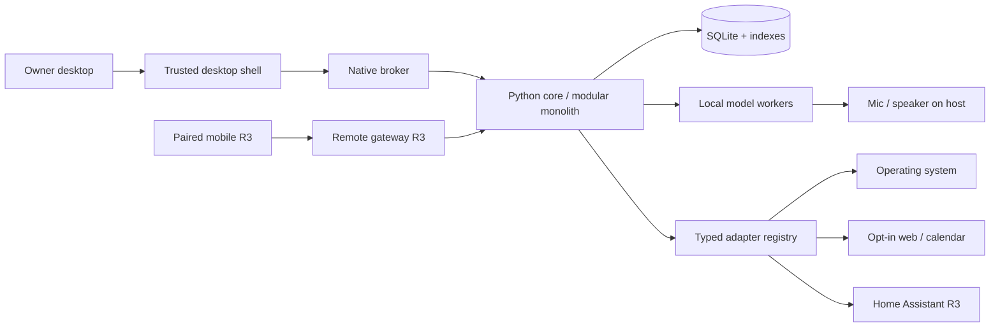
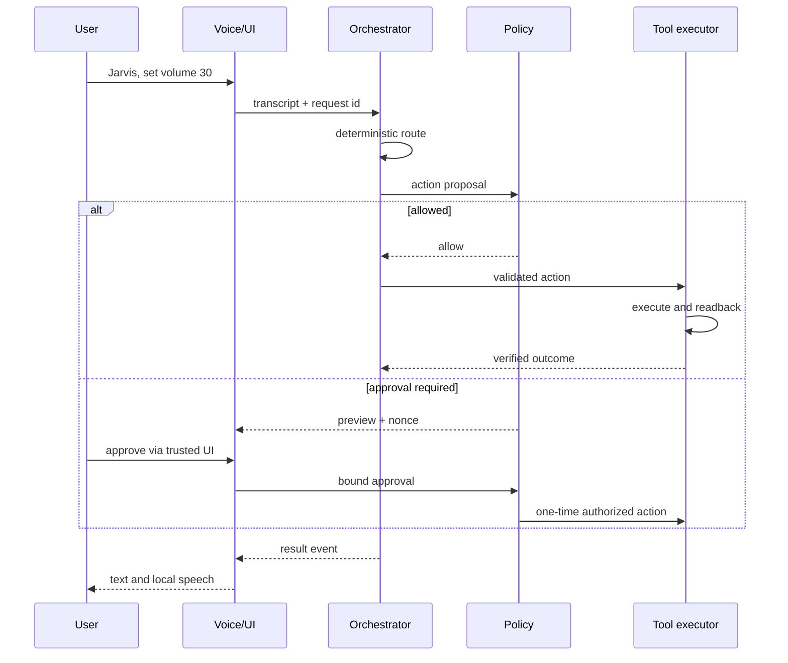

# Software Design Description (SDD)

**Project:** J.A.R.V.I.S. Local Personal Intelligence System  
**Version:** 0.2.0 | **Status:** Proposed baseline, belum diimplementasikan  
**Tanggal:** 25 November 2026 | **Pemilik persetujuan:** Product Owner

## 1. Architectural drivers
Local inference, low idle resource, Indonesian voice, controlled effects, offline-first, recoverable reminders, explicit data ownership. Stakeholders: owner (utility/privacy), developer (maintainability), QA (reproducibility), operator (recovery). Design views below address these concerns; inspired by ISO/IEC/IEEE 42010 (not certification).

## 2. Context and container views

Desktop UI uses Tauri 2 + React/TypeScript, no untrusted remote WebView. Rust broker launches Python core in current user's session, selects ephemeral loopback port and exchanges bootstrap token over inherited pipe. Core binds 127.0.0.1 only, verifies broker token and no CORS. UI gets typed IPC calls, not core token. Remote gateway has separate listener and scoped auth; never proxies arbitrary core endpoints. Core owns DB; no adapter receives direct write credentials. Workers isolated in child processes for fault/resource control; no container orchestration, Redis, Kafka, or mandatory microservices.

## 3. Logical components and ownership
| Module | Responsibility | Inputs / outputs | Failure handling |
|---|---|---|---|
| Voice manager | Wake/VAD, PTT, capture, STT, playback | Frames → transcript; text → PCM | Text fallback, close stream on lock/mute |
| Session/context | Request lifecycle, language, turn history | Context budget + identity | Expire on session close; no implicit long-term save |
| Intent router | Deterministic parser, clarification, local LLM fallback | Intent + slots or clarification | Unknown action never coerced into execution |
| Planner | Bounded structured plan | Typed list ≤5 actions | Schema failure ≤2 retries, deadline 60s |
| Policy engine | Evaluate role, channel, risk, grants, state | allow/deny/approval | Fail closed; no model discretion |
| Tool executor | Idempotency, timeout, preconditions, verify, compensate | Action result + audit | Reconcile uncertain external effects |
| Scheduler | Persisted jobs, leases, delivery dedup, missed | Due UTC jobs | Reclaim lease; reconcile non-idempotent effect |
| Resource manager | Worker lifecycle, CPU/GPU admission | Worker budget, priority | Unload model, smaller fallback, direct mode |
| Memory | Consent, CRUD, TTL, provenance | Facts and retrieval context | Delete invalidates indexes/cache |
| Knowledge | Safe extract, FTS, optional embeddings | Chunks and citations | Parser quarantine, stale index invalidation |
| Personal | Tasks, calendar, expenses, habits | Domain CRUD and deterministic aggregates | Input validation, transactional writes |
| Adapters | Windows UIA, OS APIs, network, IoT, camera | Typed result/error | Timeouts, backoff read-only, unavailable |
| Audit/health | Redacted logs, metrics, readiness | Correlation and outcome | Local bounded logs; degraded state visible |

Dependency rule: domain models + policies do not import UI, LLM, or OS implementation. Application services depend on port interfaces; infrastructure implements them. Only executor invokes effectful adapters. Data from LLM/web/doc/screen never enters trusted instruction channel. Scheduler reuses executor and policy. Native OS controls need user-session process; no SYSTEM service.

## 4. Request sequences

For LLM path retrieve scoped context → local infer → strict parse → policy evaluation per step. If ambiguity, request clarification before effects. For remote, authenticated gateway establishes device context, restricts capabilities, forwards typed use case; local approval cannot be forged by remote request. For proactive workflow, event evaluator debounces, enqueues persistent job, policy re-evaluates at run time, result delivered or marked missed. For read-only RAG, no tools in generation; cite valid chunk IDs only.

## 5. State machines
Request: RECEIVED → ROUTING → CLARIFYING / PLANNING → AWAITING_APPROVAL / EXECUTING → VERIFYING → COMPLETED / PARTIAL / FAILED / UNKNOWN / CANCELED. Cancellation stops unstarted steps; completed side effects remain and are reported. Approval expires/rejected → CANCELED, never auto-approved.
Job: SCHEDULED → LEASED → RUNNING → DELIVERED / MISSED / FAILED / UNKNOWN; retry only if read-only/idempotent and precondition still true. On lease expiry inspect state/outbox before retry. Worker: STOPPED → STARTING → READY → BUSY → READY → IDLE_UNLOAD; crashes → DEGRADED → restart with bounded backoff. Audio: MUTED / IDLE_WAKE / LISTENING / TRANSCRIBING / SPEAKING, lock forces MUTED; barge-in cancels playback before new turn.

## 6. Physical deployment
One Windows workstation, current-user privileges, desktop session required. SQLite/data on local disk; separate model cache and backup destination. App shell and core start on login only if enabled; worker processes launched lazily. No external runtime connections in offline mode. GPU heavy jobs serialized; foreground voice preempts background indexing at checkpoint. Host sleep cannot be overcome without separate always-on host; no Wake-on-LAN baseline. Linux/macOS are future ADRs.

## 7. Data consistency and failure boundaries
All DB writes through transactional application service, single writer queue, bounded readers and busy timeout. Persist intent/audit before effect, finalize verified state after effect. DB and OS external effect are not atomic: on crash mark UNKNOWN, reconcile by readback, never repeat non-idempotent action blindly. Notifications may be delivered twice across crash if OS lacks dedup; logical delivery record deduped, uncertainty exposed. No distributed exactly-once claim. Logs redact payloads; use IDs. See 07 and 08.

## 8. Extensibility and implementation layout
```
apps/desktop/               # Tauri shell, React UI
core/jarvis/domain/         # entities, policy, ports
core/jarvis/application/    # requests, workflows, scheduler
core/jarvis/adapters/       # OS, persistence, web, integrations
core/jarvis/workers/        # voice, inference, parsing
core/jarvis/transport/      # authenticated local API, events
contracts/                  # JSON schemas, error catalogue
migrations/                 # numbered immutable SQL migrations
tests/{unit,integration,e2e,eval,security}/
docs/                       # this pack
```
New skills are declarative registered tools or reviewed adapters, not downloaded arbitrary scripts. MCP external adapters are deferred pending separate threat review; no arbitrary tool discovery or server install. Adapters implement validate, execute, verify, optional compensate. Contract version breaking changes require migration, tests and ADR. No implementation supplied here.

## 8. Flexible inference and cinematic presentation extension
Add Provider Registry (adapter lifecycle/capability metadata), Model Manager (manifest/role/profile, atomic config revisions), Selection Policy (task matching and consent), and Resource Governor (lease/admission for inference and rendering). These components sit behind Intent Router; see 06 §6. Native local adapters or separately approved private LAN endpoint never execute application tools themselves. Core stores active profile reference, not runtime-specific dependencies. Motion Controller consumes sequenced core events through existing authenticated broker; view state reducer and ephemeral audio envelope are separate from domain and safety logic. Renderer cannot change grants, approve from animation, or declare success. Governor publishes visual tier recommendations; UI honors Reduced Motion and pressure ceilings. R0 renderer benchmark and R1 motion component tests precede release. See 10 §§6–10.
