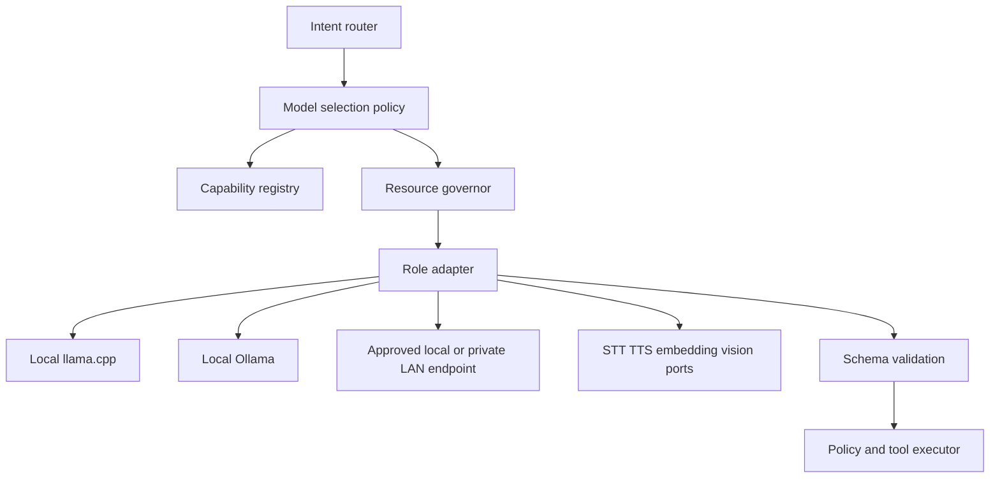

# AI, Voice Pipeline & Resource-Aware Inference

**Project:** J.A.R.V.I.S. Local Personal Intelligence System  
**Version:** 0.2.0 | **Status:** Proposed baseline, belum diimplementasikan  
**Tanggal:** 25 November 2026 | **Pemilik persetujuan:** Product Owner

## 1. Pipeline
Audio 16 kHz mono PCM candidate; frame length driven by wake/VAD model. Ring buffer ≤2 seconds pre-roll in RAM. Wake detection always-on only when enabled and unlocked; PTT fallback. VAD starts capture and detects silence; max utterance 30s, idle timeout 5s configurable. STT CPU int8; normalize punctuation and number/date slots without changing user meaning. Route deterministic exact intents first. LLM fallback uses structured JSON for tool proposal and plain text for chat, never execution privileges. Speech generated in short sentence chunks; cancel clears buffer. Acoustic echo handling and suppress wake during playback unless validated barge-in path; PTT interruption always works. No silent microphone recording on lock.

## 2. Model candidates and selection
| Role | Candidate | Baseline decision / evaluation |
|---|---|---|
| Router | regex/grammar + app aliases | no model needed for supported deterministic commands |
| LLM lightweight | Qwen3-1.7B GGUF Q4 | test Indonesian instruction following, schema correctness, latency |
| LLM higher quality | Qwen3-4B GGUF Q4 | optional partial GPU offload, short context; compare measured benefit |
| STT | faster-whisper multilingual tiny/base int8 CPU | choose based on ID WER and real-time factor |
| Wake | openWakeWord English phrase candidate | custom phrase support and license verify; PTT mandatory fallback |
| TTS | Piper id_ID / en voice | test naturalness, pronunciation, first audio time and license |
| Embedding | multilingual-e5-small CPU candidate | optional R2, compare FTS baseline and hybrid |
| Vision | OCR/UIA baseline; small VLM only after R3 feasibility | never assume full VLM fits 4 GB; unload LLM first if necessary |

Model manifest: id, upstream repo, exact revision, file SHA-256, byte size, format, license/voice model card, context length, backend version, measured RAM/VRAM, approved scope, approval date. Download manual/explicit; verify provenance, no trust_remote_code, no auto model plugins. Model versions not finalized. Qwen family selected as reproducible candidates, not assertion of best/latest.

## 3. Resource envelope (proposed targets, not measured)
Reference RTX 3050 4 GB VRAM / 24 GB RAM. CPU model not known. Target dedicated GPU process family ≤3.3 GiB (leave remainder for desktop), total working set ≤16 GB, idle unloaded ≤1 GB, idle CPU ≤3%. Model weights alone do not represent peak VRAM; KV cache, activations, runtime, display usage matter. Q4 4B may fail at given context; choose GPU layers by measured free memory and keep 2–4k context baseline. CPU STT/TTS and embeddings avoid competition. Only one heavy model lease; index worker nice/low priority and pause during foreground voice. Load LLM lazily; warm retention 120s candidate, unload under pressure. No mandatory model resident at idle. If GPU free memory insufficient, reduce context/GPU layers, CPU fallback, smaller model, or direct-mode; never auto-cloud. If RAM pressure, stop indexing and decline large analysis.

## 4. Prompt/context policy
Budget at 4096 context initial candidate: 700 system/policy guidance, 600 recent history, 1000 scoped retrieved evidence, 600 tool schema, 400 user input, 796 output/overhead; measure actual tokenizer and adjust; trim evidence/history first, never remove essential safety contract. Context exceeding budget triggers chunked summarization with source provenance or user narrowing. Route tool proposal with constrained schema, temperature low, max output 512 tokens; two repair attempts total and 60s LLM deadline. Thinking/reasoning output disabled where model supports suitable non-thinking mode; never expose scratch reasoning. No execution based on plain text. Retrieved docs in separate untrusted field; generation for RAG has tools disabled. User-visible answer cites source ids verified against retrieved evidence. Conversation history default session RAM only.

## 5. Latency and evaluation protocol
Capture timestamps wake_detected, speech_end, stt_done, route_done, llm_first_token, plan_validated, tool_done, tts_first_frame, playback_start. Measure direct and model warm separately, cold start separately, text separately, tool duration separately; report p50/p95, throughput, timeout rate, CPU/GPU and peak RAM. Target p95 end-of-speech→first audio ≤4s direct, ≤12s warm simple LLM; cold startup report and UX progress, no fixed claim. STT WER = (substitutions+deletions+insertions)/reference words; evaluate Indonesia accent/noise and code switching; false wake per non-command hour, false reject per true wake attempt. Evaluate wake in music/TV and playback interference. Use ≥200 STT utterances, ≥100 wake attempts, ≥20h negative audio, consented/synthetic or licensed samples; report confidence intervals and failures. Compare LLM on same ≥100 mixed intents and ≥100 adversarial schema cases. Safety violations disqualify regardless of speed. Model selection score: task correctness 35%, latency 25%, peak resources 20%, Indonesian quality 15%, maintainability 5%; licenses/safety are gates. No tests executed in document creation.

## 6. Provider abstraction and profile runtime (normative design extension)
Provider adapters implement role-specific contracts instead of coupling the core to model names. Local llama.cpp and Ollama are initial local LLM adapter candidates; generic local OpenAI-compatible endpoint only after contract test, never assume identical API semantics. Optional private LAN R2 is a separate trust zone. STT, TTS, wake/VAD, embeddings and VLM use independent ports; feature availability per role. No model adapter has tools/OS privileges; policy executor remains sole effect boundary. Disable built-in provider tool execution and external MCP/agent features.

| Port | Minimum operations / semantics |
|---|---|
| Provider lifecycle | discover, probe, list_models, capabilities, prepare, health, cancel, release; external-owned servers never killed by JARVIS |
| LLM | generate/stream normalized token, final, usage_if_known, error events; structured_output feature negotiated; deadline and max output enforced |
| STT/TTS | transcribe/stream segments, synthesize PCM frames, cancel, supported language/voice discovery |
| Embedding | embed batch, dimension, normalization, embedding_space_id and version; isolated index per space |
| Vision | analyze scoped image, image limits, supported role; OCR fallback; never imply camera permission |

Provider record fields: provider_id, adapter_kind/version, trust_zone (device/private_lan), endpoint ref, credential_ref (vault), lifecycle_owner, enabled, capabilities, last_probe_at, error_code. Model manifest extends existing manifest with role, tokenizer/template compatibility, context and modality limits, tool/schema support, measured profiles, embedding_space_id. Profile stores role→provider/model, context, output cap, temperature, thinking mode if supported, GPU layers/CPU threads if supported, keep_warm, max concurrency, fallback allowlist and trust zone. Persist no secrets in model/profile JSON. Capability probe runs controlled fixture; unrecognized feature means unsupported. Loopback endpoint validated and bound; never arbitrary URL fetch; private LAN opt-in requires pinned identity/trusted TLS, authentication, destination allowlist and per-data scope consent. No silent fallback across trust zones or to public API.

Selection algorithm: (1) deterministic route before model selection; (2) resolve user-pinned profile or adaptive role; (3) filter approved models by capabilities, language, trust, consent and health; (4) estimate/reserve resources from measured high-water mark + current free memory, context/KV headroom; (5) choose fastest acceptable candidate according to task and profile; (6) stream bounded request and validate structured output; (7) release lease and record redacted latency/resource result. Unknown model capabilities require validation first. Fallback on pre-effect load/OOM/timeout to approved same-zone smaller model or CPU; never replay executed action. If model fails after partial stream, label incomplete; if tool effect unknown, reconcile. Adaptive routing uses local metrics, not unconstrained LLM discretion. Eco/Performance/Balanced/Quality/Adaptive/Custom modes defined in PRD. AI and UI quality are independently selectable; governor coordinates actual resource grants.

Switch transaction: validate new profile and manifest → stage pending config → drain request or explicit cancel → release old worker lease → load/probe candidate → atomically commit active revision → invalidate model-specific KV/session cache → emit profile.changed. On failure restore previous known-good profile or direct mode, emit reason; do not lose memory/reminders. No simultaneous heavy workers to achieve zero downtime on 4GB reference GPU. Provider process external to JARVIS may reserve resources independently; probe, respect capacity and refuse admission if unknown/unavailable. Switching STT/TTS waits for audio turn end or explicit cancellation; embedding switching builds new index generation in background, then atomic pointer swap; FTS remains usable. Manual benchmarking requires consent, bounded workload, stop, no private prompts by default. Record model/version, adapter, exact settings, warm/cold, corpus ID, latency, quality, peak memory, failures, and concurrent workload. R0 compare two local adapters; R1 show same canonical contract, failure handling, and model-switch usability. Models are replaceable candidates, not a promise that every family fits hardware.
