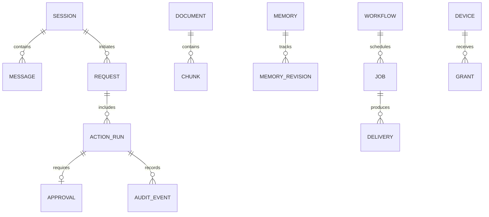

# Data Architecture, Database & Knowledge Design

**Project:** J.A.R.V.I.S. Local Personal Intelligence System  
**Version:** 0.2.0 | **Status:** Proposed baseline, belum diimplementasikan  
**Tanggal:** 25 November 2026 | **Pemilik persetujuan:** Product Owner

## 1. Storage model
SQLite local DB (WAL, foreign_keys ON on every connection, synchronous FULL for critical writes, busy timeout, single write queue). FTS5 search; optional vector index rebuilt from approved chunks. Model cache separate. DB in per-user OS data directory protected by ACL, OS disk encryption recommended; secrets in OS credential store/DPAPI, not plaintext DB. SQLite itself is not encrypted by default; evaluate SQLCipher if app-level encryption required. Backups encrypted with authenticated encryption and user-controlled key recovery. No shared network filesystem.

## 2. Logical schema (proposed)
All PKs UUID/ULID text; timestamps UTC ISO 8601 normalized or epoch integer (choose one physical convention in migration ADR), timezone IANA separately. Revision integer increments on mutation. Every enum constrained; FKs indexed; soft delete only where necessary and deletion ledger records IDs not content. No raw media fields.

| Entity | Key columns and constraints |
|---|---|
| settings | key PK, JSON value schema, revision, updated_at |
| session | id, channel, started_at, expires_at, ended_at; local or device actor |
| message | id, session_id FK, role enum, content, expires_at; absent when retention off |
| request | id, actor_ref, channel, state, created_at, deadline_at, correlation_id unique; no transcript by default |
| action_run | id, request_id FK, tool_id/version, canonical_args_hash, state, idempotency_key unique, attempt_count, outcome_code, started/finished_at; minimal redacted args only |
| approval | id, action_run_id unique FK, nonce_hash unique, bound_hash, actor_ref, session_ref, expiry, consumed_at, state |
| grant | id, subject_type/id, capability, scope_json, expires_at, revoked_at, revision |
| audit_event | id, correlation_id, action_run_id nullable FK, actor, event_type, outcome, redacted_meta, timestamp |
| memory | id, type enum, text, sensitivity, source_ref, status, revision, created_at, updated_at, expires_at nullable |
| memory_revision | id, memory_id FK cascade, revision, change reason, timestamp; no superseded sensitive text by default |
| deletion_ledger | entity_type, entity_id, deleted_at; unique entity_type+id, protected separately for restore replay |
| source_root | id, canonical_path unique, scope, enabled, revision |
| document | id, root_id FK, relative_path, sha256, size, mtime, mime, index_state, source_revision; unique root+path |
| chunk | id, document_id FK cascade, ordinal, locator_json, text, token_count, source_revision; unique doc+revision+ordinal |
| chunk_fts | FTS5 virtual table synchronized with chunk insert/update/delete in transaction |
| embedding | chunk_id FK cascade, model_id, dimension, vector_blob; unique chunk+model |
| workflow | id, name, trigger_json, steps_json, enabled, revision, next_due_at |
| job | id, workflow_id nullable FK, reminder_id nullable FK, due_at, state, lease_until, attempt, idempotency_key unique, payload_min, revision |
| delivery | id, job_id FK, channel, status, dedup_key unique, delivered_at |
| reminder | id, title, due_at, timezone, recurrence_json, state, revision |
| task | id, title, due_at nullable, status, completed_at, revision |
| calendar_event | id, title, start_at, end_at, timezone, source enum, external_ref nullable, revision; end > start |
| expense | id, amount_minor >0, currency ISO code, kind expense/refund, category, occurred_at, notes optional, revision |
| habit_log | id, habit_id or name, local_date, timezone, value, unit, revision |
| device | id, public_key/fingerprint, label, paired_at, expires_at, revoked_at; credential secrets in vault |
| model_manifest | id, revision, hash, path, license_ref, approved, metrics_json |

Indexes: job(state,due_at), job(lease_until), reminder(due_at,state), audit_event(timestamp,correlation_id), memory(status,expires_at), document(root_id,relative_path), expense(currency,occurred_at), calendar_event(start_at). Transactions: request/action ledger before effect; memory update + index invalidation; document version swap + FTS update; reminder + due job upsert; approval consume + action transition atomic.

## 3. Lifecycle and privacy defaults
| Data | Retention proposed | Delete behavior |
|---|---|---|
| Raw audio/screen/camera | RAM only, request lifetime; wake ring ≤2s | zero/release buffers best effort; no disk cache |
| Conversation | current session only by default; optional 30 days | clear message table/cache/index; no implicit permanent facts |
| Explicit memory | until user deletion/TTL | hard delete content + embeddings + cache, ledger tombstone |
| Documents/chunks | while root approved and file exists | remove chunks and vectors on revoke/delete |
| Personal records | until user deletion | delete content and derived cached aggregates |
| Redacted audit/requests | 30 days, configurable | prune; no secret/raw content |
| Backups | 7 daily + 4 weekly if enabled | encrypted; old snapshots may contain deleted content; prune by policy; replay deletion ledger on restore |
| Model files | until uninstall/eviction | remove cache on request |

Deletion guarantees apply to active application copies, not forensic secure erasure, OS swap or external backup copies. Explain this to user. Disable crash dumps or redact; OS disk encryption recommended. Backup key recovery is user responsibility; forgotten key may make backup unrecoverable. Export explicit R2 approval, file path restricted to approved destination.

## 4. Knowledge pipeline
1. Register folder and resolve canonical path; deny system dirs, secrets dirs, UNC, junction escape; limit per file 25 MiB, initial corpus 1000 docs, configurable after benchmark. No macros/active content. Parser worker no network, timeout 30s, archive decompression limit and safe ZIP inspection for DOCX.
2. Compute SHA-256, MIME sniff, incremental skip unchanged. Extract TXT/MD by line/heading; PDF page number (1-based), DOCX heading/paragraph (no fabricated page number). Scanned PDF marked OCR-required, deferred or opt-in local OCR later.
3. Chunk by section/paragraph ~300–500 tokens, overlap 50 candidate; store locator and source revision. Atomic index replacement. If root revoked or source changed, stale revision excluded even if reindex pending.
4. Lexical FTS BM25 top 20; optional multilingual embeddings top 20 cosine; reciprocal rank fusion k=60 candidate, dedup and pick top 4–6 within context. Scope filter applied before ranking or enforced on every candidate. Query budget and no external embedding service.
5. Generate with tools disabled. Answer cites only existing evidence IDs; UI expands path/locator and optional snippet. If citation invalid or evidence insufficient, abstain. No fake confidence or claim full file read when partial.

## 5. Backup/migrations
Versioned SQL migration table with checksums. Before migration create SQLite Online Backup API snapshot, integrity_check, encrypt and record manifest. Do not copy live DB alone in WAL mode. Restore to staging directory, verify checksum/schema/version, replay separate deletion ledger and reindex, then atomically switch while core stopped. Downgrade via compatible pre-migration backup, not destructive reverse DDL. Test RPO/RTO under fixture. Ledger loss means restore may resurrect deleted records; warn and require review before enabling retrieval.

## Model/profile persistence extension v0.2.0
Add model_providers (id, kind, adapter_version, trust_zone, endpoint_ref, credential_ref, capabilities_json, enabled, health_at), model_manifests (id, provider_id, role, revision, sha256, license_ref, capability_json, verified_at), ai_profiles (id, revision, mode, role_map_json, settings_json, fallback_allowlist_json), active_profile (singleton, profile_id, revision, previous_healthy_revision), model_benchmarks (id, manifest_id, adapter_version, settings_hash, corpus_id, metrics_json, created_at), and embedding_index_generations (id, embedding_space_id, status, index_ref). Foreign keys and uniqueness on revisions; transaction for active pointer. Secret refs only; no benchmark prompt by default; bounded retention, audit switching without raw data. UI settings store visual tier, reduced-motion override, audio visualization/earcon preferences; never persist raw audio envelope. Apply migration and rollback/restore tests before R1.
