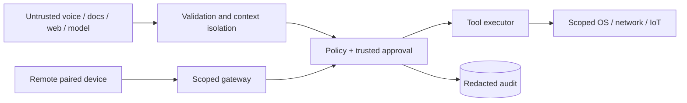

# Security Architecture, Threat Model & Privacy

**Project:** J.A.R.V.I.S. Local Personal Intelligence System  
**Version:** 0.2.0 | **Status:** Proposed baseline, belum diimplementasikan  
**Tanggal:** 25 November 2026 | **Pemilik persetujuan:** Product Owner

## 1. Assets and trust boundaries
Assets: private files, audio/screen, personal memories, tasks/expenses, device grants, OAuth tokens, local automation effects and audit. Trusted: owner interaction through native UI, signed app code, policy engine; untrusted: LLM output, webpage/doc contents, microphone speech, remote clients until paired, local model downloads, file paths and adapter responses. OS compromise/malware with same-user access is outside strong isolation guarantees; no claim that loopback auth protects from fully compromised host. No admin privileges.

## 2. Threat register
| Threat | Scenario | Mitigation | Verification |
|---|---|---|---|
| T01 Spoofing | recorded wake/voice, guest requests | wake not identity, locked host denies, R2 local UI approval | FR-ADM-02/03 |
| T02 Prompt injection | malicious webpage/PDF/screen tells model to send or delete | separate data from authority, tools disabled RAG, schema + policy allowlist | FR-KNO-05, FR-WEB-02 |
| T03 Excessive agency | model proposes arbitrary shell or repeated actions | hard ban, step cap, deadlines, no dynamic tools | FR-COR-02/03 |
| T04 Path traversal | symlink/junction/UNC escaping root | canonicalize, open handle validation, recheck before effects | FR-OS-03/04 |
| T05 SSRF | URL redirects to localhost/metadata/private hosts | scheme/host/IP allowlist public web; validate all resolutions and redirects; separate integration adapters | FR-WEB-02 |
| T06 Replay | reuse approval, stale resource revision | nonce one use, bound hash, expiry, session lock invalidation | FR-ADM-02 |
| T07 Info disclosure | secrets in prompts/logs/screen | local inference, scope filtering, redaction, denylist sensitive UI, no raw media | NFR-10 |
| T08 DoS | model OOM, queue flooding, decompression bomb | admission control, cap sizes, timeouts, bounded queue, worker isolation | NFR-02/12 |
| T09 Supply chain | compromised model/dependency/installer | pinned official releases, checksums, signature/SBOM, no remote code | NFR-09 |
| T10 Tampering | modify local settings or DB | ACL, least privilege, schema constraints, revision checks, backup; local owner compromise remains residual | NFR-04/05 |
| T11 Remote breach | stolen device/token or LAN exposure | TLS/VPN, explicit ACL, scoped expiring creds, revoke, rate limit, no direct core exposure | NFR-11 |
| T12 Unsafe actuation | device state stale, heater/door/alarm action | allowlist harmless devices, deny high-risk classes, verify readback | FR-IOT-03/04 |
| T13 Privacy persistence | deleted memory restored from backup | separate deletion ledger, retention, warning/restore review | FR-MEM-05 |
| T14 UI attack | XSS / malicious Markdown invokes native commands | sanitize render, no raw HTML, CSP, explicit Tauri capabilities and command validation | NFR-04 |
| T15 Repudiation | tool success claimed without evidence | correlation, before/after audit, explicit unknown state | FR-ADM-04, FR-OS-05 |

## 3. Controls and operational guardrails
- Local auth uses random per-launch secret ≥256 bits shared over inherited pipe, not command line/log. Restrict loopback host/port, reject invalid Origin, no CORS, no web content in privileged WebView. Tauri command permissions explicit, check every command in core. Workers use separate IPC/credentials and minimal access; parser process network blocked where OS sandbox feasible. Verify sandbox enforcement, not merely process separation.
- Secrets in OS vault; OAuth token revocation and minimal scopes; never include credential in model context, frontend state, export or log. Model runtime has no general web/network tool. Offline flag gates all external adapters, firewall test confirms. Installer/update signed, manual approval, no unsigned binary or model download execution.
- Approval trusted UI displays exact action, resource, effects, risk and expiry; bind to canonical args and resource revision; recheck at execution. File mutation needs no overwrite by default, no permanent delete; remote no R2. Stop/mute available from tray, lock cancels pending approvals and capture.
- Remote: separate gateway, VPN/private network and TLS, per-device credentials with expiry and rotation, explicit deny-all policy except required path/device, pairing local challenge, per-device 30 requests/min candidate, failed login backoff. No UPnP/router port forwarding. Host unreachable shown honestly. No remote screen/camera or arbitrary filesystem.
- Web: public scheme HTTP(S) only, prefer HTTPS, validate all A/AAAA resolved IP and connected address; reject private/loopback/link-local/reserved ranges, DNS rebinding, redirects outside policy, cap 2 MiB response and 10s deadline; no cookies/credentials from personal browser; strip active content. Explicit allowlisted local integrations use separate adapter and TLS/token policy, not web fetch.

## 4. Privacy and data flow
| Data flow | Default | Control |
|---|---|---|
| Mic → STT → local model | local RAM only | mute/indicator, no external AI by default; optional scoped private LAN LLM in R2 |
| Screenshot/camera → local OCR/vision | disabled until explicit request | scoped preview, no raw storage |
| Files → parser/index | disabled until folder grant | root revocation and deletion |
| User query → internet | disabled | opt-in, redact/preview private query, source evidence |
| Calendar/email → local cache | disabled | read-only OAuth, revoke, TTL |
| Audit → disk | redacted only | bounded retention, export approval |
| Data → backup | opt-in encrypted | user-held key, prune and restore review |

User can inspect, edit, export, delete and disable collection. No background face recognition or speaker biometrics in scope. A public distribution or shared-device use needs privacy/legal assessment before release. Standards references: OWASP LLM Top 10 and NIST AI RMF (18). Risk review per release. Zero unresolved critical/high security defects at gate; record accepted residual risks, no acceptance for hard-banned effects.

## Flexible AI and visual threat extension
Untrusted model/runtime supply chain, malicious local endpoints, provider built-in tool execution, LAN impersonation and prompt leakage, stale animation state and spoofed approval are additional threats. Verify signed upstream artifacts/hash/license, sandbox worker and deny model tools/MCP, authenticate/pin allowed LAN endpoint over TLS, explicit data-scope consent, no silent cross-zone fallback, enforce policy on all adapter results; audit profile revision and location. Renderer treats model output as text, sanitizes markdown/URLs, no remote WebView content, no HTML execution. Approval displayed only by trusted core-backed UI; decorative panels cannot mimic authorization. Mic/camera/mute/offline indicators reflect real state; envelope ephemeral, never logged. Regression: malicious model, fake schema, endpoint redirect, revoked LAN credential, provider attempts upload, stale event after cancel, injected markup and spoofed approval. LAN server retention and transport are trust assumptions, explicitly disclose before enable.
