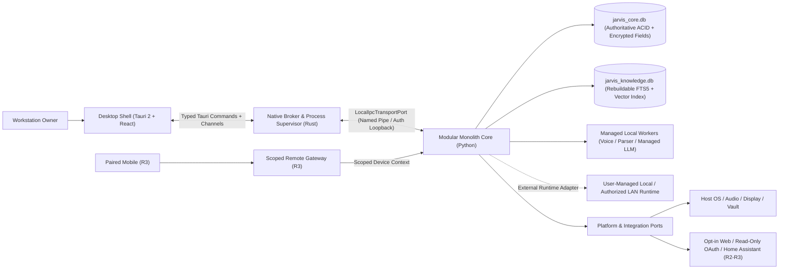
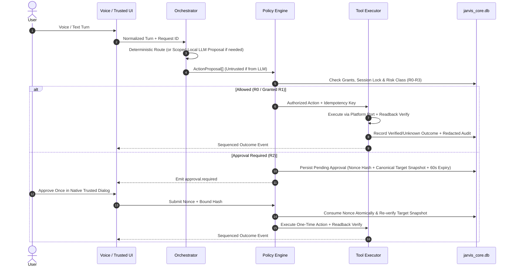

# Software Design Description (SDD)

**Project:** J.A.R.V.I.S. Local Personal Intelligence System  
**Version:** 0.2.1 | **Status:** Approved architectural baseline, belum diimplementasikan  
**Tanggal:** 26 November 2026 | **Pemilik persetujuan:** Product Owner

## 1. Architectural drivers dan prinsip utama
Penggerak arsitektur utama: inferensi lokal fleksibel lintas kelas perangkat keras, jejak resource idle rendah, keamanan berbasis *zero-trust tool proposal*, portabilitas instalasi tanpa hardcode mesin pengembang, ketahanan jadwal/pengingat, kepemilikan data transparan, dan antarmuka sinematik yang adaptif. Desain disusun berdasarkan sudut pandang konteks, kontainer, komponen logis, urutan interaksi, state machine, konsistensi data, dan abstraksi platform (mengacu konsep ISO/IEC/IEEE 42010).

## 2. Context and container views


- **Trusted Desktop Shell & Native Broker:** Tauri 2 + React/TypeScript tanpa memuat konten web jarak jauh ke dalam WebView berhak istimewa. Broker Rust menghasilkan rahasia sesi per peluncuran (`≥ 256-bit`), mengelola transport lokal melalui `LocalIpcTransportPort` (*Windows Named Pipe* ber-ACL SID pengguna aktif sebagai default, loopback `127.0.0.1` terautentikasi untuk harness pengujian), dan mengawasi proses anak yang dikelola JARVIS melalui `ProcessSupervisorPort` (*Windows Job Object* `KILL_ON_JOB_CLOSE` + pemeriksaan PID yatim saat startup).
- **Modular Monolith Core + Isolated Workers:** Core memegang seluruh aturan domain, kebijakan keamanan, penjadwalan, manajemen konfigurasi/storage/runtime, dan akses tulis ke `jarvis_core.db`. Komputasi berat atau pemrosesan input tak tepercaya (audio/STT/TTS, ekstraksi dokumen, inferensi model lokal yang dikelola JARVIS) dijalankan pada proses anak terisolasi agar kegagalan C++/GPU atau timeout parser tidak menjatuhkan proses inti. Tidak digunakan microservices terdistribusi, Docker wajib, Redis, atau Kafka.

## 3. Logical components, Four Foundations & platform abstraction ports
Arsitektur dibagi menjadi empat fondasi kohesif yang berkomunikasi hanya melalui kontrak antarmuka publik bertipe (*ports*):

| Foundation | Modul utama | Tanggung jawab | Penanganan kegagalan |
|---|---|---|---|
| **F1 Intelligence Core** | `IntentRouter`, `LocaleNormalizer`, `BoundedPlanner`, `ProviderRegistry`, `ModelManager`, `MemoryService`, `KnowledgeService`, `PersonalService` | Routing deterministik, normalisasi bahasa/zona waktu dinamis, rencana terstruktur `≤ 5` langkah, manajemen manifest/profil AI, memori eksplisit, dan hybrid RAG | Fallback ke *Direct Mode* bila model gagal/absen; abstensi saat bukti RAG kurang |
| **F2 Voice Engine** | `AudioSessionManager`, `WakeVadPipeline`, `SttAdapter`, `TtsAdapter`, `EchoGuard` | Ring buffer RAM `≤ 2s`, deteksi hotplug perangkat audio, wake/PTT, STT/TTS lokal, barge-in adaptif, pengiriman envelope amplitudo sementara | Tutup stream saat *mute/lock/suspend*; alihkan ke input/output teks bila perangkat audio gagal |
| **F3 Cinematic Experience** | `VisualStateReducer`, `AdaptiveRenderEngine`, `HudController`, `OnboardingWizard`, `ManagementViews` | Koreografi 12 state berbasis nomor urut event (`seq`), pengaturan target FPS (`Auto/30/60/120/Native`), 4 tier kualitas visual, dialog persetujuan `<dialog>` | Abaikan event usang; turunkan tier visual saat tekanan resource; hentikan loop saat jendela tersembunyi |
| **F4 Execution, Security & System** | `PolicyEngine`, `ApprovalManager`, `ToolExecutor`, `Scheduler`, `CapabilityDiscovery`, `ConfigRecommendationEngine`, `StorageManager`, `RuntimeSupervisor`, `LicenseInventory`, `AuditBackupService` | Evaluasi izin `R0`–`R3`, nonce/hash `R2`, verifikasi readback, penjadwalan UTC persisten, deteksi hardware, manajemen 11 lokasi storage, kepemilikan runtime, audit & backup terenkripsi | *Fail-closed* pada policy; status `unknown` bila verifikasi gantung; *rollback* atomik pada gagal switch/migrasi |

### Sembilan Port Abstraksi Platform (`DEC-023`)
Agar domain inti tetap bebas dari ketergantungan langsung pada API Windows dan siap diperluas di masa depan:
1. `LocalIpcTransportPort` (Named Pipe Windows / loopback; ekstensi masa depan Unix Domain Socket).
2. `ProcessSupervisorPort` (Windows Job Object + watchdog; dibedakan tegas antara `managed_local` dan `external_local`).
3. `SecretVaultAndCryptoPort` (Windows Credential Manager + DPAPI local key wrapping + `Argon2id/AES-256-GCM` portabel lintas perangkat).
4. `DesktopAutomationPort` (Win32 process/AUMID + CoreAudio volume + UI Automation).
5. `AudioDevicePort` (enumerasi perangkat, notifikasi hotplug, deteksi form-factor headphone vs speaker).
6. `FilesystemSafetyPort` (validasi jenis filesystem lokal vs jaringan, resolusi handle kanonik anti-*TOCTOU*, pemeriksaan reparse point/junction, kuota ruang bebas).
7. `HardwareDiscoveryPort` (CPU/ISA, RAM, enumerasi GPU multi-vendor & memori bebas via NVML/DXGI/OS counters, layar/Hz/DPI, status baterai/daya).
8. `NotificationPort` (notifikasi desktop/tray lokal dengan penghormatan *quiet hours*).
9. `StartupIntegrationPort` (pendaftaran *start-on-login* tingkat pengguna yang bersifat opt-in).

## 4. Request and configuration sequences


## 5. Core state machines
- **Request:** `RECEIVED → ROUTING → CLARIFYING / PLANNING → AWAITING_APPROVAL / EXECUTING → VERIFYING → COMPLETED / PARTIAL / FAILED / UNKNOWN / CANCELED`. Pembatalan menghentikan langkah yang belum dimulai; persetujuan kedaluwarsa atau ditolak selalu berakhir di `CANCELED`.
- **Scheduled Job:** `SCHEDULED → LEASED → RUNNING → DELIVERED / MISSED / FAILED / UNKNOWN`. *Retry* otomatis hanya untuk operasi baca atau terbukti idempoten (`maks 2` dengan jitter); saat bangun dari *sleep*, rekonsiliasi menandai jadwal terlewat sebagai `MISSED` atau mengirimkan sesuai kebijakan *quiet hours*.
- **Runtime Lifecycle (`DEC-020`):** Untuk `managed_local`: `STOPPED → STARTING → PROBING → READY → BUSY → IDLE_UNLOAD` (dan `DEGRADED → BACKOFF_RESTART` saat gagal). Untuk `external_local` dan `authorized_lan`: `DISCONNECTED → PROBING → AVAILABLE → BUSY / UNAVAILABLE` — JARVIS hanya memantau kesehatan dan melepaskan sewa logis tanpa pernah membunuh proses milik pengguna.
- **Storage Migration (`DEC-019`, `R2`):** `IDLE → PREFLIGHT_VALIDATED → WRITES_PAUSED → STAGING_COPY → VERIFYING_INTEGRITY → POINTER_COMMITTED → OLD_CLEANUP_PENDING → COMPLETED` (kegagalan sebelum `POINTER_COMMITTED` langsung memicu `ROLLED_BACK` dengan menghapus direktori `.staging` dan memulihkan operasi pada path asal).

## 6. Dual-SQLite consistency, encryption and failure boundaries (`DEC-007`)
SQLite dalam mode WAL **tidak** menjamin atomisitas transaksi dua-fase lintas dua berkas database terpisah. Oleh sebab itu, batas konsistensi didefinisikan secara eksplisit:
1. **Pembagian Tanggung Jawab:**
   - **`jarvis_core.db` (Authoritative System of Record):** Menyimpan konfigurasi, sesi, permintaan, persetujuan, izin (`grant`), `source_root`, memori, `deletion_ledger`, pengingat/job, domain personal, registri provider/model/profil, dan audit teredaksi. Menggunakan antrean penulis tunggal, `foreign_keys = ON`, `busy_timeout`, dan `synchronous = FULL` pada komit kritis.
   - **`jarvis_knowledge.db` (Derived & Rebuildable Index Store):** Menyimpan metadata ekstraksi dokumen, `chunk`, tabel virtual `chunk_fts` (FTS5), metadata generasi vektor, dan tabel vektor. Tidak pernah digabungkan menggunakan `ATTACH DATABASE` untuk transaksi tulis lintas-file.
2. **Invarian Konsistensi Lintas-DB & Pemulihan Pasca-Crash:**
   - Setiap pencabutan izin folder (`source_root`) atau penghapusan entitas dicatat terlebih dahulu secara atomik pada `jarvis_core.db` (termasuk `deletion_ledger`).
   - Setiap pembacaan pencarian pengetahuan wajib mengambil daftar `(root_id, revision)` aktif dan filter `deletion_ledger` dari `jarvis_core.db` sebelum mengeksekusi query ke `jarvis_knowledge.db`. Apabila terjadi crash setelah pencabutan di `jarvis_core.db` namun sebelum pembersihan di `jarvis_knowledge.db`, potongan data tersebut langsung terisolasi dari hasil pencarian dan dibersihkan secara idempoten oleh pekerja rekonsiliasi saat startup.
   - Bila `jarvis_knowledge.db` rusak atau hilang saat perpindahan perangkat, tidak ada data otoritatif pengguna yang hilang; indeks dibangun ulang secara deterministik dari folder sumber yang diizinkan.
3. **Koordinasi Enkripsi & Backup Lintas Perangkat:**
   - Kunci enkripsi data lokal (`DEK` 256-bit untuk kolom sensitif di `jarvis_core.db`) dibungkus pada mesin aktif melalui `SecretVaultAndCryptoPort` (DPAPI/OS Vault).
   - Saat membuat backup (`FR-ADM-05`/`08`), sistem menjeda antrean tulis `jarvis_core.db`, menyalin snapshot konsisten via *SQLite Online Backup API* beserta `deletion_ledger` dan manifest konfigurasi (tanpa rahasia mentah atau jalur lokal absolut), lalu mengenkripsi bundel menggunakan kunci turunan `Argon2id + AES-256-GCM` dari frasa pemulihan pengguna sehingga dapat dipulihkan dengan aman baik pada instalasi yang sama maupun komputer baru.

## 7. Target repository layout (`Convention + Platform Isolation`)
```text
JARVIS/
├── JARVIS-SDLC-v0.2.1/              # Dokumen spesifikasi kanonik
├── JARVIS-SDLC-Complete-v0.2.1.md   # Bundel otomatis (scripts/build_sdlc_complete.py)
├── planning/                        # Artefak audit, keputusan, dan rencana eksekusi R0
├── scripts/                         # Utilitas dokumentasi, verifikasi skema, dan CI
├── contracts/                       # JSON Schema berversi (config, tools, events, manifests, extensions)
├── apps/desktop/                    # Tauri 2 shell (src/ React + Adaptive Render; src-tauri/ Rust Broker)
├── core/
│   ├── migrations/{core,knowledge}/ # Migrasi SQL bernomor dengan verifikasi SHA-256
│   └── jarvis/
│       ├── domain/                  # Entitas murni, policy R0-R3, state machine, port interfaces (0 OS imports)
│       ├── application/             # Router, normalizer locale, orchestrator, config/storage/runtime managers
│       ├── providers/               # Adapter LLM, STT, TTS, wake, embedding, vision, web search
│       ├── platform/                # Implementasi port spesifik platform (windows/, mock_portable/)
│       ├── workers/                 # Entrypoint proses terisolasi (voice, parser)
│       └── transport/               # Endpoint lokal terautentikasi + sequenced event stream + remote gateway (R3)
└── tests/{unit,contract,integration,security,eval,e2e}/
```
Konfigurasi spesifik mesin pengembang (seperti pengalihan direktori cache build lokal) diletakkan pada berkas `.local` yang diabaikan oleh `.gitignore` dan tidak pernah dikomit ke logika produk.
