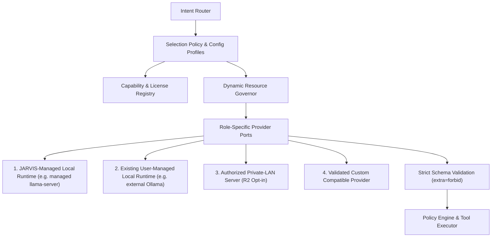

# AI, Voice Pipeline & Resource-Aware Runtime Architecture

**Project:** J.A.R.V.I.S. Local Personal Intelligence System  
**Version:** 0.2.1 | **Status:** Approved architectural baseline, belum diimplementasikan  
**Tanggal:** 26 November 2026 | **Pemilik persetujuan:** Product Owner

## 1. Adaptive voice & multimodal pipeline
1. **Capture & Wake/PTT:** Input audio (kandidat standar 16 kHz mono PCM, panjang frame mengikuti spesifikasi engine wake/VAD aktif) disimpan hanya dalam ring buffer RAM `≤ 2 detik`. Perangkat input/output tidak di-hardcode; `AudioDevicePort` memantau perangkat aktif dan menangani pergantian perangkat (*hotplug*). Wake word hanya berjalan bila diaktifkan pengguna dan sesi tidak terkunci; PTT dan input teks selalu siap sebagai jalur utama maupun cadangan.
2. **VAD, STT & Locale Normalization:** VAD memotong ucapan (`maks 30s` durasi, `5s` hening yang dapat diatur). STT memproses bahasa utama pilihan pengguna (default Bahasa Indonesia dengan kosakata campuran Inggris/nama aplikasi) secara lokal. Normalizer deterministik memetakan angka, mata uang, dan ungkapan waktu sesuai locale serta zona waktu IANA pengguna sebelum masuk ke router.
3. **Deterministic-First Routing & Bounded LLM Proposal:** Perintah yang cocok dengan tata bahasa deterministik langsung diteruskan ke Policy Engine (`0` panggilan LLM). Permintaan kompleks atau percakapan bebas menggunakan runtime LLM terpilih: untuk perencanaan tool digunakan output JSON terstruktur berbatas skema (`maks 5` langkah, tanpa eksekusi langsung); untuk jawaban pengetahuan (`RAG`) pemanggilan tool dimatikan sepenuhnya.
4. **TTS, Barge-In & Echo Protection:** Respons disintesis per kalimat pendek agar latensi audio pertama rendah. Kebijakan *barge-in* menyesuaikan perangkat output yang terdeteksi: pada headphone diizinkan interupsi suara penuh, sedangkan pada speaker terbuka diterapkan proteksi *self-trigger* (gating wake/VAD terhadap sinyal playback atau AEC yang lulus validasi `R0`) sembari tetap mengizinkan interupsi instan melalui PTT, keyboard, atau klik UI.

## 2. Kandidat model & seleksi adaptif lintas perangkat keras
Aplikasi tidak terikat pada satu keluarga model atau satu ukuran kuantisasi. Kandidat berikut menjadi titik awal evaluasi `R0` dan rekomendasi dinamis:

| Peran | Kandidat evaluasi awal (`R0`) | Kriteria evaluasi & adaptasi perangkat keras |
|---|---|---|
| Deterministic router | Aturan tata bahasa/regex + alias aplikasi terizinkan | Tidak membutuhkan model AI; selalu tersedia di semua perangkat |
| LLM kelas CPU-only / ringan | Kandidat GGUF Q4 0.5B–1.7B (mis. `Qwen3-1.7B` Q4) | Uji kepatuhan skema JSON, Bahasa Indonesia, dan kontrol *non-thinking* pada CPU-only maupun GPU kecil |
| LLM kelas GPU ~4 GB VRAM | Kandidat 1.7B–4B Q4 (mis. `Qwen3-1.7B` / `Qwen3-4B` dengan kuantisasi KV cache bila didukung) | Sesuaikan lapisan offload GPU dan panjang konteks terhadap VRAM bebas aktual yang terukur |
| LLM kelas GPU ≥12–24 GB / LAN | Kandidat model lokal lebih besar (mis. kelas 7B–14B+) yang diimpor pengguna | Diklasifikasikan `Unverified` hingga lulus *capability probe* pada perangkat pengguna |
| Wake word & VAD | `openWakeWord` (ONNX) dan `sherpa-onnx` keyword spotter + Silero VAD | Bandingkan *false wake*, *false reject*, kemudahan kustomisasi frasa, dan lisensi bobot model |
| STT | `faster-whisper` (`tiny`/`base`/`small` `int8` CPU atau akselerator kompatibel) & kandidat ONNX | Pilih per profil perangkat berdasarkan WER korpus uji dan faktor waktu-nyata (*RTF*) |
| TTS | `Piper` (`piper1-gpl` / `sherpa-onnx` VITS `id_ID` & `en`) + fallback suara offline OS (WinRT/SAPI) | Periksa ketersediaan riil voice pack pada OS pengguna dan tinjau *model card* suara secara terpisah |
| Embedding (`R2`) | Kandidat multibahasa ringan (mis. `multilingual-e5-small` ONNX) | Opsional mendampingi FTS5; terikat pada `embedding_space_id` dan generasi indeks terpisah |
| Vision (`R2`/`R3`) | UIA + OCR lokal sebagai baseline; VLM kecil opsional pada `R3` | VLM memerlukan kuota memori tersendiri dan pelepasan model LLM terlebih dahulu pada GPU terbatas |

Setiap manifest model menyimpan: `id`, repositori hulu, revisi tepat, ukuran byte, hash `SHA-256`, format, referensi lisensi kode & *model card*/dataset, batas konteks, dukungan output terstruktur, mekanisme kontrol *thinking* (`supports_thinking_control`), estimasi vs hasil ukur RAM/VRAM, dan status verifikasi. Tidak diizinkan memuat `trust_remote_code` atau kode eksekusi dalam berkas model.

## 3. Tata kelola resource dinamis (bukan batas statis satu mesin)
*Resource Governor* membaca kapasitas dan memori bebas aktual melalui `HardwareDiscoveryPort` (RAM tersedia, VRAM bebas via NVML/OS counters jika ada, beban CPU, serta status baterai/daya):
- **Anggaran Konfigurabel:** Pada *reference host* (GPU 4 GB / RAM ≥24 GB), target awal menjaga idle tanpa model `≤ 1 GB` RAM dan `≤ 3%` CPU, serta membatasi sewa GPU berat milik JARVIS agar menyisakan ruang aman bagi kompositor OS dan aplikasi lain (target referensi `≤ 3,3 GiB` saat memori bebas mencukupi, bukan asumsi bahwa seluruh 4 GB selalu kosong). Pada mesin CPU-only 8–16 GB atau workstation GPU 12–24 GB, batas dihitung proporsional terhadap kapasitas nyata dan preferensi pengguna.
- **Kebijakan Siklus Hidup, Baterai & Gaming:** Mendukung mode `always_loaded`, `on_demand`, dan `idle_unload` (TTL konfigurabel, kandidat default `120s`), pembatasan thread CPU, penyesuaian otomatis ke hemat daya saat baterai lemah, serta peredaman/penjedaan inferensi latar saat aplikasi layar penuh berat (seperti game) terdeteksi.
- **Degradasi Bertingkat:** Bila memori bebas saat akan memuat model lebih rendah dari kebutuhan model + KV cache, sistem secara berurutan menyesuaikan panjang konteks/lapisan offload yang diizinkan profil, beralih ke kandidat model lokal lebih ringan/CPU dalam zona kepercayaan yang sama, atau masuk ke *Direct Mode* dengan penjelasan jujur — tidak pernah beralih diam-diam ke cloud.

## 4. Kebijakan prompt, kontrol *thinking* & isolasi konteks
- **Kontrol Mode *Thinking* pada Model Penalaran Hibrida:** Model seperti keluarga `Qwen3` secara bawaan menghasilkan blok penalaran internal (`<think>...</think>`) yang dapat menghabiskan kuota token output dan menggagalkan penguraian JSON skema ketat. Oleh karena itu, adapter wajib menormalisasi penonaktifan *thinking* (mis. `enable_thinking=false` / `think=false` / direktif template terverifikasi saat *capability probe*) pada seluruh pemanggilan *tool proposal* serta pada profil cepat (`Eco`, `Performance`, `Balanced`), dan hanya mengaktifkan *thinking* berbatas kuota pada tugas analisis teks murni di profil `Quality`/`Custom` bila dipilih pengguna.
- **Anggaran Konteks Adaptif:** Pada jendela konteks kandidat awal `4096` token (disesuaikan per kapabilitas model dan anggaran memori): instruksi sistem & kontrak keamanan dijaga utuh di prefiks statis untuk efisiensi *KV prefix reuse*, diikuti skema tool relevan, bukti terambil yang dibungkus dalam penanda data tak tepercaya, riwayat singkat sesi, input pengguna, dan ruang token keluaran (`maks 512` token untuk proposal tool).

## 5. Abstraksi provider & empat mode kepemilikan runtime (`DEC-006`, `DEC-020`)

| Mode kepemilikan (`ownership_mode`) | Hak siklus hidup oleh JARVIS | Kewajiban keamanan & operasional |
|---|---|---|
| `managed_local` | JARVIS memprovisi (atas izin pengguna), menjalankan, memantau, melakukan *idle unload*, dan menghentikan proses saat keluar (di bawah `ProcessSupervisorPort`) | Verifikasi hash biner/model, ikat pada transport lokal terautentikasi, matikan fitur tool/WebUI bawaan runtime |
| `external_local` | Pengguna/OS mengelola proses (mis. daemon Ollama atau llama.cpp yang sudah berjalan); JARVIS hanya melakukan *probe*, mengirim permintaan, dan melepas sewa logis | **Dilarang** mematikan proses atau mengubah konfigurasi global saat JARVIS keluar; peringatkan bila endpoint lokal terbuka ke `0.0.0.0` |
| `authorized_lan` (`R2`) | Server di jaringan privat milik/tepercaya pengguna | Wajib pendaftaran eksplisit, verifikasi TLS/identitas, kredensial di Vault OS, persetujuan cakupan data, tanpa fallback otomatis lintas zona |
| `custom_compatible` | Endpoint tambahan melalui adapter tervalidasi | Wajib lulus suite uji *capability probe* (streaming, pembatalan, skema JSON, batas error) sebelum diizinkan aktif |

Pengguna akhir pada instalasi produksi **tidak pernah diwajibkan** memasang `llama.cpp` dan `Ollama` sekaligus; keduanya dievaluasi pada `R0` untuk membuktikan portabilitas kontrak `FR-AIP-01`, sementara pengguna cukup memilih satu runtime yang sesuai atau beroperasi dalam *Direct Mode*.

## 6. Transaksi pergantian profil/model & protokol evaluasi
- **Atomic Switch & Rollback:** Validasi profil & manifest → tahap konfigurasi tertunda → tunggu permintaan aktif selesai (*drain*) atau batalkan atas perintah pengguna → lepaskan sewa lama → muat & jalankan *capability/health probe* kandidat baru → komit revisi konfigurasi aktif secara atomik → bersihkan cache sesi spesifik model. Jika pemuatan atau *probe* gagal (mis. OOM atau driver tidak kompatibel), kembalikan ke revisi sehat sebelumnya atau *Direct Mode* tanpa mengulang aksi tool yang telah tereksekusi.
- **Protokol Evaluasi & Benchmark (`R0` / `FR-AIP-05`):** Rekam stempel waktu setiap tahap (`wake_detected`, `speech_end`, `stt_done`, `route_done`, `llm_first_token`, `plan_validated`, `tool_done`, `tts_first_frame`, `playback_start`), pisahkan kondisi *warm* vs *cold* serta per kelas perangkat keras, gunakan korpus *holdout* (`≥ 200` ucapan STT, `≥ 100` percobaan wake + `≥ 20 jam` audio negatif, `≥ 100` mixed intents, `≥ 100` kasus skema adversarial), dan jangan pernah menjalankan benchmark berat tanpa persetujuan eksplisit pengguna.
