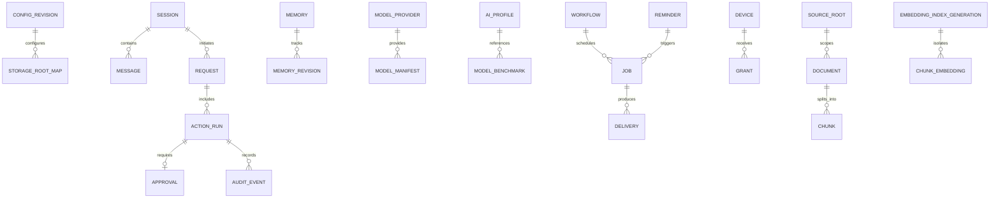

# Data Architecture, Dual-SQLite Consistency & Dynamic Storage Design

**Project:** J.A.R.V.I.S. Local Personal Intelligence System  
**Version:** 0.2.1 | **Status:** Approved architectural baseline, belum diimplementasikan  
**Tanggal:** 26 November 2026 | **Pemilik persetujuan:** Product Owner

## 1. Arsitektur penyimpanan Dual SQLite & manajemen 11 lokasi dinamis
JARVIS memisahkan penyimpanan relasional lokal menjadi dua database SQLite mode WAL dengan antrean penulis tunggal per database, `PRAGMA foreign_keys = ON` di setiap koneksi, dan `busy_timeout` terukur:
1. **`jarvis_core.db` (Authoritative Transactional Store):** Menyimpan seluruh data primer pengguna, izin, konfigurasi berversi, pengingat, memori, registri model/runtime, inventaris lisensi, `deletion_ledger`, dan jejak audit (`synchronous = FULL` untuk komit kritis). Kolom berlabel sensitif dienkripsi pada lapisan aplikasi (`AES-256-GCM`) menggunakan kunci yang dilindungi `SecretVaultAndCryptoPort` (DPAPI/OS Credential Vault pada mesin aktif).
2. **`jarvis_knowledge.db` (Derived & Rebuildable Index Store):** Menyimpan status ekstraksi dokumen, potongan teks (`chunk`), indeks leksikal `chunk_fts` (FTS5), metadata `embedding_index_generation`, dan tabel vektor (`synchronous = NORMAL`). Berkas ini murni indeks turunan yang dapat dibangun ulang secara deterministik dari folder dokumen sumber yang diizinkan.

### 1.1 Dynamic 11-Root Storage Manager (`DEC-003`, `DEC-019`)
Seluruh jalur menggunakan direktori aplikasi standar OS secara default tanpa hardcode huruf drive atau nama pengguna, dan setiap kategori berikut dapat diarahkan secara independen oleh pengguna melalui *Storage Manager*:
`app_data`, `models` (mendukung referensi ke *shared model directory* milik runtime lain tanpa menyalin ulang file multi-GB), `runtimes`, `core_db`, `knowledge_db`, `logs`, `temp`, `cache` (dengan kuota konfigurabel mis. `10 GB`, `25 GB`, `50 GB`, `Custom`, `Unlimited` dan penggusuran LRU khusus artefak sementara), `backups`, `imported_docs`, serta `extensions`. Penempatan `core_db` dan `knowledge_db` wajib divalidasi berada pada filesystem lokal (menolak *network filesystem* SMB/UNC/NFS/WebDAV karena keterbatasan penguncian *shared-memory* SQLite WAL).

## 2. Skema logis ternormalisasi (`v0.2.1`)
Seluruh kunci primer menggunakan teks UUID/ULID; stempel waktu disimpan seragam dalam UTC ISO-8601 ternormalisasi sementara zona waktu asal disimpan pada kolom IANA terpisah; setiap entitas yang dapat diubah memiliki integer `revision` untuk penguncian optimistik. Kontradiksi duplikasi tabel manifest dan pencampuran generasi vektor pada v0.2.0 telah disatukan di bawah ini.

### 2.1 Entitas pada `jarvis_core.db`
| Entitas | Kolom utama dan batasan integritas |
|---|---|
| `config_revision` | `revision` PK integer, `schema_version`, `config_json` (tanpa rahasia), `source` (`onboarding`/`user`/`rollback`), `is_active`, `previous_healthy_revision`, `created_at` |
| `storage_location` | `category` PK (`app_data`..`extensions`), `resolved_path`, `quota_bytes` nullable, `is_removable`, `filesystem_kind`, `status`, `updated_at` |
| `hardware_snapshot` | `id` PK, `os_info_json`, `cpu_json`, `ram_bytes`, `gpus_json`, `displays_json`, `audio_json`, `power_state`, `captured_at` |
| `session` | `id` PK, `channel`, `actor_ref`, `started_at`, `expires_at`, `ended_at` |
| `message` | `id` PK, `session_id` FK, `role`, `content_cipher_or_text`, `is_encrypted`, `expires_at` (kosong bila retensi riwayat mati) |
| `request` | `id` PK, `correlation_id` UNIQUE, `actor_ref`, `channel`, `state`, `created_at`, `deadline_at` |
| `action_run` | `id` PK, `request_id` FK, `tool_id`, `tool_version`, `canonical_args_hash`, `state`, `idempotency_key` UNIQUE, `attempt_count`, `outcome_code`, `verified`, `redacted_summary`, `started_at`, `finished_at` |
| `approval` | `id` PK, `action_run_id` UNIQUE FK, `nonce_hash` UNIQUE, `bound_hash`, `actor_ref`, `session_ref`, `expires_at`, `consumed_at`, `state` |
| `grant` | `id` PK, `subject_type`, `subject_id`, `capability`, `scope_json`, `expires_at`, `revoked_at`, `revision` |
| `audit_event` | `id` PK, `correlation_id`, `action_run_id` nullable FK, `actor`, `event_type`, `outcome`, `redacted_meta_json`, `timestamp` |
| `memory` | `id` PK, `kind`, `content`, `is_encrypted`, `sensitivity`, `source_ref`, `status` (`active`/`proposal`/`superseded`), `revision`, `created_at`, `updated_at`, `expires_at` nullable |
| `memory_revision` | `id` PK, `memory_id` FK CASCADE, `revision`, `change_reason`, `timestamp` (tanpa menyimpan salinan teks sensitif lama secara default) |
| `deletion_ledger` | `entity_type`, `entity_id`, `deleted_at`; `UNIQUE(entity_type, entity_id)` — dipertahankan untuk *replay* saat pemulihan backup |
| `source_root` | `id` PK, `canonical_path` UNIQUE, `scope_json`, `enabled`, `revision`, `revoked_at` nullable |
| `workflow` | `id` PK, `name`, `trigger_json`, `steps_json`, `enabled`, `revision`, `next_due_at` |
| `reminder` | `id` PK, `title`, `due_at_utc`, `timezone_iana`, `recurrence_json`, `state`, `revision` |
| `job` | `id` PK, `workflow_id` nullable FK, `reminder_id` nullable FK, `due_at_utc`, `state`, `lease_until`, `attempt`, `idempotency_key` UNIQUE, `payload_min_json`, `revision` |
| `delivery` | `id` PK, `job_id` FK, `channel`, `status`, `dedup_key` UNIQUE, `delivered_at` |
| `task` | `id` PK, `title`, `due_at_utc` nullable, `status`, `completed_at`, `revision` |
| `calendar_event` | `id` PK, `title`, `start_at_utc`, `end_at_utc` (`> start_at_utc`), `timezone_iana`, `source_kind`, `external_ref` nullable, `revision` |
| `expense` | `id` PK, `amount_minor` (`CHECK > 0`), `currency_iso`, `kind` (`expense`/`refund`), `category`, `occurred_at_utc`, `notes` nullable, `revision` |
| `habit_log` | `id` PK, `habit_key`, `local_date`, `timezone_iana`, `value`, `unit`, `revision` |
| `device` | `id` PK, `fingerprint`, `label`, `paired_at`, `expires_at`, `revoked_at` (rahasia sesi disimpan di OS Vault) |
| `model_provider` | `id` PK, `adapter_kind`, `adapter_version`, `ownership_mode` (`managed_local`/`external_local`/`authorized_lan`/`custom_compatible`), `trust_zone`, `endpoint_ref`, `credential_vault_ref` nullable, `capabilities_json`, `support_tier`, `enabled`, `last_probe_at`, `health_code` |
| `model_manifest` | `id` PK, `provider_id` FK, `role`, `family`, `revision`, `sha256`, `byte_size`, `storage_ref` nullable, `is_shared_external_file`, `format`, `license_spdx`, `model_card_ref`, `dataset_license_note`, `capability_json`, `resource_estimate_json`, `approval_state`, `verified_at` |
| `ai_profile` | `id` PK, `revision`, `mode` (`eco`/`performance`/`balanced`/`quality`/`adaptive`/`custom`), `role_bindings_json`, `runtime_knobs_json`, `resource_limits_json`, `fallback_allowlist_json`, `UNIQUE(id, revision)` |
| `active_ai_profile` | `singleton_id` PK (`= 1`), `profile_id`, `profile_revision`, `previous_healthy_profile_id`, `previous_healthy_revision`, `updated_at` |
| `model_benchmark` | `id` PK, `manifest_id` FK, `provider_id` FK, `hardware_snapshot_id` FK, `settings_hash`, `corpus_id`, `metrics_json`, `created_at` |
| `license_artifact` | `id` PK, `category` (11 kategori artefak), `name`, `version_or_rev`, `license_spdx`, `obligations_json`, `source_url`, `notice_text`, `verified_at` |
| `extension_package` | `id` PK, `version`, `sdk_version`, `sha256`, `capabilities_requested_json`, `enabled`, `installed_at` |

### 2.2 Entitas pada `jarvis_knowledge.db` (Indeks Turunan yang Dapat Dibangun Ulang)
| Entitas | Kolom utama dan isolasi generasi |
|---|---|
| `document` | `id` PK, `root_id` (merujuk logis `source_root.id`), `root_revision`, `relative_path`, `sha256`, `byte_size`, `mtime_ns`, `mime_type`, `index_state` (`indexed`/`ocr_required`/`unsupported`/`failed`), `source_revision`; `UNIQUE(root_id, relative_path)` |
| `chunk` | `id` PK, `document_id` FK CASCADE, `root_id`, `ordinal`, `locator_json` (halaman/heading), `text`, `token_count`, `source_revision`; `UNIQUE(document_id, source_revision, ordinal)` |
| `chunk_fts` | Tabel virtual FTS5 tersinkronisasi secara transaksional dengan penyisipan/pembaruan/penghapusan `chunk` |
| `embedding_index_generation` | `id` PK, `embedding_space_id` (`model_id + dim + norm`), `dimension`, `status` (`building`/`ready`/`active`/`superseded`/`failed`), `is_active_pointer`, `created_at`, `promoted_at` |
| `chunk_embedding` | `generation_id` FK CASCADE, `chunk_id` FK CASCADE, `vector_blob`; `PRIMARY KEY (generation_id, chunk_id)` (atau tabel virtual `sqlite-vec` per `generation_id`) |

## 3. Invarian konsistensi lintas-DB, siklus hidup privasi & pipeline RAG
1. **Batas Konsistensi Lintas-Database:** Tidak ada transaksi SQL lintas `jarvis_core.db` dan `jarvis_knowledge.db`. Setiap kueri RAG pertama-tama membaca himpunan `(root_id, revision)` yang berstatus `enabled = 1 AND revoked_at IS NULL` serta daftar `deletion_ledger` dari `jarvis_core.db`, kemudian menyaring kandidat dari `jarvis_knowledge.db` secara ketat terhadap daftar izin tersebut. Pembersihan fisik dokumen dari root yang dicabut dijalankan secara asinkron dan diulang secara idempoten saat startup bila sempat terputus oleh crash.
2. **Privasi & Retensi:** Frame audio/layar/kamera mentah hanya hidup di RAM selama siklus permintaan (`wake ring ≤ 2s`); riwayat percakapan sesi default hanya selama sesi aktif; penghapusan memori bersifat keras pada tabel aktif + pencatatan ID di `deletion_ledger`; audit teredaksi disimpan berbatas waktu/ukuran (kandidat default `30` hari / `100 MiB`). Dijelaskan secara transparan bahwa penghapusan aplikasi tidak menggantikan penghapusan forensik *swap* OS atau salinan backup eksternal milik pengguna.
3. **Pipeline Pengetahuan (`R2`):** Validasi jalur kanonik & jenis file (`maks 25 MiB`/file default konfigurabel) di dalam *parser worker* tanpa jaringan (`timeout 30s`, proteksi rasio kompresi ZIP pada DOCX) → ekstraksi teks dengan lokator nyata (halaman PDF 1-based, subjudul/paragraf DOCX tanpa mengarang nomor halaman; PDF gambar ditandai `ocr_required`) → *chunking* ~300–500 token → pengambilan hibrida BM25 + vektor pada `generation_id` yang berstatus `active` (`RRF`) → sintesis jawaban dengan `tools=[]` dan verifikasi ID sitasi.

## 4. Transaksi migrasi penyimpanan, migrasi skema & backup lintas perangkat
- **Migrasi Skema Database:** Tabel versi migrasi bernomor dengan verifikasi SHA-256. Sebelum migrasi `jarvis_core.db`, sistem membuat snapshot konsisten via *SQLite Online Backup API* dan menjalankan `PRAGMA integrity_check`.
- **Migrasi Lokasi Penyimpanan (`FR-SYS-04`):** (1) Preflight memverifikasi ruang bebas tujuan, hak tulis ACL, dan menolak share jaringan untuk DB WAL; (2) menjeda antrean tulis dan melepas file handle worker terkait; (3) menyalin ke subdirektori `.staging` pada lokasi baru; (4) memverifikasi hash SHA-256 / `PRAGMA integrity_check`; (5) memperbarui `storage_location` pada `config_revision` secara atomik; (6) bila gagal di tahap mana pun sebelum komit pointer, direktori `.staging` dibersihkan dan lokasi asal langsung aktif kembali tanpa kehilangan data.
- **Backup & Pemulihan Lintas Instalasi (`FR-ADM-08`):** Snapshot backup bundel terenkripsi menggunakan kunci turunan `Argon2id + AES-256-GCM` dari frasa pemulihan pengguna (tidak bergantung pada DPAPI mesin asal), menyertakan `deletion_ledger` yang diputar ulang sebelum indeks retrieval dibuka kembali, serta memetakan ulang jalur penyimpanan sesuai direktori yang dipilih pengguna pada mesin tujuan.
