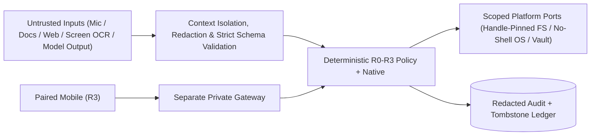

# Security Architecture, Threat Model & Privacy

**Project:** J.A.R.V.I.S. Local Personal Intelligence System  
**Version:** 0.2.1 | **Status:** Approved architectural baseline, belum diimplementasikan  
**Tanggal:** 26 November 2026 | **Pemilik persetujuan:** Product Owner

## 1. Assets, trust boundaries & batasan model ancaman
- **Aset yang dilindungi:** Dokumen dan file pribadi, aliran mikrofon/layar/kamera, memori dan catatan personal, konfigurasi izin, kredensial konektor/LAN, efek otomasi sistem operasi, integritas database/backup, serta jejak audit.
- **Batas kepercayaan (*Trust Boundaries*):**
  - *Tepercaya:* Interaksi pemilik langsung melalui *trusted native UI* pada sesi tidak terkunci, kode aplikasi terverifikasi, dan *Policy Engine* deterministik.
  - *Tidak tepercaya:* Ucapan mikrofon (wake word bukan autentikasi identitas), keluaran model LLM/VLM, isi dokumen/halaman web/teks OCR layar, respons runtime/ekstensi eksternal, jalur file mentah, serta klien jarak jauh sebelum dan di luar cakupan pemasangan (*pairing*).
- **Asumsi realistis tingkat host:** Aplikasi berjalan dengan hak pengguna standar (tanpa layanan `SYSTEM`/administrator). Arsitektur ini memitigasi injeksi prompt, penyalahgunaan tool, *confused deputy* antarproses/jaringan lokal, *TOCTOU* file, SSRF, dan kebocoran privasi, namun **tidak mengklaim isolasi tingkat kernel terhadap malware yang sudah berjalan dengan SID pengguna Windows yang sama**.

## 2. Threat register (`T01` – `T18`)
| ID | Ancaman | Skenario serangan / kegagalan | Kontrol mitigasi berlapis | Verifikasi |
|---|---|---|---|---|
| T01 | Voice spoofing / guest | Rekaman suara atau tamu di dekat mikrofon meminta aksi sensitif | Wake bukan identitas; sesi terkunci/*suspend* mematikan capture; `R2` wajib klik/keyboard di UI lokal | `TC-FR-ADM-02/03`, `TC-FR-VOI-06` |
| T02 | Indirect prompt injection | PDF, DOCX, web, atau teks layar menyisipkan perintah eksfiltrasi/mutasi | Pemisahan kanal data vs instruksi; `tools=[]` saat sintesis RAG; skema ketat + Policy Engine | `TC-FR-KNO-05`, `TC-FR-WEB-02` |
| T03 | Excessive model agency | Model mengusulkan shell, properti liar, atau loop langkah panjang | Larangan keras `R3`, `extra="forbid"`, batas `5` langkah, kontrol *non-thinking*, timeout `60s` | `TC-FR-COR-02/03` |
| T04 | Path traversal & TOCTOU | Symlink/junction mengarah ke luar root atau target ditukar saat jeda approval | Validasi berbasis handle (`FilesystemSafetyPort`), tolak reparse point keluar cakupan, ikat snapshot handle pada hash `R2`, larang timpa | `TC-FR-OS-03/04/06` |
| T05 | SSRF & DNS rebinding | URL pencarian/fetch dialihkan ke `127.0.0.1`, metadata IP, atau router privat | Validasi skema HTTPS/HTTP publik, periksa seluruh IP hasil resolusi DNS sebelum koneksi dan pada tiap redirect, batas `2 MiB`/`10s` | `TC-FR-WEB-02` |
| T06 | Approval replay | Penggunaan ulang nonce persetujuan atau persetujuan pada target yang telah berubah | `nonce_hash` unik sekali-pakai, `bound_hash` argumen+revisi, TTL `60s`, gugur saat *lock/suspend* | `TC-FR-ADM-02/03` |
| T07 | Sensitive info disclosure | Kredensial di layar/log/DB tanpa BitLocker bocor ke konteks model atau disk | Redaksi rahasia pra-OCR (`FR-SCR-04`), enkripsi kolom sensitif (`AES-256-GCM`), kredensial di OS Vault, tanpa simpan audio/layar mentah | `TC-FR-SCR-04`, `TC-NFR-10`, `TC-FR-ADM-08` |
| T08 | Resource DoS & zombie | Model OOM, bom kompresi DOCX, atau worker menggantung pasca-crash induk | *Resource Governor*, batas ukuran/rasio arsip, antrean terbatas, supervisor `Job Object` untuk proses `managed_local` (`NFR-15`) | `TC-NFR-02/12/15` |
| T09 | Software/model supply chain | Biner runtime, bobot model, atau ekstensi rusak/berbahaya atau berlisensi gelap | Verifikasi hash `SHA-256`, larang `trust_remote_code`, inventaris lisensi 11 kategori (`Unknown` diblokir), SBOM/`NOTICE` | `TC-FR-ADM-06`, `TC-FR-SYS-05/06` |
| T10 | Storage migration corruption | Gangguan daya/pencabutan drive eksternal saat memindahkan database/model | Preflight ruang & jenis FS lokal, jeda tulis, salin ke `.staging`, `integrity_check`, komit pointer atomik + rollback | `TC-FR-SYS-03/04` |
| T11 | Remote session compromise | Token perangkat mobile dicuri atau port terekspos ke publik | Gateway terpisah nonaktif default, wajib VPN/jaringan privat + TLS, cakupan sempit tanpa `R2`, *rate limit*, pencabutan seketika | `TC-FR-REM-01/02`, `TC-NFR-11` |
| T12 | Unsafe IoT actuation | Perintah ke kunci/alarm/pemanas atau status perangkat IoT basi | Blokir keras kelas keselamatan (`R3`), allowlist per entitas, readback segar atau status `unknown` | `TC-FR-IOT-02/03/04` |
| T13 | Deleted data resurrection | Pemulihan backup lama menghidupkan kembali memori yang sudah dihapus pengguna | `deletion_ledger` diputar ulang secara wajib saat *restore* sebelum indeks dibuka kembali | `TC-FR-MEM-05`, `TC-FR-ADM-08` |
| T14 | WebView XSS / IPC abuse | Markdown jahat mencoba mengeksekusi skrip atau memalsukan dialog persetujuan | Sanitasi ketat tanpa HTML mentah, CSP ketat, kapabilitas Tauri eksplisit, dialog `<dialog>` hanya dari state Core | `TC-NFR-04`, `TC-FR-UX-01` |
| T15 | Repudiation / false success | Klaim tindakan selesai padahal adapter gagal atau timeout | Pencatatan audit sebelum/sesudah aksi dengan `correlation_id` dan pembedaan tegas status `unknown` | `TC-FR-ADM-04`, `TC-FR-OS-05` |
| T16 | External runtime interference | JARVIS mematikan daemon Ollama milik pengguna atau terpapar tool bawaan provider | Pisahkan `external_local` (dilarang dibunuh tanpa izin) vs `managed_local`; matikan eksekusi tool/MCP bawaan provider | `TC-FR-AIP-08`, `TC-NFR-14` |
| T17 | Private LAN data leakage | Pengiriman prompt ke endpoint LAN salah atau fallback diam-diam dari lokal ke LAN | Pendaftaran eksplisit, verifikasi TLS/identitas, persetujuan cakupan data per jenis input, larang fallback lintas zona | `TC-FR-AIP-06` |
| T18 | Machine-config secret leak | Ekspor profil konfigurasi atau komit Git tidak sengaja menyertakan jalur pribadi/token | Pemisahan referensi Vault dari JSON konfigurasi, `.gitignore` ketat, dan pemeriksa otomatis bebas rahasia/jalur pribadi | `TC-FR-SYS-02`, `TC-NFR-04/16` |

## 3. Kontrol kriptografi, transport & privasi data
1. **Transport & Isolasi Lokal:** Rahasia autentikasi Core (`≥ 256-bit` acak kriptografis) dikirim melalui pipa terwarisi saat peluncuran proses anak, tidak pernah melalui argumen baris perintah atau variabel lingkungan global yang mudah dibaca proses lain. Implementasi Windows menggunakan *Named Pipe* dengan DACL yang dibatasi pada SID pengguna saat ini serta `PIPE_REJECT_REMOTE_CLIENTS`.
2. **Kredensial, Enkripsi Data & Backup Portabel:** Seluruh token API/OAuth/LAN/HA disimpan di brankas kredensial OS (`SecretVaultAndCryptoPort`). Kolom sensitif pada `jarvis_core.db` dienkripsi menggunakan `AES-256-GCM` dengan nonce unik 96-bit per penulisan. Snapshot backup dienkripsi secara autentik menggunakan kunci yang diturunkan melalui `Argon2id` dari frasa pemulihan pengguna sehingga aman disimpan di media cadangan maupun dipulihkan ke perangkat baru.
3. **Transparansi Aliran Data:** Seluruh konektor jaringan, tangkapan layar, kamera, folder pengetahuan, server LAN, dan akses mobile berada dalam kondisi **nonaktif secara default** dan setiap pengaktifannya memerlukan persetujuan eksplisit yang dapat dicabut kapan saja.
