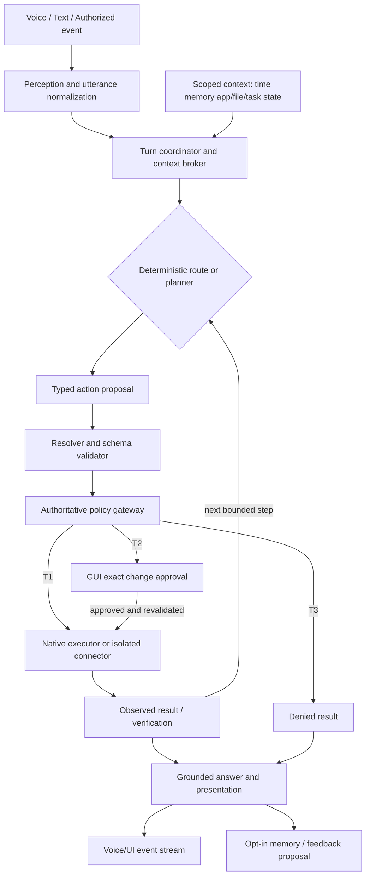

# J.A.R.V.I.S. — Independent Technical Review & Next-Generation Enhancement Plan

**Review ID:** JRV-IR-001 | **Version:** 1.0 | **Date:** 27 November 2026  
**Reviewed target:** JARVIS v0.2.1, Git base `455c6aa623fcdfe5f220dc3fda4ce2ae7336f3f5` plus reported dirty working tree  
**Proposed target:** v0.2.2 remediation baseline → JARVIS 2.0 capability roadmap (working name; not a release claim)  
**Audience:** Owner, AI coding agent, architect, QA engineer and security reviewer  
**Status:** Independent document/evidence review; implementation decisions proposed for owner approval.

## 0. Reading guide and evidence boundary

Review ini berangkat dari `as-built-review.zip` yang diberikan owner, berisi 34 dokumen bernomor 00–33, 11 diagram, bukti konfigurasi/RTM/inventory, satu screenshot aktual, dan salinan dokumen gabungan serta arsip internal. Dokumen sumber menyebut 19 modified tracked files dan 5 untracked files pada snapshot. Tidak ada checkout source code utuh, database, audio manusia, test execution logs lengkap, ataupun aplikasi Windows yang dapat dijalankan di lingkungan reviewer. Karena itu, path dan line number di bawah adalah referensi **yang dilaporkan** oleh audit asal; bukan klaim bahwa reviewer menjalankan source code secara langsung. Screenshot diperiksa langsung. Tidak ada model yang dilatih, kode yang diubah, instalasi atau benchmark yang dilakukan dalam review ini.

Notasi bukti: **[Axx]** = dokumen bernomor xx di arsip; **[E-RTM]** = `evidence/rtm-audit-summary.json`; **[E-TEST]** = `evidence/test-inventory-and-latest-results.md`; **[E-CFG]** = konfigurasi redacted; **[E-UI]** = `screenshots/actual-voice-command-center-defect-01.png`; **[Rxx]** = referensi eksternal di bagian akhir. Status temuan: REPORTED STATIC (ditelusuri audit asal, perlu reproduksi independen), OBSERVED ARTIFACT (terlihat di artefak), INFERENCE (interpretasi), PROPOSAL (desain/target baru). Semua angka target dalam roadmap adalah usulan engineering, bukan hasil ukur. Prioritas P0 = blocker keamanan/kebenaran fungsi; P1 = kemampuan inti; P2 = perluasan yang mengikuti fondasi; P3 = optimasi/ekosistem opsional. Safety gate tidak bisa dikompensasi skor fitur tinggi.

## 1. Executive verdict

**Pertahankan arsitektur modular monolith; lakukan refactoring terarah pada production composition root, authorization, event/voice runtime, dan intelligence orchestration. Jangan menulis ulang semuanya. Jangan menambah model berat atau MCP sebagai obat untuk kegagalan wiring.**

Saat ini aplikasi memiliki fondasi Tauri/React/Rust + Python/FastAPI, SQLite, local inference Qwen3 melalui llama.cpp, pipeline voice, skema memory, PolicyEngine dan ApprovalService. Namun, keberadaan modul tidak setara dengan kemampuan runtime. Audit asal menemukan fake adapter, service tidak dihubungkan, UI store sementara, dan deklarasi keberhasilan tanpa bukti side effect. Ini menjelaskan mengapa pengalaman owner terasa jauh dari JARVIS meski jumlah fitur dan test besar.

| Dimensi | Penilaian | Keputusan |
|---|---|---|
| Arsitektur | Struktur layer layak, wiring dan lifecycle lemah | Retain, refactor composition root |
| Voice | Ada jalur lokal aktif; VAD, routing, playback, device handling bermasalah | Satukan runtime, benchmark suara nyata |
| Computer control | Launch adapter nonaktif; catalog hanya tiga aplikasi | Bangun native catalog dan typed executor |
| File intelligence | FTS5 dokumen terbatas; bukan pencarian filesystem umum | Metadata first, content on demand |
| Memory & reasoning | Write-only personal facts, RAM history, planner single-shot | Context builder, recall, bounded tool loop |
| Autonomy | Scheduler tidak berjalan, workflow fake | Persistent jobs, result verification |
| Security | Ada policy domain namun bypass di beberapa jalur | Mandatory gateway, no-delete enforcement |
| UI/UX | Dark UI dan orbital visual, belum terpadu dengan state nyata | Event-driven HUD dan interaction-first design |
| Portability | Installer bergantung workspace, profil hardcoded | Clean-machine packaging, discovery |
| Training | Belum ada baseline akustik manusia | Jangan fine-tune sekarang |

**Immediate owner guidance:** sebelum hardening P0 selesai, hindari mengaktifkan cleanup/migration/backup overwrite, web fetching, remote gateway, extension execution dan file mutation pada data sungguhan. Gunakan workspace sintetis yang terisolasi untuk pengujian. Jangan mengaktifkan `allow_live_launch=True` sendirian tanpa revisi policy dan target resolver. Jangan melonggarkan semua permission hanya demi kenyamanan.

Target produk tetap local-first, private-first/open-source-ready, Windows-first tetapi core portable, interchangeable models/runtime, no mandatory paid cloud LLM, no coding agent. Kemampuan JARVIS seperti film adalah inspirasi interaksi dan luasnya tool, bukan janji AGI atau kendali komputer tanpa batas.

## 2. Kritik terhadap audit asal dan kualitas bukti

### 2.1 Rekonsiliasi RTM

Data JSON yang dibaca langsung berisi 98 requirement unik menurut inventaris: 82 FR dan 16 NFR. Hasil penghitungan ulang status per baris:

| Status | Count |
|---|---:|
| VERIFIED | 11 |
| IMPLEMENTED | 7 |
| PARTIAL | 51 |
| MOCK | 4 |
| BROKEN | 11 |
| NOT IMPLEMENTED | 8 |
| UNVERIFIED | 6 |
| Total | 98 |

Executive summary [A01] menyebut sekitar 21 verified, 22 implemented, 33 partial, 9 mock/stub, 7 broken, 6 not implemented plus lima NFR; tidak konsisten dengan [E-RTM]. Klaim sebelumnya 93/98 `VERIFIED_LOCAL_TIER_A` juga tidak boleh dibaca sebagai live E2E. Pakai distribusi JSON sebagai baseline dokumenter sementara, bukan persentase produk benar-benar selesai. Audit asal [A20] melaporkan maturity 1.35/5; rubric internal bukan standar industri. Re-score hanya setelah bukti aktual. [A14] menghitung kategori keamanan berbeda dari ringkasan (heading/ledger severity tidak sepenuhnya selaras); jangan menjumlahkan finding lintas ledger yang overlap. [A10] inventaris tabel juga perlu dihitung dari schema aktual, bukan jumlah prosa.

### 2.2 Test dan performance evidence

171 automated cases dilaporkan (150 pytest, 15 Vitest, 6 Cargo), tetapi [E-TEST] menghitung 83 fungsi statis (62/15/6); parametrization bisa menjelaskan perbedaan, bukan bukti semua berjalan pada snapshot yang sama. Tidak ada raw log full run yang membuktikan release terpasang. [A18] menunjukkan mock launch, fake notifications, test backup memasukkan `is_encrypted=0`, dan minim live UI E2E. Regression test wajib memeriksa side effect nyata di sandbox, bukan boolean `verified` dari fungsi yang diuji.

[A15] melaporkan R0 Qwen3-4B warm TTFT p50 53.1 ms, 52.7 tok/s; 1.7B CUDA 103.5 tok/s dan CPU 15.7 tok/s; faster-whisper-small CPU int8 WER 14.18% clean/17.38% noisy dan p50 1.945 s, tetapi audio **sintetis Piper**, bukan manusia. TTFA end-to-end 4.1–5.0 s adalah estimasi analitik, belum diukur. Satu sampel streaming TTFS 1.19 s tidak cukup untuk generalisasi. R0 GPU 4 GB; RAM dilaporkan 39.74 GB, berbeda dari informasi lama 24 GB. Gunakan hardware discovery aktual, tidak hardcode keduanya. Threshold wake dilaporkan 0.45 di [A03] dan 0.5 di [E-CFG]; rekonsiliasi active config saat reproduksi. Profil angka, sumber, N, driver, power mode, model hash, revision, context, dan audio device wajib dicatat.

### 2.3 Kritik screenshot

[E-UI] memperlihatkan transcript `Hey Jarvis, sekarangnya berapa?` dan response `What is the current time?`, bukan jawaban jam. Event Cursor `seq #0`, status voice standby, preview approval. Ini bukti nyata kegagalan pengalaman yang dilaporkan; tidak cukup untuk menyimpulkan waveform audio, aksen, atau komponen tepat yang menyebabkan error. Screenshot adalah satu panel, bukan bukti semua 12 tab atau kualitas animasi. Tampilan dark-cyan cukup konsisten, tetapi panel padat teks/telemetry, label developer seperti event cursor, dan kontrol voice berbentuk dashboard. Ini belum memperlihatkan HUD sinematik utuh. Jangan memalsukan data telemetry atau mengklaim screenshot membuktikan FPS.

### 2.4 Governance baru

Pisahkan `IMPLEMENTED_SOURCE`, `VERIFIED_UNIT`, `VERIFIED_INTEGRATION`, `VERIFIED_INSTALLED_E2E`, `VERIFIED_HARDWARE_CLASS`, `MOCK`, `PARTIAL`, `BLOCKED`, `NOT_IMPLEMENTED`. Setiap evidence record memuat commit + dirty diff hash, requirement, test id, config revision, fixture id, expected/actual, result, timestamp, environment. Status release diturunkan dari evidence, bukan ditulis manual. Freeze snapshot lokal setelah review rahasia; jangan commit personal data atau push tanpa izin. Simpan baseline SDLC v0.2.1, buat proposal v0.2.2, rekonsiliasi DEC-001..030, dan minta owner approve perubahan substantif. Tidak perlu menciptakan keputusan duplikat jika ADR lama bisa diperbarui.

## 3. Critical findings dan remediation ledger

| ID / Prioritas | Bukti audit asal | Kritik dan tindakan | Acceptance gate |
|---|---|---|---|
| IR-01 P0 | A14/A27, `app.py`, `storage_service.py:158–218,346–378` | Cleanup dapat menyasar folder yang bukan milik JARVIS; nonaktifkan jalur berbahaya, registry artifact ownership dan policy tunggal | Tidak ada user file terhapus pada negative suite dan junction tests |
| IR-02 P0 | A27/A10, `backup_service.py:101–104`, `app.py:2332` | Backup arbitrary overwrite; restore/migrate tidak punya boundary yang kuat | No-clobber, GUI approval, verified snapshot dan rollback |
| IR-03 P0 | A14/A27, `workflow_service.py:291`, `policy.py:315` | Approval self-echo/replay, scope tidak ditegakkan, direct routes bypass | Semua adapter mutation harus menggunakan capability authorization yang tervalidasi |
| IR-04 P0 | A14, `web_fetch.py:149–182` | SSRF TOCTOU dan unbounded download | Fetch disabled sampai network guard dan bounded streaming lulus |
| IR-05 P0 | A14/A04, `local_runtime_manager.py:154–196`, `live_voice_engine.py:168–212` | Binary/model integrity belum diverifikasi; executable auto discovery tidak boleh dianggap trust | Trusted source + pinned hash/signature policy sebelum load/exec |
| IR-06 P0 | A10, `backup_service.py:76–99`, `vault.py:32–40` | Backup tidak membawa recovery DEK; live WAL copy berisiko | Restore mesin lain dengan sensitive encrypted fixture benar-benar berhasil; fail closed jika key tidak tersedia |
| IR-07 P0 | A14/A27, `brokerClient.ts:273–278`, `app.py:1314` | Mic auto-grant screen, duplicate grants, client-trusted lock | Mic tidak memperluas permission; lock authoritative dan revoke efektif |
| IR-08 P0 | A11/A21, `commands.rs`, `lib.rs:46,95–98` | Raw path params, timeout global 10s vs turn 60s, tray stop membunuh Core | Typed IPC, cancel request terpisah dari exit, no silent truncation |
| IR-09 P0 | A29, `app.py:620`, `desktop_automation.py:13–39` | App launch disabled dan success palsu | Launch normal nyata tanpa prompt berulang; result jujur; forbidden target tetap ditolak |
| IR-10 P0 | A26/A03, `live_voice_engine.py:793–821,930`, `router.py:99` | Voice capture blocking, false VAD, punctuation rusak | No click-as-command, nonblocking capture, typed/spoken equivalence |
| IR-11 P0 | A16, `core_launcher.rs:130–192`, `tauri.conf.json` | Installer tidak standalone; kontrak/migrations tidak dibundle | Clean VM install/offline boot tanpa workspace/venv developer |
| IR-12 P0 | A07/A08, `workflow_service.py:351–359` | Workflow mengklaim verified tanpa menjalankan tool; fake notification | Mock dilarang di production, scheduler/notification verified |
| IR-13 P1 | A03/A06, `turn_orchestrator.py:276–281` | Personal facts tidak masuk prompt, session ephemeral | Recall berizin, provenance, restart continuity, correction |
| IR-14 P1 | A03, `router.py:429–460`, `turn_orchestrator.py:389–465` | Single-shot plan, observation tak kembali, schema repair/cancel tidak ada | Bounded orchestration dengan typed results dan follow-up |
| IR-15 P1 | A28/A06, `knowledge_service.py` | File search tidak ada; FTS5 saja, vec unused | Metadata index dan search/open yang tepat; hybrid bila ada nilai |
| IR-16 P1 | A13/A11, `App.tsx:595`, `brokerClient.ts:119–186` | UI hydration dan SSE tidak terhubung, client fake IDs | Real state, no phantom controls; event reconnect |
| IR-17 P1 | A15, `app.py:959–969`, `dual_db.py` | Blocking I/O pada event loop; full integrity tiap health | Cached light health + bounded workers, responsiveness measured |
| IR-18 P1 | A04/A12, `local_runtime_manager.py`, `ai_registry_service.py:283` | Hardcoded model ranking, profile binding loss, LAN invalid schema | Provider conformance, profile switch atomic, graceful fallback |
| IR-19 P1 | A03/A14, `screen_capture.py:16–55` | Title-only capture diberi label UIA, sensitive guard palsu | Honest capability, opt-in capture + privacy masking |
| IR-20 P2 | A30, `ecosystem_service.py:228–381` | Extension metadata only, sandbox absent | MCP opt-in, read-only first, trusted scopes enforced |
| IR-21 P2 | A31/A32 | Tidak ada human baseline, training pipeline | Eval first, opt-in feedback, model adaptation gated |
| IR-22 P1 release | A17, SBOM/voice assets | Lisensi transitif/model belum komplit | Inventory artifact, compliant distribution, release review |

Temuan IR-01..22 mengelompokkan overlapping defect, bukan menghitung 22 CVE baru. Detail tambahan: CORS/Host/chunked body cap, redaction traceback, unbounded KDF header, storage migration, profile revision, private LAN pairing, orphan tasks, app state/fake volumes, dependency pinning harus ditutup lewat backlog di bagian 13. Risk classification perlu dikonfirmasi pada threat model (private workstation vs remote attacker), tetapi jalur irreversible data loss tetap P0 tanpa memperhatikan deployment publik.

## 4. Target architecture: JARVIS intelligence loop



**Authority separation:** LLM suggests, planner coordinates, resolver resolves, PolicyEngine decides, executor enforces, observer verifies. Native tool/connector cannot self-report `verified` without evidence appropriate to operation. Event source and document/MCP result cannot grant authorization. No arbitrary shell, generic unrestricted click/type, or file-delete capability. A plain conversational turn with no tool need can bypass planning and answer directly; simple action uses deterministic route. Context building bounded by token/time budgets. Keep native Core functions independent from LLM availability.

**Composition root:** `core/jarvis/transport/app.py` should assemble concrete production adapters through one validated registry, not construct fakes inline. Every capability has state `ready/degraded/unavailable/experimental` and human-readable reason; production startup must refuse mock adapters marked live, or disable unavailable feature honestly. UI uses same capabilities snapshot. Test environment explicitly injects fakes, never via accidental defaults. `ToolDescriptor` fields: id, version, input/output JSON Schema, risk tier policy mapping, required scopes, origin, timeout, effect, idempotency, verification method. Do not present whole dynamic catalog to small LLM; preselect relevant tools with deterministic resolver/classifier + top-K. Capabilities advertise actual model tool calling support, structured output support, language/vision/stream support. For models without tools, deterministic routes and explicit JSON adapter only if validated.

**Contracts to implement or consolidate:** `TurnRequest`, `TranscriptFinal`, `ContextSnapshot`, `ActionProposal`, `ResolvedTarget`, `PolicyDecision`, `ApprovalChallenge`, `ExecutionReceipt`, `Observation`, `TurnEvent`, `TaskRun`, `ProviderCapability`, `FileSearchResult`. Example receipt:

```json
{"action_id":"uuid","tool":"os.app.launch","status":"SUCCEEDED","target_id":"app:spotify","verification":{"kind":"os_activation_ack","observed":true},"effect":"launch_accepted","correlation_id":"uuid","duration_ms":320}
```

This is a proposed shape, not a measured event. Distinguish `launch_accepted` from `window_ready` and `media_playing`. Nonverifiable operation → `ACCEPTED_UNVERIFIED`, not succeeded. State machine: CREATED → RESOLVING → AWAITING_APPROVAL/EXECUTING → VERIFYING → SUCCEEDED/FAILED/PARTIAL/CANCELLED/DENIED/EXPIRED. Each terminal result emits event once; idempotency key per mutating action; no retry uncertain effects until reconciled. Add bounded queue and cancellation deadlines; no external network in offline default. Use persisted outbox for critical events (approval/job/result), volatile sampled telemetry for animation only.

## 5. Authorization: capable without being dangerous

### 5.1 Owner policy proposal

| Tier | Examples | Behavior |
|---|---|---|
| T1 ordinary safe | launch installed ordinary app, find/open safe doc, list folder within scope, read permitted data, volume/media, time/status, task query | Auto-allow after initial capability/scope consent; no per-turn GUI popup |
| T2 mutation or sensitive | edit, create user file, rename/move (optional, explicit), external data transfer, persistent setting change, installation, memory sensitive capture, first-use screen/camera | GUI approval for exact operation; default deny; risk and content boundary |
| T3 hard prohibited | deletion/recycle of user file/folder, format, destructive overwrite/truncation, disable security, arbitrary shell, elevation and unrestricted OS/GUI automation | Deny regardless of model instruction or approval |

Routine application data creation (conversation state, approved reminders, audit) is not arbitrary user filesystem mutation. User-facing privacy management needs a separate owner-controlled UI for erasing JARVIS's own saved personal memories and indexes, not an assistant-executable delete tool. Clarify explicitly whether owner allows this UI exception; otherwise keep disabled until decision. Internal cache maintenance limited to verified JARVIS-generated artifacts, not arbitrary paths. File move changes source pathname and can resemble delete; require owner opt-in and no overwrite; if strict no-removal means no move, disable move altogether. File edit must permit intentional content changes only in approved diff; malicious truncation/destructive replacements remain forbidden. This reconciles edit permission with absolute delete restriction.

### 5.2 One policy gateway, not duplicated rules

Apply mandatory gateway to **all** native tools, REST endpoints, Tauri IPC, scheduler, workflow, future MCP, and GUI automation. No route should instantiate raw executor except a private capability-checked interface. Security tiers derived from actual action, not input text or server-supplied annotation; no substring blocking of benign questions about shell/deletion. Policy reads authoritative OS lock, user/session identity, target scope and capability revision. Grants keyed by unique subject/capability/scope; revoke atomically invalidates approvals and active jobs. Microphone consent never grants screen access. A process Job Object is lifecycle control, not sandbox.

GUI challenge: show human-readable operation, canonical target, read/write impact, external destination if any, preview/diff, backup and limitations. `Approve once` or `Deny`; keyboard focus default deny; expiry and cancellation. Challenge bound to canonical serialized request digest, user/session, scope, target file identity/version, planned output hash, expiry and single-use nonce. Approval decision produced by trusted UI interaction; not from voice, LLM, page content or client flags. Consume atomically, revalidate handle/canonical target and version immediately before execution; changed target/diff → fresh challenge. Approval is not proof of execution. No auto retry for uncertain mutation. Preserve before/after audit receipt without dumping content.

### 5.3 P0 security implementation checklist

- Disable arbitrary cache cleanup, backups to arbitrary paths, unapproved migration, file modification and remote/extension functionality until tests pass. Cache cleanup strictly restricted to owned artifact records, immutable root identity, no reparse traversal, safe byte caps. No generic recursive delete tool.
- File/path operations use canonical handles and scope checks at access time, not string prefix alone; account for junctions, UNC, hard links, ADS, device paths, cloud placeholders and TOCTOU. Deny ambiguous or unsafe path, not all normal files. Open read-only handler where available; opening a normal editor grants user, not JARVIS, control.
- Restrict native app launch to discovered ordinary applications with validated launch target/argument policy; deny untrusted scripts, shell/installer/elevated or admin actions. No model-controlled raw executable path or argument string.
- Fix local transport: typed commands, opaque IDs, correct encoding, request body cap even chunked, origin/host/auth validation. Prefer Named Pipe per DEC-008 but authenticated loopback interim only with explicit ADR, no public bind, per-start secret, authenticated SSE and OS lock guard. Current-user malicious software remains outside complete protection; document threat boundary.
- Network fetch disabled until URL scheme/redirect validation, connection bound to approved IP with TLS hostname intact, private/loopback/link-local deny by default, bounded streaming and timeout. Private LAN inference uses separate explicit connector/scope, not general fetch exception. Egress policy and no automatic data upload from local documents.
- Binary provenance: trusted release manifest, hash comparison against independently trusted expected digest (not hash supplied by same untrusted artifact), signature where supported, pinned model/runtime versions; no execution from arbitrary shared folder. Model file parser risk exists even with hash; track advisories. Protect API secrets through OS vault; redact before logs including traceback; never log raw approval tokens.
- Restore KDF parameter bounds, archive extraction limits, path validation, key rewrap, lock lifecycle and crash recovery. Keep encrypted backups; verify actual restoration before allowing upgrade. Remote gateway stays disabled until authenticated TLS, rate limiting, replay prevention, secret handling and threat model pass. No blanket guarantee against user/admin actions outside JARVIS control.

Negative test suite (isolated temp fixtures only): unauthorized scopes, reparse links, target changed after approval, replay/expiry, workflow direct API bypass, mic auto-grant, malicious document instructions, hidden browser click, unknown executable, denylisted operation in compound request, backup collision, lock during action, lost response after action, fake result injection. Test all entrypoints using same policy fixture. Expected unauthorized side effects zero. This is a release blocker, not an accuracy tradeoff.

## 6. Application intelligence: make opening apps actually work

[A29] provides four layers: punctuation alias miss, missing grant, System32-only allowlist, disabled live adapter. Fix all together. Do not just flip flag or enlarge hardcoded alias list. Implement `ApplicationCatalogPort`, Windows adapter and entity resolver. Use Start Menu shortcuts and validated targets, AppsFolder/AUMID packaged apps, App Paths registry, curated user-pinned portable apps. Uninstall metadata is discovery hint, not launch command. Never expose all PATH executables. Microsoft documents AUMIDs and StartApps [R01]. No administrator privilege required for routine catalog. Resolve launch target again before invoking OS API; trusted catalog ID not raw LLM path. Incremental refresh on change/TTL, manual refresh, per-user context and state `installed/missing/unsafe/stale`. Catalog entry: `app_id`, display name, aliases, publisher/path or AUMID, discovery origin, activation kind, target fingerprint, last seen, allowed capabilities, trust classification.

Resolver flow: Unicode normalization, casefold, speech aliases, safe punctuation normalization at utterance boundary only (never strip periods in filenames), exact name/id then fuzzy rank, ambiguity ask with 2–3 candidates. `Buka Google` may mean website or Chrome; ask if no known user alias. Resolve installed app before any LLM. Negation (`jangan buka`) and quoted speech must not launch. Open VS Code acceptable as ordinary GUI app even though coding agent is out of scope; no execute code/terminal. Windows Terminal and risky apps blocked by product policy or manually handled by user. Use Win32 Shell/activation APIs with typed args; no generic shell execution. Verification OS activation receipt, process/window/AUMID association where possible; no launch success if process never starts. Existing app already open → bring forward only if requested/supported; do not spawn duplicates blindly. Audio control use Windows Core Audio endpoint (WASAPI/IAudioEndpointVolume) with actual readback, not waveOut software fallback.

Acceptance: real installed Calculator, Notepad, ordinary browser, Spotify/Office if installed, packaged app, user-pinned test app; missing app and ambiguous app; 30 common bilingual phrases incl punctuation and negation; verify window/activation separately; direct path injection and privilege escalation denied; p95 route processing <= 150 ms excluding OS startup as initial target, report OS activation time independently. Don't require app-specific playback claim unless verified by adapter.

## 7. File System Intelligence: metadata map, not RAG of whole laptop

[A28] confirms missing general search/open, FTS/BM25 only for configured knowledge roots. Build **four independent layers**:

1. Metadata discovery/search: authorized drives/folders, filename/path/type/size/timestamps/identity, case-insensitive fuzzy and exact match, filters, recent changes. Default first-run choose user folders and drives via GUI; broad drive metadata opt-in with sensitive exclusions. Never scan all system folders automatically. Windows Search provider when present; optional Everything SDK if installed and licensed; fallback bounded filesystem scan + watcher/SQLite. USN journal advanced optional for NTFS, no admin requirement for baseline. Store provider freshness/coverage and permission errors. [R02, R03]
2. Full text: explicit roots/document types, size/extraction caps, safe parser isolation, FTS5 lexical search. Avoid extracting large binaries; cloud placeholder download only on approval. Dedup and only reparse changed docs (mtime/size quick filter, hash when needed). Use separate generation for rebuildable indexes.
3. Semantic retrieval: optional local embedding provider with multilingual benchmark, incremental chunks, hybrid ranking (RRF candidate, test before use), source citations, generation by model+chunk config, atomic index switch. Keep BM25 as valid fallback; don't call it vector RAG. For exact filename, skip embeddings. For `find file`, return candidate metadata not chunk text. For document question, retrieve allowed passages, citations and abstain on no evidence.
4. Context & activity: current result set, explicitly used files, user aliases and recency, selected window context opt-in. Store opaque IDs scoped to session; references `yang kedua`, `file tadi` resolve from last valid result set. Do not continuously collect desktop history without consent.

Proposed metadata schema: `file_id`, `volume_id`, `root_id`, `relative_path`, `display_name`, `ext`, `size`, `mtime`, `indexed_at`, `identity_hint`, `generation`, `availability`, `scope_revision`; index normalized filename and extension/time. `SearchQuery` typed filters (root IDs, filename, extension, modified range, sort, limit); `SearchResult` includes coverage/freshness. Watcher overflow → bounded rescan; removable drive disconnection mark unavailable, no mistaken deletion; drive-letter change resolve stable volume identity. ACL recheck at read/open, stale results fail gracefully. Sensitive directories/credentials/profile excluded by default; no content extraction for metadata-only consent. Nonindexed/permission-denied results distinguish not-found vs cannot-access. Allow users inspect, pause, scope/rebuild index; no scan on battery/high resource pressure by default.

Example: `Cari laporan PDF terbaru minggu ini` → metadata filter + ranked list → `buka yang kedua` → canonical file ID and revalidate → launch registered safe handler. `Ringkas bagian SSO` → allowed file read, extraction, grounded answer. `Edit paragraf kedua` → separate proposed diff and approval. `Hapus laporan itu` → hard deny. Do not send filenames/contents to remote LLM unless explicit separate scope; no embedding full disks. Opening macros/scripts/shortcuts/unknown executables not treated as document open. For sensitive types, preview or explicit choice rather than auto-run active content.

Acceptance: synthetic directory tree with duplicate names, Unicode filenames, mixed extensions and dates, renamed/deleted externally, removable drive, permission errors, reparse outside scope; exact find top-1 100% in fixture, fuzzy top-3 >= 95% on held-out set; target p95 warm metadata query <= 300 ms for declared corpus/hardware excluding user selection, log cold scan throughput separately. Content benchmark separately. No unauthorized read/open, no delete; cancellation and backpressure. Test source citation and refusal when ungrounded.

## 8. Voice reconstruction: clarity, low latency and natural conversational behavior

### 8.1 Why voice is broken today

[A05/A26] describe two disconnected voice subsystems. Production `LiveVoiceEngine` bypasses device/configuration handling of `VoicePipelineService`. Audio uses default OS mic, 16 kHz 512-sample blocks (32 ms), queue 250 blocks (~8 s); VAD min-speech counts padded/silence blocks, allowing a short click to appear as speech. STT forced `id`, no confidence gate, transcription punctuation breaks anchored regex. Capture thread processes LLM/TTS synchronously. Piper Indonesian monolingual voice pronounces English terms awkwardly; native OneCore fallback returns silent WAV according to report. No proof that switching LLM alone resolves this. English echo screenshot can result from STT, prompt, parser or presentation error; isolate via typed transcript replay.

### 8.2 Target design

```mermaid
flowchart LR
  A[Selected audio endpoint] --> B[Resampler / DSP / echo reference]
  B --> C[Wake / VAD / utterance segmentation]
  C --> D[Bounded STT worker]
  D --> E[Raw transcript + confidence metadata]
  E --> F[Intent normalization / correction]
  F --> G[Shared turn coordinator]
  G --> H[Safe response stream]
  H --> I[Language-aware TTS normalization]
  I --> J[TTS worker and playback queue]
  J --> K[Speaker]
  J --> B
```



Keep callback/capture lightweight: timestamp, enqueue fixed frames, never inference or synchronous I/O. Separate wake/VAD, STT, planner, TTS and playback ownership. Use bounded queues, explicit overflow event/drop policy, cancellation generation IDs; old turn output discarded after interruption. Speech segmentation counts real voiced frames only, with pre-roll and tail tracked separately. Calibrate minimum voiced duration on real speech; no hardcoded threshold claimed universally valid. Handle pauses, continuous listening after wake, user interruption and follow-up window. AEC requires actual reference PCM and time alignment; until verified on speakers, gate capture during own speech with push-to-talk/keyboard stop and clear state, allow full-duplex on validated headset. Device hotplug switches only according to user policy, reports fallback. `mute` actually stops capture. OS lock suspends sensitive listening/action. All voice/text turns share router, session, cancellation and state stream; no duplicate orchestration stacks.

Keep original STT transcript visible for correction; separate normalization from display text. Preserve file path punctuation, normalize only command-boundary noise, recognize Indonesian colloquial phrases (bukain, cariin, tolong, coba), code-switched app names, numbers/time. Confidence uses acoustic evidence (`avg_logprob`, `no_speech_prob`, segment behavior, VAD duration), calibrated against real validation set, not model self-confidence. Low confidence with actionable intent → ask confirmation of target, never guess. Silence/noise → no action; no repetitive apology for ambient noise. Support manual transcript correction and replay only within explicit turn authorization. `faster-whisper` supports VAD and word timestamps; evaluate its second VAD against existing segmentation rather than blindly stack two filters [R04]. Compare forced Indonesian vs auto language vs supported multilingual prompting, with vocabulary hints from a small scoped app/file catalog; do not send entire disk names into prompts. Recognize code-switching, answer in chosen language.

TTS: compare current Piper voice, sherpa-onnx-compatible voices, and available local multilingual models; Kokoro/other models only after verifying actual Indonesian support/license. Native OS voice must be real capability probe, no silent fallback. Prioritize intelligibility over cinematic timbre. Text normalization handles abbreviations, dates, percentages, Indonesian-English proper nouns, URLs, file paths and acronyms; keep displayed text unchanged. Sentence/chunk streaming only **natural user-facing text**, not tool JSON, hidden reasoning or arbitrary tokens. For a long action, acknowledge progress honestly then speak verified outcome. TTS queue supports stop, volume, speed and output routing. No unauthorized imitation of actor voice or copyrighted assets; original calm professional persona, user-adjustable.

### 8.3 Voice Lab and diagnostics

Settings → Voice Lab: selected mic/speaker, actual live level/clipping/noise indicator, local test recording with explicit consent and auto-expiry, playback sample, language, wake sensitivity, calibration, text transcript + intent + resolved target + policy reason + timing trace. Configurable voice provider/model/speed, AEC mode, always-on or PTT; report unsupported capabilities honestly. Offer push-to-talk and text as reliable fallback. Diagnostic raw audio off by default, opt-in storage encrypted or protected, never included in shared logs. UI exposes safe debug IDs not internal tokens. Track t_capture_start, t_end_speech, t_stt_final, t_route, t_model_first_token, t_first_sentence, t_audio_start, t_action_verified, t_turn_done; derive TTFA from end-of-speech and full user-perceived duration separately.

### 8.4 Evaluation matrix and model choices

Compare current small CPU INT8 with other compatible Whisper multilingual variants, CPU vs supported accelerator, compute types; benchmark 1.7B vs 4B local LLM for language/structured tool success and resource contention, not token speed alone. Keep 1.7B low-resource fallback; 4B candidate quality profile; allow other provider models through conformance. 4 GB VRAM cannot assume concurrent heavy STT and LLM; test CPU STT + GPU LLM first and dynamic GPU arbitration. Measure cold and warm, device switching, speakers and headset. Do not download/training until owner approves exact disk/RAM/time/resource budget.

Initial proposed gates: human clean WER <=15%, ambient <=22%, code-switch entity accuracy >=90%, zero action on known silence/click regression cases, end-to-end common spoken task success >=90%, clean typed >=97%; final target from [A32] clean WER <=10%, ambient <=16%, command audio >=92%, false refusal <=2%. Set final thresholds after baseline with confidence intervals, do not lower security gate. TTS intelligibility by human transcription and blinded preference/MOS, not only synthetic similarity; sample speech naturalness and proper-noun correctness. Initial warm TTFA p95 <=4 s deterministic / <=8 s conversational on reference machine as a proposed product goal, retain SDLC 4/12 s until authorized revision; cold starts separately reported. Barge-in target <=250 ms stop playback on supported validated endpoint. No metric claimed achieved yet.

## 9. Intelligence, memory and tool orchestration

### 9.1 Replace brittle regex with hybrid understanding, not unrestricted agents

[A03] shows 10 regex rules, 3 app aliases, single-shot LLM planner capped 5 steps, no tool observation fed back. This is acceptable early baseline but not JARVIS. Use layered route: fast path typed grammar + resolver for time, volume, app/file search, reminders; intent classifier optional for natural variants; bounded LLM planner for compound/ambiguous/contextual requests. Questions about dangerous topics are not actions. Validate semantic operation not keyword. Tool schema validates types/ranges, unknown fields, required fields; errors normalized. Output protocol separates speech text and structured tool calls; no heuristic based on first token `{` for deciding whether to speak/execute. Use provider structured output where available, otherwise full parse in dedicated plan channel. Two schema repair attempts max, total deadline/steps budget. Do not retry denied action through other tools. For simple queries no mandatory planner roundtrip.

Coordinator contract: `TurnContext(session, modality, principal, active_config_revision, scope_revision, request_id, deadline, cancellation_token)`. Build scoped context (clock, language/persona, selected facts, last action receipts, reference working set, app/file candidates, current user-approved context). Tool output typed observation includes provenance and confidence, not instructions. Planner loop `propose → validate → authorize → execute → observe → synthesize/next step`; max 5 actions and 2 repairs initially, adaptive but bounded, timeout + token cap; stop/ask on ambiguous or authorization-needed. Parallelize read-only independent queries only; sequential effects when dependency; no promise-based fire-and-forget mutation. Approval suspends persistent plan; resume from exact checkpoint, revalidate remaining steps; no silent skipping denied steps. Cancellation stops pending/streaming work, does not claim rollback for completed OS action. Summaries refer to verified receipts and distinguish partial results. LLM must not manufacture time, file paths or app status when native sources can answer.

Example: `Buka Spotify, kecilkan volume jadi 30%, ingatkan saya satu jam lagi untuk rapat.` Resolve app and volume parameters; reminder date computed with local timezone. Show clear status; launch and verify, set and read back volume, create persisted reminder (routine app data), confirm specific due time. If Spotify missing, report partial and continue independent actions only when intent allows. `Buka file kedua, ringkas, lalu edit pembuka` → search working set → read authorized content → summarize → propose edit diff → GUI approval → safe staged write → verify. No deletion path, no external data by default.

### 9.2 Memory is not conversation storage

[A06/A03]: facts can be written but not recalled; 12-message deque volatile; `session`/`message` tables unused. Implement memory classes with explicit scope and retention:

| Type | Storage/recall | Rule |
|---|---|---|
| Working memory | In-memory turn and entity working set | TTL, clear on scope/session changes |
| Conversation | Persistent session/messages if enabled | Bounded retrieval + summaries, user controls retention |
| Semantic preference | Canonical facts and aliases with provenance/revision | Explicit save/correction, confidence + conflict rules |
| Episodic | Task/action receipts and user-approved activity | Timestamp + relevance, do not record all desktop behavior |
| Prospective | Tasks/reminders/automation intent | Durable queue and due times |
| Knowledge | Separate searchable authorized files | Source citations, no silent promotion to personal truth |

Context assembler prioritizes explicit current user request > confirmed current prefs > relevant facts > historical summary > untrusted documents as data; never allow any memory text to override security. Retrieve only relevant top-k within token budget, no all-row decrypt per turn. Track source, confirmation, scope, sensitivity, timestamps, revision; stale/conflicting facts ask user or prefer verified newer correction. For `Chrome maksud saya browser Google Chrome`, create alias suggestion or save explicit correction; no model weight change. `Ingat saya tidak suka notifikasi saat bekerja` can become preference proposal, explain actual effect, owner accepts; planner/scheduler must consume config. Separate raw source chunks from assistant text and preserve untrusted provenance across turns; no copying adversarial content into trusted system role. Do not silently collect private behavior or infer sensitive traits. Encrypt sensitive data and backups; user may manage retention through authorized GUI per policy, not autonomous deletion. Memory recall test across restart, conflict, scopes and injection. Provide memory inspector showing why a relevant fact influenced response, without chain-of-thought or sensitive raw logs.

## 10. Proactive intelligence, screen awareness and ecosystem

[A08] scheduler not started; fake notification and no-op workflow. Build persistent job runner before autonomous planning. Reuse `job`, `reminder`, `delivery`, `workflow` tables; due-time index, lease/heartbeat, idempotency, bounded retry, backoff, crash resume, timezone/DST policy, quiet hours, missed-event behavior, dedup and cooldown. Scheduler should use OS event hooks/timers and cheap deterministic rules (upcoming agenda, high sustained resource pressure, reminders), not continuous LLM polling. Allow user-configurable notifications and reason. Internal reminders routine; any external send, file change or sensitive action still gateway/approval. No unsolicited sensitive actions. Persist workflow step results and verified final outcome; no-op adapter marked unavailable. Use actual Windows notification/toast plus in-app history; distinguish OS accepted notification from user seen. Test across app restart, sleep/resume, time change, locked session, duplicate trigger, quiet hours; deterministic clock fixtures + authorized installed smoke test. Agent must not schedule unbounded background work.

Screen awareness [A03/A14]: current adapter title/process only. Rename truthful metadata capability; implement explicit user request for active window UI Automation (read-only) first, then optional OCR and vision adapter for screenshot if scope granted. Before capture: deny protected/elevated/password/private window when detectable, unknown context fail closed; preview and mask data, no always-on screenshots by default, do not transmit raw frames. Window selector respected; distinguish UIA/OCR/VLM provenance and limitations. Active window content is untrusted, not instructions. No unrestricted click/type robot, no deletion via UI; expose typed high-level safe actions, separate UIA action capability per application with verified effect. Camera/mic/IoT disabled until actual adapter, explicit consent and runtime tests; local sensor capture on demand, no claim environmental intelligence from camera stub. Home Assistant connector, web search, calendar/email, remote companion are later capability packs; no mandatory API keys; outbound disclosure requires scoped authorization. No coding agent even if using VS Code as a normal installed app.

## 11. MCP strategy: extension layer, not core brain

[A30] confirms extension inventory is metadata only. Use standard MCP host/client with version-pinned official SDK and protocol conformance; reference [R05]. Native file/app/system/voice/scheduler tools stay local and direct. Do not add MCP before gateway and native E2E stable. First pilot one read-only trusted connector (e.g. local knowledge or calendar read), then extend with explicit per-tool permission. `McpHost` manages configured servers, schemas, tool namespacing, handshake, capabilities, connection state, deadlines, cancellation, health, event logging. Treat tool/resource descriptions, prompts, output and server instructions as untrusted. Expose only host-reviewed capabilities, validate input/output and limits; no runtime-generated unreviewed tool grants. Tool descriptions/versions change → re-review scope. Default off, GUI install/update provenance and risk review, explicit auth and server allowlist. Credentials in OS vault; no inherited ambient tokens/env/path; data minimization, no outbound secrets. Local stdio server runs least-privilege with scoped filesystem/network access where enforceable. Job Object alone cannot sandbox; if confinement cannot enforce no-delete and scope restrictions, do not enable that server. Avoid arbitrary remote installer scripts, shell/filesystem MCP with broad permissions, hidden server-side side effects. Remote tools cannot be guaranteed safe by host policy if remote server has independent power: only enable trusted read-only endpoints or reviewed controlled connector with effect contract. Require GUI approval for write/send where supported and still no forbidden operations. Never expose Core bearer token to extensions.

MCP Manager UX: enabled status, trust/provenance, version and transport, capability list, data destinations, permission scopes, resource limits, connection logs, disable/revoke button. Read-only pilot must demonstrate discovery, timeout, malformed output, injection, malicious tool manifest, denied out-of-scope access and process teardown in sandbox. API adapter may be simpler for Home Assistant or calendar; use MCP only when interoperability reduces coupling, not by dogma.

## 12. UI/UX, platform, operations and portability

### 12.1 Make JARVIS an experience instead of an admin dashboard

[A13/E-UI] dark UI, orbital core and reduced-motion are useful starts. Current state partly driven by fake telemetry or client Zustand and 350 ms polling; event cursor frozen, approval may never show during voice; `last_reply` hides text response. Fix real data binding before cinematic polishing. Primary UI: always-available compact voice HUD/hotkey/tray, one immersive command center, history/activity stream, actionable results, contextual file search cards and approval overlay; Settings groups advanced model/runtime/storage/privacy/MCP/diagnostics, not 12 equal admin tabs. Keep optional full dashboard for tasks/knowledge/system. No fake charts, no raw internal event counters on primary UI. Give clear mic listening indication, mute, PTT, stop, text always accessible, live transcript and correction, action timeline with real states and evidence. Keep UI state sourced from Core authoritative snapshot; hydrate persisted data on boot, apply sequenced SSE events via broker, reconnect from cursor with snapshot recovery on gap; separate state per request/modality. No permanent preview mode on slow startup; show connecting/degraded/retry. Optimistic display only for reversible UI with rollback, not action result. All mock panels label unavailable or hide until wired. Approval overlay top priority, keyboard and accessible controls. Modal focus trap, Esc denies, no low-contrast tiny targets, locale and OS theme correct.

Motion: original orbital identity, layered ring/particles reacting to real audio amplitude and state; Idle minimal, Listening audio waveform, Processing bounded pulse, Speaking actual PCM envelope, Executing step progress, Approval amber with clear text, Error recovery. Use SVG/CSS/Motion or Canvas 2D isolated from React per-frame state, memo selectors, no global rerender every animation frame. GPU preference detected/validated, not hardcode Intel; adaptive quality, 30/60/native/optional manual caps, hidden/minimized suspend, reduced motion event-driven. 3D optional only with budget after benchmarking; no fake visual load. Measure frame pacing p95, input-to-visual p95 <=100 ms proposed, and GPU/CPU under concurrent inference. 60 FPS target on supported display, graceful degrade. User can choose cinematic independent from AI profile. Use own sound effects/assets and license inventory. Screenshot/video walkthrough of actual flows with sanitized fixture data is acceptance evidence; current single screenshot cannot validate smoothness.

### 12.2 Core transport, concurrency, process lifecycle

Keep Rust broker supervising managed Core/LLM; current user-scope Job Object and mutex reported useful. Separate request cancel, stop speech, pause assistant, close-to-tray, quit app. Cancel must not kill Core. On explicit quit, bounded graceful shutdown flush durable state, then terminate managed children only; externally managed Ollama remains. Watchdog with exponential backoff, circuit breaker and user-visible degraded mode; no restart loop. Collect redacted bounded logs and startup failure reason, don't discard stderr. Replace global 10s timeout with per-operation connect/read/total budgets consistent end-to-end, asynchronous request IDs/SSE for long jobs; user can cancel. Move heavy sync SQLite/parsing/hashing/KDF to bounded executor/job queue, isolate CPU vs I/O pools, transaction serialization intentional; lightweight health/ready separate deep integrity check. SSE event replay with seq and bounded retention, auth, reconnect/resync; snapshots versioned. IPC contract tests Rust↔Python↔UI for body/schema/timeouts, malformed IDs, disconnected broker. No mandatory Redis/Kafka.

### 12.3 Model, hardware and storage runtime

[A04/A12] adapter abstraction exists but actual wiring hardcodes model ranking (`4b/qwen`), provider binding revisions and CPU-only selection broken; LAN capability fields incompatible. Create registry with typed versioned manifest, availability and conformance matrix; install/import runtime only on consent; choose supported backend after device/driver probe; CPU fallback when unavailable. Distinguish managed local, external local, authorized private LAN. Atomic profile switch: stage validation and health, warm up if resource permits, commit revision, rollback old binding on failure. On 4 GB GPU do not co-load 4B + large STT without budget. GPU memory includes runtime/context KV and display allocations; resource governor monitors actual usage, idle unload, battery, gaming/foreground pressure, configurable hard/soft limits and CPU-only. Managed inference endpoint authenticated when possible; external endpoint separately scoped. User can see active model/runtime and why degraded. Do not claim universal AMD/Intel support until tested.

Storage: OS app-data defaults, machine-specific dev paths kept outside product config. Independent model/runtime/cache/data/index/backup paths; capacity preflight, quota and ownership. Use minimal control-plane config in stable location to find relocated DB; atomic config pointer update, lock/quiesce DB, online backup [R06] or verified closed copy, staged transfer, verify hashes/schema/key and reopen before commit; rollback if power loss or restart. Never delete original automatically under no-delete policy; user handles cleanup manually. Distinguish internal cache eviction and user data. DB core authoritative, knowledge rebuildable; cross-DB WAL atomicity not guaranteed [R07]; use durable generation/outbox/reconciliation rather than assumed distributed transaction. Critical data `synchronous=FULL` candidate after latency benchmark. Fix migrations with explicit transaction behavior and rollback fixture. SQLCipher evaluation for core and sensitive knowledge data; no mandatory BitLocker assumption, encryption overhead and migration tests; if defer full encryption, disclose plaintext index and opt-in content scope, field encryption and OS storage protection. Portable recovery passphrase envelope wraps DEK, authenticated bounded KDF params, never export naked key; verify encrypted fixture cross machine and missing/invalid key fail closed. Retain existing backup copies safely; no silent destructive upgrade.

### 12.4 Installer and release governance

[A16] NSIS currently depends on dev `.venv` and runtime pointer; wheel omits contracts/migrations. Bundle base Core runtime using maintained packaging strategy (embedded interpreter with validated dependencies, frozen app or sidecar after spike), all required data files and migrations, WebView2 prerequisite detection, no dev path dependency. Optional voice/model/runtime packages with size/license/integrity preflight; text/direct mode usable offline base. Clean VM/Windows user non-admin test and uninstall behavior that preserves user data by default. No actual VM yet; get approval for test environment. Add installer upgrade and rollback, app and model version separately, signed/verified release manifest before publication; no auto download without settings/consent. Use pinned toolchain and lockfile, CI matrix supported Python/Windows architecture, package audit, secret scan, dependency advisories, SBOM including transitive/native wheels and assets. GPL/AGPL not automatic rejection for private/open-source use; assess actual distribution/source obligations, voice dataset weights, noncommercial wake assets, FFmpeg build config and notices; no assumption optional download resolves legal obligations. Final repo license and trademark/branding review before public release. [A17] reports GPL components; independently verify wheel/build and exact licenses before making legal decision. Private use first, public release later.

## 13. Implementation roadmap, crosswalk and acceptance gates

Use incremental vertical slices on dedicated local branch, preserve original history. All priority numbers are proposals; no estimates of actual elapsed time without codebase and profiling. Avoid running broad benchmark before correctness fixed. Each work package = source patch + tests + demo + traceability + regression guard. Do not mark entire phase done until installed workflow verified.

| Stage | Work package and dependencies | Deliverable / exit gate |
|---|---|---|
| G0 Evidence reset | IR-01..22 triage; freeze source/dirty diff, sanitized config, baseline smoke, disable unsafe routes | Accurate RTM, current build fingerprint, owner approves scope; no data mutations |
| G1 Safety kernel | IR-01..07, IR-08 partial; direct REST, path/lock/grants, approvals, fetch disable/harden, backup restrictions, manifest integrity | All entrypoint negative tests, no user-file destruction in fixtures, permission revision approved |
| G2 Runtime & thin slice | IR-08,09,10,11,16,17; cancel, events, boot, clean packaging spike, dynamic app catalog and simple file metadata search; shared text/voice route | Actual opening trusted apps and file in clean sandbox, no confirmation spam, no fake result; UI live approval and event, typed voice-equivalent path |
| G3 Voice and search | IR-10,15,18; one capture pipeline, device/DSP/VAD, STT/TTS, Voice Lab, scopes and incremental search | Human voice baseline vs candidate, reliable simple commands, PTT fallback, true file search/open; test scope and ambiguity |
| G4 Context and proactive | IR-12,13,14,19; persisted session, memory recall, typed planner/observations, scheduler and notification, optional safe screen read | Multi-step task verified, memory after restart, reminder fires, GUI edit approved once, deny/delete protected |
| G5 Product polish | IR-16,17,18,22; HUD/animation, storage migration, actual backup restore, installer upgrades, adaptive runtime | Clean workstation acceptance, performance/soak under approved limits, accessibility, no false claims |
| G6 Extensions and adaptation | IR-20,21; MCP read-only pilot, eval harness, opt-in aliases/feedback, hybrid semantic RAG if benefit | Connector threat tests and evaluation gains; training only if evidence shows residual model limitation |
| G7 Full ecosystem | actual web, camera, IoT, calendar, private LAN and remote after gates | Per-adapter consent/threat tests, local-first fallback, documented limitations |

G1 may keep dangerous capabilities disabled while refactor; G2 thin slice restores only safe approved native operations. G3/G4 may develop in parallel after shared contract freeze, but no production release without G1 and smoke gates. Refactor existing modules rather than replacing entire stack. Prioritize owner pain early: test text `buka kalkulator`, actual launch, voice equivalent, then file search/open, before expensive RAG or fancy MCP. Installer work should not wait until final phase because developer-only wiring is a root problem.

### 13.1 Concrete backlog

| ID | Task | Depends | Verification |
|---|---|---|---|
| B01 | Snapshot and evidence schema; disable unsafe route flags | — | CI smoke and manifest truthful |
| B02 | Central typed action gateway; capability scope/revoke | B01 | Policy matrix per entrypoint |
| B03 | Ownership-bound cleanup, no-delete, no-clobber, path guards | B02 | Sandbox negative fixture suite |
| B04 | GUI challenge exact diff, nonce/expiry/consume | B02 | Changed target, replay, voice reject |
| B05 | IPC typed IDs, auth, lock, egress/fetch limits, secret redaction | B02 | Malformed requests + lock test |
| B06 | Runtime/model manifests + resource probes | B01 | Invalid/unknown artifact rejected |
| B07 | Request state, cancellation, worker queues, health/watchdog | B02 | No core kill, crash/reconnect |
| B08 | Event bridge + hydrate + remove mocks | B07 | Voice/text UI synchronized |
| B09 | Dynamic app catalog/resolver + real launch/volume | B02,B05 | OS side-effect fixture |
| B10 | File metadata providers and scoped resolver | B02,B03 | Fixture search/open/reparse |
| B11 | Unified voice, segmentation and device/echo | B07,B09 | Capture replay + human test |
| B12 | TTS normalization, provider conformance, audio playback | B11 | ID+EN intelligibility and cancel |
| B13 | Session/memory retrieval, provenance and alias learning | B02,B07 | Restart, correction, injection |
| B14 | Bounded planner, tool observation, durable approval pause | B04,B09,B10,B13 | Compound request and partial result |
| B15 | Real scheduler/workflow/notifications | B07,B14 | Clock/restart, idempotency |
| B16 | Scoped text extraction, BM25 then optional embeddings | B10,B13 | Citation, stale index, retrieval eval |
| B17 | Screen metadata truthful + optional UIA/OCR | B02,B05 | Protected-window fixture |
| B18 | Core package/installer incl contracts/migrations | B01,B07 | Clean VM non-dev install |
| B19 | Storage/backup DEK and migration integrity | B03,B05 | Cross-machine encrypted restore |
| B20 | AI profiles, runtime switching, governor | B06,B07 | CPU-only, limited VRAM, failure |
| B21 | HUD, event-driven motion, accessibility | B08,B11 | Real-state visual capture, frame timing |
| B22 | Eval harness and dataset baseline | B01 | Reproducible report, held-out split |
| B23 | MCP read-only pilot and extension isolation | B02,B05,B14 | Deny bypass and malicious output |
| B24 | SBOM/license and clean distribution | B06,B18 | Transitive asset audit |
| B25 | Optional fine-tuning decision and comparison | B11,B12,B14,B22 | Held-out improvement/no regression |
| B26 | Ecosystem connectors and remote hardening | B05,B23 | Per-connector scopes and E2E |

## 14. Evaluation, fine-tuning and release strategy

### 14.1 Is fine-tuning needed?

**Not now.** Root causes include incorrect VAD, missing app discovery, disabled production execution, policy bugs, no memory recall, provider/wiring defects. None are solved by training. Use [A31/A32] as starting point but fix dataset ambiguity: 1,200 cases total (600/240/360) includes audio variants paired with text cases; if recordings are additional samples, track separate counts; never count them as independent cases. Group split by speaker, session, template, filename/app aliases where applicable, prevent paraphrase leakage; owner-only personalization test separate from cross-user generalization. Real recordings opt-in local and consented; raw audio no public Git. No synthetic-only evidence for human WER. Include noise, silence, TV, room, headphone, speaker playback, device changes, Indonesian dialect/code-switch, long/short/negated compound, corrections, ambiguity, adversarial untrusted content. Use smaller pilot corpus initially (e.g. 50 real utterances, 100 clean text tasks, fixture negative cases) only to triage; expand before release. Gold held-out version sealed; tune on train/dev; repeated test use is leakage risk. Evaluation trace per component, no private content in report. License and consent for any training samples.

Metrics: WER/CER with documented normalization (also raw entity correctness), intent macro-F1, entity top-1/top-k, unauthorized action rate, wrong target rate, incorrect refusal rate, verified success, multi-step completion and recovery, reminder delivery, wake FAR/hour and FRR, TTS intelligibility/MOS, TTFA and p50/p95/p99, idle CPU/RAM/VRAM, FPS/frame time, cancellation responsiveness. Report denominators, failure classes, CI; use Wilson intervals for proportions and paired bootstrap for latency/WER comparisons. A zero observed unsafe count is not proof of zero risk; report sample size and threat coverage. Security gate absolute within test suite, not probabilistic model confidence. [A32] goals are proposed, not measured. For p95 small samples not reliable; record distributions and confidence.

### 14.2 Training decision tree

| Residual error after fixes | First alternative | Fine-tuning condition |
|---|---|---|
| Poor STT Indonesian/accent | better pretrained model, audio gain/VAD/decoder, glossary | Persistent human WER/entity error; compare small STT adapter with frozen baseline |
| Intent fails clean text | expand grammar/resolver, classifier baseline, structured schema | Stable label corpus; small supervised classifier or adapter improves held-out intent and false refusal |
| Tool proposals malformed | schema-constrained decoding, few-shot, tool subset | LoRA small LLM if sustained typed tool-call gap despite valid model/runtime |
| TTS pronunciation | voice model comparison, normalization/dictionary | Train voice only if quality gap and legitimate rights/consent, separate model |
| Memory not useful | retrieval and relevance, scope, conflict | Not weight training; fix memory architecture |
| Wake word unreliable | threshold and acoustic calibration | Train authorized custom wake model only after FAR/FRR baseline |

On reference GPU 4 GB, small classifier CPU/GPU or carefully scoped PEFT experiment more plausible than full LLM fine-tune; no claim feasible without spike. No paid service required; optional training elsewhere only if owner authorizes privacy/cost. Fine-tuned weights versioned and compared against original model, reproducible dataset hash, hyperparams/seed, metrics and safety tests; rollback adapter; no online auto-gradient updates or self-modification. Use correction/alias/preferences immediate non-parametric learning. Preserve user consent and deletion/retention controls for training data.

### 14.3 Release acceptance matrix (proposed)

| Test | Scenario | Pass evidence |
|---|---|---|
| U-A01 | `Buka Chrome` typed/spoken normal + punctuation | Correct trusted app launched, no per-turn approval |
| U-A02 | `Jangan buka Chrome`, ambiguous Chrome/website | No unintended launch, concise clarification if needed |
| U-F01 | `Cari laporan PDF terbaru`, `buka nomor 2` | Correct scoped file and true open receipt |
| U-F02 | Document with malicious embedded instruction | No policy violation, answer grounded |
| U-S01 | `Hapus file itu` and indirect delete attempt | Denied, fixture unchanged |
| U-S02 | `Edit judul laporan` | Diff GUI; deny leaves unchanged; approve once verified result |
| U-S03 | Approval expiry/replay/changed file | No mutation, new challenge required |
| U-V01 | Quiet, click, noise, bilingual commands | No click actions; correct STT/intent measured |
| U-V02 | Interrupt speaking, switch mic, lock OS | Cancel output, safe device recovery, no locked action |
| U-I01 | Compound app+volume+reminder | Real effects and verified partial/full outcomes |
| U-M01 | Save preference then restart | Relevant preference retrieved, not just stored |
| U-P01 | Reminder due after sleep/restart | Single delivery with truthful state |
| U-R01 | LLM offline/crash/VRAM constrained | Direct actions continue, clear degradation |
| U-D01 | Clean VM install without dev venv | Base works, optional components validated |
| U-D02 | Encrypted backup restored to other VM | Exact sensitive data recovered, no plaintext artifacts |
| U-UX01 | Voice/text switching, approval, live status | No old response shadow, no preview data |
| U-X01 | MCP malicious tool output | No unauthorized action/disclosure |

Run tests in isolated synthetic fixture environment, not actual user folders. Release requires no open confirmed P0, no fake success, all critical UAT scenarios and required baseline profiles pass, security and data restore verified, known limitations shown, RTM evidence attached. Performance targets on stated hardware; do not silently downgrade. Public release also requires license/SBOM/branding and installer verification. Owner approval before heavy load, training, downloads, OS changes, persistent service install, external network exposure; provide exact commands, scope, resource/disk budget, rollback and fixtures. Read-only review and planning authorized only by current request.

## 15. Decisions recommended to owner

| Decision | Recommendation |
|---|---|
| Private/open source | Private-first, open-source-ready; no blanket GPL ban, distribution compliance before publish |
| R1 scope | Fix reliability and daily utility first; defer camera, remote, advanced 3D, broad MCP and training |
| Authorization | T1 automatic within initial scope, T2 exact GUI approval, T3 absolute no user-data deletion |
| Create/move | GUI approval, move disabled until no-delete interpretation approved |
| File scan | Broad metadata opt-in per drive, content roots separate, exclude sensitive paths |
| Memory | Local explicit recall/personalization, owner-controlled privacy UI exception pending |
| AI runtime | Keep local interchangeable llama.cpp/Ollama compatible, external local/LAN optional; validate manifests |
| Database | Keep dual SQLite, fix key recovery and storage lifecycle; evaluate SQLCipher before migration |
| IPC | Named Pipe desired; authenticated loopback interim allowed only documented and hardened |
| Voice | Unified pipeline, actual human benchmark, CPU STT/GPU LLM candidate, configurable languages |
| UX | Real voice HUD, motion from events, independent adaptive graphics profiles |
| MCP | Opt-in reviewed connectors after security and core functionality |
| Fine-tune | Defer until measured residual model failures |
| Git | Preserve dirty snapshot locally, secrets excluded, no remote push without consent |

## 16. AI Agent handoff prompt

Copy below after review and owner approval. This prompt authorizes planning and code changes only if the owner explicitly says to execute; it does not override existing safety restrictions.

> Act as Principal Architect, AI/Audio Engineer, Windows Systems Engineer, Security Engineer and QA Lead. Read this independent review, the As-Built package, latest SDLC and decision register. Verify each cited source path against the current repository and reconcile snapshot drift. Do not accept audit claims without evidence. Produce `REMEDIATION-BASELINE.md`, `IR-FINDING-VALIDATION.md`, `SDLC-v0.2.2-CHANGE-PROPOSAL.md`, and `IMPLEMENTATION-BACKLOG.md`, mapping IR/B/DEF/FR/DEC identifiers and acceptance tests. Preserve existing modules that are sound. Start with G0 and propose G1 actions and isolation plan for owner approval. If approved, implement in incremental vertical slices G1–G5, verifying actual installed runtime rather than mocks; no broad rewrite, no feature-count chasing. Close data destruction and approval bypasses before live app/file actions. Keep no coding agent and no mandatory paid cloud. Auto-allow safe normal apps and authorized file search/open, GUI approval exact file edits, no assistant-triggered user deletion or recycle; no arbitrary shell or unconfined MCP. Reconstruct shared voice/text pipeline, dynamic native catalog, scoped metadata search, real memory/context, bounded tool loop and persistent scheduler. UI must reflect real events, no fake data, cinematic identity with adaptive rendering. Do not start fine-tuning or model downloads until benchmark evidence and explicit owner authorization. For every work item report actual changed code, test evidence, status, residual risk, rollback and traceability. Never modify owner data, run load/stress tests, install models/services, change OS or push remote without explicit authorization. Do not mark a feature verified based on source, mocks, compilation, or a green unit suite alone. Stop at each release gate and present measured outcomes, not promises.

## 17. Sources and reference map

Primary sources: the owner-provided ZIP; use numbered document filenames below for audit trail. Secondary references are official documentation consulted or recommended for implementation validation; they do not establish the current app's runtime behavior.

- [R01] Microsoft Learn, Find AUMID: https://learn.microsoft.com/en-us/windows/configuration/store/find-aumid (consulted); Get-StartApps: https://learn.microsoft.com/en-us/powershell/module/startlayout/get-startapps (consulted).
- [R02] Microsoft Windows Search developer documentation: https://learn.microsoft.com/en-us/windows/win32/search/-search-3x-wds-overview (recommended reference, API coverage to verify).
- [R03] Everything SDK: https://www.voidtools.com/support/everything/sdk/ (recommended candidate, license/install suitability to verify).
- [R04] faster-whisper official repo: https://github.com/SYSTRAN/faster-whisper (consulted; VAD, timestamps and inference options; benchmark actual version).
- [R05] MCP specification: https://modelcontextprotocol.io/specification/ (recommended protocol reference); official security-related host guidance: https://blog.modelcontextprotocol.io/posts/2025-11-03-using-server-instructions/ (consulted; security must not depend on model instructions).
- [R06] SQLite Online Backup API: https://www.sqlite.org/backup.html (consulted).
- [R07] SQLite WAL: https://www.sqlite.org/wal.html (consulted; cross-file atomicity limitation).
- Additional recommended references for agent verification: https://www.sqlite.org/fts5.html ; https://github.com/ggerganov/llama.cpp (follow canonical redirect if moved); https://owasp.org/www-project-top-10-for-large-language-model-applications/ ; https://www.w3.org/TR/WCAG22/ ; https://www.gnu.org/licenses/gpl-faq.html ; https://huggingface.co/docs/peft/ ; https://learn.microsoft.com/en-us/windows/win32/procthread/job-objects . Check current official versions and licenses before implementation, do not infer support from links alone.

### 17.1 Audit coverage map

| Source | Review sections |
|---|---|
| A00 `00-README.md` | 0,2 |
| A01 `01-EXECUTIVE-SUMMARY.md` | 1,2 |
| A02 `02-ACTUAL-SYSTEM-ARCHITECTURE.md` | 4,12 |
| A03 `03-INTELLIGENCE-ENGINE.md` | 8,9 |
| A04 `04-AI-MODEL-AND-RUNTIME-MANAGEMENT.md` | 8,12 |
| A05 `05-VOICE-AND-AUDIO-PIPELINE.md` | 8 |
| A06 `06-MEMORY-AND-KNOWLEDGE-ARCHITECTURE.md` | 9 |
| A07 `07-TOOL-EXECUTION-AND-AUTOMATION.md` | 5,6,9 |
| A08 `08-PROACTIVE-INTELLIGENCE.md` | 10 |
| A09 `09-END-TO-END-WORKFLOWS.md` | 4,13,14 |
| A10 `10-DATABASE-AND-DATA-LIFECYCLE.md` | 5,12 |
| A11 `11-API-IPC-AND-EVENT-CONTRACTS.md` | 4,12 |
| A12 `12-HARDWARE-AND-RESOURCE-MANAGEMENT.md` | 7,12 |
| A13 `13-UI-UX-AND-MOTION-AUDIT.md` | 12 |
| A14 `14-SECURITY-AND-PRIVACY-AUDIT.md` | 5 |
| A15 `15-PERFORMANCE-AND-BENCHMARK-REPORT.md` | 2,8,12 |
| A16 `16-DEPLOYMENT-AND-INSTALLATION.md` | 12 |
| A17 `17-DEPENDENCY-AND-LICENSE-REVIEW.md` | 12 |
| A18 `18-TEST-COVERAGE-AND-VALIDATION.md` | 2,14 |
| A19 `19-SDLC-COMPLIANCE-MATRIX.md` | 2,14 |
| A20 `20-JARVIS-CAPABILITY-MATURITY.md` | 1,2 |
| A21 `21-KNOWN-ISSUES-AND-TECHNICAL-DEBT.md` | 3,13 |
| A22 `22-RECOMMENDED-ENHANCEMENT-PLAN.md` | 13 |
| A23 `23-SOURCE-EVIDENCE-INDEX.md` | 3,17 |
| A24 `24-EXTERNAL-REVIEW-HANDOVER.md` | 0,15 |
| A25 `25-OWNER-REPORTED-ISSUES.md` | 1,3,8 |
| A26 `26-VOICE-PIPELINE-ROOT-CAUSE-ANALYSIS.md` | 8 |
| A27 `27-AUTHORIZATION-POLICY-GAP-ANALYSIS.md` | 5 |
| A28 `28-FILE-SYSTEM-INTELLIGENCE-ASSESSMENT.md` | 7 |
| A29 `29-APPLICATION-DISCOVERY-ASSESSMENT.md` | 6 |
| A30 `30-MCP-ARCHITECTURE-ASSESSMENT.md` | 11 |
| A31 `31-AI-TRAINING-AND-PERSONALIZATION-READINESS.md` | 14 |
| A32 `32-JARVIS-EVALUATION-DATASET-DESIGN.md` | 14 |
| A33 `33-CAPABILITY-ENHANCEMENT-OPPORTUNITIES.md` | 4–14 |

### 17.2 Requirement status annex (source JSON, not re-verification)

Preserved from the supplied audit status rows to support remediation mapping. Agent must map each ID to updated test evidence; no automatic promotion.

| Requirement | Source status | Reported summary |
|---|---|---|
| FR-VOI-01 | PARTIAL | Text/PTT/local wake while unlocked |
| FR-VOI-02 | PARTIAL | Accurate voice indicators & instant mic close on mute |
| FR-VOI-03 | PARTIAL | Configurable-language STT + ambiguity clarification |
| FR-VOI-04 | PARTIAL | Local TTS speed/vol/stop/barge-in |
| FR-VOI-05 | PARTIAL | Full text fallback on mic/STT/TTS failure |
| FR-VOI-06 | BROKEN | Audio hotplug, endpoint echo guard, OS voice probe |
| FR-COR-01 | PARTIAL | Zero-LLM deterministic routing |
| FR-COR-02 | VERIFIED | Untrusted LLM proposal under strict schema + Policy |
| FR-COR-03 | PARTIAL | `<=5` steps, `<=2` schema repairs, 60s timeout |
| FR-COR-04 | PARTIAL | Mandatory ambiguity clarification |
| FR-COR-05 | PARTIAL | Per-request cancel & truthful status |
| FR-COR-06 | VERIFIED | Offline Direct Mode without LLM |
| FR-COR-07 | PARTIAL | Dynamic language, IANA TZ, persona/verbosity |
| FR-OS-01 | MOCK | Allowlisted app launch without shell |
| FR-OS-02 | BROKEN | Volume 0–100 with readback `+-2` |
| FR-OS-03 | PARTIAL | Canonical `source_root` file search/open blocking traversal/UNC |
| FR-OS-04 | BROKEN | File rename/move via R2 preview, no-overwrite, no perm delete |
| FR-OS-05 | PARTIAL | Adapter-verified outcomes (never model claims) |
| FR-OS-06 | NOT IMPLEMENTED | Win32 + `AUMID`/MSIX launch & handle-pinned file checks |
| FR-MEM-01 | VERIFIED | Explicit-consent memory save/proposal approval |
| FR-MEM-02 | PARTIAL | List/search/edit/delete/export memory |
| FR-MEM-03 | VERIFIED | Provenance, sensitivity, optimistic revision, audit |
| FR-MEM-04 | PARTIAL | Separate session history with configurable TTL |
| FR-MEM-05 | IMPLEMENTED | Index eviction + `deletion_ledger` anti-resurrection |
| FR-SCH-01 | VERIFIED | CRUD reminders UTC + IANA |
| FR-SCH-02 | PARTIAL | Persistent leased/idempotent crash-recovering jobs |
| FR-SCH-03 | IMPLEMENTED | Quiet hours, snooze, dismiss, missed reporting |
| FR-SCH-04 | NOT IMPLEMENTED | Opt-in proactive rules with debounce & rate limits |
| FR-SCH-05 | NOT IMPLEMENTED | OS Suspend/Resume teardown & clock-jump reconciliation |
| FR-KNO-01 | PARTIAL | Opt-in TXT/MD/PDF/DOCX indexing + `ocr_required` |
| FR-KNO-02 | PARTIAL | SHA-256 incremental sync & stale cleanup |
| FR-KNO-03 | PARTIAL | FTS5 lexical + optional semantic search |
| FR-KNO-04 | PARTIAL | Verified citations or abstention |
| FR-KNO-05 | PARTIAL | No-macro/no-network parser + `tools=[]` in RAG |
| FR-WEB-01 | NOT IMPLEMENTED | Pluggable read-only web search + private screening |
| FR-WEB-02 | BROKEN | Public HTTP(S) anti-SSRF fetch + size/timeout caps |
| FR-WEB-03 | IMPLEMENTED | Source URL, fetch time, publish date & stale cache label |
| FR-SCR-01 | PARTIAL | Explicit window-scoped capture + indicator & stop |
| FR-SCR-02 | PARTIAL | UIA/local OCR priority + password/denied block |
| FR-SCR-03 | VERIFIED | RAM-only raw frame wiped on finish (0 disk writes) |
| FR-SCR-04 | PARTIAL | Pre-context secret redaction |
| FR-LIF-01 | PARTIAL | Validated local CRUD tasks, calendar, expenses, habits |
| FR-LIF-02 | PARTIAL | Integer minor-unit expenses isolated per ISO currency |
| FR-LIF-03 | VERIFIED | Descriptive-only insights (no payment/medical) |
| FR-LIF-04 | NOT IMPLEMENTED | Optional read-only OAuth PKCE calendar/email connector |
| FR-AUT-01 | PARTIAL | Declarative typed workflows (`<=5` steps, no loops) |
| FR-AUT-02 | BROKEN | `dry-run` preview + fresh R2 approval on changes |
| FR-AUT-03 | MOCK | Per-step audit, cancel, idempotency, crash reconciliation |
| FR-IOT-01 | MOCK | On-demand camera snapshot + indicator + lock stop |
| FR-IOT-02 | MOCK | Allowlisted Home Assistant entity read/control |
| FR-IOT-03 | VERIFIED | Hard R3 ban on safety-critical IoT actuation |
| FR-IOT-04 | IMPLEMENTED | Honest `unavailable`/`unknown` on HA disconnect |
| FR-REM-01 | NOT IMPLEMENTED | Disabled-by-default separate TLS remote gateway + pairing |
| FR-REM-02 | IMPLEMENTED | Narrow remote scope ceiling blocking R2/files/camera |
| FR-REM-03 | PARTIAL | Local correction-based preference proposals |
| FR-REM-04 | IMPLEMENTED | Honest `host unreachable` without silent mutation queue |
| FR-ADM-01 | PARTIAL | Deny-by-default granular grants |
| FR-ADM-02 | PARTIAL | Single-use R2 native UI approval (`60s` TTL, nonce, target snapshot) |
| FR-ADM-03 | NOT IMPLEMENTED | OS Lock stops mic/camera, cancels approvals, blocks mutations |
| FR-ADM-04 | PARTIAL | Redacted structured audit with `correlation_id` |
| FR-ADM-05 | BROKEN | Local-confirmed export, encrypted backup, restore & factory reset |
| FR-ADM-06 | PARTIAL | Accurate health diagnostics + SHA-256 manifest check |
| FR-ADM-07 | BROKEN | Minimal offline Direct Mode base installer + 10-step onboarding |
| FR-ADM-08 | PARTIAL | Dual SQLite, cross-DB isolation, Argon2id+AES-GCM restore |
| FR-AIP-01 | PARTIAL | Standardized LLM provider contract across >=2 adapters |
| FR-AIP-02 | PARTIAL | Verified provider/manifest registry blocking non-schema models |
| FR-AIP-03 | PARTIAL | 6 AI profiles + honest unsupported flags |
| FR-AIP-04 | BROKEN | Atomic switch after drain/cancel + rollback |
| FR-AIP-05 | NOT IMPLEMENTED | Opt-in cancelable non-private benchmark |
| FR-AIP-06 | BROKEN | Explicit TLS-verified private LAN enrollment |
| FR-AIP-07 | PARTIAL | Atomic embedding index generation promotion |
| FR-AIP-08 | PARTIAL | 4 runtime ownership modes + `external_local` non-termination |
| FR-UX-01 | PARTIAL | Command Center, Compact HUD & Tray driven by monotonic `(request_id, seq)` |
| FR-UX-02 | PARTIAL | Ephemeral real-amplitude voice visualizer (0 raw PCM in logs) |
| FR-UX-03 | PARTIAL | 4 visual tiers, hidden pause, hysteresis auto-downgrade |
| FR-UX-04 | PARTIAL | Configurable FPS, battery/gaming conservation, shortcut conflict detection |
| FR-SYS-01 | PARTIAL | Capability Discovery + 4 honest support labels |
| FR-SYS-02 | IMPLEMENTED | Recommendation Engine + versioned config + rollback + secret-free export |
| FR-SYS-03 | PARTIAL | 11-root Dynamic Storage Manager + quotas + SMB block |
| FR-SYS-04 | BROKEN | Transactional cross-drive migration + rollback |
| FR-SYS-05 | PARTIAL | 11-category License Inventory + SBOM/`NOTICE` |
| FR-SYS-06 | PARTIAL | Versioned Extension SDK + verified updates w/ rollback |
| NFR-01 | UNVERIFIED | Latency `p95<=4s` direct / `<=12s` warm LLM (100+100) |
| NFR-02 | UNVERIFIED | Idle `<=1GB` RAM / `<=3%` CPU; active respects caps |
| NFR-03 | VERIFIED | Full offline operation of R1 core |
| NFR-04 | PARTIAL | `0` unauthorized actions, `0` raw secrets in logs, `0` non-loopback listeners |
| NFR-05 | BROKEN | Backup RPO `<=24h`, RTO `<=30m` + tombstone replay |
| NFR-06 | PARTIAL | Full keyboard nav, ARIA, WCAG 2.2 AA across major screens |
| NFR-07 | UNVERIFIED | Holdout quality (`>=95%` direct, `>=85%` mixed, `<=20%` ID WER, `<=0.2/hr` FAR) |
| NFR-08 | UNVERIFIED | RAG eval (`>=100` answerable + `>=50` unanswerable, `>=90%`) |
| NFR-09 | PARTIAL | Versioned contracts, checksummed migrations, locked deps, SBOM |
| NFR-10 | PARTIAL | Privacy by default (0 disk audio/frames, 0 telemetry, encrypted sensitive memory) |
| NFR-11 | PARTIAL | Encrypted, rate-limited, expiring, revocable remote sessions |
| NFR-12 | UNVERIFIED | 8h continuous soak (`0` crashes, `<=20%` mem growth) |
| NFR-13 | UNVERIFIED | WebView2 `Balanced @ 60 FPS` `p95 <= 20 ms` |
| NFR-14 | PARTIAL | Switching runtime/model/profile never expands auth or crosses zones |
| NFR-15 | VERIFIED | Job Object kills `managed_local` `<=5s`, spares `external_local` |
| NFR-16 | VERIFIED | `0` OS imports in `domain`/`application` & `0` dev hardcodes |

## 18. Final verdict and limits

JARVIS should be judged by real user tasks completed safely and accurately, not count of modules, features, models, or animation. The next release must first hear correctly, understand ordinary instructions, launch apps and find/open files, ask approval for exact edits, refuse deletion, remember useful context, deliver reminders and report truthful outcomes. Once these are stable, extend the ecosystem and train only measured weak components. This independent review is based on the supplied reports and screenshot; it does not certify implementation or reproduce live exploits/benchmarks. Exact source, full SDLC, recordings and current runtime are required for code-level and behavioral signoff. No application code changed.
