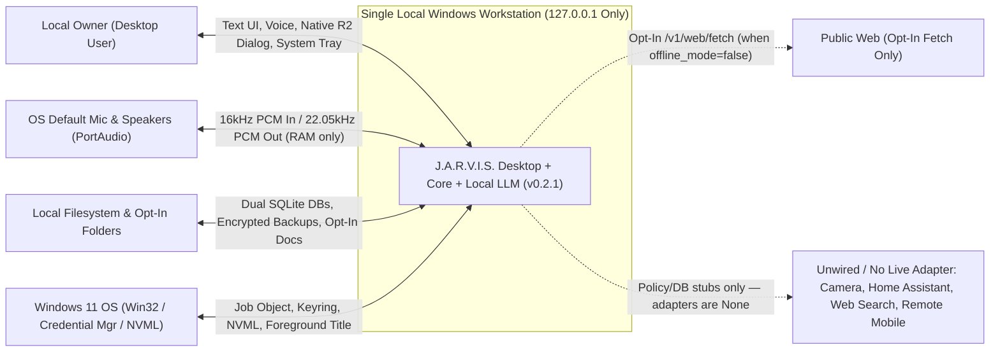
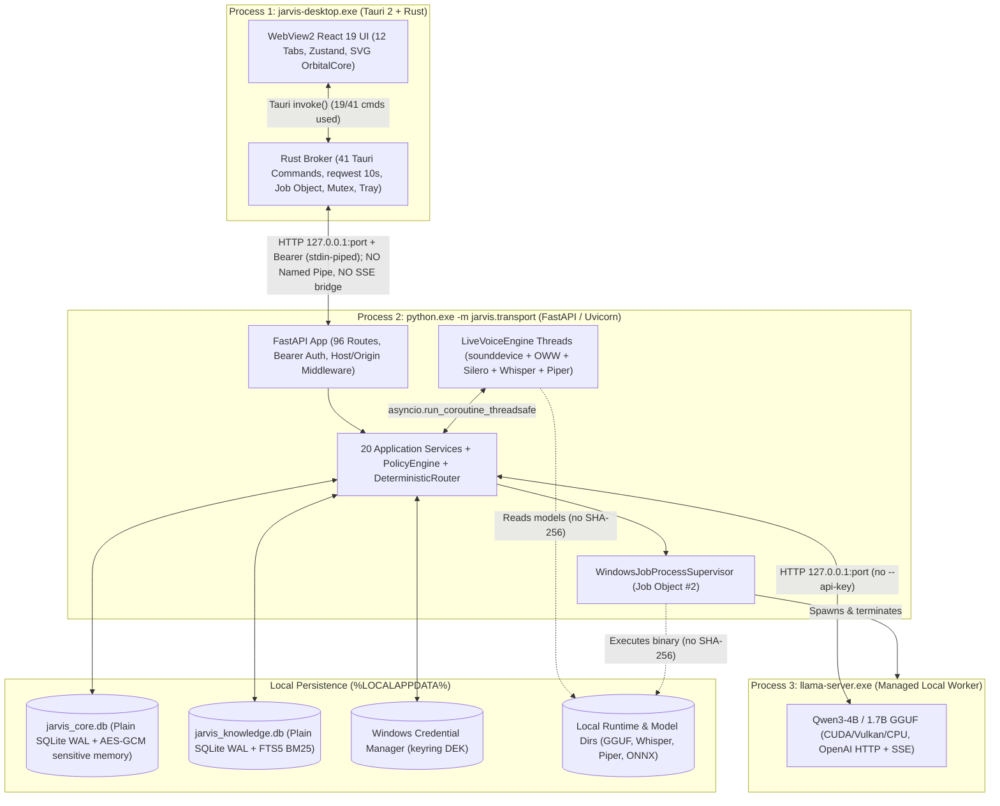
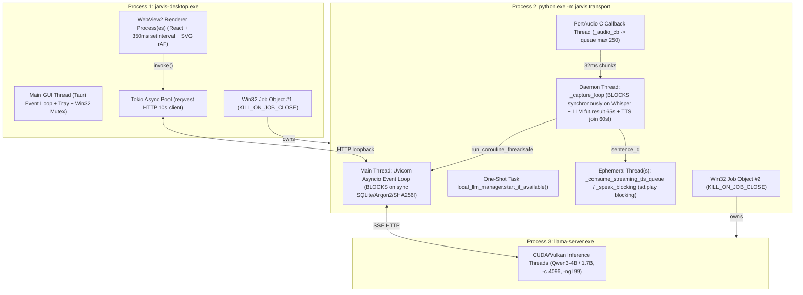
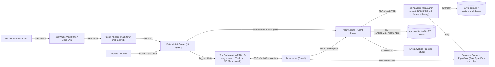
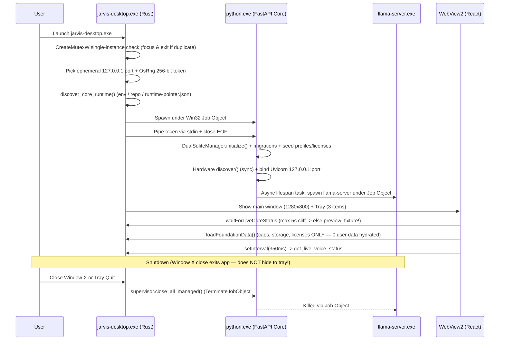
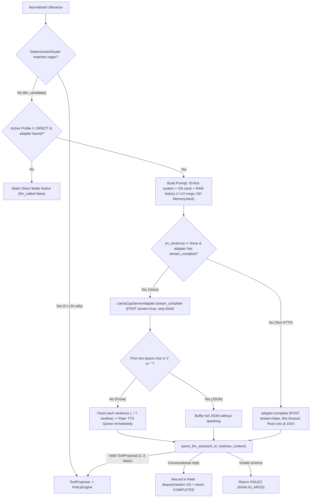
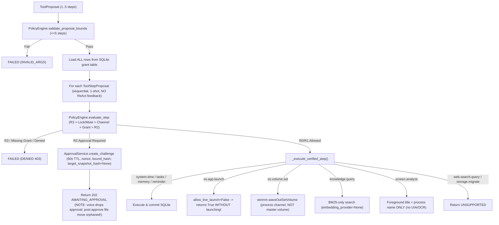
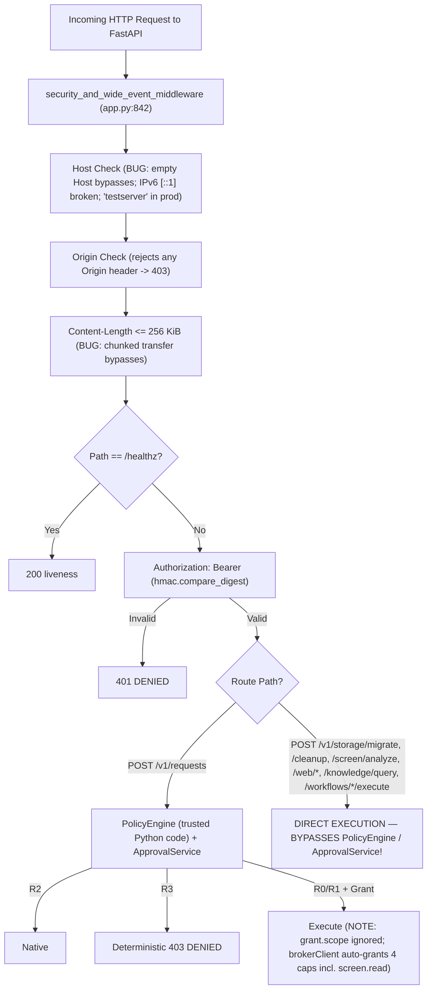

# 02 — Actual System Architecture (As-Built)

This document describes the **actual implemented architecture** verified from source code as of commit `455c6aa` + working-tree voice/single-instance additions, and explicitly records every material deviation from `JARVIS-SDLC-v0.2.1/03-SDD.md` and `planning/ARCHITECTURE-REVIEW.md`.

---

## 1. Architectural Overview & Module Boundaries

J.A.R.V.I.S. is implemented as a **3-process local desktop modular monolith** on Windows x64:

1. **Desktop Shell & Native Broker (`apps/desktop/`):**
   - **Frontend (`apps/desktop/src/`):** React `19.3.1` + TypeScript `~7.0.2` + Tailwind CSS `4.3.5` + Zustand `5.1.0` + Zod `4.6.7` + `motion` `14.14.0`, bundled via Vite `8.4.0` into static assets served inside Tauri 2 WebView2 (`withGlobalTauri: false`, CSP `connect-src 'self'`).
   - **Rust Broker (`apps/desktop/src-tauri/src/`):** Tauri `2.12.7` binary (`jarvis-desktop.exe`) responsible for Win32 single-instance mutex (`single_instance.rs`), ephemeral loopback port picking & Python Core discovery (`core_launcher.rs`), Win32 Job Object supervision (`process_supervisor.rs`), 256-bit Bearer token generation (`ipc_transport.rs`), system tray (`lib.rs`), and 41 Tauri IPC proxy commands (`commands.rs`) forwarding HTTP requests over `reqwest` (`10s` global timeout).
2. **Local Core Service (`core/jarvis/`):**
   - Clean 5-layer Python `3.11.9` monolith enforced by `import-linter` (`core/pyproject.toml:99-138`, **2/2 contracts kept** across 125 files / 562 deps):
     - `domain/` — Pure Pydantic `StrictModel` entities, `PolicyEngine`, `DeterministicRouter`, security regexes, licensing, hardware recommendations, ports (`0` OS/infrastructure/transport imports).
     - `application/` — 20 use-case services (`TurnOrchestratorService`, `AiRegistryService`, `MemoryVaultService`, `KnowledgeRagService`, `ReminderSchedulerService`, `PersonalLifeService`, `WorkflowEngineService`, `ScreenAwarenessService`, `WebIntelligenceService`, `ApprovalService`, `StorageService`, `BackupService`, `ConfigService`, `LicenseInventoryService`, `VoicePipelineService`, `EcosystemGovernanceService`, `OnDemandCameraService`, `HomeAssistantService`, `RemoteGatewayService`, `PreferenceProposalService`) (`0` OS/Win32/FastAPI imports).
     - `infrastructure/` — `DualSqliteManager`, `migrations`, `crypto`, `document_parser`, `event_bus`, `logging_setup`, `web_fetch`, `live_voice_engine`, `providers/{llama_cpp_adapter,local_runtime_manager,ollama_adapter}`.
     - `platform/` — `portable_mock.py` + `windows/{hardware,audio,desktop_automation,filesystem,screen_capture,supervisor,vault}.py`.
     - `transport/` — FastAPI `0.165.0` + Uvicorn `0.54.0` (`app.py`: 96 routes; `remote_gateway_app.py`: 5 routes, **unwired dead server**; `settings.py`; `__main__.py`).
3. **Managed Local LLM Worker (`llama-server.exe`):**
   - Auto-discovered and spawned asynchronously by `LocalLlmRuntimeManager` (`core/jarvis/infrastructure/providers/local_runtime_manager.py:148-289`) under Python's `WindowsJobProcessSupervisor` on a random `127.0.0.1:<port>` (unauthenticated HTTP, `--no-webui --jinja --reasoning-budget 0`).

---

## 2. Actual Architecture Diagrams (All 9 Required Views)

*(Standalone `.mmd` sources are also persisted under `docs/as-built-review/diagrams/`.)*

### 2.1 System Context (`diagrams/01-system-context.mmd`)

### 2.2 Container Architecture (`diagrams/02-container-architecture.mmd`)

### 2.3 Component Architecture (`diagrams/03-component-architecture.mmd`)

```mermaid
flowchart TB
    subgraph Transport["transport/"]
        App["app.py (96 routes)"]
        RemoteDead["remote_gateway_app.py (UNWIRED DEAD SERVER)"]
        Settings["settings.py (CoreStartupSettings)"]
    end

    subgraph AppLayer["application/ (20 Services)"]
        Turn["TurnOrchestratorService (RAM 12-msg history, NO memory recall)"]
        PolicyWrap["ApprovalService + PolicyEngine (domain)"]
        AIReg["AiRegistryService"]
        VoiceSvc["VoicePipelineService (DISCONNECTED from LiveVoiceEngine)"]
        Mem["MemoryVaultService"]
        Know["KnowledgeRagService (BM25 only, embedding=None)"]
        Life["PersonalLifeService + ReminderSchedulerService (NO cron loop)"]
        ScreenWeb["ScreenAwarenessService + WebIntelligenceService (search=None)"]
        WorkEco["WorkflowEngineService (NO-OP stub) + EcosystemGovernanceService (metadata stub)"]
        InfraSvc["ConfigService + StorageService + BackupService + LicenseInventoryService"]
        R3Svc["Camera (port=None) + HA (client=None) + Remote + PreferenceProposal"]
    end

    subgraph InfraLayer["infrastructure/"]
        DualDB["DualSqliteManager + migrations"]
        LiveVoice["LiveVoiceEngine (sounddevice/OWW/Silero/Whisper/Piper)"]
        LlmMgr["LocalLlmRuntimeManager + LlamaCppServerAdapter"]
        OllamaDead["OllamaAdapter (DEAD CODE)"]
        Bus["SequencedEventBus (SSE unwired to UI)"]
        WebFetch["SafeWebFetchClient (SSRF DNS TOCTOU)"]
    end

    subgraph PlatformLayer["platform/windows/"]
        WinAdapters["Hardware, Audio (WinMM), Desktop (allow_live_launch=False), FS, Screen (title only), Vault, Supervisor"]
        FakeNotif["FakeNotificationAdapter (in production!)"]
    end

    App --> Turn & PolicyWrap & AIReg & VoiceSvc & Mem & Know & Life & ScreenWeb & WorkEco & InfraSvc & R3Svc
    App --> LiveVoice & LlmMgr & Bus
    Turn --> PolicyWrap & AIReg & Mem & Know & Life & ScreenWeb
    Turn --> WinAdapters
    LlmMgr --> AIReg
    AppLayer --> DualDB & WebFetch & WinAdapters & FakeNotif
```

### 2.4 Process & Thread Architecture (`diagrams/04-process-architecture.mmd`)

### 2.5 Data Flow (`diagrams/05-data-flow.mmd`)

### 2.6 Application Startup & Shutdown (`diagrams/06-startup-shutdown.mmd`)

### 2.7 AI Inference Flow (`diagrams/07-ai-inference-flow.mmd`)

### 2.8 Tool Execution Flow (`diagrams/08-tool-execution-flow.mmd`)

### 2.9 Security & Authorization Flow (`diagrams/09-security-authorization-flow.mmd`)

---

## 3. Explicit Deviations from Approved SDD (`JARVIS-SDLC-v0.2.1/03-SDD.md` & `DEC-001`–`DEC-030`)

| SDD / DEC Mandate | Actual Implemented Architecture | Source Evidence | Deviation Impact |
| --- | --- | --- | --- |
| **`DEC-008` / SDD §5:** Windows Named Pipe (current-SID DACL) primary IPC | Loopback `http://127.0.0.1:<port>` + Bearer token only; `WindowsNamedPipe` enum is dead code | `ipc_transport.rs:9,62`, `app.py:756`, `__main__.py:28` | Higher local-host attack surface; Host/Origin parsing bugs exposed |
| **`DEC-023` / SDD §3:** 9 complete platform ports | `NotificationPort` uses `FakeNotificationAdapter()` in prod; `StartupIntegrationPort` has 0 impl; `Camera`/`HA`/`WebSearch` ports are `None` | `app.py:621,660,691-692`, `ports.py:148` | Core promises (reminders, notifications, startup, IoT, search) non-functional |
| **`DEC-009/013` / SDD §4:** Single unified voice pipeline with hotplug & echo guard | Two completely disconnected stacks: `VoicePipelineService` (unused in prod) vs `LiveVoiceEngine` (ignores config/devices/EventBus) | `app.py:647,750`, `live_voice_engine.py:673` | Device selection, audio mode, speech rate, and headphone barge-in broken |
| **`DEC-007` / SDD §6:** Encrypted sensitive data + portable cross-machine restore | Plaintext SQLite + AES-GCM on `sensitive` memory only; backup omits `master_dek` | `dual_db.py:67`, `backup_service.py:85-98` | Cross-machine restore permanently bricks all sensitive memories |
| **`DEC-018` / SDD §9:** Minimal standalone base installer | NSIS installs only `jarvis-desktop.exe` + static UI; requires local repo `.venv` | `tauri.conf.json:32-45`, `core_launcher.rs:130-192` | Unusable by external users on clean Windows machines |
| **`DEC-020/021` / SDD §4:** Manifest SHA-256 verification + `DynamicResourceGovernor` + idle unload | `LocalLlmRuntimeManager` executes unhashed binaries/GGUFs; `DynamicResourceGovernor` & `OllamaAdapter` are dead code; zero idle unload | `local_runtime_manager.py:154-196`, `domain/ai_models.py:204` | Integrity bypass + permanent VRAM occupation until exit |
| **SDD §7 / `FR-UX-01`:** Monotonic SSE `/v1/events` driving UI state + Canvas 2D renderer | Zero SSE bridge in Rust/React (`Event Cursor` permanently `seq #0`); UI polls `/v1/voice/live-status` every 350 ms; `OrbitalCore` is inline DOM `<svg>` | `App.tsx:161-176`, `OrbitalCore.tsx:135-235` | High re-render CPU churn; voice R2 approvals never appear in UI |
| **`BR-22` / SDD §7:** Tray residency + `<= 2` clicks for Stop/Mute/Offline | Window `X` kills app; Tray has only Show/Stop/Quit; Stop kills Python Core | `lib.rs:64-105, 161-165` | Closing window terminates background wake-word and Core |
| **`FR-SCH-02` / SDD §4:** Persistent background scheduler | Zero background timer/cron loop anywhere in `core/jarvis/` | `app.py:808-830`, `reminder_service.py:182` | Reminders and scheduled workflows never trigger autonomously |
