# 05 — Voice and Audio Pipeline Audit

This document audits the complete as-built voice/audio subsystem across `core/jarvis/infrastructure/live_voice_engine.py`, `core/jarvis/application/voice_service.py`, `core/jarvis/domain/voice.py`, `core/jarvis/platform/windows/audio.py`, and `apps/desktop/src/App.tsx`. *(For step-by-step root-cause analysis of owner-reported voice defects, see [26-VOICE-PIPELINE-ROOT-CAUSE-ANALYSIS.md](./26-VOICE-PIPELINE-ROOT-CAUSE-ANALYSIS.md).)*

---

## 1. Critical Architectural Finding: Dual Disconnected Voice Stacks

The backend contains **two separate, non-communicating voice implementations** mounted simultaneously in `CoreContainer` (`core/jarvis/transport/app.py:279, 294, 647-654, 750-754`):

| Dimension | Stack A: `VoicePipelineService` (`application/voice_service.py`) | Stack B: `LiveVoiceEngine` (`infrastructure/live_voice_engine.py`) |
| --- | --- | --- |
| **HTTP Endpoints** | `GET /v1/audio/state`, `PUT /v1/audio/mode`, `PUT /v1/audio/devices`, `POST /v1/audio/test` (`app.py:1530-1579`) | `GET /v1/voice/live-status`, `POST /v1/voice/arm`, `POST /v1/voice/stop-speaking` (`app.py:1364-1376`) |
| **Frontend Usage** | **ZERO calls from UI** (`commands.rs:214-228` exposes `get_audio_state`/`set_audio_mode` as dead commands; `select_audio_devices` & `test_audio` have no Tauri commands) | Actively polled every `350 ms` by `App.tsx:161-176` and controlled by Voice buttons |
| **Domain Primitives (`domain/voice.py`)** | Uses `BoundedAudioRingBuffer` (`<= 2s`), `EndpointAwareEchoGuard`, `split_sentences_for_streaming_tts` | **Bypasses `domain/voice.py` entirely**; re-implements its own `deque`, naive mute boolean, and `split_sentences_for_tts` |
| **Config & EventBus** | Reads/writes `ConfigService` (`audio.mode`, device IDs, `speech_rate`, `echo_guard_enabled`) & publishes `SequencedEventBus` | **Completely ignores `ConfigService` and `SequencedEventBus`** |
| **Audio Hardware / Models** | **Non-functional in prod:** `stt_provider=None`; `WindowsOneCoreVoiceProbeAdapter.synthesize()` (`windows/audio.py:147-159`) returns a **44-byte empty silent WAV stub** | **Real local execution:** `sounddevice` (PortAudio), `openwakeword`, `onnxruntime` Silero VAD, `faster-whisper`, `piper-tts` |

**Impact:** Changing audio devices (`PUT /v1/audio/devices`), audio mode (`PUT /v1/audio/mode`), speech rate, or primary language in `ConfigService` has **0% effect on live voice operation**. The only endpoint touching both stacks is `POST /v1/session/lock` (`app.py:1317-1319`).

---

## 2. Actual Live Voice Pipeline (`LiveVoiceEngine`)

```mermaid
flowchart LR
    Mic["OS Default Mic (PortAudio 16kHz f32, 512 samp = 32ms; NO DSP/AGC/AEC)"]
    Q["queue.Queue(maxsize=250) (~8s; silent drop on Full)"]
    EG{"Echo Guard: _speaking or cooldown 300ms?"}
    Standby{"session_active == False?"}
    OWW["openWakeWord ONNX (hey_jarvis_v0.1, 1280 samp = 80ms, thr >= 0.45)"]
    VAD["Silero VAD ONNX (prob >= 0.42 & rms >= 0.004) + 320ms pre-roll (BUG: 1 click -> 33 frames!)"]
    STT["faster-whisper-small (CPU int8, beam=3, HARDCODED lang='id', vad_filter=False)"]
    Sleep{"is_sleep_command?"}
    LLM["TurnOrchestrator.submit_turn_streaming (Qwen3 SSE -> sentence_q)"]
    TTS["PiperVoice (id_ID-news_tts-medium, RAM BytesIO WAV, 22.05kHz)"]
    Spk["OS Default Speaker (sd.play blocking=True)"]

    Mic --> Q --> EG
    EG -->|"Drop"| Drop["Discard frames (NO voice barge-in)"]
    EG -->|"Pass"| Standby
    Standby -->|"Yes + OWW loaded"| OWW -->|"Trigger + 580ms grace"| VAD
    Standby -->|"No (Awake 30s) or OWW absent"| VAD -->|"SYNC inside _capture_loop!"| STT
    STT --> Sleep
    Sleep -->|"Yes"| Stand["Speak 'Baik, saya kembali siaga.' -> Standby"]
    Sleep -->|"No"| LLM --> TTS --> Spk
```

### 2.1 Component Configuration & Verification Status

| Stage | Actual Implementation (`live_voice_engine.py`) | Hardcoded Parameters | Status |
| --- | --- | --- | :---: |
| **Audio Capture** | `sd.InputStream` (`L673-679`), callback pushes `indata[:, 0].copy()` into `queue.Queue(maxsize=250)` (`L341, L667-671`) | `16000 Hz`, `1 ch`, `float32`, `blocksize=512` (`32ms`), **no `device=`**, no DSP/NS/AGC | **`PARTIAL`** |
| **Wake-Word (`openWakeWord`)** | `_OpenWakeWordRunner` (`L253-291`), `hey_jarvis_v0.1.onnx` + `melspectrogram.onnx` + `embedding_model.onnx`, `inference_framework="onnx"` | `FRAME_SAMPLES=1280` (`80ms`), `OWW_WAKE_THRESHOLD=0.45`, cooldown `1.5s`, `POST_WAKE_FOLLOW_SECONDS=0.58` | **`IMPLEMENTED`** *(ONNX load & 0.0 silence verified; live human accuracy unverified)* |
| **VAD (`Silero VAD`)** | `_SileroVadRunner` (`L215-250`, `silero_vad.onnx`, `onnxruntime` CPU 1T) + `PRE_ROLL_FRAMES=10` (`320ms`) | `VAD_SPEECH_THRESHOLD=0.42`, `rms >= 0.004`, `SILENCE_END_SECONDS=0.72` (22 frames), `MIN_SPEECH_SECONDS=0.28` (8 frames), `MAX_UTTERANCE_SECONDS=12.0` | **`BROKEN`** *(noise-spike inflation at `L793-821`)* |
| **Session Lifecycle** | Continuous active session (`L307, L599-610, L866-909`): wake once -> 30s rolling window refreshed after each reply -> sleep phrases (`is_sleep_command`, `L57-67`) or 30s silence -> `standby_wake` | `ACTIVE_SESSION_SECONDS=30.0`; `mode="ptt"` aliases to `active` 30s session (not real hold-to-talk) | **`IMPLEMENTED`** *(transitions verified via HTTP; physical room UX unverified)* |
| **STT (`faster-whisper`)** | Lazy-loaded `WhisperModel` (`L450-464`), called at `L843-851` | `faster-whisper-small`, `device="cpu"`, `compute_type="int8"`, `cpu_threads=4`, **`language="id"`**, `beam_size=3`, `vad_filter=False`, `condition_on_previous_text=False` | **`PARTIAL`** *(no confidence filter; English/app-name distortion)* |
| **TTS (`piper-tts`)** | `PiperVoice.load` (`L466-480`) -> `synthesize_wav` into in-RAM `io.BytesIO()` (`L482-499`, **0 temp files on disk**) -> `sd.play(..., blocking=True)` (`L593, L640`) | First alphabetical `*.onnx`+`.onnx.json` (`id_ID-news_tts-medium`, `22050 Hz`, `espeak voice="id"`). Ignores `speech_rate` & `output_device_id`. | **`VERIFIED`** *(RAM synthesis verified; English/non-Latin pronunciation degraded)* |
| **Echo Guard & Barge-In** | Half-duplex mute flag `self._speaking` + `0.30s` tail (`L602, L731`) + HTTP `POST /v1/voice/stop-speaking` calling `sd.stop()` (`L535-551`) | Zero AEC; zero headphone awareness; **voice barge-in impossible**; UI button barge-in only | **`PARTIAL`** |

---

## 3. Confirmed Concurrency, Reliability & Privacy Findings in Voice Engine

1. **[CRITICAL] Synchronous Blocking Inside `_capture_loop` (`live_voice_engine.py:821, 930, 944`):** `_process_utterance_audio()` runs directly on the audio consumer thread while Whisper transcribes, `fut.result(timeout=65.0)` awaits the LLM, and `tts_thread.join(timeout=60.0)` waits for audio playback. During this time `_audio_queue` stops draining, silently overflows after ~8s, and leaves stale buffered frames behind.
2. **[CRITICAL] Single-Spike Noise Inflation (`live_voice_engine.py:793-821`):** Any single 32 ms click/pop tripping Silero VAD prepends 10 pre-roll frames + 22 trailing silence frames = 33 frames (`1.05s`), unconditionally defeating `len(buffered) < min_speech_blocks (8)` and sending pure room noise to Whisper.
3. **[HIGH] Unjoined Worker Thread Race (`live_voice_engine.py:684-693`):** `_stop_capture_locked()` sets `_stop_event` and closes `_stream` without calling `self._worker_thread.join()`. Rapid mute → arm spawns a second concurrent `_capture_loop` sharing mutable `_audio_queue`, `_vad_runner`, `_oww_runner`, and `_whisper_model`.
4. **[HIGH] Untracked `speak_async` Collisions (`live_voice_engine.py:553-558`):** Spawns a new daemon thread per call without canceling prior `sd.play()`, racing on `self._speaking` and PortAudio's global playback stream.
5. **[HIGH] Zero Audio Device Disconnect / Hotplug Recovery (`live_voice_engine.py:353-382, 667-680`):** `_probe_capabilities()` runs once at `__init__` (`self._mic_ok` cached permanently); `_audio_cb` ignores PortAudio `_status` flags; unplugging the mic during `arm` throws an unhandled HTTP 500 or hangs silently in `queue.Empty` loops.
6. **[MEDIUM] Hardcoded Simulated Speaking Amplitude (`live_voice_engine.py:569, 636`):** Sets `self._amplitude = 0.45` flat constant during TTS playback instead of computing real output PCM RMS.
7. **[VERIFIED POSITIVE] Zero Disk Audio Writes:** Both mic capture (`numpy` buffers in RAM) and Piper TTS (`io.BytesIO()` WAV buffer) write zero raw audio files to disk (`BR-13`, `NFR-10`).
