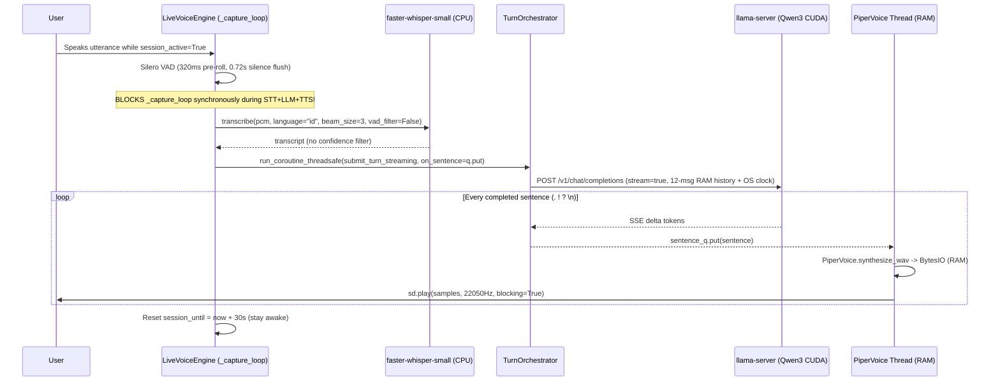

# 09 — End-to-End Operational Workflows (All 24 Scenarios)

Every workflow below traces the **actual implemented code paths** (not intended SDLC design). Scenarios with no live implementation are explicitly marked **`NOT IMPLEMENTED`** or **`BROKEN`**.

---

## Workflow 1 — Application Startup & Readiness
- **Status:** **`PARTIAL`** *(works on dev machine with `runtime-pointer.json`; **BROKEN** on clean Windows workstation)*
- **Trigger:** User launches `jarvis-desktop.exe`.
- **Preconditions:** Valid `core/.venv` discovered via env/repo/`runtime-pointer.json` (`core_launcher.rs:130-192`).
- **Entry Point:** `apps/desktop/src-tauri/src/main.rs:4` → `lib.rs:24`.
- **Components:** `SingleInstanceGuard`, `core_launcher`, `NativeProcessSupervisor`, `python.exe -m jarvis.transport`, `DualSqliteManager`, `LocalLlmRuntimeManager`, `WebView2` (`App.tsx`, `brokerClient.ts`).
- **Step-by-Step:** (1) `CreateMutexW` checks single instance (`lib.rs:27`); (2) picks ephemeral port + 256-bit `OsRng` token (`lib.rs:32-37`); (3) spawns Python Core under Win32 Job Object #1 with `stdout/stderr=Stdio::null()` and pipes token via stdin (`process_supervisor.rs:212-258`); (4) Core runs SQLite migrations, seeds profiles/licenses, runs sync `hardware.discover()`, binds Uvicorn (`app.py:596-830`); (5) Core lifespan spawns async `local_llm_manager.start_if_available()` loading `llama-server.exe` under Job Object #2 (`app.py:811-814`); (6) React polls `get_broker_status` up to 25×200 ms (`5s` cliff, `brokerClient.ts:119-161`) then loads caps/storage/licenses ONLY and starts `350 ms` voice status polling (`App.tsx:161-176`).
- **Decision Points:** Single-instance duplicate → focus existing & exit; Core not found or >5s cold start → UI permanently degrades to `preview_fixture`.
- **Data Exchanged:** Stdin 64-hex token; JSON over `http://127.0.0.1:<port>` with `Authorization: Bearer`.
- **Persistence:** SQLite schema migrations + `config_revision` + `hardware_snapshot` + `license_artifact` + `ai_profile` + `active_ai_profile`.
- **Security Checks:** Loopback-only bind, Bearer token, CSP `connect-src 'self'`, `withGlobalTauri: false`.
- **Success Criteria:** Core `/healthz` = 200, UI badge `CORE: LIVE`, `LLM: Qwen3-... (CUDA)`.
- **Failure Paths:** Clean machine lacks Python Core (`F-01`); >5s boot falls back to preview with no retry; `stdout/stderr` discarded so startup tracebacks are invisible.
- **Limitations / Evidence:** Zero hydration of user data on startup (`brokerClient.ts:140-186`).

---

## Workflow 2 — First-Run Onboarding & Hardware Discovery
- **Status:** **`PARTIAL`**
- **Trigger:** User opens `Onboarding` tab (`OnboardingWizard.tsx:1-430`).
- **Preconditions:** `capabilities` loaded from `GET /v1/system/capabilities` (`app.py:971-998`) or fallback preview fixture.
- **Entry Point:** `App.tsx:701-724` → `OnboardingWizard.tsx`.
- **Components:** `WindowsHardwareDiscoveryAdapter`, `recommend_configuration()` (`domain/recommendations.py`), `OnboardingWizard`, `brokerClient.ts:248-256`, `commands.rs:185-211`.
- **Step-by-Step:** (1) Core discovers CPU/NVIDIA NVML/GDI displays/volumes (`hardware.py:193-240`); (2) `recommend_configuration()` computes visual tier, FPS target, and runtime ownership; (3) user steps through 10 UI steps (or clicks `"1-Click Recommended Setup"` at `OnboardingWizard.tsx:99-104`, which skips Step 9); (4) Step 10 calls `persistOnboardingCompletion()` → `POST /v1/onboarding/steps/10?mark_completed=true` + `PUT /v1/grants` for `system.time`, `memory.write`, `reminder.write` (+ checked Step 9 boxes).
- **Decision Points:** 1-Click bypasses Step 9 grant checkboxes (`os.app.launch` stays ungranted).
- **Data Exchanged:** `CapabilitiesResponse` JSON; capability strings.
- **Persistence:** Persists `onboarding.completed=true` and `grant` rows in `jarvis_core.db`.
- **Security Checks:** Deny-by-default enforced; explicit local UI click required.
- **Success Criteria:** Onboarding marked complete and baseline grants saved.
- **Failure Paths:** **ALL settings chosen in Steps 1–8** (language, timezone, quiet hours, runtime ownership, visual tier, FPS) are **NEVER sent to `PUT /v1/config`** — lost on restart! `onboardingCompleted` resets to `false` on reload because `get_config` is never hydrated (`brokerClient.ts:162-166`).
- **Limitations / Evidence:** AMD/Intel GPUs report `0 MiB` VRAM (`hardware.py:167-169`); `audio_endpoints=()` hardcoded empty (`L216`).

---

## Workflow 3 — Wake-Word Activation (`"Hey Jarvis"`)
- **Status:** **`IMPLEMENTED`** *(ONNX inference & HTTP arming verified; physical room acoustics unverified; VAD noise bug impacts fallback/follow-up)*
- **Trigger:** User clicks `Aktifkan Mode "Hey Jarvis"` (`App.tsx:526`) then speaks `"Hey Jarvis"`.
- **Preconditions:** Microphone available, `faster-whisper-small` present, optional `openwakeword/` ONNX models present.
- **Entry Point:** `App.tsx:178` → `brokerClient.ts:268` → `commands.rs:235` → `POST /v1/voice/arm` (`app.py:1368`) → `LiveVoiceEngine.set_mode("wake")` (`live_voice_engine.py:501-533`).
- **Components:** `LiveVoiceEngine`, `sounddevice.InputStream`, `_OpenWakeWordRunner`, `_SileroVadRunner`, `PiperVoice`.
- **Step-by-Step:** (1) `brokerClient.ts:273-278` silently upserts 4 duplicate grant rows (`system.time`, `knowledge.read`, `life.task`, `screen.read`); (2) `set_mode("wake")` opens OS default mic (`16 kHz`, `512` samples); (3) in `standby_wake`, `_capture_loop` pushes `80 ms` int16 frames to `openWakeWord` (`L764-781`); (4) score `>= 0.45` (cooldown `1.5s`) sets `_session_active=True` (`33s`) and starts `580 ms` follow-up grace window (`L779`); (5) if user pauses, speaks `"Ya, siap. Ada yang bisa saya bantu?"` via Piper in RAM; if user keeps speaking, captures post-wake command directly.
- **Decision Points:** OWW models absent → falls back to Silero VAD + Whisper regex `extract_wake_command()`.
- **Data Exchanged:** RAM-only float32/int16 PCM arrays; JSON status polled every `350 ms`.
- **Persistence:** Zero audio persisted to disk; **4 duplicate grant rows written on every arm**.
- **Security Checks:** RAM-only audio (`BR-13`); ignores room speech in standby; **defect:** silent `screen.read` auto-grant violates `FR-SCR-01`.
- **Success Criteria:** Transitions `standby_wake` → `listening_command` (`session_active=true`).
- **Failure Paths:** Unplugged mic throws uncaught `PortAudioError` (HTTP 500); user starting speech at `~0.60s` collides with Echo Guard during `"Ya, siap..."` greeting (`L785-791`).

---

## Workflow 4 — Voice Conversation (Continuous Multi-Turn)



- **Status:** **`PARTIAL` / `BROKEN`** *(SSE streaming & multi-turn memory verified via probe; broken by VAD noise inflation, blocking `_capture_loop`, hardcoded `language="id"`, monolingual TTS, and dropped R2 approvals)*
- **Trigger:** Spoken utterance while `session_active=True`.
- **Preconditions:** Voice armed & woken (`mode="wake"`, `session_active=True`); local LLM ready for non-deterministic turns.
- **Entry Point:** `LiveVoiceEngine._capture_loop` (`live_voice_engine.py:695-821`) → `_process_utterance_audio` (`L831-950`).
- **Persistence:** RAM-only 12-message `_session_history` (`turn_orchestrator.py:130`). Zero SQLite conversation transcript.
- **Security Checks:** Sleep commands (`is_sleep_command`) return cleanly to standby; PolicyEngine runs on any tool proposal.
- **Failure Paths:** 32 ms click triggers 1.05 s noise → Whisper hallucination → poisons `_session_history`; voice-triggered R2 approvals are dropped (`app.py:748`); `_capture_loop` queue overflows after 8s while waiting for LLM+TTS.

---

## Workflow 5 — Text Conversation
- **Status:** **`PARTIAL`**
- **Trigger:** User submits text form in Command Center (`App.tsx:239-250, 618-639`).
- **Preconditions:** Keyboard fallback visible (either voice muted or `Mode Teks (Fallback)` clicked).
- **Entry Point:** `App.tsx:244` → `brokerClient.ts:315` → `commands.rs:169` → `POST /v1/requests` (`app.py:1380-1425`) → `TurnOrchestratorService.submit_turn` (`turn_orchestrator.py:182`).
- **Components:** `App.tsx`, `commands.rs` (`reqwest` 10s), `DeterministicRouter`, `TurnOrchestratorService`, `LlamaCppServerAdapter.complete` (non-streaming).
- **Decision Points:** Deterministic match vs LLM; R2 approval opens native `<dialog>`.
- **Data Exchanged:** `SubmitTurnBody` JSON (`session_id="local-session-1"`) → `TurnResponse` JSON.
- **Persistence:** RAM-only `_session_history` under `"local-session-1"` (separate from voice `"local-voice-session"`!).
- **Failure Paths:** (1) Any LLM turn >10s aborts in Rust `reqwest` (`lib.rs:46`); (2) UI swallows error (no `.catch()`); (3) **UI reply permanently hidden** if `liveVoice?.last_reply` is non-empty (`App.tsx:595`).

---

## Workflow 6 — Opening an Installed Application
- **Status:** **`BROKEN` / `MOCK`**
- **Trigger:** User says/types `"Buka kalkulator"` or `"Buka Chrome"`.
- **Entry Point:** `router.py:307-319` (`_APP_LAUNCH_RE`) → `PolicyEngine` (`os.app.launch` R1) → `turn_orchestrator.py:531-551` → `WindowsDesktopAutomationAdapter.launch_allowlisted_app` (`desktop_automation.py:27-47`).
- **Step-by-Step Failure Chain:** (1) Whisper `"Buka kalkulator."` captures trailing `.` (`"kalkulator."`) missing alias map; (2) `os.app.launch` grant is missing on voice-arm & 1-click onboarding → `403 DENIED`; (3) any app outside `calc.exe`/`notepad.exe`/`mspaint.exe` raises `PermissionError` (`403 DENIED`); (4) even for `calculator` with grant, `app.py:620` hardcodes **`allow_live_launch=False`**, returning `True` without launching any process while falsely reporting success!

---

## Workflow 7 — Executing a Multi-Step User Request
- **Status:** **`PARTIAL`** *(schema supports 1..5 steps; single-shot only, zero ReAct, zero deterministic compound parsing)*
- **Trigger:** User asks for 2–5 actions in one utterance (e.g., *"atur volume ke 30 dan buat tugas laporan"*).
- **Entry Point:** `router.py` (no compound regex → `llm_candidate`) → `TurnOrchestratorService` (`turn_orchestrator.py:249-483`).
- **Step-by-Step:** (1) LLM must emit `{"steps":[step1, step2, ...]}` (`1..5` steps); (2) `PolicyEngine.validate_proposal_bounds()` checks `<=5`; (3) loop (`L389-465`) evaluates & executes sequentially, stopping on first failure or R2 pause; (4) returns concatenated step summaries.
- **Failure Paths:** Zero ReAct observation loop; zero data passing between steps; partial execution before a failed step has no rollback; malformed step args throw HTTP 500 `KeyError`; mixed prose+JSON streams raw JSON to TTS.

---

## Workflow 8 — Retrieving Information from Previous Conversations
- **Status:** **`PARTIAL`** *(within-session <=6 turns in RAM ONLY; **NOT IMPLEMENTED** across restarts)*
- **Trigger:** Follow-up utterance (e.g., Turn 1 `"terjemahkan selamat pagi ke bahasa Jepang"` → Turn 2 `"kalau ke bahasa Korea?"`).
- **Entry Point:** `turn_orchestrator.py:123-133, 276-281`.
- **Persistence:** **NONE.** `session` and `message` SQLite tables (`0001_initial_core.sql:43-61`) are completely unused; voice (`local-voice-session`) and text (`local-session-1`) do not even share history; restart or `/v1/session/lock` wipes all memory.
- **Evidence:** Verified within a single live session in `task-1230` (`TURN2_FOLLOWUP_KO`); confirmed lost across restart by code inspection.

---

## Workflow 9 — Storing a New User Preference
- **Status:** **`PARTIAL` / DISCONNECTED**
- **Trigger:** `"ingat bahwa saya suka kopi hitam"` (Memory) OR `POST /v1/preferences/proposals` + `decide` (Adaptive Preference).
- **Entry Point:** `router.py:218-235` → `memory_service.py:65-122` OR `preference_proposal_service.py:56-250` (`app.py:2271-2302`).
- **Step-by-Step:** (1) Memory route saves row in `memory` table (encrypted if `sensitive`); (2) Preference proposal updates 1 of 6 whitelisted `config_revision` keys (`persona.verbosity`, `persona.style`, etc.) upon explicit `approve`.
- **Failure Paths / Limitations:** (1) Neither `MemoryVaultService` facts nor `PersonaConfig` (`style`/`verbosity`) are **ever read by `TurnOrchestratorService`** — stored preferences have **0% effect on AI responses**; (2) UI `EcosystemPanel` shows hardcoded fake proposal `prop-verbosity-brief` whose approve click hits `404` on Core; (3) UI `MemoryVaultPanel` delete sends fake ID `mem-${Date.now()}` (`404` on Core).

---

## Workflow 10 — Searching and Analyzing a Local Document
- **Status:** **`PARTIAL`** *(backend BM25 FTS5 works via API/voice if manually synced; UI is 100% mock; semantic vectors dead)*
- **Trigger:** Voice/text `"cari di dokumen <query>"` (`router.py:347-358`) or `POST /v1/knowledge/query` (`app.py:1771`).
- **Preconditions:** Folder added via `POST /v1/roots` AND manually indexed via `POST /v1/roots/{id}/sync` (not exposed in Tauri `commands.rs` or UI!), file is `.txt/.md/.pdf/.docx` <= 25 MiB, `knowledge.read` granted (for turn route; bypassed on `/v1/knowledge/query`).
- **Step-by-Step:** (1) `KnowledgeRagService.search_hybrid()` runs FTS5 `bm25(chunk_fts)` filtered by active `source_root` revisions & `deletion_ledger` (`knowledge_service.py:423-562`); (2) `embedding_provider=None` so vector branch is skipped; (3) via `TurnOrchestrator`, calls Qwen3 with `tools_disabled=True` and `<untrusted_document_data>` wrapper (`L604-626`) and verifies filename citations; via `POST /v1/knowledge/query` (`app.py:1773`), omits `llm_adapter` and returns raw 240-char snippet.
- **Failure Paths:** Desktop `KnowledgePanel` (`ProductivityPanels.tsx:10-143`) never calls backend APIs (Zustand-only + fake search string); no file watcher; `<untrusted_document_data>` tag breakout + second-order injection into `_session_history`.

---

## Workflow 11 — Searching the Internet
- **Status:** **`NOT IMPLEMENTED`** *(search)* / **`BROKEN`** *(fetch SSRF TOCTOU)*
- **Trigger:** `POST /v1/web/query` (`app.py:1780`) or `POST /v1/web/fetch` (`app.py:1793`).
- **Preconditions:** `offline_mode=False` (default `True` blocks with `503`).
- **Step-by-Step:** (1) `web.search.query` has **no executor** in `TurnOrchestratorService` (`UNSUPPORTED`) and `WebIntelligenceService` has `search_provider=None` (`app.py:660`) → `/v1/web/query` ALWAYS fails `503 RUNTIME_UNAVAILABLE`; (2) `/v1/web/fetch` invokes `SafeWebFetchClient.fetch_public_url()` (`web_fetch.py:135-190`), which validates DNS IPs then calls `httpx` without pinning `pinned_ip` (**TOCTOU DNS rebinding SSRF**) and buffers full response before checking 2 MiB cap. No UI exists.

---

## Workflow 12 — Understanding Screen Content
- **Status:** **`PARTIAL`** *(window title + process name ONLY; zero UIA text, zero OCR)*
- **Trigger:** Voice/text `"baca layar aktif"` (`router.py:361-374`) or `POST /v1/screen/analyze` (`app.py:1815`).
- **Entry Point:** `turn_orchestrator.py:685-722` → `ScreenAwarenessService.analyze_window` (`screen_service.py:72-151`) → `WindowsActiveWindowCaptureAdapter.observe_window` (`screen_capture.py:16-55`).
- **Step-by-Step:** (1) Calls `GetForegroundWindow`, `GetWindowTextW`, `GetWindowThreadProcessId`, `psutil.Process.name()`; (2) checks blocked password-manager processes/titles (`security_guards.py:63-95`); (3) runs `redact_screen_secrets()` on `extracted_text` (NOT `window_title`); (4) returns `"Jendela aktif saat ini: '<title>' (aplikasi: <proc>)."` with zero disk screenshots.
- **Failure Paths:** Cannot read actual screen text/errors/code; `has_focused_password_field=False` hardcoded; elevated admin apps fail `psutil` with `AccessDenied` → `"pid:<n>"` bypassing blocklists; direct `/v1/screen/analyze` bypasses `PolicyEngine`; voice arm auto-grants `screen.read`.

---

## Workflow 13 — Creating and Triggering a Reminder
- **Status:** **`PARTIAL`** *(creation **VERIFIED**; autonomous triggering **NOT IMPLEMENTED**)*
- **Trigger:** `"ingatkan saya 10 menit lagi untuk istirahat"` (`router.py:238-282`) or `POST /v1/reminders` (`app.py:1664`).
- **Step-by-Step:** (1) Creates `reminder` + `job` rows in `jarvis_core.db` (`reminder_service.py:105-160`); (2) **STOPS HERE at runtime** — zero background timer ever calls `process_due_reminders()` (`L182`); (3) even if manually triggered via `POST /v1/reminders/process-due`, `FakeNotificationAdapter` (`app.py:621`) records to an in-RAM list without showing a Windows Toast.

---

## Workflow 14 — Generating an Unsolicited Proactive Notification
- **Status:** **`NOT IMPLEMENTED`**
- **Evidence:** Zero background scheduler/event daemon in `app.py:808-830`, `ProactiveRateLimiter` (`reminder_service.py:62-85`) is dead code, `FakeNotificationAdapter` is wired in production (`app.py:621`), and `PreferenceProposalService` has zero automatic producers.

---

## Workflow 15 — Requesting Authorization for a Sensitive Action (`R2`)

```mermaid
sequenceDiagram
    participant User
    participant UI as React (ApprovalDialog)
    participant Rust as commands.rs
    participant Core as app.py + ApprovalService
    participant DB as jarvis_core.db

    User->>UI: Submits "pindahkan file a.txt ke b.txt"
    UI->>Rust: invoke('submit_turn')
    Rust->>Core: POST /v1/requests
    Core->>DB: PolicyEngine -> ApprovalService.create_challenge (60s TTL, nonce, bound_hash; target_snapshot_hash=None)
    Core-->>UI: 202 AWAITING_APPROVAL + ApprovalChallenge
    UI->>User: Native <dialog> focusing Tolak (Esc) first
    User->>UI: Clicks Setujui (1x)
    UI->>Rust: invoke('submit_approval_decision')
    Rust->>Core: POST /v1/approvals/{id}/decision (modality=TRUSTED_UI, LOCAL)
    Core->>DB: Atomic UPDATE approval SET state='approved', consumed_at=...
    Core-->>UI: 200 approved
    Note over Core,DB: DEAD END: execute_approved_file_move() is NEVER called! File is never moved!
```

- **Status:** **`PARTIAL` / `BROKEN`** *(challenge creation, single-use nonce, 60s TTL, and native `<dialog>` verified; **post-approval execution is orphaned**, TOCTOU snapshot hash is omitted, voice R2 approvals never reach GUI, and `/v1/storage/migrate` + `/v1/workflows/*/execute` bypass approval)*
- **Source Evidence:** `approval_service.py:49-354`, `ApprovalDialog.tsx:1-176`, `turn_orchestrator.py:399-419, 733-813`, `commands.rs:147-160`.

---

## Workflow 16 — Switching AI Models and Inference Runtimes
- **Status:** **`BROKEN`**
- **Trigger:** `POST /v1/profiles/{profile_id}/activate` (`app.py:1497-1513`) or `POST /v1/providers` (`app.py:1437`).
- **Failure Paths:** (1) No UI exists to switch AI profiles or models; (2) activating `"balanced"` defaults to `revision=1` (`role_bindings={}`), disconnecting `local_llama_cpp` which was bound to `revision=2` (`local_runtime_manager.py:254`); (3) switching profiles never restarts `llama-server` with a different GGUF; (4) `POST /v1/providers` never binds an adapter (`OllamaAdapter` is dead code); (5) registering a LAN provider crashes `GET /v1/providers` with HTTP 500 (`ecosystem_service.py:110-136`).

---

## Workflow 17 — Handling Insufficient RAM or VRAM
- **Status:** **`NOT IMPLEMENTED` (Runtime Governance)** / **`PARTIAL` (Boot Discovery Only)**
- **Evidence:** `local_runtime_manager.py:111` checks initial `vram_mib >= 3800` once at boot to prefer `4B` over `1.7B`, then hardcodes `-ngl 99` and `-c 4096`. `DynamicResourceGovernor` (`domain/ai_models.py:204-309`) is **dead code**. No runtime NVML/RAM polling, no partial layer offload, no idle unload, and no automatic downgrade under VRAM pressure exist (concurrent VRAM pressure causes silent spill to RAM or `llama-server` crash).

---

## Workflow 18 — Handling an AI Runtime Crash
- **Status:** **`BROKEN`**
- **Evidence:** During initial 45s boot (`local_runtime_manager.py:208-227`), a `llama-server` exit falls back cleanly to Direct Mode. **Post-startup:** zero watchdog exists; `local_llm_manager.status.ready` stays `True` forever after `llama-server` dies; every turn fails with `httpx.ConnectError` (`RUNTIME_UNAVAILABLE`) with zero auto-restart and zero `fallback_allowlist` execution. Similarly, if Python Core crashes, Rust (`lib.rs`) never restarts it.

---

## Workflow 19 — Handling Microphone or Audio-Device Disconnection
- **Status:** **`BROKEN`**
- **Evidence:** `LiveVoiceEngine._probe_capabilities()` (`live_voice_engine.py:353-382`) runs once at `__init__` (`self._mic_ok` cached forever); `_audio_cb` ignores PortAudio `_status`; `_start_capture_locked` has no `try/except` around `sd.InputStream(...).start()` (unplugged mic causes HTTP 500 on `/v1/voice/arm` or silent `queue.Empty` hang mid-session). `WindowsAudioDeviceAdapter` (`windows/audio.py`) polls legacy WinMM with zero `IMMNotificationClient` hotplug callbacks.

---

## Workflow 20 — Interrupting JARVIS While It Is Speaking (Barge-In)
- **Status:** **`PARTIAL`** *(UI button stop works; voice barge-in **NOT IMPLEMENTED**)*
- **Trigger:** User clicks `Hentikan Suara` (`App.tsx:560`) or header `Stop` (`App.tsx:411`).
- **Entry Point:** `brokerClient.ts:285` → `commands.rs:246` → `POST /v1/voice/stop-speaking` (`app.py:1373`) → `LiveVoiceEngine.stop_speaking()` (`live_voice_engine.py:535-551`).
- **Step-by-Step:** Sets `self._speaking=False`, calls `sd.stop()`, transitions back to `listening_command`/`standby_wake`.
- **Limitations:** Voice barge-in is impossible (even on headphones) because Echo Guard drops 100% of mic frames while `self._speaking=True` (`L731`) and no AEC exists; clicking `Stop` does not cancel an in-flight LLM generation.

---

## Workflow 21 — Changing Storage Locations
- **Status:** **`BROKEN` (for DBs/Models) / `PARTIAL` (for Cache/Temp)**
- **Trigger:** `PUT /v1/storage/locations/{category}` (`app.py:1087`) or `POST /v1/storage/migrate` (`app.py:1099`).
- **Failure Paths:** (1) Desktop `StorageManagerPanel` has no path picker or migrate button (only local `useState` cache quota buttons that never call backend!); (2) `POST /v1/storage/migrate` bypasses R2 approval; (3) copies open SQLite WAL DBs via `shutil.copy2` (`storage_service.py:295`) without closing/checkpointing, never reopens `DualSqliteManager`, and Core restart (`app.py:623-628`) ignores migrated DB paths; (4) `LocalLlmRuntimeManager`/`LiveVoiceEngine` cache model dirs at boot only; (5) pointing `cache` to a user folder + `/v1/storage/cleanup` permanently deletes user files!

---

## Workflow 22 — Running Without Internet Access (Offline Mode)
- **Status:** **`VERIFIED`** *(local Qwen3 + faster-whisper + Piper + openWakeWord + Silero VAD + SQLite core run 100% offline once assets are present)*
- **Evidence:** Default `ai.offline_mode=True` (`models.py:310`) blocks `WebIntelligenceService` (`503`); `LlamaCppServerAdapter` and `LocalLlmRuntimeManager` bind strictly `127.0.0.1` (`trust_env=False`); `WhisperModel(..., local_files_only=True)` (`live_voice_engine.py:462`).
- **Limitations:** Header `Offline` toggle button in `App.tsx:403-410` mutates Zustand only (never calls `PUT /v1/config`); `LocalLlmRuntimeManager` & `LiveVoiceEngine` still require pre-downloaded model assets on disk (zero offline import UI).

---

## Workflow 23 — Recovering from Application Restart
- **Status:** **`PARTIAL` / `BROKEN` (UI State)**
- **What survives restart:** SQLite tables (`jarvis_core.db`, `jarvis_knowledge.db`), `config_revision`, grants, memories, tasks, reminders, expenses, workflows, knowledge roots, and `deletion_ledger` (plus `DualSqliteManager.gc_revoked_knowledge()` runs on startup, `dual_db.py:167-200`).
- **What is LOST on restart:** (1) All conversation history (RAM-only `deque`); (2) **All UI panels appear empty** (`brokerClient.ts:140-186` never hydrates memories/tasks/reminders/expenses/roots/workflows/HA/devices/proposals/config/onboarding status); (3) all pending R2 approvals expire; (4) `WorkflowEngineService` & `ReminderSchedulerService` never reconcile interrupted `in_progress`/`unknown` runs automatically; (5) migrated DB paths are ignored (`app.py:623`).

---

## Workflow 24 — Shutting Down Without Leaving Managed Background Processes
- **Status:** **`VERIFIED`** *(normal close & Win32 Job Object kill verified 0 orphans in `task-1172` & `process_supervisor.rs`)*
- **Trigger:** User closes main window (`WindowEvent::Destroyed`, `lib.rs:161-165`) or clicks Tray `Quit` (`lib.rs:99-103`).
- **Step-by-Step:** (1) Rust calls `supervisor.close_all_managed()` (`process_supervisor.rs:311-325`) → kills Python Core + `TerminateJobObject` on Job Object #1; (2) OS closes Core handles → Core's Job Object #2 (`KILL_ON_JOB_CLOSE`) terminates `llama-server.exe` in `< 1s` (`verified: 0 jarvis-desktop, 0 python core, 0 llama-server` after close); (3) `external_local` PIDs are untouched (`process_supervisor.rs` unit test verified).
- **Limitations:** Closing Window `X` exits the whole app instead of minimizing to tray; `LiveVoiceEngine._worker_thread` is not joined on graceful shutdown (`live_voice_engine.py:684-693`); Tray `Stop Active Action` accidentally runs this same `close_all_managed()` path, killing Core while the UI stays open!
