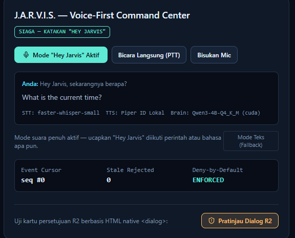

# 13 — UI/UX and Cinematic Experience Audit

This document audits the actual implemented desktop frontend (`apps/desktop/src/**`) against the intended Orbital Precision JARVIS experience (`JARVIS-SDLC-v0.2.1/10-UX-DESIGN.md`, `planning/UI-UX-IMPLEMENTATION-STRATEGY.md`).

---

## 1. Overall Experience Verdict

**What does the implemented interface actually feel like?**
> **Primarily a futuristic-themed administrative dashboard with a Voice Command tab — NOT yet an integrated, fluid, cinematic Personal Intelligence System.**

- **What feels authentic:** Dark obsidian-blue palette (`#080d17`, `#101927`), crisp cyan Orbital Core motif (`#57dfff`), tabular monospace telemetry badges, voice-first Command Center layout collapsing text input when armed, and accessible native HTML `<dialog>` R2 approval modal focusing safe `Tolak (Esc)` first.
- **What breaks the illusion immediately:**
  1. Left sidebar with **12 flat administrative tabs** (`Command Center`, `Onboarding`, `Knowledge`, `Personal Life`, `Workflows`, `Ecosystem`, `Memory Vault`, `Reminders`, `Capabilities`, `Storage`, `Runtime & Visual`, `Licenses`) instead of a unified ambient HUD + contextual drawers.
  2. **Over half the panels are UI-only mocks or lose all data on restart** (see Section 2).
  3. **No Floating Compact Overlay / Quick Palette** and closing Window `X` exits the app instead of minimizing to tray (`lib.rs:161-165`).
  4. **No multi-turn conversation view or live streaming text:** Command Center renders only a single `last_transcript` + single `last_reply` string box (`App.tsx:582-596`), AND once any voice turn runs, `liveVoice?.last_reply` permanently shadows all subsequent text replies (`App.tsx:595`).
  5. **`Event Cursor: seq #0` and `Stale Rejected: 0`** sit prominently in the Command Center (`App.tsx:658-676`) permanently frozen at zero because no SSE `/v1/events` bridge exists.

### Authorized Live Runtime Screenshot Evidence

*Figure 1: Actual owner-captured live desktop screenshot (`screenshots/actual-voice-command-center-defect-01.png`, prior to final prompt/VAD iteration) showing real Command Center typography, Voice-First controls, live readout (`Anda: Hey Jarvis, sekarangnya berapa?` → `What is the current time?`), runtime engine status bar, permanently frozen `Event Cursor seq #0`, and debug `Pratinjau Dialog R2` button shipped inside production UI. Note: Mockups from R0 design exploration are excluded per audit rules.*

---

## 2. Exhaustive Screen-by-Screen & Panel Wiring Audit

| # | Screen / Component | Source File | Wiring Classification | Observed Defects & Missing Capabilities |
| :---: | --- | --- | :---: | --- |
| 1 | **Header Bar** (Core/Mic/LLM badges, Mute, Offline, Stop) | `App.tsx:274-430` | **`PARTIAL` / `BROKEN`** | `Offline` toggle (`L403-410`) is Zustand-only (never calls `PUT /v1/config`); `Mute` desyncs `privacy.micMode` vs `liveVoice.mode`; `Stop` only stops TTS (doesn't cancel LLM or camera). |
| 2 | **Command Center (`command`)** | `App.tsx:473-697` | **`PARTIAL`** | Voice arm/mute/stop & text `submit_turn` hit real Core. **Bugs:** `liveVoice?.last_reply` shadows text replies (`L595`); no `.catch()` on `submit_turn`; `Event Cursor` permanently `seq #0`; production UI exposes demo button `Pratinjau Dialog R2` (`L683-695`). |
| 3 | **OrbitalCore Visualizer** | `components/OrbitalCore.tsx` | **`PARTIAL`** | Inline DOM `<svg>` + 1 `<motion.circle>` (NOT Canvas 2D/WebGL). Calls React `setAngleDeg` inside `rAF` (up to 120–200 re-renders/s); `dprCap` & `onBattery` unused; `liveVoice.phase` overrides `Approval`/`Executing`/`Error` colors (`App.tsx:187-201`); speaking amplitude is hardcoded `0.45`. |
| 4 | **R2 Approval Modal** | `components/ApprovalDialog.tsx` | **`PARTIAL`** | Native `<dialog>` properly focuses `Tolak (Esc)` first (`L34`), live 60s countdown, sends real `submit_approval_decision`. **Bugs:** `.finally()` marks approved even if backend rejects 409/403 (`App.tsx:213`); doesn't restore focus on expiry; post-approval file move is orphaned on backend. |
| 5 | **Onboarding Wizard (`onboarding`)** | `components/OnboardingWizard.tsx` | **`PARTIAL`** | Step 10 calls `complete_onboarding_step` + `upsert_grant`. **Bugs:** Steps 1–8 settings (language, TZ, quiet hours, runtime, visual tier, FPS) are **never saved to `PUT /v1/config`**; 1-Click skips Step 9 (`os.app.launch` never granted); Step 10 fakes `"Uji Kesiapan Offline Lulus"`; resets to incomplete on restart. |
| 6 | **Knowledge Base (`knowledge`)** | `components/ProductivityPanels.tsx:10-143` | **`MOCK`** | **100% Zustand-only!** Ignores existing Rust `add_knowledge_root`/`revoke_knowledge_root`/`query_knowledge`; search returns a hardcoded fake notice string (`L30-38`); no `/sync` trigger. |
| 7 | **Personal Life (`life`)** | `components/ProductivityPanels.tsx:145-314` | **`PARTIAL` / `BROKEN`** | Task create & expense record call real IPC (write-only, never hydrated on restart). **Bugs:** `record_expense` overwrites user's category with `'general'` (`App.tsx:746`); task toggle done is Zustand-only; no Calendar, Habit, or Refund UI. |
| 8 | **Workflows (`workflows`)** | `components/ProductivityPanels.tsx:316-410` | **`MOCK`** | **100% Zustand-only!** Fabricates fake `step_count: 2` / `bound_hash` (`jarvisStore.ts:451-464`) and static fake dry-run string (`L396-398`); zero step editor or execute button. |
| 9 | **Ecosystem (`ecosystem`)** | `components/EcosystemPanels.tsx` | **`MOCK` / `BROKEN`** | Pre-seeded with hardcoded fake store fixtures (`light.desk_lamp`, `dev-sample-mobile`, `prop-verbosity-brief`, `jarvisStore.ts:158-186`). Camera & Remote toggles are Zustand-only; Revoke Device & Decide Proposal send fake fixture IDs → **`404` on Core**; Add HA Entity is write-only (never hydrated). |
| 10 | **Memory Vault (`memories`)** | `components/IntelligencePanels.tsx:10-175` | **`BROKEN`** | Create memory writes to SQLite then discards server UUID (uses fake `mem-${Date.now()}`); Delete sends fake ID → **`404` on Core (never deletes from SQLite)**; Approve Proposal is Zustand-only; never hydrated on restart. |
| 11 | **Reminders (`reminders`)** | `components/IntelligencePanels.tsx:177-275` | **`PARTIAL`** | Create reminder writes to SQLite (write-only, never hydrated); Dismiss is Zustand-only; no snooze UI; reminders never fire automatically. |
| 12 | **Capabilities (`capabilities`)** | `components/FoundationPanels.tsx:10-120` | **`VERIFIED` (Read)** | Reads real `discover_capabilities`; `"Terapkan Recommended Setup"` button is Zustand-only. |
| 13 | **Storage Manager (`storage`)** | `components/FoundationPanels.tsx:122-235` | **`PARTIAL` / `MOCK`** | Reads real `get_storage_locations`; cache quota buttons (`10/25/50 GB`) mutate **local component `useState` only** (`L164`); zero path picker, migration, or cleanup UI. |
| 14 | **Runtime & Visual (`runtime`)** | `components/FoundationPanels.tsx:237-377` | **`MOCK`** | **100% Zustand-only!** Ownership mode, visual tier, and FPS target never persist or configure Core; **zero Model Manager, zero Provider Manager, zero AI Profile switcher UI**. |
| 15 | **Licenses (`licenses`)** | `components/FoundationPanels.tsx:379-434` | **`VERIFIED` (Read)** | Reads real `get_license_inventory`; lacks SBOM/Notices export buttons. |

---

## 3. Animation, Rendering Performance & Accessibility Audit

### 3.1 Animation Inventory (`OrbitalCore.tsx` & `visualEngine.ts`)

| Animation Element | Trigger & Mapped State | Data Source | Rendering Tech | Resource Management & Defects |
| --- | --- | --- | --- | --- |
| **Outer & Inner Orbital Rings (`angleDeg`)** | Continuous `requestAnimationFrame` (`OrbitalCore.tsx:76-119`) mapped to `MachineState` angular velocity (`16°/s` Idle/Muted/Offline, `38°/s` Listening, `65°/s` Thinking, `52°/s` Speaking) | Deterministic wall-clock `dt` (keeps rotating even in `Muted`/`Offline`!) | Inline DOM `<svg>` `transform="rotate(...)"` via React `useState` | **Defect:** Calls `setAngleDeg` inside `rAF` (up to 120–200 React re-renders/s) + updates Zustand `frameTelemetry` every 20 frames -> triggers **root `App` full re-render ~6×/sec** (`App.tsx:75-137` subscribes to entire store!) + `350 ms` HTTP poll (`~2.9×/sec`) = **~9 full-app re-renders/s continuously**. |
| **Acoustic Core Iris & Pulse Ring** | `voiceAmplitude` prop (`0.0–1.0`, `OrbitalCore.tsx:157-212`) | **Real** RMS during mic listening (polled coarsely at `2.86 Hz` = `350 ms`); **Simulated flat `0.45`** during TTS playback (`live_voice_engine.py:569, 636`) | `<motion.circle>` (`motion/react`) + SVG radius | Pauses cleanly in `Reduced Motion` & `document.visibilityState === 'hidden'`. `plan.dprCap` (`visualEngine.ts:84`) and `onBattery` throttling (`App.tsx:477`) are **dead/unwired**. |
| **State Color Shifts** | `effectiveMachineState` (`App.tsx:187-201`) | `liveVoice.phase` overrides Zustand `machineState` | CSS semantic vars (`--accent-core`, `--status-warn`, `--status-ok`, `--status-danger`) | **Bug:** Because `liveVoice.phase` overrides `machineState`, `OrbitalCore` never turns amber during R2 `Approval` when voice is running. |

### 3.2 Accessibility (`WCAG 2.2 AA`) & Visual Polish Findings
- **Verified Positives:** Native `<dialog>` focus trap + `Tolak (Esc)` autofocus (`ApprovalDialog.tsx:34`), `prefers-reduced-motion: reduce` disables `rAF` (`0 FPS`, `OrbitalCore.tsx:50`), `cursor: pointer` / `:focus-visible` outlines (`index.css:39-60`), `aria-live="polite"` status region (`App.tsx:269`).
- **Confirmed Violations:**
  1. `OnboardingWizard.tsx:114-137`: Interactive `<button>` elements nested inside `role="progressbar"` (ARIA violation) and `h-2` (`8 px` tall — fails WCAG 2.2 AA `24×24 px` target size).
  2. `index.css:3-20`: Missing `color-scheme: dark` on `:root` (native `<select>` popups/scrollbars render bright white in Windows WebView2); raw hardcoded hexes (`#1c2c44`, `#080d17`, `#e6f1ff`) scattered across components.
  3. `index.html:2`: `<html lang="id">` hardcoded regardless of language setting; inconsistent ID/EN UI copy.
  4. Inline error banners (`App.tsx:597`, `EcosystemPanels.tsx:152`, `ProductivityPanels.tsx:95`) lack `role="alert"`.
  5. `ApprovalDialog.tsx:53`: Does not restore focus to opener on countdown expiry; countdown timer not announced to screen readers.
