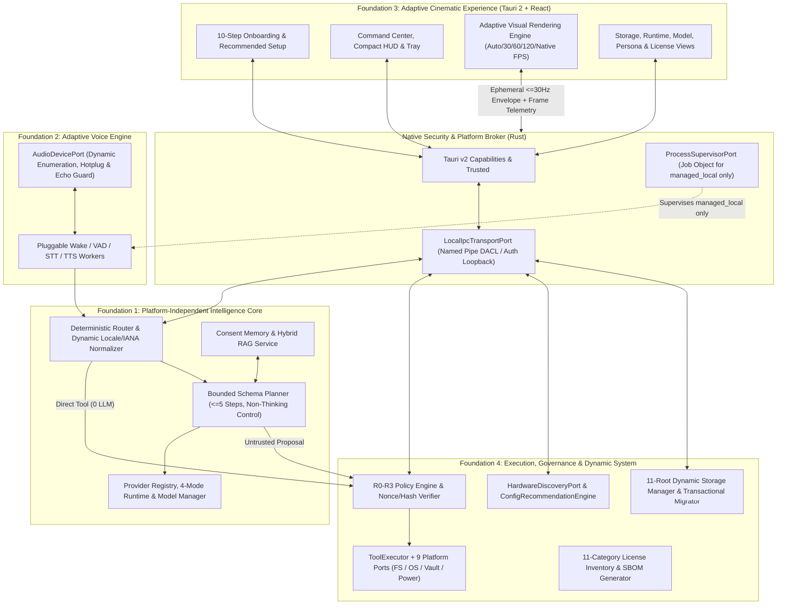

# ARCHITECTURE REVIEW & PORTABLE SYSTEM DESIGN — J.A.R.V.I.S.

**Document ID:** `PLAN-04`  
**Version:** 0.2.1 (Revised for Hardware-Adaptive, Dynamic Storage & Platform-Abstracted Architecture)  
**Baseline Evaluated:** `JARVIS-SDLC-v0.2.1/03-SDD.md`, `04-TECH-STACK-ADR.md`, `06-AI-VOICE-DESIGN.md`, `07-DATA-DESIGN.md`, `08-INTERFACE-CONTRACTS.md`  
**Date:** 26 November 2026  
**Status:** Approved Architectural Blueprint (`DEC-001`–`DEC-025`)

---

## 1. Architectural Overview: Hardware-Adaptive Modular Monolith + Supervised Workers

JARVIS combines a **Trusted Tauri 2 Desktop Shell & Rust Security Broker**, a **Platform-Independent Modular Monolith Core (Python)**, and **Role-Isolated Workers / Interchangeable Runtimes** around three foundational invariants:
1. **Hardware & Storage Agnosticism (`DEC-016`, `DEC-019`)**: At startup and during onboarding, `HardwareDiscoveryPort` and `StorageManager` inspect the actual host machine (CPU-only laptop, entry 4 GB GPU, 24 GB workstation GPU, or LAN endpoint) and resolve user-configurable paths — **zero hardcoded drive letters, usernames, GPU vendors, refresh rates, or locales exist in Core**.
2. **Strict Runtime Ownership Separation (`DEC-020`)**: Processes spawned by JARVIS (`managed_local`) are bound to `ProcessSupervisorPort` (*Windows Job Object* on Windows, targeting `≤ 5s` teardown on crash), whereas user-owned services (`external_local` such as an existing Ollama daemon, or `authorized_lan`) are probed and consumed via clean HTTP/IPC adapters and **never terminated or reconfigured unilaterally**.
3. **Platform Isolation (`DEC-023`, `NFR-16`)**: Windows 11 x64 is the initial production target, but all OS-coupled mechanics sit strictly behind **9 typed Platform Ports** so `domain/` and `application/` remain 100% OS-independent.

---

## 2. Dynamic Hardware Discovery & Configuration Recommendation Engine (`DEC-016`, `DEC-017`)

### 2.1 Capability Discovery & Honest Support Classification
`HardwareDiscoveryPort` produces a structured, redacted `HardwareSnapshot` without making external network calls:
- **Compute**: OS build/arch, CPU physical/logical cores & ISA flags (`AVX2`, `AVX-512`), total & currently available RAM, GPU adapter list (vendor ID, device name, dedicated VRAM, driver version, live free VRAM via NVML/DXGI where supported), and installed local runtimes (`Ollama`, `llama-server`).
- **Peripherals & Environment**: Local vs. network/removable storage volumes & free bytes, audio capture/render devices & form factors, connected displays (`width × height`, DPI scale, refresh rate `Hz`), AC vs. battery power / saver mode, and installed OS TTS/OCR language packs.

`ConfigRecommendationEngine` maps the `HardwareSnapshot` into an explainable `RecommendedProfile` (*1-Click Recommended Setup*) while classifying every option into four explicit tiers:
- **`Supported`**: Implemented and verified by automated/hardware test suites for that capability class.
- **`Experimental`**: Implemented adapter/backend (e.g., Vulkan/CPU LLM on low-RAM hosts) with functional probes passing but limited soak coverage.
- **`Unverified`**: User-imported model or unbenchmarked GPU/VRAM tier; allowed via explicit user override after passing basic safety/hash checks.
- **`Unsupported`**: Blocked with actionable reason (e.g., placing active SQLite WAL DB on an SMB network share, or enabling a tool-planning model that lacks JSON schema support).

### 2.2 Versioned Configuration & Local Dev Separation (`DEC-017`)
- Product configuration uses `schema_version` + monotonic `revision` stored in `jarvis_core.db` (`config_revision`), supporting secret-free JSON export/import and instant rollback to `previous_healthy_revision`.
- Machine-specific developer overrides (such as routing Cargo `target/` or `R0` sandbox paths across local drives on the developer's laptop) live exclusively in gitignored `.jarvis.dev.local.toml` — **never** in committed defaults.

---

## 3. Dynamic 11-Root Storage Architecture & Safe Migration (`DEC-003`, `DEC-019`)

Users can independently configure: `app_data`, `models`, `runtimes`, `core_db`, `knowledge_db`, `logs`, `temp`, `cache`, `backups`, `imported_docs`, and `extensions`.
1. **Shared Model Directories (Zero Forced Duplication)**: `model_manifest` supports `is_shared_external_file = true`, allowing JARVIS to reference verified GGUF/ONNX files in an existing user model folder (after SHA-256 verification) without copying multi-GB weights twice.
2. **Filesystem Validation**: Active `core_db` and `knowledge_db` paths are checked via `FilesystemSafetyPort`; network shares (`SMB`/`UNC`/`NFS`/`WebDAV`) are rejected (`UNSUPPORTED_FILESYSTEM`) because SQLite WAL shared-memory (`-shm`) locking is unsafe over network filesystems.
3. **Transactional Cross-Drive Migration (`FR-SYS-04`, `R2`)**:
   - `PREFLIGHT` (check target free space `>= size + headroom` & write ACL) → `PAUSE_WRITES` (drain active DB writer & release worker file handles; run `PRAGMA wal_checkpoint(TRUNCATE)`) → `STAGING_COPY` (copy to `<target>/.staging-<txid>`) → `VERIFY` (SHA-256 + `PRAGMA integrity_check`) → `COMMIT_POINTER` (atomic update of `storage_location` in `config_revision`) → `CLEANUP_SOURCE` (only after post-switch health probe succeeds). Any crash or cancellation prior to `COMMIT_POINTER` deletes `.staging` and resumes on the untouched source path.
4. **External Drive Disconnection & Disk-Full Handling**: If an external USB/NVMe drive holding `models` or `knowledge_db` is unplugged, `StorageManager` marks that location `OFFLINE_VOLUME`, transitions gracefully into *Direct Mode* (or lexical/core-only mode), and never corrupts `jarvis_core.db`. Under `ENOSPC` / low disk, background indexing pauses and `cleanup_cache` evicts **only** regenerable temp/cache files (`BR-SYS-02`).

---

## 4. Dual-SQLite Consistency, Encryption & Cross-Machine Recovery (`DEC-007`)

Because SQLite WAL mode **does not provide cross-file two-phase commit (`2PC`)** across `jarvis_core.db` and `jarvis_knowledge.db`, consistency and recovery are engineered explicitly without assuming zero lock waits:

| Concern | Explicit Architectural Mechanism | Failure / Crash Recovery Guarantee |
| :--- | :--- | :--- |
| **Write Contention Reduction** | `jarvis_core.db` handles small, fast control/memory/schedule transactions (`synchronous = FULL`, single-writer queue + `busy_timeout = 5000ms`), while bulk document chunking/FTS5/vector indexing writes solely to `jarvis_knowledge.db` (`synchronous = NORMAL`). Neither DB ever `ATTACH`es the other. | Bulk RAG indexing does not hold the `jarvis_core.db` write lock; residual intra-DB contention is bounded by the single-writer queue and measured (`p95 ≤ 25 ms` target). |
| **Cross-DB Revocation & Deletion Isolation** | `jarvis_core.db` is the **sole authoritative source** of enabled `source_root` grants and `deletion_ledger` tombstones. Every `KnowledgeService` query reads active `(root_id, root_revision)` + `deletion_ledger` from `core.db` **first** and passes that allowlist as a mandatory `WHERE root_id IN (...)` filter to `knowledge.db`. | Even if the app crashes milliseconds after revoking a folder in `core.db` before `knowledge.db` deletes its chunks, **zero revoked chunks can ever be returned**, and an idempotent startup reconciler purges orphan `root_id` rows from `knowledge.db`. |
| **Rebuildable Index Recovery** | If `jarvis_knowledge.db` is missing, corrupted, or omitted from a lightweight backup, zero authoritative user data is lost. | `KnowledgeService` recreates `jarvis_knowledge.db` from SQL migrations and re-indexes approved `source_root` folders incrementally. |
| **Local Field Encryption vs. Cross-Machine Backup Portability** | On an active installation, sensitive columns (`memory.content`, session transcripts when enabled) are encrypted with a 256-bit `DEK` using `AES-256-GCM`; the `DEK` is wrapped locally by `SecretVaultAndCryptoPort` (Windows Credential Vault / DPAPI). Because DPAPI is machine/user-bound, **backups (`FR-ADM-05`/`08`) never export raw DPAPI blobs**: the backup service checkpoints `jarvis_core.db` via *SQLite Online Backup API* and encrypts the backup archive + `DEK`/manifest + `deletion_ledger` using a portable key derived via **`Argon2id + AES-256-GCM`** from the user's recovery passphrase/key. | Restoring onto a brand-new PC with a different Windows user/drive layout decrypts via the user's recovery passphrase, re-wraps a fresh local `DEK` in the new machine's OS Vault, remaps `storage_location` paths via onboarding/restore UI, and replays `deletion_ledger` before unlocking retrieval (`PRIV-01`). |

---

## 5. Nine Platform Portability Ports (`DEC-023`, `NFR-16`)

To ensure Windows 11 excellence in `R1`–`R3` while keeping future Linux/macOS ports clean:

| Port Interface (`core/jarvis/domain/ports/`) | Initial Windows 11 Adapter (`platform/windows/`) | Portable Test / Future OS Extension Point |
| :--- | :--- | :--- |
| `LocalIpcTransportPort` | Named Pipe (`DACL` current-SID + `PIPE_REJECT_REMOTE_CLIENTS`) + auth loopback | Loopback mock / future Unix Domain Socket (`0600`) |
| `ProcessSupervisorPort` | Win32 Job Object (`KILL_ON_JOB_CLOSE`) for `managed_local` workers | Subprocess group mock / future Linux `prctl`/`cgroups` |
| `SecretVaultAndCryptoPort` | Windows Credential Manager + DPAPI `DEK` wrap + `Argon2id/AES-GCM` | Ephemeral in-memory vault for CI / future Keychain & Secret Service |
| `DesktopAutomationPort` | Win32 `CreateProcessW` + `AUMID` + CoreAudio + UI Automation | Deterministic fixture adapter / future AT-SPI & macOS Accessibility |
| `AudioDevicePort` | PortAudio/WASAPI + `IMMNotificationClient` hotplug + WinRT/SAPI voice probe | Synthetic PCM fixture port / future PipeWire & CoreAudio |
| `FilesystemSafetyPort` | `GetVolumeInformationW` (block SMB/UNC) + `GetFinalPathNameByHandleW` + `FileRenameInfoEx` | Tempdir sandbox adapter / future POSIX `openat` + `O_NOFOLLOW` |
| `HardwareDiscoveryPort` | Win32 memory/power + DXGI/NVML GPU + display mode enumeration | Parameterized JSON hardware fixtures (CPU-only, 4GB, 24GB) |
| `NotificationPort` | Windows Toast / System Tray notifications with quiet-hours gate | In-memory event sink / future native desktop notifications |
| `StartupIntegrationPort` | Per-user Registry/Startup task (opt-in only, zero `SYSTEM` service) | No-op CI adapter / future `systemd --user` & `LaunchAgent` |
