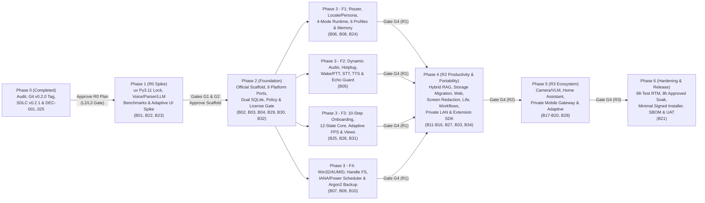

# MASTER IMPLEMENTATION PLAN (`v0.2.1`) — J.A.R.V.I.S. Personal Intelligence System

**Document ID:** `PLAN-09`  
**Version:** 0.2.1 (Reconciled with `JARVIS-SDLC-v0.2.1`: `98` Requirements, `34` Backlog Items, `DEC-001`–`DEC-025`)  
**Date:** 26 November 2026  
**Status:** Approved Roadmap Structure — Live `R0` & Scaffolding Gated on Explicit `L2`/`L3` Approval

---

## 1. Master Roadmap & Phase Reconciliation

This roadmap reconciles Phases `0`–`6` (`Stages 00–08`) with canonical SDLC releases (`R0`, `R1`, `R2`, `R3`, `Hardening`) across the **Four Parallel Foundations** (`F1 Intelligence Core`, `F2 Voice Engine`, `F3 Adaptive Cinematic UX`, `F4 Execution, Security & Dynamic System`), covering **all `98` normative `v0.2.1` requirements (`82 FR + 16 NFR`)** and **all `34` backlog deliverables (`B01`–`B34`)**.

---

## 2. Work Breakdown Structure (WBS), Stories & Complete `98`-Requirement Traceability

Execution approval tags:
- **`[L1]`**: Local implementation & offline automated tests within an already-approved wave.
- **`[APPROVAL-REQUIRED: L2]`**: Installing dependencies, scaffolding repositories, or enabling new external connectors.
- **`[APPROVAL-REQUIRED: L3]`**: Downloading AI/voice models, running hardware benchmarks, or running the `8h` soak test.
- **`[APPROVAL-REQUIRED: L4]`**: OS startup/installer registration, LAN/remote/IoT live network tests, or external Git publishing.

### WAVE 1 — Phase 1 (`R0 Feasibility & Prototype` — Detailed in [R0-EXECUTION-PLAN.md](R0-EXECUTION-PLAN.md))

| Story ID | Backlog | Scope Summary | Dependencies | Mapped Requirement IDs | Gate |
| :--- | :--- | :--- | :--- | :--- | :---: |
| **`US-R0.1`** | `B01` | **Dependency Lock (`uv` + `Python 3.11.9`), Hardware Probe & Voice/PDF Benchmark**: Verify actual `win_amd64` wheel resolution, dynamic OS voice/language-pack probe, STT (`base`/`small`), wake (`openWakeWord` vs `sherpa-onnx`), TTS (`piper1-gpl` vs `sherpa-onnx` vs OS WinRT), and PDF (`PyMuPDF` vs `pypdfium2`) + 11-category license inventory. | `DEC-014` Approval | `FR-VOI-03`, `FR-VOI-06`, `FR-SYS-01`, `FR-SYS-05`, `NFR-07`, `NFR-09` | `[APPROVAL-REQUIRED: L2/L3]` |
| **`US-R0.2`** | `B22` | **Reference LLM Adapter Conformance (`llama.cpp` CPU/CUDA & `Ollama`)**: Benchmark `Qwen3-1.7B` (CPU-only & GPU) and `Qwen3-4B` (`Q8_0` KV) with `enable_thinking=false` + strict JSON Schema across intent & adversarial suites; verify `external_local` non-termination. | `US-R0.1` | `FR-AIP-01`, `FR-AIP-02`, `FR-AIP-08`, `NFR-01`, `NFR-02`, `NFR-14` | `[APPROVAL-REQUIRED: L3]` |
| **`US-R0.3`** | `B23` | **Orbital Precision Styleframes & Adaptive Rendering Telemetry Spike**: Clickable 12-state core, 10-step onboarding & Storage/Runtime wireframes, plus WebView2 frame-interval & GPU placement telemetry across `Auto/30/60/120/Native` FPS settings. | `DEC-014` Approval | `FR-UX-01`, `FR-UX-03`, `FR-UX-04`, `NFR-13` | `[APPROVAL-REQUIRED: L2/L3]` |

---

### WAVE 2 — Phase 2 (`Project & Hardware-Adaptive Foundation`)

| Story ID | Backlog | Foundation | Scope Summary | Dependencies | Mapped Requirement IDs | Gate |
| :--- | :--- | :---: | :--- | :--- | :--- | :---: |
| **`US-FND.1`** | `B02`, `B32` | All | **Official Monorepo Scaffold, 9 Platform Port Contracts & License/Portability CI**: Scaffold Tauri 2 + React + TS (`npm` lockfile) & `uv` Python `3.11.9` (`uv.lock`), `.local` dev-config separation, CI `NFR-16` import/hardcode linter, and 11-category `license_artifact` + CycloneDX SBOM/`NOTICE` generator. | `Gates G1/G2` | `FR-SYS-05`, `NFR-09`, `NFR-16` | `[APPROVAL-REQUIRED: L2]` |
| **`US-FND.2`** | `B03` | `Broker` + `F4` | **`LocalIpcTransportPort`, `ProcessSupervisorPort` & Power/Lock Hooks**: Named Pipe current-SID DACL + 256-bit pipe-inherited secret (with auth loopback test mode), Windows `Job Object` (`managed_local` `≤ 5s` cleanup target, protecting `external_local`), `Lock`/`Suspend` hooks, and sequenced SSE + `≤ 30 Hz` ephemeral `Channel`. | `US-FND.1` | `FR-ADM-03`, `FR-ADM-06`, `FR-SCH-05`, `NFR-04`, `NFR-15` | `[L1]` |
| **`US-FND.3`** | `B03` | `F4` | **Dual SQLite Architecture, Cross-DB Consistency & Vault/Field Encryption**: Checksummed migrations for `jarvis_core.db` (`synchronous=FULL`) and rebuildable `jarvis_knowledge.db`, `root_id`/`deletion_ledger` read-filter + startup orphan GC, `SecretVaultAndCryptoPort` (`AES-256-GCM` sensitive fields), and redacted `structlog` audit. | `US-FND.2` | `FR-ADM-04`, `FR-ADM-08`, `NFR-04`, `NFR-10` | `[L1]` |
| **`US-FND.4`** | `B04` | `F4` | **Deterministic `R0`–`R3` Policy Engine, Grant Store & Nonce Approval**: Deny-by-default grants, `BR-01` authority order, `60s` single-use `nonce_hash` + handle-bound `bound_hash` `R2` approval, `idempotency_key` ledger, and bounded workflow queue (`cap 20`). | `US-FND.3` | `FR-ADM-01`, `FR-ADM-02`, `FR-COR-05` | `[L1]` |
| **`US-FND.5`** | `B29`, `B30` | `F4` | **System Capability Discovery, Recommendation Engine & Dynamic 11-Root Storage Manager**: Implement `HardwareDiscoveryPort`, support-tier classifier (`Supported`/`Experimental`/`Unverified`/`Unsupported`), versioned `config_revision` export/import/rollback, and 11-root `StorageManager` (OS defaults, quotas, shared model dirs, SMB/UNC WAL block). | `US-FND.3` | `FR-SYS-01`, `FR-SYS-02`, `FR-SYS-03` | `[L1]` |

---

### WAVE 3 — Phase 3 (`R1 Core & Adaptive Experience` across 4 Parallel Foundations)

| Story ID | Backlog | Epic / Found. | Scope Summary | Dependencies | Mapped Requirement IDs |
| :--- | :--- | :---: | :--- | :--- | :--- |
| **`US-E01.1`** | `B05` | `E01` (`F2`) | **Dynamic Audio Session, Hotplug, Mute Gate & Wake/PTT/STT/TTS Pipeline**: RAM-only `≤ 2s` ring, dynamic device enumeration & hotplug recovery, runtime OS voice-pack check, wake/PTT, local STT, sentence-streaming TTS, headphone/speaker adaptive barge-in & echo guard, and full text fallback. | `US-FND.2`, `US-R0.1` | `FR-VOI-01`, `FR-VOI-02`, `FR-VOI-03`, `FR-VOI-04`, `FR-VOI-05`, `FR-VOI-06`, `NFR-01`, `NFR-03`, `NFR-07` |
| **`US-E02.1`** | `B06` | `E02` (`F1`) | **Deterministic Router, Dynamic Locale/Timezone/Persona & Bounded Planner**: Zero-LLM direct routing, configurable language/multilingual/IANA timezone/persona/verbosity, deterministic slot normalizer, `≤ 5`-step schema planner (`≤ 2` repairs, `60s` cap), ambiguity clarification, and zero-model *Direct Mode*. | `US-FND.4`, `US-FND.5` | `FR-COR-01`, `FR-COR-02`, `FR-COR-03`, `FR-COR-04`, `FR-COR-05`, `FR-COR-06`, `FR-COR-07` |
| **`US-E13.1`** | `B24` | `E13` (`F1`) | **Provider Registry, 4-Mode Runtime Manager, 6 AI Profiles & Atomic Switch/Rollback**: Support `managed_local`, `external_local` (never killed on exit), `authorized_lan` (`R2`), and `custom_compatible` with single-runtime sufficiency, `/no_think` normalization, GPU/CPU/context/idle/battery/gaming controls, atomic drain/switch/rollback, and consent-gated Benchmark runner. | `US-E02.1`, `US-R0.2` | `FR-AIP-01`, `FR-AIP-02`, `FR-AIP-03`, `FR-AIP-04`, `FR-AIP-05`, `FR-AIP-08`, `NFR-02`, `NFR-14` |
| **`US-E03.1`** | `B07` | `E03` (`F4`) | **Safe OS Actions (`Win32`/`AUMID`, Volume & Handle-Pinned Files)**: Shell-free allowlisted app launch (`CreateProcessW` + `AUMID`), verified `0–100` volume readback, canonical root search/open, and handle-verified non-overwriting `R2` file rename with truthful outcome reporting. | `US-FND.4` | `FR-OS-01`, `FR-OS-02`, `FR-OS-03`, `FR-OS-04`, `FR-OS-05`, `FR-OS-06` |
| **`US-E04.1`** | `B08` | `E04` (`F1/F4`) | **Explicit Consent Memory, Session TTL & Tombstone Ledger**: Explicit save/proposal review, list/search/edit/delete/export, optimistic `revision`, encrypted sensitive fields, separated session TTL, immediate index eviction, and `deletion_ledger` tombstones. | `US-FND.3`, `US-E02.1` | `FR-MEM-01`, `FR-MEM-02`, `FR-MEM-03`, `FR-MEM-04`, `FR-MEM-05` |
| **`US-E05.1`** | `B09` | `E05` (`F4`) | **Persistent IANA/UTC Scheduler, Quiet Hours, Proactive Rules & Power/Clock Reconciliation**: Durable leased jobs across restarts/sleep, `MISSED` reporting, configurable quiet hours, rate-limited proactive rules, and monotonic timer + `Suspend`/`Resume`/clock-jump handling. | `US-FND.2`, `US-FND.4` | `FR-SCH-01`, `FR-SCH-02`, `FR-SCH-03`, `FR-SCH-04`, `FR-SCH-05` |
| **`US-E14.1`** | `B25`, `B26`, `B31` | `E14`/`E15` (`F3`) | **10-Step Onboarding, 12-State Core, Adaptive Visual Engine & Management Views**: Guided onboarding (*Recommended Setup* + *Direct Mode* skip), Command Center/HUD/Tray, `(request_id, seq)` motion reducer, `Cinematic`/`Balanced`/`Lite`/`Reduced Motion` + `Auto/30/60/120/Native` FPS targets, global shortcut conflict check, Storage/Runtime/Model/Persona/License screens, and WCAG 2.2 AA keyboard/ARIA compliance. | `US-FND.5`, `US-E01.1`, `US-E13.1` | `FR-UX-01`, `FR-UX-02`, `FR-UX-03`, `FR-UX-04`, `FR-ADM-07`, `NFR-06`, `NFR-13` |
| **`US-ADM.1`** | `B10` | `ADM` (`F4`) | **Cross-Machine Encrypted Backup/Restore (`Argon2id + AES-GCM`) & Minimal Base Installer**: Online Backup snapshot + `deletion_ledger` replay + path remapping on clean/new machine (`RTO ≤ 30m`), factory reset, minimal offline base installer, and `R1` exit gate (`65` P0 requirements + `U01`–`U09`, `U19`–`U24`). | `US-E03.1`–`US-E14.1` | `FR-ADM-05`, `FR-ADM-07`, `FR-ADM-08`, `NFR-05` |

---

### WAVE 4 — Phase 4 (`R2 Productivity, Storage Migration & Extension Architecture`)

| Story ID | Backlog | Epic | Scope Summary | Dependencies | Mapped Requirement IDs |
| :--- | :--- | :---: | :--- | :--- | :--- |
| **`US-E15.2`** | `B33`, `B34` | `E15` | **Transactional Cross-Drive Storage Migration & Trusted Extension/Update SDK**: Preflight + write-pause + `.staging` copy + SHA-256/`integrity_check` + atomic pointer swap + rollback on interruption/unplugged external drive (`FR-SYS-04`), plus versioned Policy-governed Extension SDK & verified component update/rollback (`FR-SYS-06`). | `US-ADM.1` | `FR-SYS-04`, `FR-SYS-06` |
| **`US-E06.1`** | `B11`, `B27` | `E06`, `E13` | **Sandboxed Document Parser, Hybrid RAG (`knowledge.db`) & Atomic Embedding Generations**: Incremental SHA-256 indexing of TXT/MD/PDF/DOCX, FTS5 + optional `sqlite-vec` generation swap, tools-disabled synthesis, and verified page/section citations (`≥ 90%` validity/abstention). | `US-E04.1`, `US-E13.1` | `FR-KNO-01`, `FR-KNO-02`, `FR-KNO-03`, `FR-KNO-04`, `FR-KNO-05`, `FR-AIP-07`, `NFR-08` |
| **`US-E07.1`** | `B12` | `E07` | **Pluggable Web Search & DNS-Pinned Anti-SSRF Fetch**: Local/LAN/API/browser-fallback search port, private-query screening, IP/redirect-validated read-only fetch (`2 MiB`/`10s`), source timestamps, and stale-cache/offline truthfulness. | `US-FND.4` | `FR-WEB-01`, `FR-WEB-02`, `FR-WEB-03` |
| **`US-E08.1`** | `B13` | `E08` | **Window-Scoped Screen Awareness (`UIA`, Local `OCR` & Pre-Inference Secret Redaction)**: Per-request window capture + active badge, password/banking denylist, regex secret/token/`.env` redaction before LLM context, and RAM-only buffer cleanup. | `US-E03.1`, `US-E14.1` | `FR-SCR-01`, `FR-SCR-02`, `FR-SCR-03`, `FR-SCR-04` |
| **`US-E09.1`** | `B14` | `E09` | **Personal Life Domain (`Tasks`, `Calendar`, Integer `Expenses`, `Habits`) & Read-Only OAuth**: Local CRUD + revision-based undo, multi-currency integer minor units, descriptive-only insights, and optional PKCE read-only calendar/email connector with instant vault revoke. | `US-E05.1` | `FR-LIF-01`, `FR-LIF-02`, `FR-LIF-03`, `FR-LIF-04` |
| **`US-E10.1`** | `B15` | `E10` | **Typed Workflow Builder, Parameter-Bound Dry-Run & Crash Reconciliation**: `≤ 5`-step declarative workflows (`120s` cap), `R2` re-approval on parameter change, step audit, cancellation, and post-crash `UNKNOWN` reconciliation without blind retries. | `US-FND.4`, `US-E05.1` | `FR-AUT-01`, `FR-AUT-02`, `FR-AUT-03` |
| **`US-E13.2`** | `B27`, `B16` | `E13` | **Enrolled Private LAN Provider & `R2` Release Gate**: TLS-verified LAN server enrollment + per-data-scope consent + zero silent cross-zone fallback, `R2` visual extensions (`B28`), and full `24` P1 + `65` P0 regression gate (`U10`–`U14`, `U25`–`U26`). | `US-E15.2`–`US-E10.1` | `FR-AIP-06` |

---

### WAVE 5 & WAVE 6 — Phase 5 (`R3 Ecosystem`) & Phase 6 (`Production Hardening`)

| Story ID | Backlog | Epic / Phase | Scope Summary | Dependencies | Mapped Requirement IDs | Gate |
| :--- | :--- | :---: | :--- | :--- | :--- | :---: |
| **`US-E11.1`** | `B17` | `E11` (`R3`) | **On-Demand Camera & Optional Local Vision Evaluation**: Per-session consent + indicator, immediate stop on cancel/lock/suspend, RAM-only frames, and resource-governed VLM option. | `US-E08.1`, `US-E13.2` | `FR-IOT-01` | `[APPROVAL-REQUIRED: L3/L4]` |
| **`US-E11.2`** | `B18` | `E11` (`R3`) | **Allowlisted Home Assistant Connector & Safety Actuation Block**: Dedicated limited HA token, allowlisted safe entities + fresh readback (`UNKNOWN` on disconnect), and hard `R3` block on locks/alarms/heaters. | `US-FND.4`, `US-E13.2` | `FR-IOT-02`, `FR-IOT-03`, `FR-IOT-04` | `[APPROVAL-REQUIRED: L4]` |
| **`US-E12.1`** | `B19`, `B28` | `E12` (`R3`) | **Private VPN/TLS Remote Gateway & Mobile Responsive Lite UI**: Separate opt-in gateway, local challenge pairing, revocable expiring tokens (`30 req/min`), narrow `R0`/`R1` scope (`no R2/file/screen`), and honest host-sleep/offline state. | `US-FND.2`, `US-E13.2` | `FR-REM-01`, `FR-REM-02`, `FR-REM-04`, `NFR-11` | `[APPROVAL-REQUIRED: L4]` |
| **`US-E12.2`** | `B20` | `E12` (`R3`) | **Local Feedback-Driven Preference Proposals**: Non-intrusive preference adjustment cards from repeated explicit user corrections; zero autonomous policy/grant/model mutation. | `US-E04.1`, `US-E13.2` | `FR-REM-03` | `[L1]` |
| **`US-HRD.1`** | `B21` | Hardening | **Full `98`-Test RTM Gate, `8h` Approved Soak, Signed Minimal Installer, SBOM & Pre-Publication Review**: Execute Tier A + approved Tier B (`NFR-12` `8h` soak), accessibility & restore drills, CycloneDX SBOM/`THIRD-PARTY-NOTICES`, UAT `U01`–`U26`, and pre-public license/trademark gate (`Gate G5`). | `US-E11.1`–`US-E12.2` | `NFR-01`, `NFR-02`, `NFR-03`, `NFR-04`, `NFR-05`, `NFR-06`, `NFR-07`, `NFR-08`, `NFR-09`, `NFR-10`, `NFR-11`, `NFR-12`, `NFR-13`, `NFR-14`, `NFR-15`, `NFR-16` | `[APPROVAL-REQUIRED: L3/L4]` |
